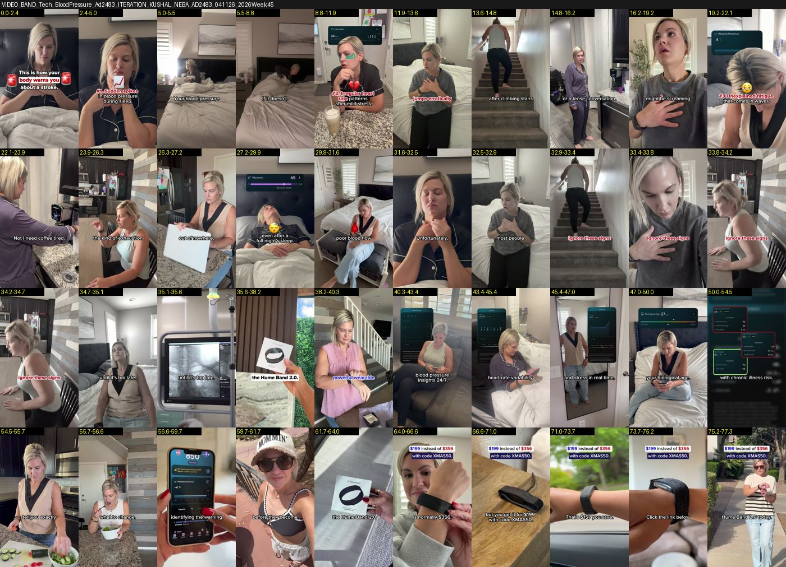

# VIDEO_BAND_Tech_BloodPressure_Ad2483_ITERATION_KUSHAL_NEBA_AD2483_041126_2026Week45

Master: `VIDEO_BAND_Tech_BloodPressure_Ad2483_ITERATION_KUSHAL_NEBA_AD2483_041126_2026Week45_9X16_HOOK1.mp4` · 77.3s · 1080x1920

**Pacing:** 40 shots · avg 1.933s · median 1.95s · 5.04 cuts/10s · first cut 2.4s · 178.0 wpm · talk ratio 0.92 · cuts on word start 64.1% · cuts in speech gaps 48.7%
**Audio:** {'I_lufs': -20.1, 'LRA': 2.4, 'true_peak_db': -7.0} · BPM≈136.0 · music {'speech_rms_db': -23.3, 'pause_seconds': 2.1, 'pause_rms_db': -41.8, 'bed_minus_voice_db': -18.5, 'music_bed_likely': True} · cuts with SFX/transient 56.4%

**Captions:** 133 cards · 1 words/card (median) · y≈0.624 of frame height · text height≈0.034 · colours {'white': 89, 'red': 11, 'blue': 1, 'dark/other': 27, 'yellow': 2, 'other-colour': 3} · cards crossing a cut: 1
Highlighted: body warns you, #1.Suddenspikes, should drop at night., #2.rregularheart, ratepatterns, #2.lrregularheart, jumpserratically, #3Unexplainedfatigue, that hits you, ignore thesesigns, That's why we built, powerful wearable, We'vejustpreparedyourHealth, Report-Checkitoutnow!, butyougetitfor$199
**Headlines:** 66bpm (10.0–11.0s, white) | MetabolicMomentum (19.0–19.0s, white) | 65i (27.0–29.0s, white) | Recovery (27.0–28.0s, white) | 100 (27.0–27.0s, dark/other) | RecoveryNeed (27.0–27.0s, white) | PRecovery (29.0–29.0s, white) | RecoveryNeed (29.0–29.0s, white)

**Hook (0–3s) spoken:** One, sudden
**Hook on-screen:** #1.Suddenspikes / This is how your / about a stroke. / body warns you / during sleep. / inbloodpressure
**CTA (last 5s):** you save. Click the link below and get your HumeBand 2 .0 today. · on-screen: $199 instead of $356 / Clickthe linkbelow / Hume Band 2.0 today. / KHumeHealth' / That's $157 you save. / withcodeXMAS50 / withcodeXMAS50.

## Beat sheet

| # | in–out (s) | dur | transition | spoken | on-screen text |
|---|---|---|---|---|---|
| 1 | 0.00–2.40 | 2.4 |  | One, | This is how your / body warns you [red] / about a stroke. |
| 2 | 2.40–5.03 | 2.63 | cut +SFX hit | sudden spikes in blood pressure during sleep. | This is how your / body warns you [red] / about a stroke. / #1.Suddenspikes [red] / inbloodpressure / during sleep. |
| 3 | 5.03–5.47 | 0.43 | cut +SFX hit | Your blood pressure | Your blood pressure |
| 4 | 5.47–8.77 | 3.3 | cut +SFX hit | should drop at night. If it doesn't, that's a red flag. | Your blood pressure / should drop at night. [red] / If it doesn't, / that's a red flag. |
| 5 | 8.77–11.90 | 3.13 | cut +SFX hit | Two, irregular heart rate patterns after mild stress. | #2.rregularheart [red] / ratepatterns [red] / aftermild stress. / 66bpm (HEADLINE) / #2.lrregularheart [red] |
| 6 | 11.90–13.60 | 1.7 | cut | If your heart rate jumps erratically after | If your heart rate / jumpserratically [red] |
| 7 | 13.60–14.77 | 1.17 | cut | climbing stairs or | after climbing stairs |
| 8 | 14.77–16.17 | 1.4 | cut | a tense conversation, | oratense conversation, / your cardiovascular |
| 9 | 16.17–19.23 | 3.07 | cut +SFX hit | your cardiovascular system might be screaming for help. | your cardiovascular / system / might be screaming / MetabolicMomentum (HEADLINE) / #3Unexplainedfatigue [red] / thatcomes in waves. |
| 10 | 19.23–22.13 | 2.9 | cut +SFX hit | Three, unexplained fatigue that comes in waves. | MetabolicMomentum (HEADLINE) / #3Unexplainedfatigue [red] / thatcomes in waves. / NotIneed coffeetired |
| 11 | 22.13–23.90 | 1.77 | cut | Not, I need coffee tired. | NotIneed coffeetired / NotIneed coffeetired. |
| 12 | 23.90–26.33 | 2.43 | cut | We're talking about the kind of exhaustion that hits you out | We're talking about / the kind of exhaustion / that hits you [red] |
| 13 | 26.33–27.20 | 0.87 | cut | of nowhere, even | that hits you [red] / 65i (HEADLINE) / Recovery (HEADLINE) / 100 (HEADLINE) / RecoveryNeed (HEADLINE) / evenaftera |
| 14 | 27.20–29.87 | 2.67 | cut +SFX hit | after a full night's sleep. This can signal poor | 65i (HEADLINE) / Recovery (HEADLINE) / 100 (HEADLINE) / RecoveryNeed (HEADLINE) / evenaftera / full night'ssleep |
| 15 | 29.87–31.57 | 1.7 | cut +SFX hit | blood flow to your brain. Unfortunately, | poor blood flow / to your brain. |
| 16 | 31.57–32.50 | 0.93 | cut +SFX hit |  | Unfortunately, |
| 17 | 32.50–32.93 | 0.43 | cut | most people |  |
| 18 | 32.93–33.37 | 0.43 | cut | ignore | ignore thesesigns [red] |
| 19 | 33.37–33.80 | 0.43 | cut +SFX hit | these | ignore thesesigns [red] |
| 20 | 33.80–34.23 | 0.43 | cut | signs until | ignore thesesigns [red] |
| 21 | 34.23–34.67 | 0.43 | cut +SFX hit | it's | ignore thesesigns [red] |
| 22 | 34.67–35.10 | 0.43 | cut | too late. | until it'stoo late. |
| 23 | 35.10–35.60 | 0.5 | cut |  | until it'stoo late. |
| 24 | 35.60–38.17 | 2.57 | cut +SFX hit | That's why we built the Hume Band 2 .0. | 2HunotHeait / That's why we built [red] / HumeHealth / the Hume Band 2.0. / It'sthe world's most |
| 25 | 38.17–40.30 | 2.13 | cut +SFX hit | It's the world's most powerful wearable because | It'sthe world's most / powerful wearable [blue] |
| 26 | 40.30–43.43 | 3.13 | cut +SFX hit | it gives you blood pressure insights 24 -7. | powerful wearable [blue] / blood pressure / insights 24/7. |
| 27 | 43.43–45.37 | 1.93 | cut +SFX hit | It reads your heart rate variability and | blood pressure / insights 24/7. / heart rate variability |
| 28 | 45.37–47.00 | 1.63 | cut | stress in real time and | heart rate variability / and stressin real time, |
| 29 | 47.00–50.03 | 3.03 | cut | shows your biological age, metabolic momentum, | andshows / BiologicalAge 27 yrs (HEADLINE) / Younger (HEADLINE) / your biological age, / MetabolicMomentum (HEADLINE) / metabolicmomentum, |
| 30 | 50.03–54.50 | 4.47 | cut +SFX hit | and signs correlated with chronic illness risk. And its AI -driven recommendations tell | Chronic lllness (HEADLINE) / 71 (HEADLINE) / /100 (HEADLINE) / B- (HEADLINE) / Yourmostnotablephysiologicalpatterncenterson (HEADLINE) / asameaningfulcontributoracrosscardiovascular, |
| 31 | 54.50–55.73 | 1.23 | cut | you exactly what | tell you exactly |
| 32 | 55.73–56.63 | 0.9 | cut | to change, | whatto change. |
| 33 | 56.63–59.70 | 3.07 | cut +SFX hit | so you can get help identifying the warning signs early, | 8:13 [blue] (HEADLINE) / HealthScore [blue] (HEADLINE) / 850 [blue] (HEADLINE) / VeryHigh [blue] (HEADLINE) / We'vejustpreparedyourHealth [yellow] / Report-Checkitoutnow! [yellow] |
| 34 | 59.70–61.67 | 1.97 | cut +SFX hit | before they become life -threatening. | OMMIN (HEADLINE) / before theybecome / MOMMIN (HEADLINE) / life threatening. |
| 35 | 61.67–64.03 | 2.37 | cut +SFX hit | And right now, the HumeBand 2 .0 is | XHumeHealth / MIDNIGHTBLUE / And right now, / HumeHealth" / theHumeBand 2.0 / $199 instead of $356 [other-colour] (HEADLINE) |
| 36 | 64.03–66.63 | 2.6 | cut | normally $356, but | $199 instead of $356 [other-colour] (HEADLINE) / withcodeXMAS50. (HEADLINE) / isnormally$356 / withcodeXMAS50 (HEADLINE) / withcodeXMAS50. (HEADLINE) / isnormally$356, |
| 37 | 66.63–70.97 | 4.33 | cut +SFX hit | you get it for $199 with code XNAS50. | $199 instead of $356 [other-colour] (HEADLINE) / withcodeXMAS50. (HEADLINE) / butyougetitfor$199 [other-colour] / withcodeXMAS50 [other-colour] / withcodeXMAS50 (HEADLINE) / withcodeXMAS50. [other-colour] |
| 38 | 70.97–73.73 | 2.77 | cut +SFX hit | That's $157 you save. | $199 instead of $356 [other-colour] (HEADLINE) / withcodeXMAS50. (HEADLINE) / That's $157 you save. |
| 39 | 73.73–75.17 | 1.43 | cut | Click the link below and get your | $199 instead of $356 [other-colour] (HEADLINE) / withcodeXMAS50 (HEADLINE) / KHumeHealth' / Clickthe linkbelow / Hume Band 2.0 today. |
| 40 | 75.17–77.32 | 2.16 | cut +SFX hit | HumeBand 2 .0 today. | $199 instead of $356 [other-colour] (HEADLINE) / withcodeXMAS50 (HEADLINE) / Hume Band 2.0 today. |

## Hook variants

| hook | file | dur | first cut | spoken 0–3s | on-screen 0–3s |
|---|---|---|---|---|---|
| 1 | `TERATION_KUSHAL_NEBA_AD2483_041126_2026Week45_9X16_HOOK1.mp4` | 77.3 | 2.4 | One, sudden | #1.Suddenspikes / This is how your / about a stroke. / body warns you / during sleep. / inbloodpressure |
| 2 | `TERATION_KUSHAL_NEBA_AD2483_041126_2026Week45_9X16_HOOK2.mp4` | 78.8 | 2.033 |  |  |
| 3 | `TERATION_KUSHAL_NEBA_AD2483_041126_2026Week45_9X16_HOOK3.mp4` | 79.5 | 2.033 |  |  |

## Full transcript

One, sudden spikes in blood pressure during sleep. Your blood pressure should drop at night. If it doesn't, that's a red flag. Two, irregular heart rate patterns after mild stress. If your heart rate jumps erratically after climbing stairs or a tense conversation, your cardiovascular system might be screaming for help. Three, unexplained fatigue that comes in waves. Not, I need coffee tired. We're talking about the kind of exhaustion that hits you out of nowhere, even after a full night's sleep. This can signal poor blood flow to your brain. Unfortunately, most people ignore these signs until it's too late. That's why we built the Hume Band 2.0. It's the world's most powerful wearable because it gives you blood pressure insights 24-7. It reads your heart rate variability and stress in real time and shows your biological age, metabolic momentum, and signs correlated with chronic illness risk. And its AI-driven recommendations tell you exactly what to change, so you can get help identifying the warning signs early, before they become life-threatening. And right now, the HumeBand 2.0 is normally $356, but you get it for $199 with code XNAS50. That's $157 you save. Click the link below and get your HumeBand 2.0 today.