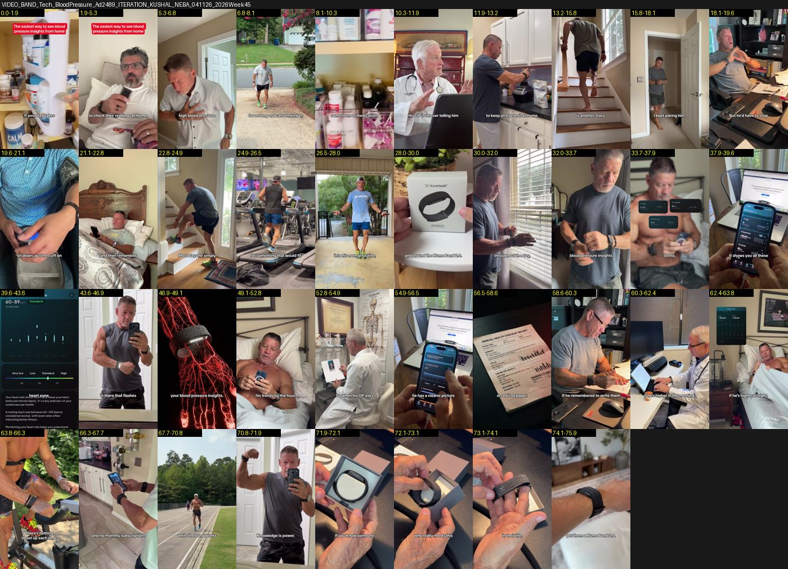

# VIDEO_BAND_Tech_BloodPressure_Ad2489_ITERATION_KUSHAL_NEBA_041126_2026Week45

Master: `VIDEO_BAND_Tech_BloodPressure_Ad2489_ITERATION_KUSHAL_NEBA_041126_2026Week45_Hook1_9x16.mp4` · 75.9s · 1080x1920

**Pacing:** 38 shots · avg 1.996s · median 1.744s · 4.88 cuts/10s · first cut 1.902s · 260.0 wpm · talk ratio 0.95 · cuts on word start 100.0% · cuts in speech gaps 83.8%
**Audio:** {'I_lufs': -18.3, 'LRA': 3.3, 'true_peak_db': 0.2} · BPM≈99.4 · music {'speech_rms_db': -22.7, 'pause_seconds': 0.0} · cuts with SFX/transient 70.3%

**Captions:** 177 cards · 1 words/card (median) · y≈0.744 of frame height · text height≈0.0304 · colours {'white': 135, 'yellow': 3, 'blue': 11, 'dark/other': 21, 'red': 6, 'other-colour': 1} · cards crossing a cut: 0
Highlighted: 2INC, CAL, ONIC, CALI, some form of medicationeF, COUGHDROPS, But he'd have to stop, what he was doing,, Most dayshe simply, into his norma routine,, 4:34L, wumeBand (87%）, 4:340, Conoected, 4:340
**Headlines:** Theeasiest wayto seeblood (0.0–5.0s, red) | pressureinsightsfromhome (0.0–5.0s, red) | GODO STATE (1.0–1.0s, white) | ONIC (1.0–1.0s, yellow) | REISHI (1.0–1.0s, white) | nexa (1.5–1.5s, white) | GOOU STATE (1.5–1.5s, white) | FIRSTA (8.0–8.0s, white)

**Hook (0–3s) spoken:** If your dad takes blood pressure medication, but rarely remembers to check
**Hook on-screen:** 2INC / CAL / CALI / GODO STATE / GOOU STATE / Ifyourdadtakes / MAGWELL / NORDIC / ONIC / REISHI / Theeasiest wayto seeblood / ULTIMATE / bloodpressuremedication, / butrarelyremembers / d liveroil / eMyte / hylBcomplex / nexa / omega / pressureinsightsfromhome
**CTA (last 5s):** is power. If you know someone who really needs this in their life, get them a Hume band 2 .0. · on-screen: If youknowsomeone / Knowledge is power. / get themaHumeBand 2.0. / who really needs this

## Beat sheet

| # | in–out (s) | dur | transition | spoken | on-screen text |
|---|---|---|---|---|---|
| 1 | 0.00–1.90 | 1.9 |  | If your dad takes blood pressure medication, | Theeasiest wayto seeblood [red] (HEADLINE) / pressureinsightsfromhome [red] (HEADLINE) / NORDIC / d liveroil / Ifyourdadtakes / CALI |
| 2 | 1.90–5.27 | 3.37 | cut | but rarely remembers to check their readings at home, please watch this. | Theeasiest wayto seeblood [red] (HEADLINE) / pressureinsightsfromhome [red] (HEADLINE) / MAGWELL / NORDIC / ULTIMATE / omega |
| 3 | 5.27–6.81 | 1.54 | cut | My dad has had high blood pressure | Theeasiest wayto seeblood [red] (HEADLINE) / pressureinsightsfromhome [red] (HEADLINE) / pleasewatchthis. / My dad hashad / highbloodpressure |
| 4 | 6.81–8.07 | 1.27 | cut | for as long as I can remember and | foras long asI can remember, / FIRSTA (HEADLINE) / and hasalwaystaken / ETER / COLD&FIU |
| 5 | 8.07–10.34 | 2.27 | cut +SFX hit | has always taken some form of medication. | FIRSTA (HEADLINE) / and hasalwaystaken / ETER / COLD&FIU / some form of medication. / Mir (HEADLINE) |
| 6 | 10.34–11.95 | 1.6 | cut +SFX hit | His GP is forever telling him | Mir (HEADLINE) / some form of medicationeF [red] / ALLERGYADUL / COUGHDROPS [red] / His GPis forever telling him |
| 7 | 11.95–13.25 | 1.3 | cut +SFX hit | to keep an eye on it at home, | to keep aneye on itat home / but getting him to actually do it |
| 8 | 13.25–15.78 | 2.54 | cut +SFX hit | but getting him to actually do it is another story. | but getting him to actually do it / is another story. |
| 9 | 15.78–18.05 | 2.27 | cut +SFX hit | I kept asking him, dad, have you done it today? | I keptasking him, / "Dad,have you done it today? / But he'd have to stop [red] |
| 10 | 18.05–19.59 | 1.54 | cut +SFX hit | But he'd have to stop what he was doing, | But he'd have to stop [red] / what he was doing, [red] |
| 11 | 19.59–21.12 | 1.54 | cut +SFX hit | sit down, put the cuff on, | sitdown,putthecuff on / andthenremember |
| 12 | 21.12–22.82 | 1.7 | cut +SFX hit | and then remember to send me the reading. | andthenremember / to send me the reading. |
| 13 | 22.82–24.93 | 2.1 | cut | Most days, he simply didn't get round to it. | Most dayshe simply [other-colour] / didn't get round to it, |
| 14 | 24.93–26.53 | 1.6 | cut +SFX hit | So I started looking for something that would fit | soIstarted looking / for something that would fit |
| 15 | 26.53–28.03 | 1.5 | cut +SFX hit | into his normal routine and | into his norma routine, [yellow] / XHumeHealth" (HEADLINE) / and I found theHume Band 2.0. |
| 16 | 28.03–29.96 | 1.94 | cut +SFX hit | I found the Hume Band 2 .0. | XHumeHealth" (HEADLINE) / and I found theHume Band 2.0. / XHumeHealth (HEADLINE) / HumeBand2.0 (HEADLINE) / 24/7Health |
| 17 | 29.96–32.00 | 2.04 | cut +SFX hit | He can wear it throughout the day while it shows his | He can wear it / throughout the dayh |
| 18 | 32.00–33.70 | 1.7 | cut | blood pressure insights and trends, | blood pressureinsights / and trends, |
| 19 | 33.70–37.90 | 4.2 | cut +SFX hit | alongside his heart rate, sleep, stress, temperature and blood oxygen. | alongside his heart rate, / 85bpm / 6h23m / sleep, / DBodyTemperature / temperature, |
| 20 | 37.90–39.57 | 1.67 | cut +SFX hit | It shows you all these different metrics, | 4:34L [blue] / wumeBand (87%） [blue] / 120/69mtg / HeHRats / 44.4mm / Itshowsyouall these |
| 21 | 39.57–43.61 | 4.04 | cut +SFX hit | your sleep quality, your cardiac stress, heart zone, SPO2 levels. | Sleep (HEADLINE) / Time Asleep (HEADLINE) / 7h46m (HEADLINE) / Standard [green] (HEADLINE) / 19/08/2025 (HEADLINE) / Deep |
| 22 | 43.61–46.88 | 3.27 | cut +SFX hit | It also has a little light sensor in there that flashes into your blood vessels, | Italso has a little light sensor / intherethatflashes / intoyourbloodvessels, |
| 23 | 46.88–49.12 | 2.24 | cut | which is how it reads your blood pressure insights. | whichishowitreads / your blood pressure insights. / The app letshimreview |
| 24 | 49.12–52.75 | 3.64 | cut +SFX hit | The app lets him review his trends by the hour, day, week or month. | The app letshimreview / his trends bythe hour, / day,week,ormonth |
| 25 | 52.75–54.85 | 2.1 | cut | So when his GP asks how things have been, he | THESKELETON (HEADLINE) / LifeSize (HEADLINE) / Sodbueslem Mevical Staol (HEADLINE) / SowhenhisGPasks / Soutusten Melical Shosl (HEADLINE) / howthings havebeen, |
| 26 | 54.85–56.46 | 1.6 | cut +SFX hit | has a clearer picture to show them, | 4:340 [blue] / LMetabolcMomenum / Metabolc Capactty / hehasaclearerpicture / fsaganarufdetectartyllness (HEADLINE) / 4:34C [blue] |
| 27 | 56.46–58.56 | 2.1 | cut +SFX hit | not a few numbers scribbled on a bit of paper. | fsaganarufdetectartyllness (HEADLINE) / 4:34C [blue] / VeryHigh [blue] / f HumePlas Exclusive [blue] / LMetebolcMomentum / Capacit |
| 28 | 58.56–60.29 | 1.73 | cut +SFX hit | If he remembered to write them down at all, | Ifhe remembered to write them / down at all. |
| 29 | 60.29–62.36 | 2.07 | cut +SFX hit | his GP can see if he's higher in the morning, | down at all. / if he's higher in the morning, |
| 30 | 62.36–63.83 | 1.47 | cut +SFX hit | they can see if he's higher at night. | if he's higher in the morning, / if he's higher at night. |
| 31 | 63.83–66.33 | 2.5 | cut +SFX hit | It's so helpful. There's nothing to set up each time and | It's so helpful. / There's nothing [red] / toset up each time / to set up each time? |
| 32 | 66.33–67.73 | 1.4 | cut | no monthly subscription. | There's nothing [red] / to set up each time? / and no monthly subscription. |
| 33 | 67.73–70.77 | 3.04 | cut | He just gets on with his day while the band works in the background. | He just gets on with his day, / whiletheband works / inthebackground |
| 34 | 70.77–71.87 | 1.1 | cut +SFX hit | Knowledge is power. | Knowledge is power. |
| 35 | 71.87–72.14 | 0.27 | cut +SFX hit | If you | If youknowsomeone [red] |
| 36 | 72.14–73.07 | 0.93 | cut | know someone who really needs | If youknowsomeone [red] / who really needs this |
| 37 | 73.07–74.11 | 1.03 | cut | this in their life, | who really needs this / get themaHumeBand 2.0. |
| 38 | 74.11–75.86 | 1.75 | cut +SFX hit | get them a Hume band 2 .0. | get themaHumeBand 2.0. |

## Hook variants

| hook | file | dur | first cut | spoken 0–3s | on-screen 0–3s |
|---|---|---|---|---|---|
| 1 | `d2489_ITERATION_KUSHAL_NEBA_041126_2026Week45_Hook1_9x16.mp4` | 75.9 | 1.902 | If your dad takes blood pressure medication, but rarely remembers to check | 2INC / CAL / CALI / GODO STATE / GOOU STATE / Ifyourdadtakes / MAGWELL / NORDIC |
| 2 | `d2489_ITERATION_KUSHAL_NEBA_041126_2026Week45_Hook2_9x16.mp4` | 74.4 | 1.468 |  |  |
| 3 | `d2489_ITERATION_KUSHAL_NEBA_041126_2026Week45_Hook3_9x16.mp4` | 74.0 | 1.235 |  |  |

## Full transcript

If your dad takes blood pressure medication, but rarely remembers to check their readings at home, please watch this. My dad has had high blood pressure for as long as I can remember and has always taken some form of medication. His GP is forever telling him to keep an eye on it at home, but getting him to actually do it is another story. I kept asking him, dad, have you done it today? But he'd have to stop what he was doing, sit down, put the cuff on, and then remember to send me the reading. Most days, he simply didn't get round to it. So I started looking for something that would fit into his normal routine and I found the Hume Band 2.0. He can wear it throughout the day while it shows his blood pressure insights and trends, alongside his heart rate, sleep, stress, temperature and blood oxygen. It shows you all these different metrics, your sleep quality, your cardiac stress, heart zone, SPO2 levels. It also has a little light sensor in there that flashes into your blood vessels, which is how it reads your blood pressure insights. The app lets him review his trends by the hour, day, week or month. So when his GP asks how things have been, he has a clearer picture to show them, not a few numbers scribbled on a bit of paper. If he remembered to write them down at all, his GP can see if he's higher in the morning, they can see if he's higher at night. It's so helpful. There's nothing to set up each time and no monthly subscription. He just gets on with his day while the band works in the background. Knowledge is power. If you know someone who really needs this in their life, get them a Hume band 2.0.