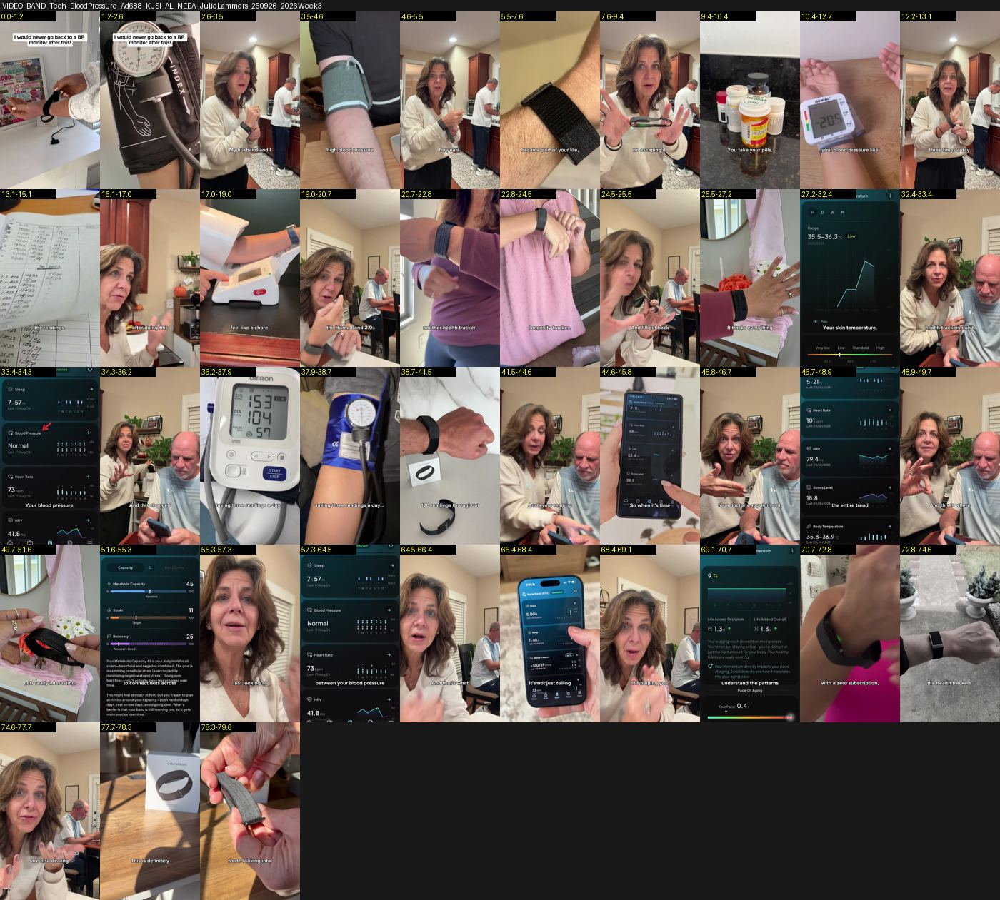

# VIDEO_BAND_Tech_BloodPressure_Ad688_KUSHAL_NEBA_JulieLammers_250926_2026Week3

Master: `VIDEO_BAND_Tech_BloodPressure_Ad688_KUSHAL_NEBA_JulieLammers_250926_2026Week3_Hook1_9x16.mp4` · 79.6s · 1080x1920

**Pacing:** 43 shots · avg 1.852s · median 1.7s · 5.27 cuts/10s · first cut 1.2s · 226.0 wpm · talk ratio 0.96 · cuts on word start 92.9% · cuts in speech gaps 81.0%
**Audio:** {'I_lufs': -16.8, 'LRA': 1.6, 'true_peak_db': -0.2} · BPM≈117.5 · music {'speech_rms_db': -20.7, 'pause_seconds': 0.0} · cuts with SFX/transient 52.4%

**Captions:** 331 cards · 1 words/card (median) · y≈0.724 of frame height · text height≈0.0246 · colours {'white': 253, 'yellow': 2, 'dark/other': 75, 'blue': 1} · cards crossing a cut: 2
Highlighted: READTHENED, CE, worth looking into.
**Headlines:** I would nevergobackto aBP (0.0–0.5s, white) | monitor after this! (0.0–2.0s, white) | HOLIDAY (0.0–0.5s, white) | DRE (0.0–0.0s, white) | DREAMS (0.5–0.5s, dark/other) | 160 180 (1.0–1.5s, white) | 200 (1.0–1.0s, white) | would never go back to a BP (1.0–1.0s, white)

**Hook (0–3s) spoken:** I would never go back to a BP monitor after this. My husband
**Hook on-screen:** 000 / 000k / 08 / 09 / 100 / 120 / 160 180 / 20 / 200 / 26 / 260 / 280 / 300 / 40 / 60 / 80 / CE0197 / CETIFIED / DRE / DREAMS / E0197 / ERTIFIED / GERTIFIED / HOLIDAY / I would never goback toa BP / I would nevergobackto aBP / INDEX / My husband and I / Q&A / Stylis / TANGBCA / WITHTHATIRONS / YOUDU / monitor after this! / would never go back to a BP
**CTA (last 5s):** if you and your partner are also dealing with high blood pressure, this is definitely worth looking into. · on-screen: Hime Band 2.0 / This is definitely / XHumeHealth / and your partner / are also dealing / with high blood pressure... / worth looking into.

## Beat sheet

| # | in–out (s) | dur | transition | spoken | on-screen text |
|---|---|---|---|---|---|
| 1 | 0.00–1.20 | 1.2 |  | I would never go back to a | I would nevergobackto aBP (HEADLINE) / monitor after this! (HEADLINE) / HOLIDAY (HEADLINE) / DRE (HEADLINE) / 000 / Stylis |
| 2 | 1.20–2.63 | 1.43 | cut | BP monitor after this. | monitor after this! (HEADLINE) / 160 180 (HEADLINE) / 200 (HEADLINE) / would never go back to a BP (HEADLINE) / 260 (HEADLINE) / 80 (HEADLINE) |
| 3 | 2.63–3.50 | 0.87 | cut | My husband and I, | My husband and I |
| 4 | 3.50–4.63 | 1.13 | cut | we both have had high blood pressure | we both have had / high blood pressure |
| 5 | 4.63–5.53 | 0.9 | cut +SFX hit | for years. | high blood pressure / for years. / And once this |
| 6 | 5.53–7.60 | 2.07 | cut +SFX hit | And once this became part of your life, | And once this / became part of your life / became part of your life, |
| 7 | 7.60–9.40 | 1.8 | cut | there's really no escaping it. | there's really / no escaping it. |
| 8 | 9.40–10.43 | 1.03 | cut | You take your pills, | no escaping it. / TURN / READTHENED [yellow] / You take your pills |
| 9 | 10.43–12.17 | 1.73 | cut | you check your blood pressure like three | TURN / READTHENED [yellow] / You take your pills / GENIAL / SYS / DIA |
| 10 | 12.17–13.10 | 0.93 | cut +SFX hit | times a day. | three times a day. / BP (HEADLINE) / 79 (HEADLINE) / 146 (HEADLINE) / 58 (HEADLINE) / 30/12/02 (HEADLINE) |
| 11 | 13.10–15.13 | 2.03 | cut +SFX hit | You write down the readings. And honestly, | BP (HEADLINE) / 79 (HEADLINE) / 146 (HEADLINE) / 58 (HEADLINE) / 30/12/02 (HEADLINE) / 2023 |
| 12 | 15.13–17.03 | 1.9 | cut +SFX hit | after doing this for years, | after doing this / it started to |
| 13 | 17.03–19.03 | 2.0 | cut +SFX hit | it started to feel like chore. That's why my | it started to / feel like a chore. / my husband and I got |
| 14 | 19.03–20.73 | 1.7 | cut | husband and I got the Hingben 2 .0. | my husband and I got / the Hume Band 2.0. |
| 15 | 20.73–22.80 | 2.07 | cut | And this isn't just another health tracker. | And this isn't just / another health tracker. |
| 16 | 22.80–24.47 | 1.67 | cut | This isn't a longevity tracker. And | This is a / longevity tracker. |
| 17 | 24.47–25.47 | 1.0 | cut +SFX hit | I'll get back to that in a bit. | longevity tracker. / to that in a bit. |
| 18 | 25.47–27.17 | 1.7 | cut +SFX hit | It tracks everything that you'd expect. | to that in a bit. / It tracks everything / HeartRate (HEADLINE) / WM (HEADLINE) / Range (HEADLINE) / 60-89bpm (HEADLINE) |
| 19 | 27.17–32.37 | 5.2 | cut +SFX hit | Your heart rate, your HRV, your SPO2, your skin temperature, but it also traps something most | HeartRate (HEADLINE) / WM (HEADLINE) / Range (HEADLINE) / 60-89bpm (HEADLINE) / High [yellow] (HEADLINE) / 24/11/2025 (HEADLINE) |
| 20 | 32.37–33.37 | 1.0 | cut +SFX hit | health trackers don't, | HumeBand(27%) (HEADLINE) / Connected [green] (HEADLINE) / 80.8ms (HEADLINE) / Last:24/11/2025 (HEADLINE) / 28.5 / BodyTemperature |
| 21 | 33.37–34.27 | 0.9 | cut +SFX hit | your blood pressure. | health trackers don't: / HumeBand(59%) (HEADLINE) / Sleep (HEADLINE) / 19:00 (HEADLINE) / 7n57m (HEADLINE) / 14:00 (HEADLINE) |
| 22 | 34.27–36.20 | 1.93 | cut | And this changed everything for us | HumeBand(59%) (HEADLINE) / Sleep (HEADLINE) / 19:00 (HEADLINE) / 7n57m (HEADLINE) / 14:00 (HEADLINE) / Last:17/Aug/26 (HEADLINE) |
| 23 | 36.20–37.90 | 1.7 | cut +SFX hit | because instead of taking three readings | OMRON (HEADLINE) / SYS (HEADLINE) / mmHg (HEADLINE) / DIA (HEADLINE) / PULSE / 59 (HEADLINE) |
| 24 | 37.90–38.70 | 0.8 | cut | a day, | taking three readings a day... / CE [blue] |
| 25 | 38.70–41.50 | 2.8 | cut +SFX hit | Hume takes about 120 readings throughout the entire day, even | Hume takes about / 120 readings throughout / the entire day. |
| 26 | 41.50–44.63 | 3.13 | cut +SFX hit | while we're sleeping. And every reading automatically syncs | we're sleeping. / And every reading / automatically syncs |
| 27 | 44.63–45.80 | 1.17 | cut +SFX hit | the app. So when it's time | 11:28600. (HEADLINE) / HumeBand (75%) (HEADLINE) / 7h11m (HEADLINE) / Last:30/08/2025 (HEADLINE) / Heart Rate (HEADLINE) / 68bpm |
| 28 | 45.80–46.73 | 0.93 | cut | for a doctor's appointment, | for a doctor's appointment, |
| 29 | 46.73–48.93 | 2.2 | cut +SFX hit | we can see the entire trend right in the app. | Sleep (HEADLINE) / 5h21m (HEADLINE) / Last:13/10/2025 (HEADLINE) / HeartRate / 101bpm / Last:13/10/2025 |
| 30 | 48.93–49.70 | 0.77 | cut | And this is where the longevity | And thisis where |
| 31 | 49.70–51.57 | 1.87 | cut | part gets really interesting. | the longevity part / THIS / HOUSEWE / gets really interesting. |
| 32 | 51.57–55.27 | 3.7 | cut | Hume uses AI to connect dots across all the health data. | Giveusamomenttoprepareyour Health [yellow] (HEADLINE) / Report... [yellow] (HEADLINE) / WMetabolicMomentum (HEADLINE) / Capacity / BodyComp / 45 |
| 33 | 55.27–57.30 | 2.03 | cut | So you're not just looking at a bunch of numbers. | Yourreducedcapacitymeansyourbody / needsrecoverysupportratherthanintense / training. / MyDay / My Journey / SleepOverview |
| 34 | 57.30–64.53 | 7.23 | cut +SFX hit | You can start actually seeing patterns between your blood pressure and things like sleep and stress, activity and recovery. | a bunch of numbers. / Capacity (HEADLINE) / BodyComp (HEADLINE) / MetabolicCapacity (HEADLINE) / 100 / Baseline |
| 35 | 64.53–66.40 | 1.87 | cut | And that's what I love about this. | And that's what / I love about this. |
| 36 | 66.40–68.37 | 1.97 | cut +SFX hit | It's not just telling you what your numbers are. | I love about this. / 3:04米 [blue] (HEADLINE) / Connected [blue] (HEADLINE) / HumeBand(83%) [blue] (HEADLINE) / 09 steps / 5,006 |
| 37 | 68.37–69.10 | 0.73 | cut +SFX hit | It's helping you | 7h48m / 3:04 [blue] (HEADLINE) / SleepSession Length / Standard / 02/Sep/26 / Awake |
| 38 | 69.10–70.73 | 1.63 | cut +SFX hit | understand the patterns behind them. | MetabolicMomentum (HEADLINE) / LifeAddedThisWeek / LifeAddedOverall / 1.3d4 / X 1.3d + / You'reagingmuchslowerthanmostpeople |
| 39 | 70.73–72.83 | 2.1 | cut +SFX hit | Plus it comes with a zero subscription, | Plus, it comes / with a zero subscription, |
| 40 | 72.83–74.57 | 1.73 | cut | unlike most of the health trackers. | unlike most of / the health trackers. |
| 41 | 74.57–77.67 | 3.1 | cut | So if you and your partner are also dealing with high blood pressure, | and your partner / are also dealing / with high blood pressure... |
| 42 | 77.67–78.27 | 0.6 | cut | this is | XHumeHealth (HEADLINE) / Hime Band 2.0 / This is definitely |
| 43 | 78.27–79.64 | 1.38 | cut +SFX hit | definitely worth looking into. | XHumeHealth (HEADLINE) / Hime Band 2.0 / This is definitely / worth looking into. [yellow] |

## Hook variants

| hook | file | dur | first cut | spoken 0–3s | on-screen 0–3s |
|---|---|---|---|---|---|
| 1 | `688_KUSHAL_NEBA_JulieLammers_250926_2026Week3_Hook1_9x16.mp4` | 79.6 | 1.2 | I would never go back to a BP monitor after this. My husband | 000 / 000k / 08 / 09 / 100 / 120 / 160 180 / 20 |
| 2 | `688_KUSHAL_NEBA_JulieLammers_250926_2026Week3_Hook2_9x16.mp4` | 80.3 | 1.867 | Stop measuring your blood pressure manually because there's a better way now. |  |
| 3 | `688_KUSHAL_NEBA_JulieLammers_250926_2026Week3_Hook3_9x16.mp4` | 81.5 | 1.267 |  |  |

## Full transcript

I would never go back to a BP monitor after this. My husband and I, we both have had high blood pressure for years. And once this became part of your life, there's really no escaping it. You take your pills, you check your blood pressure like three times a day. You write down the readings. And honestly, after doing this for years, it started to feel like chore. That's why my husband and I got the Hingben 2.0. And this isn't just another health tracker. This isn't a longevity tracker. And I'll get back to that in a bit. It tracks everything that you'd expect. Your heart rate, your HRV, your SPO2, your skin temperature, but it also traps something most health trackers don't, your blood pressure. And this changed everything for us because instead of taking three readings a day, Hume takes about 120 readings throughout the entire day, even while we're sleeping. And every reading automatically syncs the app. So when it's time for a doctor's appointment, we can see the entire trend right in the app. And this is where the longevity part gets really interesting. Hume uses AI to connect dots across all the health data. So you're not just looking at a bunch of numbers. You can start actually seeing patterns between your blood pressure and things like sleep and stress, activity and recovery. And that's what I love about this. It's not just telling you what your numbers are. It's helping you understand the patterns behind them. Plus it comes with a zero subscription, unlike most of the health trackers. So if you and your partner are also dealing with high blood pressure, this is definitely worth looking into.