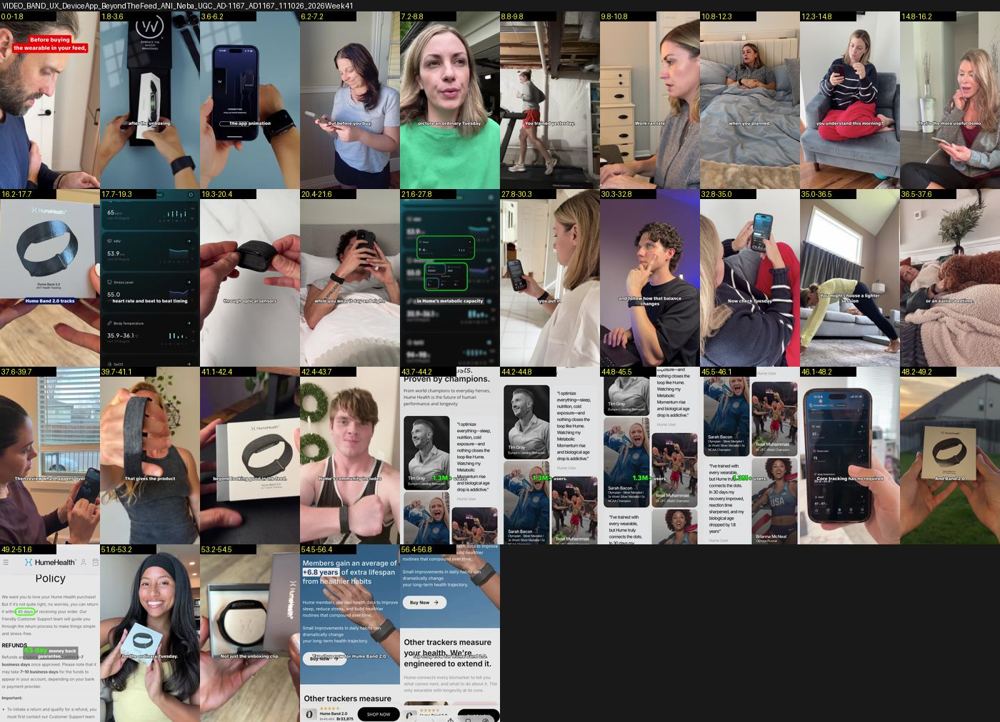

# VIDEO_BAND_UX_DeviceApp_BeyondTheFeed_ANI_Neba_UGC_AD-1167_AD1167_111026_2026Week41

Master: `VIDEO_BAND_UX_DeviceApp_BeyondTheFeed_ANI_Neba_UGC_AD-1167_AD1167_111026_2026Week41_9x16_hook1.mp4` · 56.8s · 1080x1920

**Pacing:** 35 shots · avg 1.623s · median 1.48s · 5.98 cuts/10s · first cut 1.8s · 224.0 wpm · talk ratio 0.95 · cuts on word start 73.5% · cuts in speech gaps 58.8%
**Audio:** {'I_lufs': -17.9, 'LRA': 1.9, 'true_peak_db': -2.6} · BPM≈129.2 · music {'speech_rms_db': -21.2, 'pause_seconds': 0.0} · cuts with SFX/transient 55.9%

**Captions:** 169 cards · 1 words/card (median) · y≈0.616 of frame height · text height≈0.0258 · colours {'white': 138, 'other-colour': 1, 'green': 6, 'red': 4, 'dark/other': 14, 'blue': 5, 'yellow': 1} · cards crossing a cut: 1
Highlighted: The wrist shot looks good., picturean ordinary Tuesday., You trained yesterday,, the device to help, you understand this morning?, 1.3M+users:User, 1.3M+users., Core tracking has no required, it withi, 45days, 45day, sleep,reducestress,andbuildhealthier, routinesthatcompoundovertime, Small improvementsindailyhabitscan, dramatically change
**Headlines:** Beforebuying (0.0–1.5s, red) | the wearable in your feed (0.0–0.0s, red) | the wearable in your feed, (0.5–1.5s, red) | EMBRACE THE (2.0–3.0s, white) | WHOOP (2.0–2.0s, white) | AWAKENING (2.0–3.0s, white) | XHumeHealth (16.0–16.0s, white) | XHumeHealth" (17.0–17.0s, white)

**Hook (0–3s) spoken:** Before buying the wearable in your feed, see what happens after the
**Hook on-screen:** AWAKENING / Beforebuying / EMBRACE THE / WHOOP / after the unboxing. / see whathappens / the wearable in your feed / the wearable in your feed,
**CTA (last 5s):** for the ordinary Tuesday, not just the unboxing clip. Tap Shop Now for HumeBand 2 .0 · on-screen: +6.8yearsofextralifespan / BTyRshoP now for Hume Band 2.0. / Br48,462Br33,875 / BuyNow / Hume members usereal healthdata to improve / HumeBand2.0 / HumeHealn / Humeconnects everybiomarkertotell you / LiveLongu.Bettez. / Membersgainanaverageof / NLIVELONGER / Not just the unboxing clip.

## Beat sheet

| # | in–out (s) | dur | transition | spoken | on-screen text |
|---|---|---|---|---|---|
| 1 | 0.00–1.80 | 1.8 |  | Before buying the wearable in your feed, | Beforebuying [red] (HEADLINE) / the wearable in your feed [red] (HEADLINE) / the wearable in your feed, [red] (HEADLINE) |
| 2 | 1.80–3.56 | 1.76 | cut +SFX hit | see what happens after the unboxing. | Beforebuying [red] (HEADLINE) / the wearable in your feed, [red] (HEADLINE) / EMBRACE THE (HEADLINE) / WHOOP (HEADLINE) / AWAKENING (HEADLINE) / see whathappens |
| 3 | 3.56–6.24 | 2.68 | cut +SFX hit | The wrist shot looks good, the app animation looks impressive, | The wrist shot looks good. [other-colour] / The.appanimation / The.app-animation / looks.impressive. / But before you buy. |
| 4 | 6.24–7.20 | 0.96 | cut +SFX hit | but before you buy, | But before you buy. / picturean ordinary Tuesday. [green] |
| 5 | 7.20–8.80 | 1.6 | cut | picture an ordinary Tuesday. | picturean ordinary Tuesday. [green] |
| 6 | 8.80–9.80 | 1.0 | cut | You trained yesterday, | You trained yesterday, [red] |
| 7 | 9.80–10.80 | 1.0 | cut | work ran late, | Workran late |
| 8 | 10.80–12.28 | 1.48 | cut +SFX hit | and you didn't get to bed when you planned. | and you didn't get to bed / when you planned. |
| 9 | 12.28–14.76 | 2.48 | cut +SFX hit | What would you want the device to help you understand this morning? | when you planned. / the device to help [red] / you understand this morning? [red] |
| 10 | 14.76–16.16 | 1.4 | cut +SFX hit | That's the more useful demo. | That'sthe more useful demo. / XHumeHealth (HEADLINE) / HumeBand2.0 / 24/7HealthTracking / Hume Band2.0tracks |
| 11 | 16.16–17.72 | 1.56 | cut | HumeBand 2 .0 tracks heart | XHumeHealth (HEADLINE) / HumeBand2.0 / 24/7HealthTracking / Hume Band2.0tracks / XHumeHealth" (HEADLINE) |
| 12 | 17.72–19.28 | 1.56 | cut +SFX hit | rate and beat -to -beat timing through | HeartRate (HEADLINE) / 65bpm / heart rate and beat to beat timing / HumeBand (91%) (HEADLINE) / HRV (HEADLINE) / 53.9ms (HEADLINE) |
| 13 | 19.28–20.44 | 1.16 | cut | optical sensors while | HumeBand (91%) (HEADLINE) / HRV (HEADLINE) / 53.9ms (HEADLINE) / Last:07/Aug/26 (HEADLINE) / Stress Level / 55.0 |
| 14 | 20.44–21.64 | 1.2 | cut +SFX hit | you wear it day and night. | through optical sensors / XVIIL.LXXII [red] (HEADLINE) / while you wear it day and night |
| 15 | 21.64–27.84 | 6.2 | cut +SFX hit | Its app combines those signals with sleep and activity in Hume's metabolic capacity and metabolic momentum insights. You | HumeBand(91%) (HEADLINE) / BloodPressure (HEADLINE) / 123/71mmHg (HEADLINE) / Last:07/Aug/26 (HEADLINE) / Heart Rate / 65bpm |
| 16 | 27.84–30.28 | 2.44 | cut +SFX hit | can compare the effort you put in with recovery and | You cancomparetheeffort / you put in / withrecovery |
| 17 | 30.28–32.76 | 2.48 | cut +SFX hit | follow how that balance changes across your routine. | withrecovery / and follow how that balance / changes / acrossyourroutine |
| 18 | 32.76–35.04 | 2.28 | cut | Now, check Tuesday against your usual pattern. | Now check Tuesday / against your usual pattern. / You might choose a lighter / session |
| 19 | 35.04–36.52 | 1.48 | cut +SFX hit | You might choose a lighter session or | You might choose a lighter / session |
| 20 | 36.52–37.56 | 1.04 | cut | an earlier bedtime, | oran earlierbedtime |
| 21 | 37.56–39.68 | 2.12 | cut | then review what happens over the following days. | Then reviewwhathappensover / the following days. |
| 22 | 39.68–41.12 | 1.44 | cut | That gives the product a job beyond | That gives the product / XHumeHealth (HEADLINE) / beyond lookinggood in the feed. / HumeBand2.0 / 24/7HealthTracking |
| 23 | 41.12–42.44 | 1.32 | cut +SFX hit | looking good in the feed. | XHumeHealth (HEADLINE) / beyond lookinggood in the feed. / HumeBand2.0 / 24/7HealthTracking |
| 24 | 42.44–43.72 | 1.28 | cut | Hume's community includes 1 | beyond lookinggood in the feed. / Hume'scommunityincludes |
| 25 | 43.72–44.16 | 0.44 | cut | .3 | From world chanipiuus tu everyday heroes, (HEADLINE) / HumeHealthisthefutureofhuman (HEADLINE) / performanceand longevity (HEADLINE) / "optimize (HEADLINE) / everythingsleep, (HEADLINE) / nutrition,cold (HEADLINE) |
| 26 | 44.16–44.84 | 0.68 | cut +SFX hit | million | From world chanipiuus tu everyday heroes, (HEADLINE) / HumeHealthisthefutureofhuman (HEADLINE) / performanceand longevity (HEADLINE) / "optimize (HEADLINE) / everythingsleep, (HEADLINE) / nutrition,cold (HEADLINE) |
| 27 | 44.84–45.48 | 0.64 | cut +SFX hit | plus users. | SarahBacon / caposureand (HEADLINE) / nothingclosesthe (HEADLINE) / looplikeHume. (HEADLINE) / Watching my (HEADLINE) / Metabolic (HEADLINE) |
| 28 | 45.48–46.12 | 0.64 | cut |  | SarahBacon / caposureand (HEADLINE) / nothingclosesthe (HEADLINE) / looplikeHume. (HEADLINE) / Watching my (HEADLINE) / Metabolic (HEADLINE) |
| 29 | 46.12–48.24 | 2.12 | cut | Core Tracking has no required subscription, | 12:12岁 [blue] (HEADLINE) / HumeBand(50%) (HEADLINE) / 09 steps (HEADLINE) / Lair22///26 (HEADLINE) / sleep / 9h1m |
| 30 | 48.24–49.16 | 0.92 | cut +SFX hit | and Band 2 .0 | XHumeHealth" / AndBand2.0 / humehealth.com (HEADLINE) / XHumeHealth"β (HEADLINE) / Returns & Refund (HEADLINE) / Policy (HEADLINE) |
| 31 | 49.16–51.64 | 2.48 | cut | comes with a 45 -day money -back guarantee. Choose | humehealth.com (HEADLINE) / XHumeHealth"β (HEADLINE) / Returns & Refund (HEADLINE) / Policy (HEADLINE) / Wewantyouto loveyour HumeHealthpurchase! / But if it's not quite right, no worries,you can return |
| 32 | 51.64–53.24 | 1.6 | cut | it for the ordinary Tuesday, | for the ordinary Tuesday. / LiveLongu.Bettez. / Not just the unboxing clip. |
| 33 | 53.24–54.52 | 1.28 | cut +SFX hit | not just the unboxing clip. Tap | LiveLongu.Bettez. / Not just the unboxing clip. / HumeHealn |
| 34 | 54.52–56.44 | 1.92 | cut +SFX hit | Shop Now for HumeBand 2 .0 | NLIVELONGER (HEADLINE) / Membersgainanaverageof (HEADLINE) / +6.8yearsofextralifespan (HEADLINE) / fromhealthierhabits (HEADLINE) / Hume members usereal healthdata to improve [blue] (HEADLINE) / sleep,reducestress,andbuildhealthier [blue] |
| 35 | 56.44–56.81 | 0.37 | cut +SFX hit |  | Othertrackersmeasure / ★★★★★ [yellow] / HumeBand2.0 / SHOPNOW / Br48,462Br33,875 / sleep,reducestress,andbuildhealthier (HEADLINE) |

## Hook variants

| hook | file | dur | first cut | spoken 0–3s | on-screen 0–3s |
|---|---|---|---|---|---|
| 1 | `ANI_Neba_UGC_AD-1167_AD1167_111026_2026Week41_9x16_hook1.mp4` | 56.8 | 1.8 | Before buying the wearable in your feed, see what happens after the | AWAKENING / Beforebuying / EMBRACE THE / WHOOP / after the unboxing. / see whathappens / the wearable in your feed / the wearable in your feed, |
| 1 | `ANI_Neba_UGC_AD-1167_AD1167_111026_2026Week41_9x16_hook1.mp4` | 56.8 | 1.8 | Before buying the wearable in your feed, see what happens after the |  |
| 2 | `ANI_Neba_UGC_AD-1167_AD1167_111026_2026Week41_9x16_hook2.mp4` | 56.0 | 2.76 | A good clip can make a tracker interesting. What makes it useful? The wrist |  |
| 2 | `ANI_Neba_UGC_AD-1167_AD1167_111026_2026Week41_9x16_hook2.mp4` | 56.0 | 2.76 | A good clip can make a tracker interesting. What makes it useful? The wrist |  |
| 3 | `ANI_Neba_UGC_AD-1167_AD1167_111026_2026Week41_9x16_hook3.mp4` | 55.7 | 1.48 | Your feed can show the device. Can it show the decision? The wrist shot | Canit showthe decision? / The wrist shot looks good. / Your feed can show the device. / turnit |
| 3 | `ANI_Neba_UGC_AD-1167_AD1167_111026_2026Week41_9x16_hook3.mp4` | 55.7 | 1.48 | Your feed can show the device. Can it show the decision? The wrist shot | turn it / twrn |

## Full transcript

Before buying the wearable in your feed, see what happens after the unboxing. The wrist shot looks good, the app animation looks impressive, but before you buy, picture an ordinary Tuesday. You trained yesterday, work ran late, and you didn't get to bed when you planned. What would you want the device to help you understand this morning? That's the more useful demo. HumeBand 2.0 tracks heart rate and beat-to-beat timing through optical sensors while you wear it day and night. Its app combines those signals with sleep and activity in Hume's metabolic capacity and metabolic momentum insights. You can compare the effort you put in with recovery and follow how that balance changes across your routine. Now, check Tuesday against your usual pattern. You might choose a lighter session or an earlier bedtime, then review what happens over the following days. That gives the product a job beyond looking good in the feed. Hume's community includes 1.3 million plus users. Core Tracking has no required subscription, and Band 2.0 comes with a 45-day money-back guarantee. Choose it for the ordinary Tuesday, not just the unboxing clip. Tap Shop Now for HumeBand 2.0