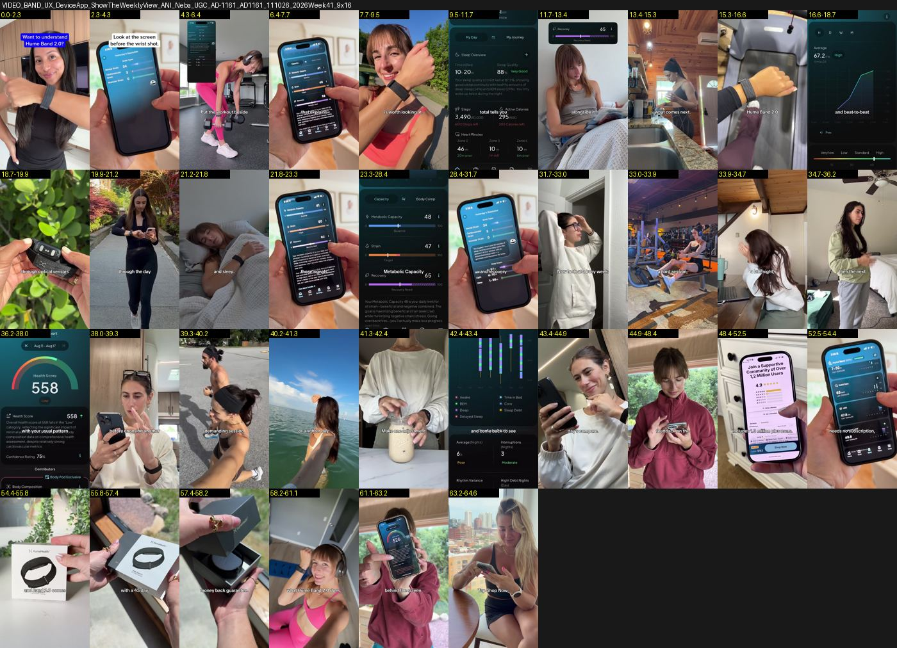

# VIDEO_BAND_UX_DeviceApp_ShowTheWeeklyView_ANI_Neba_UGC_AD-1161_AD1161_111026_2026Week41_9x16

Master: `VIDEO_BAND_UX_DeviceApp_ShowTheWeeklyView_ANI_Neba_UGC_AD-1161_AD1161_111026_2026Week41_9x16_Hook1.mp4` · 64.6s · 1080x1920

**Pacing:** 36 shots · avg 1.795s · median 1.516s · 5.42 cuts/10s · first cut 2.267s · 195.0 wpm · talk ratio 0.97 · cuts on word start 77.1% · cuts in speech gaps 68.6%
**Audio:** {'I_lufs': -20.2, 'LRA': 3.1, 'true_peak_db': -3.2} · BPM≈136.0 · music {'speech_rms_db': -24.9, 'pause_seconds': 0.5, 'pause_rms_db': -29.8, 'bed_minus_voice_db': -4.9, 'music_bed_likely': True} · cuts with SFX/transient 22.9%

**Captions:** 334 cards · 1.0 words/card (median) · y≈0.625 of frame height · text height≈0.0269 · colours {'blue': 22, 'white': 236, 'red': 11, 'dark/other': 60, 'green': 1, 'yellow': 4} · cards crossing a cut: 0
Highlighted: positivestrain fullyrecovered,zero, negativeburden,atextbook, adaptetioncycle.Muscularsystems, shownorecenttrainingstimulus,, representinganopportunityworth, Strain Types, explor.., MentalStrain, Cardiovascular, Snredipvascular, Strain, MuscularStrain, 34, Youlogged7hoursand50minutesof, Putthe workoutbeside
**Headlines:** Want to understand (0.0–2.0s, blue) | HumeBand 2.0? (0.0–2.0s, blue) | Look at the screen (2.5–4.0s, white) | before the wrist shot. (2.5–4.0s, white) | 2:38岁 (2.5–2.5s, blue) | Yesterday's Resolution (2.5–4.0s, blue) | Cardiovascularstraintells themost (2.5–2.5s, blue) | interestingstorytoday-3unitsof (2.5–2.5s, blue)

**Hook (0–3s) spoken:** Want to understand HumeBan 2 .0? Look at this screen
**Hook on-screen:** 2:38岁 / 3300 / Cardiovascular / Cardiovascularstraintells themost / HumeBand 2.0? / Look at the screen / MentalStrain / MuscularStrain / Snredipvascular / Strain / Strain Types / Want to understand / Yesterday's Resolution / adaptetioncycle.Muscularsystems / before the wrist shot. / explor.. / interestingstorytoday-3unitsof / negativeburden,atextbook / positivestrain fullyrecovered,zero / representinganopportunityworth / shownorecenttrainingstimulus,
**CTA (last 5s):** 2 .0 does, show them the decision behind the screen. Tap Shop Now. · on-screen: 526 / 526+ / HeanReport / Hesth Score / Tap ShopNow. / behind the screen. / showthem the decision / what Hume Band 2.0 does,

## Beat sheet

| # | in–out (s) | dur | transition | spoken | on-screen text |
|---|---|---|---|---|---|
| 1 | 0.00–2.27 | 2.27 |  | Want to understand HumeBan 2 .0? | Want to understand [blue] (HEADLINE) / HumeBand 2.0? [blue] (HEADLINE) |
| 2 | 2.27–4.30 | 2.03 | cut | Look at this screen before the wrist shot. | Want to understand [blue] (HEADLINE) / HumeBand 2.0? [blue] (HEADLINE) / Look at the screen (HEADLINE) / before the wrist shot. (HEADLINE) / 2:38岁 [blue] (HEADLINE) / Yesterday's Resolution [blue] (HEADLINE) |
| 3 | 4.30–6.43 | 2.13 | cut | Put the workout beside the sleep and recovery. | Look at the screen (HEADLINE) / before the wrist shot. (HEADLINE) / Yesterday's Resolution [blue] (HEADLINE) / MentalStrain [blue] / Cardiovascular [blue] / Strain [blue] |
| 4 | 6.43–7.73 | 1.3 | cut | That's the view that explains why | the sleep andrecovery. [red] / 2:384 [blue] (HEADLINE) / BodyComp (HEADLINE) / Capeelty (HEADLINE) / Metabolle Capacity / Baseine |
| 5 | 7.73–9.53 | 1.8 | cut | the device is worth looking at. | why the device / is worth looking at. [red] |
| 6 | 9.53–11.67 | 2.13 | cut | An activity total tells you what you did. | Youroptimalweigh-intimeis7:41AM (HEADLINE) / Sinceit's3:09PM.wesuggestwaitinguntil (HEADLINE) / Optimal timing (HEADLINE) / Currenttime (HEADLINE) / 7:41aM (HEADLINE) / 3:09pM (HEADLINE) |
| 7 | 11.67–13.37 | 1.7 | cut +SFX hit | Seeing recovery alongside it helps | 65 (HEADLINE) / Recovery (HEADLINE) / Seeing recovery / alongsideit |
| 8 | 13.37–15.33 | 1.97 | cut | you consider what comes next. | 65 (HEADLINE) / Recovery (HEADLINE) / alongsideit / whatcomesnext |
| 9 | 15.33–16.60 | 1.27 | cut | HumeBan 2 .0 gathers | whatcomesnext / HumeBand2.0 |
| 10 | 16.60–18.70 | 2.1 | cut +SFX hit | heart rate and beat -to -beat timing through | HeartRate (HEADLINE) / Range (HEADLINE) / 53-147bpm (HEADLINE) / High (HEADLINE) / 11/Mar/26 (HEADLINE) / 200 |
| 11 | 18.70–19.93 | 1.23 | cut | optical sensors while | through optical sensors [red] |
| 12 | 19.93–21.17 | 1.23 | cut +SFX hit | you wear it through the day | whileyou wearit / and sleep. |
| 13 | 21.17–21.80 | 0.63 | cut | and sleep. | and sleep. |
| 14 | 21.80–23.30 | 1.5 | cut | The app combines those signals with | 2:384 [blue] (HEADLINE) / BodyComp (HEADLINE) / Capaoity (HEADLINE) / 41 (HEADLINE) / Metabolic Capacilty [blue] (HEADLINE) / Baselino |
| 15 | 23.30–28.37 | 5.07 | cut | sleep and activity in Hume's metabolic capacity and metabolic insight, | 41 (HEADLINE) / Target / Recovery / Recovery Need / over time. / Home |
| 16 | 28.37–31.70 | 3.33 | cut | connecting daily strain and recovery with trends over time. | MetabolicMomentum (HEADLINE) / LifeAddedOverall / 1.1d 个 / X 1.1a + / You'reagingmuchslowerthanmostpeople / You'renotjust stayingactive-you'redoingit at |
| 17 | 31.70–33.00 | 1.3 | cut | Now look at a busy week, | Now look at a busy week: |
| 18 | 33.00–33.90 | 0.9 | cut +SFX hit | a hard session, | ahardsession, |
| 19 | 33.90–34.73 | 0.83 | cut | a late night, | a late night, |
| 20 | 34.73–36.20 | 1.47 | cut | then the next day's recovery. | thenthenext / HealthReport (HEADLINE) / Aug11-Aug17 (HEADLINE) / HealthScore (HEADLINE) / Low / 558+ |
| 21 | 36.20–38.03 | 1.83 | cut | You can compare it with your usual pattern before | HealthReport (HEADLINE) / Aug11-Aug17 (HEADLINE) / HealthScore (HEADLINE) / Low / 558+ / HealthScore |
| 22 | 38.03–39.33 | 1.3 | cut | choosing another demanding | before choosinganother |
| 23 | 39.33–40.23 | 0.9 | cut | session or | before choosinganother / or a lighterday [red] |
| 24 | 40.23–41.27 | 1.03 | cut | a lighter day. | or a lighterday [red] |
| 25 | 41.27–42.40 | 1.13 | cut | Make one adjustment and | or a lighterday [red] / Make oneadjustment |
| 26 | 42.40–43.40 | 1.0 | cut | come back to see | Make oneadjustment / Awake / TimeinBed / REM / Core / Deep |
| 27 | 43.40–44.93 | 1.53 | cut +SFX hit | how the following days compare. | Awake / TimeinBed / REM / Core / Deep / SleepDebt |
| 28 | 44.93–48.37 | 3.43 | cut | That's what you're using the app for. Feedback on the next choice. | That's what you're [red] / using the app for: [red] / feedbackonthe / nextchoice. |
| 29 | 48.37–52.47 | 4.1 | cut | Hume's community includes 1 .3 million plus users. Core | nextchoice. / 10:17 (HEADLINE) / Join a Supportive (HEADLINE) / Community of Over (HEADLINE) / 1,2MillionUsers (HEADLINE) / 4.9★★★★★ |
| 30 | 52.47–54.40 | 1.93 | cut +SFX hit | Tracking needs no subscription, | Questions / Shop Now / $366 $183 [blue] / humehealth.com / Most Recent / 11/22/2025 |
| 31 | 54.40–55.77 | 1.37 | cut +SFX hit | and Band 2 .0 comes | Connected [blue] (HEADLINE) / HumeBand (84%) [blue] (HEADLINE) / Last:20/May/26 [blue] (HEADLINE) / Last:20/May/26 / 47.8ms / 49.8 |
| 32 | 55.77–57.43 | 1.67 | cut | with a 45 -day money -back | XHumeHealth" (HEADLINE) / Hume Band 2.0 / with a 45 day / money back guarantee. |
| 33 | 57.43–58.17 | 0.73 | cut +SFX hit | guarantee. | money back guarantee. / Ifsomeoneasks |
| 34 | 58.17–61.07 | 2.9 | cut | If someone asks what Hume Band 2 .0 does, | Ifsomeoneasks / what Hume Band 2.0 does, [red] / 526 (HEADLINE) / showthem the decision [red] |
| 35 | 61.07–63.23 | 2.17 | cut | show them the decision behind the screen. | 526 (HEADLINE) / showthem the decision [red] / HeanReport [blue] (HEADLINE) / Hesth Score (HEADLINE) / 526+ / behind the screen. |
| 36 | 63.23–64.62 | 1.39 | cut | Tap Shop Now. | Tap ShopNow. |

## Hook variants

| hook | file | dur | first cut | spoken 0–3s | on-screen 0–3s |
|---|---|---|---|---|---|
| 1 | `ANI_Neba_UGC_AD-1161_AD1161_111026_2026Week41_9x16_Hook1.mp4` | 64.6 | 2.267 | Want to understand HumeBan 2 .0? Look at this screen | 2:38岁 / 3300 / Cardiovascular / Cardiovascularstraintells themost / HumeBand 2.0? / Look at the screen / MentalStrain / MuscularStrain |
| 2 | `ANI_Neba_UGC_AD-1161_AD1161_111026_2026Week41_9x16_Hook2.mp4` | 64.4 | 1.867 | Here's what to show someone who asks what Hume Band 2 .0 | Here'swhattoshowsomeone / actually does / actuallydoes. / whoaskswhatHumeBand 2.0 |
| 3 | `ANI_Neba_UGC_AD-1161_AD1161_111026_2026Week41_9x16_Hook3.mp4` | 63.0 | 1.5 | Skip the unboxing for a second. This is the useful part. Put the workout |  |

## Full transcript

Want to understand HumeBan 2.0? Look at this screen before the wrist shot. Put the workout beside the sleep and recovery. That's the view that explains why the device is worth looking at. An activity total tells you what you did. Seeing recovery alongside it helps you consider what comes next. HumeBan 2.0 gathers heart rate and beat-to-beat timing through optical sensors while you wear it through the day and sleep. The app combines those signals with sleep and activity in Hume's metabolic capacity and metabolic insight, connecting daily strain and recovery with trends over time. Now look at a busy week, a hard session, a late night, then the next day's recovery. You can compare it with your usual pattern before choosing another demanding session or a lighter day. Make one adjustment and come back to see how the following days compare. That's what you're using the app for. Feedback on the next choice. Hume's community includes 1.3 million plus users. Core Tracking needs no subscription, and Band 2.0 comes with a 45-day money-back guarantee. If someone asks what Hume Band 2.0 does, show them the decision behind the screen. Tap Shop Now.