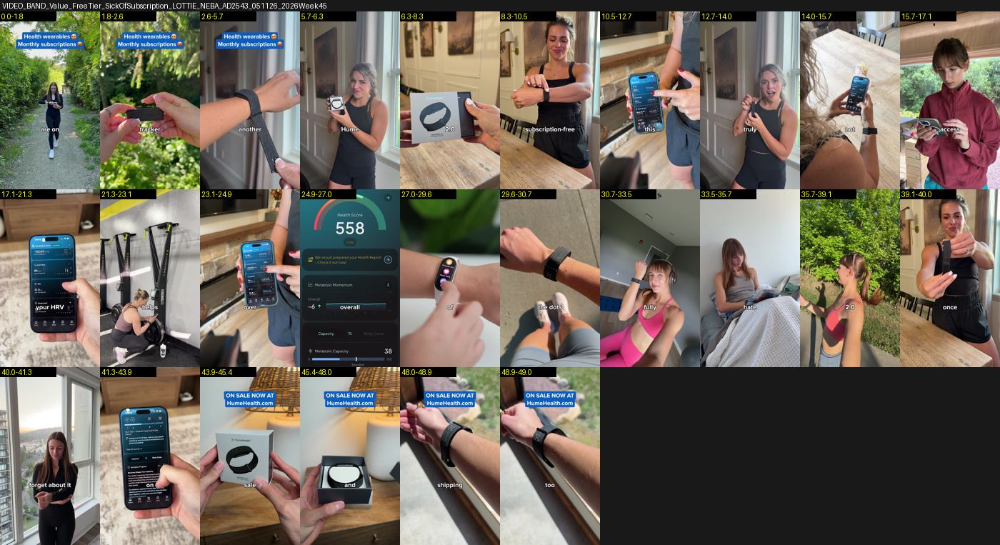

# VIDEO_BAND_Value_FreeTier_SickOfSubscription_LOTTIE_NEBA_AD2543_051126_2026Week45

Master: `VIDEO_BAND_Value_FreeTier_SickOfSubscription_LOTTIE_NEBA_AD2543_051126_2026Week45_Hook1_9x16.mp4` · 49.0s · 1080x1920

**Pacing:** 26 shots · avg 1.884s · median 1.8s · 5.1 cuts/10s · first cut 1.8s · 216.0 wpm · talk ratio 0.94 · cuts on word start 84.0% · cuts in speech gaps 80.0%
**Audio:** {'I_lufs': -13.2, 'LRA': 3.7, 'true_peak_db': 0.3} · BPM≈123.0 · music {'speech_rms_db': -18.5, 'pause_seconds': 0.2} · cuts with SFX/transient 72.0%

**Captions:** 122 cards · 1.0 words/card (median) · y≈0.644 of frame height · text height≈0.0263 · colours {'white': 97, 'red': 10, 'dark/other': 8, 'blue': 2, 'other-colour': 4, 'green': 1} · cards crossing a cut: 0
Highlighted: tracker, Enter, Hume, -124/72, 6.49, PersonalAct, Heart Rate, Workout, Workout His, Workout Ste, actually, fully, make changes, the Hume, 2.0
**Headlines:** Healthwearables (0.0–5.0s, blue) | Monthly subscriptions (0.0–5.0s, blue) | (HumeBand(83%) (19.0–19.0s, blue) | Oconcept (22.0–22.0s, white) | HealthScore (25.0–25.0s, dark/other) | Low (25.0–25.0s, dark/other) | WMetabolicMomentum (26.0–26.0s, white) | Overall (26.0–26.0s, dark/other)

**Hook (0–3s) spoken:** Okay, you are on the hunt for a health tracker, but you refuse
**Hook on-screen:** Healthwearables / Monthly subscriptions / Okay, / ahealth / areon / the / tracker / you refuse
**CTA (last 5s):** now it's on sale, too, and it's HSA and FSA -eligible. Free shipping, too. · on-screen: FSA / HSA / HumeHealth.com / ONSALENOWAT / XHumeHealth / now / shipping / too

## Beat sheet

| # | in–out (s) | dur | transition | spoken | on-screen text |
|---|---|---|---|---|---|
| 1 | 0.00–1.80 | 1.8 |  | Okay, you are on the hunt for a | Healthwearables [blue] (HEADLINE) / Monthly subscriptions [blue] (HEADLINE) / Okay, / areon / the / ahealth |
| 2 | 1.80–2.63 | 0.83 | cut +SFX hit | health tracker, | Healthwearables [blue] (HEADLINE) / Monthly subscriptions [blue] (HEADLINE) / ahealth / tracker [red] / you refuse |
| 3 | 2.63–5.70 | 3.07 | cut +SFX hit | but you refuse to pay for another monthly subscription. | Healthwearables [blue] (HEADLINE) / Monthly subscriptions [blue] (HEADLINE) / you refuse / to pay / another / monthly |
| 4 | 5.70–6.33 | 0.63 | cut +SFX hit | Enter Hume | Enter [red] / Hume [red] |
| 5 | 6.33–8.30 | 1.97 | cut +SFX hit | Health Band 2 .0. | Hume [red] / KHumeHealih / 2.0 / Hume Band 2.0 / 247 Hes Tackng / XHumeHieall |
| 6 | 8.30–10.50 | 2.2 | cut +SFX hit | This is a subscription -free health tracker, | 2.0 / XHumeHieall / Hume Band 2.4 / subscription-free / tracker |
| 7 | 10.50–12.70 | 2.2 | cut +SFX hit | and the amount of data that this thing can track is | 96.6-97.94 / of data / 96:6-97.91 / track |
| 8 | 12.70–13.97 | 1.27 | cut +SFX hit | truly insane. | truly |
| 9 | 13.97–15.73 | 1.77 | cut +SFX hit | And again, you're not paying every month | again / paying |
| 10 | 15.73–17.07 | 1.33 | cut +SFX hit | just to access your data. | access / Steps / 5.006 / 7h48m / Last:02/Sep/26 / ~120/69mmHg |
| 11 | 17.07–21.33 | 4.27 | cut | It tracks things like your sleep quality, your HRV, your stress and recovery, | Steps / 5.006 / 7h48m / Last:02/Sep/26 / ~120/69mmHg / tracks |
| 12 | 21.33–23.13 | 1.8 | cut +SFX hit | and then it actually helps you understand what | 39.2 / and recovery / Your stresslevel (measuredfrom0.0to100.0) / Indicateshow yourbodyishandlingphysical / Oconcept (HEADLINE) / helps |
| 13 | 23.13–24.90 | 1.77 | cut | all of that means over time. | -124/72 [blue] / what / 6.49 [blue] / -124/72m / over |
| 14 | 24.90–27.00 | 2.1 | cut +SFX hit | You even get an overall health score. So, | HealthScore (HEADLINE) / Low (HEADLINE) / We'vejustpreparedyourHealthReport / -Checkitoutnow! / WMetabolicMomentum / Overall |
| 15 | 27.00–29.57 | 2.57 | cut | instead of seeing a bunch of random numbers every day, | instead / PersonalAct [red] / Heart Rate [red] / of / Workout [other-colour] / Workout His [other-colour] |
| 16 | 29.57–30.67 | 1.1 | cut | it connects the dots so | the dots |
| 17 | 30.67–33.47 | 2.8 | cut | you can actually understand fully and make changes. | actually [red] / fully [red] / make changes [red] |
| 18 | 33.47–35.67 | 2.2 | cut +SFX hit | If you're like me and you hate subscriptions, | make changes [red] / and / subscriptions |
| 19 | 35.67–39.13 | 3.47 | cut +SFX hit | try the HumeBand 2 .0. Your data, yours forever. | the Hume [red] / 2.0 [red] / -124/72mm / yours / You buy |
| 20 | 39.13–40.00 | 0.87 | cut +SFX hit | You buy it once, | You buy |
| 21 | 40.00–41.27 | 1.27 | cut | wear it, forget about it, | wear / and |
| 22 | 41.27–43.87 | 2.6 | cut +SFX hit | and know the app's keeping tabs on everything for you. | and / 3:004 (HEADLINE) / MetabollelourneyPresress [blue] (HEADLINE) / Next:DuyE:MetaboleCapaeity&MyDay / uringurfist5daysmets / ViewFullouney |
| 23 | 43.87–45.37 | 1.5 | cut +SFX hit | Right now it's on sale, too, | ONSALENOWAT [blue] (HEADLINE) / HumeHealth.com [blue] (HEADLINE) / XHumeHealth / now [other-colour] / too [other-colour] |
| 24 | 45.37–48.00 | 2.63 | cut +SFX hit | and it's HSA and FSA -eligible. | ONSALENOWAT [blue] (HEADLINE) / HumeHealth.com [blue] (HEADLINE) / XHumeHealth / too [other-colour] / HSA / FSA |
| 25 | 48.00–48.93 | 0.93 | cut | Free shipping, too. | ONSALENOWAT [blue] (HEADLINE) / HumeHealth.com [blue] (HEADLINE) / shipping |
| 26 | 48.93–48.98 | 0.05 | cut +SFX hit |  |  |

## Hook variants

| hook | file | dur | first cut | spoken 0–3s | on-screen 0–3s |
|---|---|---|---|---|---|
| 1 | `cription_LOTTIE_NEBA_AD2543_051126_2026Week45_Hook1_9x16.mp4` | 49.0 | 1.8 | Okay, you are on the hunt for a health tracker, but you refuse | Healthwearables / Monthly subscriptions / Okay, / ahealth / areon / the / tracker / you refuse |
| 2 | `cription_LOTTIE_NEBA_AD2543_051126_2026Week45_Hook2_9x16.mp4` | 49.2 | 3.267 |  |  |
| 3 | `cription_LOTTIE_NEBA_AD2543_051126_2026Week45_Hook3_9x16.mp4` | 48.0 | 2.5 |  |  |

## Full transcript

Okay, you are on the hunt for a health tracker, but you refuse to pay for another monthly subscription. Enter Hume Health Band 2.0. This is a subscription-free health tracker, and the amount of data that this thing can track is truly insane. And again, you're not paying every month just to access your data. It tracks things like your sleep quality, your HRV, your stress and recovery, and then it actually helps you understand what all of that means over time. You even get an overall health score. So, instead of seeing a bunch of random numbers every day, it connects the dots so you can actually understand fully and make changes. If you're like me and you hate subscriptions, try the HumeBand 2.0. Your data, yours forever. You buy it once, wear it, forget about it, and know the app's keeping tabs on everything for you. Right now it's on sale, too, and it's HSA and FSA-eligible. Free shipping, too.