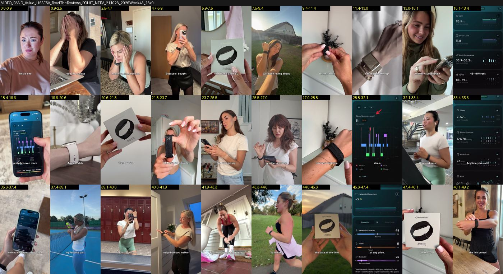

# VIDEO_BAND_Value_HSAFSA_ReadTheReviews_ROHIT_NEBA_211026_2026Week43_16x9

Master: `VIDEO_BAND_Value_HSAFSA_ReadTheReviews_ROHIT_NEBA_211026_2026Week43_Hook1_16x9.mp4` · 49.2s · 1080x1920

**Pacing:** 30 shots · avg 1.642s · median 1.567s · 5.89 cuts/10s · first cut 0.9s · 216.0 wpm · talk ratio 0.95 · cuts on word start 79.3% · cuts in speech gaps 37.9%
**Audio:** {'I_lufs': -18.4, 'LRA': 2.5, 'true_peak_db': -2.6} · BPM≈123.0 · music {'speech_rms_db': -23.0, 'pause_seconds': 0.2} · cuts with SFX/transient 79.3%

**Captions:** 147 cards · 1 words/card (median) · y≈0.745 of frame height · text height≈0.0258 · colours {'white': 109, 'dark/other': 33, 'red': 4, 'blue': 1} · cards crossing a cut: 0
Highlighted: so I could save money, So I'm ordering, becausethis thing, has been fantastic., my favorite part.
**Headlines:** HumeBand (98%) (15.0–16.0s, blue) | 09 steps (15.0–15.0s, white) | 377 (15.0–15.0s, white) | Last:06/10/2025 (15.0–16.0s, dark/other) | HRV (16.0–16.0s, white) | 93.5ms (16.0–16.0s, white) | HealthReport (17.0–18.0s, white) | Sep29-Oct5 (17.0–17.0s, white)

**Hook (0–3s) spoken:** This is one of the reasons why you always read the reviews before buying
**Hook on-screen:** This is one / before buying / of the reasons / read the reviews / why you always
**CTA (last 5s):** So if you want the data all the time at any price, make sure to get it in the link below. · on-screen: 100 / 25 / 45 / 453 / Baseline / Body Comp / BodyComp / Capacity / Giveusamomenttoprepareyour Health / Metaboithedata all the time / MetabolicCapacity / Recovery

## Beat sheet

| # | in–out (s) | dur | transition | spoken | on-screen text |
|---|---|---|---|---|---|
| 1 | 0.00–0.90 | 0.9 |  | This is one of the reasons why | This is one / of the reasons |
| 2 | 0.90–2.47 | 1.57 | cut +SFX hit | you always read the reviews before | of the reasons / why you always / read the reviews |
| 3 | 2.47–4.73 | 2.27 | cut +SFX hit | buying one of those health tracking devices. | read the reviews / before buying / oneof those / health tracking devices. / BecauseIbought |
| 4 | 4.73–5.93 | 1.2 | cut +SFX hit | Because I bought that | BecauseIbought |
| 5 | 5.93–7.50 | 1.57 | cut +SFX hit | Hume band 2 .0 that | BecauseIbought / that HumeBand 2.0 / HumeBand2.0 / 24/7HealthTracking |
| 6 | 7.50–9.37 | 1.87 | cut +SFX hit | everyone's just been raving about and | just been raving about |
| 7 | 9.37–11.37 | 2.0 | cut +SFX hit | I'm literally taking it back to the store. | just been raving about / taking it back / to the store. |
| 8 | 11.37–13.00 | 1.63 | cut +SFX hit | And it's not because I ditched my whoop because | to the store. / I ditched my Whoop, |
| 9 | 13.00–15.13 | 2.13 | cut +SFX hit | there's no monthly subscription on this. | because there's no / monthly subscription / HumeBand (98%) [blue] (HEADLINE) / 09 steps (HEADLINE) / 377 (HEADLINE) / Last:06/10/2025 (HEADLINE) |
| 10 | 15.13–18.37 | 3.23 | cut +SFX hit | Or because it gives 45 plus different health metrics, probably | HumeBand (98%) [blue] (HEADLINE) / 09 steps (HEADLINE) / 377 (HEADLINE) / Last:06/10/2025 (HEADLINE) / Sleep / 9n37m |
| 11 | 18.37–19.63 | 1.27 | cut +SFX hit | even more than my old | HealthReport (HEADLINE) / Yourbodycompositionscoreisgood.Youhavehealthy (HEADLINE) / bodyfatlevels. (HEADLINE) / ViewAllDetails→ (HEADLINE) / A+ + (HEADLINE) / CardiovascularHealth (HEADLINE) |
| 12 | 19.63–20.57 | 0.93 | cut | Apple Watch. | Apple Watch. |
| 13 | 20.57–21.83 | 1.27 | cut | Then I found out that it's HSA | Then I found |
| 14 | 21.83–23.70 | 1.87 | cut +SFX hit | and FSA eligible so | HSA and FSA eligible, |
| 15 | 23.70–25.50 | 1.8 | cut +SFX hit | I could save money. So I'm ordering another | so I could save money [red] / So I'm ordering [red] / REM |
| 16 | 25.50–26.97 | 1.47 | cut +SFX hit | one here because this thing | another one here |
| 17 | 26.97–28.83 | 1.87 | cut +SFX hit | has been fantastic. Not | becausethis thing [red] / has been fantastic. [red] |
| 18 | 28.83–32.13 | 3.3 | cut | only tracking sleep, stress, blood oxygen, | HumeBand(80%) (HEADLINE) / Connected [green] (HEADLINE) / Sleep (HEADLINE) / 18:00 (HEADLINE) / 5h1m (HEADLINE) / 16:00 (HEADLINE) |
| 19 | 32.13–33.40 | 1.27 | cut +SFX hit | and even your workouts, | and even / your workouts, |
| 20 | 33.40–35.63 | 2.23 | cut | but it's your data. Any time you want with | your workouts, / HumeBand（59%) (HEADLINE) / 5,000 (HEADLINE) / 6259 (HEADLINE) / Last:17/Aug/26 (HEADLINE) / Sleep (HEADLINE) |
| 21 | 35.63–37.37 | 1.73 | cut +SFX hit | no monthly subscription, which | 4.267 / 6.45 / 103.9 / with no monthly subscription, / meBand21A [blue] (HEADLINE) / 4,267 |
| 22 | 37.37–39.13 | 1.77 | cut +SFX hit | is my favorite part. | meBand21A [blue] (HEADLINE) / 4,267 / 645 / 103.9~ / with no monthly subscription / my favorite part. [blue] |
| 23 | 39.13–40.63 | 1.5 | cut +SFX hit | There's a reason why everybody from | There's a reason / why everybody |
| 24 | 40.63–41.93 | 1.3 | cut | the neighborhood walker to | neighborhood walker |
| 25 | 41.93–43.33 | 1.4 | cut +SFX hit | the professional athlete is | to the professional athlete |
| 26 | 43.33–44.57 | 1.23 | cut +SFX hit | making the switch. | to the professional athlete / the switch. |
| 27 | 44.57–45.63 | 1.07 | cut +SFX hit | So if you want the data all | the data all the time |
| 28 | 45.63–47.43 | 1.8 | cut +SFX hit | the time at any price, | 453 (HEADLINE) / Giveusamomenttoprepareyour Health [yellow] (HEADLINE) / Report.. [yellow] (HEADLINE) / WMetabolicMomentum / Capacity / BodyComp |
| 29 | 47.43–48.10 | 0.67 | cut | make sure to get | 100 / Baseline / Strain / Target / Capacity (HEADLINE) / Body Comp (HEADLINE) |
| 30 | 48.10–49.25 | 1.15 | cut +SFX hit | it in the link below. | to get it in |

## Hook variants

| hook | file | dur | first cut | spoken 0–3s | on-screen 0–3s |
|---|---|---|---|---|---|
| 1 | `A_ReadTheReviews_ROHIT_NEBA_211026_2026Week43_Hook1_16x9.mp4` | 49.2 | 0.9 | This is one of the reasons why you always read the reviews before buying | This is one / before buying / of the reasons / read the reviews / why you always |
| 2 | `A_ReadTheReviews_ROHIT_NEBA_211026_2026Week43_Hook2_16x9.mp4` | 49.1 | 1.167 |  |  |
| 3 | `A_ReadTheReviews_ROHIT_NEBA_211026_2026Week43_Hook3_16x9.mp4` | 48.3 | 0.867 |  |  |

## Full transcript

This is one of the reasons why you always read the reviews before buying one of those health tracking devices. Because I bought that Hume band 2.0 that everyone's just been raving about and I'm literally taking it back to the store. And it's not because I ditched my whoop because there's no monthly subscription on this. Or because it gives 45 plus different health metrics, probably even more than my old Apple Watch. Then I found out that it's HSA and FSA eligible so I could save money. So I'm ordering another one here because this thing has been fantastic. Not only tracking sleep, stress, blood oxygen, and even your workouts, but it's your data. Any time you want with no monthly subscription, which is my favorite part. There's a reason why everybody from the neighborhood walker to the professional athlete is making the switch. So if you want the data all the time at any price, make sure to get it in the link below.