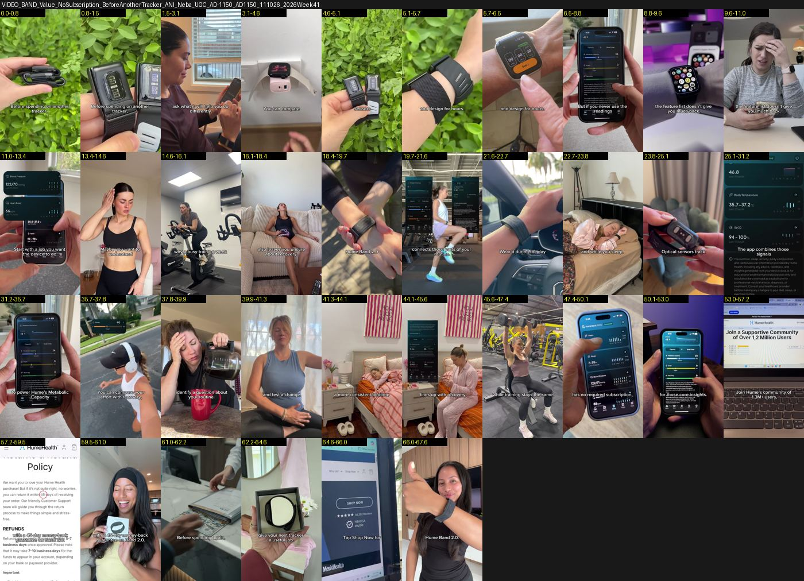

# VIDEO_BAND_Value_NoSubscription_BeforeAnotherTracker_ANI_Neba_UGC_AD-1150_AD1150_111026_2026Week41

Master: `VIDEO_BAND_Value_NoSubscription_BeforeAnotherTracker_ANI_Neba_UGC_AD-1150_AD1150_111026_2026Week41_9X16_HOOK1.mp4` · 67.6s · 1080x1920

**Pacing:** 36 shots · avg 1.879s · median 1.5s · 5.17 cuts/10s · first cut 0.767s · 193.0 wpm · talk ratio 0.94 · cuts on word start 77.1% · cuts in speech gaps 60.0%
**Audio:** {'I_lufs': -21.7, 'LRA': 2.0, 'true_peak_db': -7.6} · BPM≈117.5 · music {'speech_rms_db': -25.9, 'pause_seconds': 0.0} · cuts with SFX/transient 57.1%

**Captions:** 201 cards · 1 words/card (median) · y≈0.665 of frame height · text height≈0.0269 · colours {'green': 2, 'red': 5, 'white': 133, 'dark/other': 60, 'other-colour': 1} · cards crossing a cut: 6
Highlighted: Before spending on another, tracker,, ask what it will help you do, differently., Start, identify a question about, yourroutine, THIE
**Headlines:** 12:50 (5.5–6.0s, white) | Seconds (5.5–6.0s, dark/other) | 30 (6.0–6.0s, white) | 00 (6.0–6.0s, white) | -85 (7.0–7.0s, white) | 9:38 (8.0–8.0s, white) | 122/70 mmHg (12.0–13.0s, white) | HeartRate (25.0–25.0s, white)

**Hook (0–3s) spoken:** Before spending on another tracker, ask what it will help you do differently.
**Hook on-screen:** Before spending on another / ask what it will help you do / differently. / tracker,
**CTA (last 5s):** tracker a useful job. Tap Shop Now for Hume Band 2 .0. · on-screen: 117DM / 48,252Reviews / 9/13/2025 / AOLHelp / HSA/FSA / Hume Band 2.0 / Men'sHealth / SHOP NOW / TapShop Nowfor / WhyUs?vShop Nowy / a useful job. / auseful job

## Beat sheet

| # | in–out (s) | dur | transition | spoken | on-screen text |
|---|---|---|---|---|---|
| 1 | 0.00–0.77 | 0.77 |  | Before spending on | Before spending on another [green] / tracker, [green] |
| 2 | 0.77–1.53 | 0.77 | cut | another tracker, | Before spending on another [green] / tracker, [green] / ask what it will help you do [red] / differently. [red] |
| 3 | 1.53–3.13 | 1.6 | cut +SFX hit | ask what it will help you do differently. | ask what it will help you do [red] / differently. [red] / You can compare |
| 4 | 3.13–4.60 | 1.47 | cut | You can compare battery life, | You can compare / battery life, / sensors |
| 5 | 4.60–5.07 | 0.47 | cut +SFX hit | sensors, | sensors / and designforhours. |
| 6 | 5.07–5.73 | 0.67 | cut +SFX hit | and design for | and designforhours. / 12:50 (HEADLINE) / Seconds (HEADLINE) / 30 / 00 / Start [red] |
| 7 | 5.73–6.47 | 0.73 | cut +SFX hit | hours. | and designforhours. / 12:50 (HEADLINE) / Seconds (HEADLINE) / 30 / 00 / Start [red] |
| 8 | 6.47–8.83 | 2.37 | cut +SFX hit | But if you never use the readings to make a decision, | and designforhours. / 12:50 (HEADLINE) / Seconds (HEADLINE) / 00 / Start [red] / 30 (HEADLINE) |
| 9 | 8.83–9.63 | 0.8 | cut +SFX hit | the feature list doesn't | the feature list doesn't give / you much back. |
| 10 | 9.63–11.03 | 1.4 | cut | give you much back. | the feature list doesn't give / you much back. / 65bpm / 86.0ms / 19.6 / Start withajob you want |
| 11 | 11.03–13.43 | 2.4 | cut +SFX hit | Start with a job you want the device to do. | 65bpm / 86.0ms / 19.6 / Start withajob you want / thedevice to do.= / 122/70 mmHg (HEADLINE) |
| 12 | 13.43–14.63 | 1.2 | cut +SFX hit | Maybe you want to understand why | 122/70 mmHg (HEADLINE) / 66bpm / 62 / Recovery / Start with.ajob"yourwant / therdevice to do. |
| 13 | 14.63–16.13 | 1.5 | cut | a busy training week also | FINESSTESTING / why a busy training week / also leaves you unsure / about recovery. |
| 14 | 16.13–18.43 | 2.3 | cut +SFX hit | leaves you unsure about recovery. | also leaves you unsure / about recovery. |
| 15 | 18.43–19.73 | 1.3 | cut +SFX hit | CuneBand 2 .0 connects | also leaves you unsure / about recovery. / Hume Band 2.0 |
| 16 | 19.73–21.60 | 1.87 | cut | those parts of your routine. | connects those parts of your / routine. |
| 17 | 21.60–22.70 | 1.1 | cut | Wear it during the day and | Wear it during the day |
| 18 | 22.70–23.80 | 1.1 | cut | while you sleep. | and while you sleep. |
| 19 | 23.80–25.07 | 1.27 | cut +SFX hit | Optical sensors track heart | Optical sensors track / HeartRate (HEADLINE) / 101bpm (HEADLINE) / Last:07/Aug/26 (HEADLINE) / HRV / 38.6ms |
| 20 | 25.07–31.17 | 6.1 | cut | rate and the small timing changes between beats. The app combines those signals with sleep and activity to | HeartRate (HEADLINE) / 101bpm (HEADLINE) / Last:07/Aug/26 (HEADLINE) / HRV / 38.6ms / StressLevel |
| 21 | 31.17–35.67 | 4.5 | cut +SFX hit | power Hume's metabolic capacity and metabolic momentum insights. | 9:38 (HEADLINE) / YourMetabolicCapacity34 is yourdailyimitforall / maximizingbeneficialstrain (exercise)while / Thismightfeelabstract atfirst,butyou'llearntoplan / activitiesaroundyourcapacity-pushhardonhigh / days,rest onlowdays,avoidgoing over,What's |
| 22 | 35.67–37.77 | 2.1 | cut | You can compare your effort with recovery, | You can compare your / effort with recovery, |
| 23 | 37.77–39.93 | 2.17 | cut +SFX hit | identify a question about your routine, | identify a question about [red] / yourroutine [red] |
| 24 | 39.93–41.33 | 1.4 | cut | and test a change. | and test a change. |
| 25 | 41.33–44.10 | 2.77 | cut +SFX hit | For example, check how a more consistent bedtime lines | and test a change. / check how / a more consistent bedtime / lines up withrecovery |
| 26 | 44.10–45.60 | 1.5 | cut | up with recovery while | lines up withrecovery / 3.953n.0oo / 860 |
| 27 | 45.60–47.37 | 1.77 | cut | training stays the same. | THESTR [yellow] (HEADLINE) / while training stays the same. |
| 28 | 47.37–50.07 | 2.7 | cut +SFX hit | And core tracking has no required subscription, | THESTR [yellow] (HEADLINE) / while training stays the same. / 2:44 [blue] (HEADLINE) / Connected [blue] (HEADLINE) / HumeBand(88%) [blue] (HEADLINE) / 09Steps (HEADLINE) |
| 29 | 50.07–53.03 | 2.97 | cut +SFX hit | so there isn't a recurring fee for those core insights. Join | 34 / so thererisnitarecurring fee / Capeolty / Ostrain / DRecovery / sothere-isntarecurringfee |
| 30 | 53.03–57.17 | 4.13 | cut +SFX hit | Hume's community of 1 .3 million -plus users with | XHumeHealth [blue] (HEADLINE) / Joina SupportiveCommunity (HEADLINE) / ofOver12MillionUsers (HEADLINE) / JoinHume'scommunityof / 1.3M+ users, / ofOver1,2MillionUsers (HEADLINE) |
| 31 | 57.17–59.50 | 2.33 | cut +SFX hit | a 45 -day money -bat guarantee on | X HumeHealth"g (HEADLINE) / Policy (HEADLINE) / WewantyoutoloveyourHume Health (HEADLINE) / purchase! But if it's not quite right, no worries, / you canreturn it within 45days of receiving / your order.Our friendly Customer Support |
| 32 | 59.50–61.00 | 1.5 | cut | Band 2 .0. | witha 45-daymoney-back / guarantee on Band 2.0. |
| 33 | 61.00–62.20 | 1.2 | cut +SFX hit | Before spending again, | Before spending again, / THIE [other-colour] / Live Longer, Bettsr. / give your next tracker / a useful job. |
| 34 | 62.20–64.57 | 2.37 | cut | give your next tracker a useful job. | THIE [other-colour] / Live Longer, Bettsr. / give your next tracker / a useful job. / auseful job / a useful job. |
| 35 | 64.57–66.00 | 1.43 | cut +SFX hit | Tap Shop Now for Hume | AOLHelp [blue] (HEADLINE) / other tavonites (HEADLINE) / WhyUs?vShop Nowy (HEADLINE) / SHOP NOW / 48,252Reviews / ★★★★★ |
| 36 | 66.00–67.64 | 1.64 | cut | Band 2 .0. | Hume Band 2.0 |

## Hook variants

| hook | file | dur | first cut | spoken 0–3s | on-screen 0–3s |
|---|---|---|---|---|---|
| 1 | `ANI_Neba_UGC_AD-1150_AD1150_111026_2026Week41_9X16_HOOK1.mp4` | 67.6 | 0.767 | Before spending on another tracker, ask what it will help you do differently. | Before spending on another / ask what it will help you do / differently. / tracker, |
| 1 | `ANI_Neba_UGC_AD-1150_AD1150_111026_2026Week41_9X16_HOOK1.mp4` | 67.6 | 0.767 | Before spending on another tracker, ask what it will help you do differently. |  |
| 2 | `ANI_Neba_UGC_AD-1150_AD1150_111026_2026Week41_9X16_HOOK2.mp4` | 68.0 | 2.167 | The expensive mistake is buying more data without a reason to |  |
| 2 | `ANI_Neba_UGC_AD-1150_AD1150_111026_2026Week41_9X16_HOOK2.mp4` | 68.0 | 2.167 | The expensive mistake is buying more data without a reason to | 2:17 / Edit Card / Equipment / Heart Fat / Heart r...riabilty / Hoart r...riabillty / Measure immediately / NxWear |
| 3 | `ANI_Neba_UGC_AD-1150_AD1150_111026_2026Week41_9X16_HOOK3.mp4` | 68.8 | 1.6 | A wearable isn't good value if its app becomes another unopened | A wearable isn't good value / Apponly / USERMANUAL / if its app becomes another / if its app becomesianother / unopened icon / unopened icon. |
| 3 | `ANI_Neba_UGC_AD-1150_AD1150_111026_2026Week41_9X16_HOOK3.mp4` | 68.8 | 1.6 | A wearable isn't good value if its app becomes another unopened | Apponty / USERMANUAL |

## Full transcript

Before spending on another tracker, ask what it will help you do differently. You can compare battery life, sensors, and design for hours. But if you never use the readings to make a decision, the feature list doesn't give you much back. Start with a job you want the device to do. Maybe you want to understand why a busy training week also leaves you unsure about recovery. CuneBand 2.0 connects those parts of your routine. Wear it during the day and while you sleep. Optical sensors track heart rate and the small timing changes between beats. The app combines those signals with sleep and activity to power Hume's metabolic capacity and metabolic momentum insights. You can compare your effort with recovery, identify a question about your routine, and test a change. For example, check how a more consistent bedtime lines up with recovery while training stays the same. And core tracking has no required subscription, so there isn't a recurring fee for those core insights. Join Hume's community of 1.3 million-plus users with a 45-day money-bat guarantee on Band 2.0. Before spending again, give your next tracker a useful job. Tap Shop Now for Hume Band 2.0.