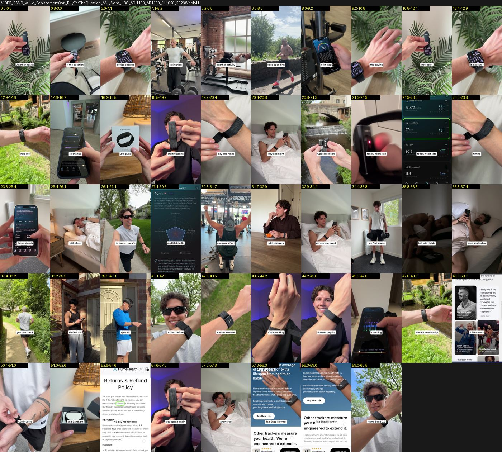

# VIDEO_BAND_Value_ReplacementCost_BuyForTheQuestion_ANI_Neba_UGC_AD-1160_AD1160_111026_2026Week41

Master: `VIDEO_BAND_Value_ReplacementCost_BuyForTheQuestion_ANI_Neba_UGC_AD-1160_AD1160_111026_2026Week41_Hook1_9x16.mp4` · 60.5s · 1080x1920

**Pacing:** 48 shots · avg 1.26s · median 1.183s · 7.77 cuts/10s · first cut 0.833s · 210.0 wpm · talk ratio 0.92 · cuts on word start 78.7% · cuts in speech gaps 55.3%
**Audio:** {'I_lufs': -11.8, 'LRA': 2.1, 'true_peak_db': 0.2} · BPM≈117.5 · music {'speech_rms_db': -15.4, 'pause_seconds': 0.3} · cuts with SFX/transient 44.7%

**Captions:** 185 cards · 1 words/card (median) · y≈0.645 of frame height · text height≈0.0258 · colours {'white': 162, 'red': 1, 'dark/other': 18, 'blue': 4} · cards crossing a cut: 3
Highlighted: MOMLXIV, healthier routines that compound over time, Small improvements in daily habits can, dramatically change, yourlong-term health trajectory.
**Headlines:** ANYTIME (15.0–15.0s, white) | 24/7 (15.0–15.0s, white) | HumeBand(77%) (22.0–22.0s, dark/other) | BloodPressure (22.0–22.0s, white) | 121/70 (22.0–22.0s, white) | mmHg (22.0–22.0s, white) | Last:30/Jun/26 (22.0–22.0s, dark/other) | Heart Rate (22.0–22.0s, white)

**Hook (0–3s) spoken:** Another health gadget won't help if the question stays the same.
**Hook on-screen:** 11:05 / 14:08 / Anotherhealth / gadget won't help / if the question / stays the same
**CTA (last 5s):** buy for the question you need answered. Tap Shop Now for HumeBand 2 .0. · on-screen: +6.8 years / BuyNow / Hume Band 2.0 / Hume members usereal healthdatato / Membersgainanaverage / Othertrackers measure / Small improvements in daily habits can / TapShopNowfor / answered / buy for / dramatically change / engineered to extend it.

## Beat sheet

| # | in–out (s) | dur | transition | spoken | on-screen text |
|---|---|---|---|---|---|
| 1 | 0.00–0.83 | 0.83 |  | Another health gadget | 11:05 / Anotherhealth / gadget won't help |
| 2 | 0.83–3.03 | 2.2 | cut | won't help if the question stays the same. | 11:05 / gadget won't help / 14:08 / if the question / stays the same / 11:04 |
| 3 | 3.03–4.13 | 1.1 | cut +SFX hit | If every new device ends | 11:04 / If every new / THUA / device ends up |
| 4 | 4.13–5.20 | 1.07 | cut | up telling you to chase | device ends up / telling you / another activity |
| 5 | 5.20–6.47 | 1.27 | cut | another activity target, | another activity / target |
| 6 | 6.47–8.03 | 1.57 | cut +SFX hit | you can keep spending without getting a | target / keep spending / 837 / a clearer |
| 7 | 8.03–9.20 | 1.17 | cut | clearer next step. | 837 / a clearer / 11:04 / So change |
| 8 | 9.20–10.77 | 1.57 | cut +SFX hit | So change the buying question. | 11:04 / So change / question |
| 9 | 10.77–12.10 | 1.33 | cut | Instead of how many things | 11:05 / Instead of / 11:04 / things does |
| 10 | 12.10–12.93 | 0.83 | cut | does it measure? | 11:04 / things does |
| 11 | 12.93–14.57 | 1.63 | cut +SFX hit | Ask, can it help me understand what | MOMLXIV [red] / ask / understandwhat |
| 12 | 14.57–16.17 | 1.6 | cut | to change in my routine? | ANYTIME (HEADLINE) / 24/7 (HEADLINE) / to change / Thismightfeelabstractattist.butyouk/eanioplan / activitiesaroundyour.capacity=pushhardontigh / days.restonlowdays.avoidggingover.What's |
| 13 | 16.17–18.47 | 2.3 | cut | HumeBand 2 .0 gives that question a practical | HumeHealth / HumeBand2.0 / 2/7Heam Tacsrg / Hume Band / XHumeHealth / 2.0 gives |
| 14 | 18.47–19.67 | 1.2 | cut | starting point. | XHumerealth / meBand2.0 / ean Tracking / a practical / starting point |
| 15 | 19.67–20.37 | 0.7 | cut | Wear it day and | day and night |
| 16 | 20.37–20.83 | 0.47 | cut | night. | day and night |
| 17 | 20.83–21.30 | 0.47 | cut +SFX hit | Optical sensors | Optical sensors |
| 18 | 21.30–21.90 | 0.6 | cut | follow | Optical sensors |
| 19 | 21.90–23.00 | 1.1 | cut | heart rate and beat to | HumeBand(77%) (HEADLINE) / BloodPressure (HEADLINE) / 121/70 (HEADLINE) / mmHg (HEADLINE) / Last:30/Jun/26 (HEADLINE) / Heart Rate (HEADLINE) |
| 20 | 23.00–23.83 | 0.83 | cut +SFX hit | beat timing. | timing |
| 21 | 23.83–25.43 | 1.6 | cut +SFX hit | The app combines those signals with | The app combines / SleepOverview / 9 Steps / CSleepRecommendation / Bedtime goal / those signals |
| 22 | 25.43–26.10 | 0.67 | cut | sleep and activity | SleepOverview / 9 Steps / CSleepRecommendation / Bedtime goal / those signals / and activity |
| 23 | 26.10–27.07 | 0.97 | cut | to power Hume's | and activity / 45i (HEADLINE) / Strain (HEADLINE) / 100 (HEADLINE) / Target (HEADLINE) / Recovery (HEADLINE) |
| 24 | 27.07–30.63 | 3.57 | cut | metabolic capacity and metabolic momentum insights. | 45i (HEADLINE) / Strain (HEADLINE) / 100 (HEADLINE) / Target (HEADLINE) / Recovery (HEADLINE) / RecoveryNeed |
| 25 | 30.63–31.73 | 1.1 | cut +SFX hit | You can compare effort with | compare effort |
| 26 | 31.73–32.87 | 1.13 | cut | recovery and see the | withrecovery |
| 27 | 32.87–34.40 | 1.53 | cut +SFX hit | balance across your week. | the balance / acrossyour week |
| 28 | 34.40–35.77 | 1.37 | cut +SFX hit | When training hasn't changed, but | acrossyour week / hasn't changed |
| 29 | 35.77–36.53 | 0.77 | cut | late nights have | but late nights |
| 30 | 36.53–37.40 | 0.87 | cut | stacked up, you can | you can check |
| 31 | 37.40–38.17 | 0.77 | cut +SFX hit | check whether recovery | you can check / whetherrecovery |
| 32 | 38.17–39.47 | 1.3 | cut | shifted too. | whetherrecovery / shifted too |
| 33 | 39.47–41.13 | 1.67 | cut +SFX hit | Now you have a specific adjustment to | shifted too / specific / to test before |
| 34 | 41.13–42.53 | 1.4 | cut | test before spending on another | to test before / spending on |
| 35 | 42.53–43.47 | 0.93 | cut | solution. | anothersolution |
| 36 | 43.47–44.20 | 0.73 | cut +SFX hit | Core tracking doesn't | anothersolution / doesn't require |
| 37 | 44.20–45.63 | 1.43 | cut +SFX hit | require a subscription. | doesn't require / a subscription |
| 38 | 45.63–47.57 | 1.93 | cut | Optional premium coaching is separate. | Optionalpremium / High / Very High / is separate / Standard / ewpisvitalforyourbodysrecoveryandmental |
| 39 | 47.57–48.87 | 1.3 | cut +SFX hit | Hume's community includes 1 | Hume's community |
| 40 | 48.87–50.07 | 1.2 | cut +SFX hit | .3 million plus | heroes, Hume Healthis thefutureof (HEADLINE) / human performance and longevity (HEADLINE) / "Being able to see (HEADLINE) / mymuscle upand (HEADLINE) / fat down while my (HEADLINE) / weight isn't (HEADLINE) |
| 41 | 50.07–50.97 | 0.9 | cut | users and | 1.3M+ users |
| 42 | 50.97–52.60 | 1.63 | cut +SFX hit | Band 2 .0 comes with a | and Band 2.0 / comes |
| 43 | 52.60–54.60 | 2.0 | cut +SFX hit | 45 day money back guarantee. | HumeHealth"0 (HEADLINE) / Returns & Refund (HEADLINE) / Policy (HEADLINE) / WewantyoutoloveyourHumeHealthpurchase! / But if it'snotquite right,noworries,you can / return it within 45 days of receiving your order. |
| 44 | 54.60–57.00 | 2.4 | cut | Before you spend again, buy for the question you | you spend again / buy for |
| 45 | 57.00–57.77 | 0.77 | cut +SFX hit | need answered. Tap | answered |
| 46 | 57.77–58.27 | 0.5 | cut +SFX hit | Shop | Membersgainanaverage (HEADLINE) / ofextra (HEADLINE) / +6.8 years (HEADLINE) / lifespanfromhealthier (HEADLINE) / habits (HEADLINE) / Hume members usereal healthdatato (HEADLINE) |
| 47 | 58.27–59.00 | 0.73 | cut +SFX hit | Now for HumeBand | Membersgainanaverage (HEADLINE) / ofextra (HEADLINE) / +6.8 years (HEADLINE) / lifespanfromhealthier (HEADLINE) / habits (HEADLINE) / Hume members usereal healthdatato (HEADLINE) |
| 48 | 59.00–60.48 | 1.48 | cut | 2 .0. | Hume Band 2.0 |

## Hook variants

| hook | file | dur | first cut | spoken 0–3s | on-screen 0–3s |
|---|---|---|---|---|---|
| 1 | `ANI_Neba_UGC_AD-1160_AD1160_111026_2026Week41_Hook1_9x16.mp4` | 60.5 | 0.833 | Another health gadget won't help if the question stays the same. | 11:05 / 14:08 / Anotherhealth / gadget won't help / if the question / stays the same |
| 1 | `ANI_Neba_UGC_AD-1160_AD1160_111026_2026Week41_Hook1_9x16.mp4` | 60.5 | 0.833 | Another health gadget won't help if the question stays the same. | 11:05 / 44:08 |
| 2 | `ANI_Neba_UGC_AD-1160_AD1160_111026_2026Week41_Hook2_9x16.mp4` | 60.3 | 1.2 | Before you spend again, decide what you want to learn. If every |  |
| 2 | `ANI_Neba_UGC_AD-1160_AD1160_111026_2026Week41_Hook2_9x16.mp4` | 60.3 | 1.2 | Before you spend again, decide what you want to learn. If every |  |
| 3 | `ANI_Neba_UGC_AD-1160_AD1160_111026_2026Week41_Hook3_9x16.mp4` | 60.5 | 0.767 | The app matters more than another impressive feature list. |  |
| 3 | `ANI_Neba_UGC_AD-1160_AD1160_111026_2026Week41_Hook3_9x16.mp4` | 60.5 | 0.767 | The app matters more than another impressive feature list. |  |

## Full transcript

Another health gadget won't help if the question stays the same. If every new device ends up telling you to chase another activity target, you can keep spending without getting a clearer next step. So change the buying question. Instead of how many things does it measure? Ask, can it help me understand what to change in my routine? HumeBand 2.0 gives that question a practical starting point. Wear it day and night. Optical sensors follow heart rate and beat to beat timing. The app combines those signals with sleep and activity to power Hume's metabolic capacity and metabolic momentum insights. You can compare effort with recovery and see the balance across your week. When training hasn't changed, but late nights have stacked up, you can check whether recovery shifted too. Now you have a specific adjustment to test before spending on another solution. Core tracking doesn't require a subscription. Optional premium coaching is separate. Hume's community includes 1.3 million plus users and Band 2.0 comes with a 45 day money back guarantee. Before you spend again, buy for the question you need answered. Tap Shop Now for HumeBand 2.0.