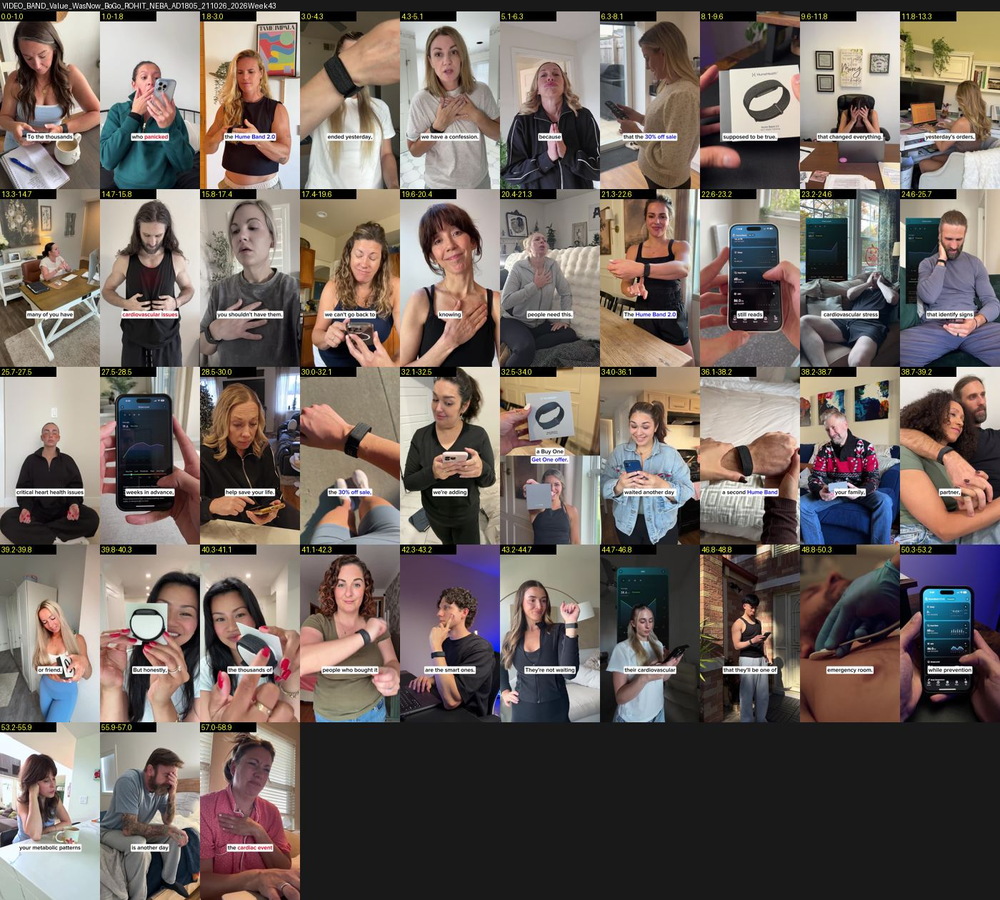

# VIDEO_BAND_Value_WasNow_BoGo_ROHIT_NEBA_AD1805_211026_2026Week43

Master: `VIDEO_BAND_Value_WasNow_BoGo_ROHIT_NEBA_AD1805_211026_2026Week43_9X16_HOOK1.mp4` · 58.9s · 1080x1920

**Pacing:** 43 shots · avg 1.37s · median 1.3s · 7.13 cuts/10s · first cut 0.967s · 262.0 wpm · talk ratio 0.93 · cuts on word start 92.9% · cuts in speech gaps 54.8%
**Audio:** {'I_lufs': -19.5, 'LRA': 2.1, 'true_peak_db': -3.8} · BPM≈107.7 · music {'speech_rms_db': -23.3, 'pause_seconds': 0.0} · cuts with SFX/transient 81.0%

**Captions:** 76 cards · 3.0 words/card (median) · y≈0.689 of frame height · text height≈0.0328 · colours {'white': 62, 'red': 3, 'blue': 8, 'dark/other': 2, 'other-colour': 1} · cards crossing a cut: 0
Highlighted: who panicked, the Hume Band 2.0, that the 30% off sale, LKSD, cardiovascularissues, The Hume Band 2.0, the 30% off sale,, Get One offer., a second Hume Band, Sleep, C Sleep, the cardiac event
**Headlines:** MIEIMIPALA (2.0–2.0s, white) | MIEIMPALA (2.5–2.5s, white) | RHumeHealtn (9.0–9.0s, white) | erc (10.0–10.0s, white) | love (11.0–11.0s, white) | 9:39 (28.0–28.0s, blue) | 19.6 (28.0–28.0s, white) | XHumeHealth (33.0–33.0s, white)

**Hook (0–3s) spoken:** to the thousands of people who panicked and bought the HumeBand 2 .0 before
**Hook on-screen:** MIEIMIPALA / MIEIMPALA / To the thousands / and bought / of people / the Hume Band 2.0 / who panicked
**CTA (last 5s):** wait to start tracking your metabolic patterns is another day closer to the cardiac event you don't see coming. · on-screen: is another day / the cardiac event / to start tracking / you don't see coming / yourmetabolic patterns

## Beat sheet

| # | in–out (s) | dur | transition | spoken | on-screen text |
|---|---|---|---|---|---|
| 1 | 0.00–0.97 | 0.97 |  | to the thousands of people who | To the thousands / of people |
| 2 | 0.97–1.83 | 0.87 | cut +SFX hit | panicked and bought the | of people / who panicked [red] / and bought |
| 3 | 1.83–3.00 | 1.17 | cut +SFX hit | HumeBand 2 .0 before | and bought / MIEIMIPALA (HEADLINE) / the Hume Band 2.0 [blue] / MIEIMPALA (HEADLINE) |
| 4 | 3.00–4.27 | 1.27 | cut +SFX hit | the sale ended yesterday. | before the sale / ended yesterday |
| 5 | 4.27–5.10 | 0.83 | cut +SFX hit | We have a confession. | ended yesterday / we have a confession. / We're sorry |
| 6 | 5.10–6.33 | 1.23 | cut +SFX hit | We're sorry because we told you | We're sorry / because / we told you |
| 7 | 6.33–8.13 | 1.8 | cut +SFX hit | that the 30 % off sale was ending, | we told you / that the 30% off sale [blue] / And that was |
| 8 | 8.13–9.60 | 1.47 | cut +SFX hit | and that was supposed to be true, | And that was / RHumeHealtn (HEADLINE) / HumeBard20 / 24i7HealToacieng / supposed to be true. |
| 9 | 9.60–11.80 | 2.2 | cut +SFX hit | but something happened that changed everything. | erc (HEADLINE) / walk / But something happened / LKSD [other-colour] / love (HEADLINE) / that changed everything. |
| 10 | 11.80–13.30 | 1.5 | cut +SFX hit | After processing yesterday's orders, | After processing / yesterday's orders, |
| 11 | 13.30–14.70 | 1.4 | cut +SFX hit | we found out that many of you have cardiovascular | yesterday's orders, / many of you have |
| 12 | 14.70–15.80 | 1.1 | cut +SFX hit | issues at | cardiovascularissues [red] |
| 13 | 15.80–17.37 | 1.57 | cut +SFX hit | an age that you shouldn't have them, | at an age that / you shouldn't have them. |
| 14 | 17.37–19.57 | 2.2 | cut +SFX hit | and we realized we can't go back to full price knowing | you shouldn't have them. / wecan'tgobackto / full price |
| 15 | 19.57–20.37 | 0.8 | cut +SFX hit | how many more | how many more |
| 16 | 20.37–21.30 | 0.93 | cut +SFX hit | people need this. | how many more / people need this. |
| 17 | 21.30–22.60 | 1.3 | cut +SFX hit | The HumeBand 2 .0 still | people need this. / The Hume Band 2.0 [blue] |
| 18 | 22.60–23.20 | 0.6 | cut | reads cardiovascular | cardiovascular stress |
| 19 | 23.20–24.57 | 1.37 | cut | stress patterns that | cardiovascular stress / patterns |
| 20 | 24.57–25.67 | 1.1 | cut +SFX hit | identify signs co | that identify signs |
| 21 | 25.67–27.53 | 1.87 | cut +SFX hit | -related to critical heart health issues weeks | co related to / criticalheart healthissues |
| 22 | 27.53–28.47 | 0.93 | cut | in advance, and | 9:39 [blue] (HEADLINE) / 19.6 (HEADLINE) / weeks in advance, / Ifyourstresslevelishigh,trydeepbreathing.short |
| 23 | 28.47–29.97 | 1.5 | cut +SFX hit | it still could help save your life. | 9:39 [blue] (HEADLINE) / 19.6 (HEADLINE) / weeks in advance, / Ifyourstresslevelishigh,trydeepbreathing.short / help save your life. |
| 24 | 29.97–32.13 | 2.17 | cut +SFX hit | So yes, on top of the 30 % off sale, | So yes, / the 30% off sale, [blue] / we're adding |
| 25 | 32.13–32.53 | 0.4 | cut +SFX hit | we're adding a | we're adding |
| 26 | 32.53–33.97 | 1.43 | cut | buy one, get one offer. | XHumeHealth (HEADLINE) / Hume Band2.0 / 24/7 Heath Tracing / a Buy One / Get One offer. [blue] |
| 27 | 33.97–36.10 | 2.13 | cut +SFX hit | And yes, that means you could have waited another day and | And yes, that means / waited another day / and gotten |
| 28 | 36.10–38.17 | 2.07 | cut | gotten a second hume band for a loved one, | and gotten / a second Hume Band [blue] / your family, |
| 29 | 38.17–38.73 | 0.57 | cut +SFX hit | your family, | your family, |
| 30 | 38.73–39.23 | 0.5 | cut | partner or | or friend. |
| 31 | 39.23–39.83 | 0.6 | cut +SFX hit | friend. | or friend. |
| 32 | 39.83–40.27 | 0.43 | cut +SFX hit | But honestly, | But honestly, |
| 33 | 40.27–41.13 | 0.87 | cut | the thousands of | But honestly, / people who bought it |
| 34 | 41.13–42.33 | 1.2 | cut +SFX hit | people who bought it yesterday are | people who bought it / yesterday |
| 35 | 42.33–43.23 | 0.9 | cut +SFX hit | the smart ones. | yesterday / They're not waiting |
| 36 | 43.23–44.73 | 1.5 | cut +SFX hit | They're not waiting until they feel symptoms to | They're not waiting / untiltheyfeelsymptoms |
| 37 | 44.73–46.80 | 2.07 | cut +SFX hit | start reading their cardiovascular health trends. | 38.6ms (HEADLINE) / to start reading / healthtrends |
| 38 | 46.80–48.77 | 1.97 | cut +SFX hit | They're not gambling that they'll be one of the lucky ones who | They're not gambling / the lucky ones |
| 39 | 48.77–50.27 | 1.5 | cut | don't end up in the emergency room. | who don't end up / emergencyroom |
| 40 | 50.27–53.17 | 2.9 | cut +SFX hit | They're taking control now while prevention is still possible. | emergencyroom / 9:36 [blue] (HEADLINE) / Sleep [blue] / 65bpm / 86.0ms / 19.6 |
| 41 | 53.17–55.87 | 2.7 | cut +SFX hit | Because every day you wait to start tracking your metabolic patterns is | Because every day / to start tracking / yourmetabolic patterns |
| 42 | 55.87–57.00 | 1.13 | cut +SFX hit | another day closer to | is another day |
| 43 | 57.00–58.91 | 1.91 | cut +SFX hit | the cardiac event you don't see coming. | the cardiac event [red] / you don't see coming |

## Hook variants

| hook | file | dur | first cut | spoken 0–3s | on-screen 0–3s |
|---|---|---|---|---|---|
| 1 | `sNow_BoGo_ROHIT_NEBA_AD1805_211026_2026Week43_9X16_HOOK1.mp4` | 58.9 | 0.967 | to the thousands of people who panicked and bought the HumeBand 2 .0 before | MIEIMIPALA / MIEIMPALA / To the thousands / and bought / of people / the Hume Band 2.0 / who panicked |
| 1 | `sNow_BoGo_ROHIT_NEBA_AD1805_211026_2026Week43_9X16_HOOK1.mp4` | 58.9 | 0.967 |  |  |
| 2 | `sNow_BoGo_ROHIT_NEBA_AD1805_211026_2026Week43_9X16_HOOK2.mp4` | 58.6 | 0.633 |  |  |
| 2 | `sNow_BoGo_ROHIT_NEBA_AD1805_211026_2026Week43_9X16_HOOK2.mp4` | 58.6 | 0.633 |  |  |
| 3 | `sNow_BoGo_ROHIT_NEBA_AD1805_211026_2026Week43_9X16_HOOK3.mp4` | 58.7 | 1.1 |  |  |
| 3 | `sNow_BoGo_ROHIT_NEBA_AD1805_211026_2026Week43_9X16_HOOK3.mp4` | 58.7 | 1.1 |  |  |

## Full transcript

to the thousands of people who panicked and bought the HumeBand 2.0 before the sale ended yesterday. We have a confession. We're sorry because we told you that the 30% off sale was ending, and that was supposed to be true, but something happened that changed everything. After processing yesterday's orders, we found out that many of you have cardiovascular issues at an age that you shouldn't have them, and we realized we can't go back to full price knowing how many more people need this. The HumeBand 2.0 still reads cardiovascular stress patterns that identify signs co-related to critical heart health issues weeks in advance, and it still could help save your life. So yes, on top of the 30% off sale, we're adding a buy one, get one offer. And yes, that means you could have waited another day and gotten a second hume band for a loved one, your family, partner or friend. But honestly, the thousands of people who bought it yesterday are the smart ones. They're not waiting until they feel symptoms to start reading their cardiovascular health trends. They're not gambling that they'll be one of the lucky ones who don't end up in the emergency room. They're taking control now while prevention is still possible. Because every day you wait to start tracking your metabolic patterns is another day closer to the cardiac event you don't see coming.