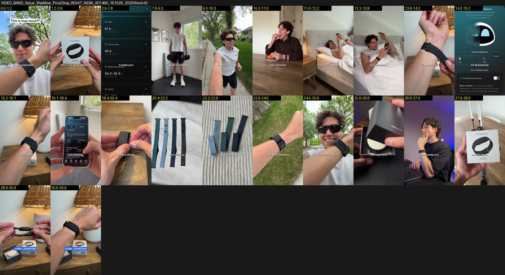

# VIDEO_BAND_Value_WasNow_PriceDrop_ROHIT_NEBA_AD1490_161026_2026Week42

Master: `VIDEO_BAND_Value_WasNow_PriceDrop_ROHIT_NEBA_AD1490_161026_2026Week42_Hook1_9x16.mp4` · 35.6s · 1080x1920

**Pacing:** 22 shots · avg 1.618s · median 1.2s · 5.9 cuts/10s · first cut 1.2s · 286.0 wpm · talk ratio 0.91 · cuts on word start 85.7% · cuts in speech gaps 76.2%
**Audio:** {'I_lufs': -16.2, 'LRA': 3.6, 'true_peak_db': 0.0} · BPM≈117.5 · music {'speech_rms_db': -23.4, 'pause_seconds': 0.3} · cuts with SFX/transient 42.9%

**Captions:** 79 cards · 1 words/card (median) · y≈0.646 of frame height · text height≈0.0269 · colours {'white': 73, 'dark/other': 2, 'green': 3, 'blue': 1} · cards crossing a cut: 0
Highlighted: Heart Rate Variability, StressLevels, Blood Pressure trends, CODE:LAUNCH30
**Headlines:** This is how much?? (0.0–0.5s, white) | HumeBand(85%) (3.0–7.0s, white) | 140 (3.0–3.0s, dark/other) | ~119/69 (3.0–4.0s, white) | mmHg (3.0–4.0s, white) | Last:03/Sep/26 (3.0–5.5s, dark/other) | HeartRate (3.0–4.0s, white) | Connected (4.5–5.5s, dark/other)

**Hook (0–3s) spoken:** These are way too expensive. This is the HumeBand 2 .0.
**Hook on-screen:** HHureHealm / Hume Band2.0 / HumeBand 2.0 / HurneHealth / Theseareway / This is how much?? / Thisis the Hume Band 2.0 / XHumeHealth / XHumeHealth" / tooexpensive
**CTA (last 5s):** other health trackers So I recommend getting one of these but only while the deal is still up you can use the code below · on-screen: CODE:LAUNCH30 / but only while / getting one / healthtrackers / isstill up / the code below

## Beat sheet

| # | in–out (s) | dur | transition | spoken | on-screen text |
|---|---|---|---|---|---|
| 1 | 0.00–1.20 | 1.2 |  | These are way too expensive. | This is how much?? (HEADLINE) / Theseareway / tooexpensive / XHumeHealth / Hume Band2.0 / Thisis the Hume Band 2.0 |
| 2 | 1.20–2.90 | 1.7 | cut | This is the HumeBand 2 .0. | XHumeHealth / Hume Band2.0 / Thisis the Hume Band 2.0 / HurneHealth / HHureHealm / XHumeHealth" |
| 3 | 2.90–7.83 | 4.93 | cut +SFX hit | Yes, it reads your heart rate variability. Yes, it reads your stress levels. Yes, it reads your blood pressure trends. | Thisis the Hume Band 2.0 / XHumeHealth" / HumeBand 2.0 / HumeBand(85%) (HEADLINE) / 140 (HEADLINE) / ~119/69 (HEADLINE) |
| 4 | 7.83–9.30 | 1.47 | cut | Yes, it's great for people who train hard | it'sgreatforpeople / who train hard |
| 5 | 9.30–10.33 | 1.03 | cut | and need to actually know | who train hard / toactuallyknow |
| 6 | 10.33–11.00 | 0.67 | cut +SFX hit | their recovery. | toactuallyknow |
| 7 | 11.00–12.17 | 1.17 | cut | Yes, it's great for people who just | Yes / who just want |
| 8 | 12.17–13.77 | 1.6 | cut | want to understand their body better. | who just want / their body better |
| 9 | 13.77–14.30 | 0.53 | cut | Yes, it's | it's Al-powered |
| 10 | 14.30–15.20 | 0.9 | cut +SFX hit | AI powered, so | it's Al-powered / so it actually |
| 11 | 15.20–16.07 | 0.87 | cut +SFX hit | it actually explains what | so it actually / those. |
| 12 | 16.07–18.37 | 2.3 | cut | those numbers mean instead of just showing you a graph. | those. / 9 steps / SleepRecommendation / We're jine-tuning ou / underjustsshowinge / recoradfournightsofsleep,we'llbeaureto |
| 13 | 18.37–20.43 | 2.07 | cut | Yes, it has a 14 day battery life. | Ative Ealefies / Bedime gual / Weve fine:tuningeufs / Bryouagraphiso / GfentEatullyour ReanheareBrevider / Befere making efy ehargeste yeuf diet: |
| 14 | 20.43–22.30 | 1.87 | cut +SFX hit | Yes, it comes with a new ultra -lux strap for | battery life / new UitraLux / strap for comfort |
| 15 | 22.30–22.87 | 0.57 | cut | comfort. | strap for comfort |
| 16 | 22.87–24.53 | 1.67 | cut +SFX hit | Yes, it has zero mandatory subscription | it has zero mandatory |
| 17 | 24.53–25.57 | 1.03 | cut | fees. | subscription fees |
| 18 | 25.57–26.77 | 1.2 | cut +SFX hit | But it's too expensive, | too expensive |
| 19 | 26.77–27.63 | 0.87 | cut +SFX hit | or normally it is, | Or normally it is |
| 20 | 27.63–28.90 | 1.27 | cut +SFX hit | but it's marked down right now There's | XHumeHealth / marked down / HumeBand2.0 |
| 21 | 28.90–35.57 | 6.67 | cut | no monthly charge on top of it like some of these other health trackers So I recommend getting one of these but only while the deal is still up you can use the code below | "iHuneHealth (HEADLINE) / HumeBnd2.0 / no monthly charge / likesomeof / healthtrackers / getting one |
| 22 | 35.57–35.60 | 0.04 | cut |  |  |

## Hook variants

| hook | file | dur | first cut | spoken 0–3s | on-screen 0–3s |
|---|---|---|---|---|---|
| 1 | `PriceDrop_ROHIT_NEBA_AD1490_161026_2026Week42_Hook1_9x16.mp4` | 35.6 | 1.2 | These are way too expensive. This is the HumeBand 2 .0. | HHureHealm / Hume Band2.0 / HumeBand 2.0 / HurneHealth / Theseareway / This is how much?? / Thisis the Hume Band 2.0 / XHumeHealth |
| 1 | `PriceDrop_ROHIT_NEBA_AD1490_161026_2026Week42_Hook1_9x16.mp4` | 35.6 | 1.2 | These are way too expensive. This is the HumeBand 2 .0. Yes, | 24/7 Hean Tracung / Hume Band 2.0 / HumeBand 2.0 / XHumeHealth / XHurneHealth |
| 2 | `PriceDrop_ROHIT_NEBA_AD1490_161026_2026Week42_Hook2_9x16.mp4` | 35.6 | 1.233 | These are way too pricey. This is the HumeBand 2 .0. |  |
| 2 | `PriceDrop_ROHIT_NEBA_AD1490_161026_2026Week42_Hook2_9x16.mp4` | 35.6 | 1.233 | These are way too pricey. This is the HumeBand 2 .0. | 24/7 Healm tracung / Hume Band 2.0 / HumeHealth / XHumeHealth" / XHurneHealth |
| 3 | `PriceDrop_ROHIT_NEBA_AD1490_161026_2026Week42_Hook3_9x16.mp4` | 35.9 | 1.5 | These cost way too much money. This is the HumeBand 2 .0. |  |
| 3 | `PriceDrop_ROHIT_NEBA_AD1490_161026_2026Week42_Hook3_9x16.mp4` | 35.9 | 1.5 | These cost way too much money. This is the HumeBand 2 .0. |  |

## Full transcript

These are way too expensive. This is the HumeBand 2.0. Yes, it reads your heart rate variability. Yes, it reads your stress levels. Yes, it reads your blood pressure trends. Yes, it's great for people who train hard and need to actually know their recovery. Yes, it's great for people who just want to understand their body better. Yes, it's AI powered, so it actually explains what those numbers mean instead of just showing you a graph. Yes, it has a 14 day battery life. Yes, it comes with a new ultra-lux strap for comfort. Yes, it has zero mandatory subscription fees. But it's too expensive, or normally it is, but it's marked down right now There's no monthly charge on top of it like some of these other health trackers So I recommend getting one of these but only while the deal is still up you can use the code below