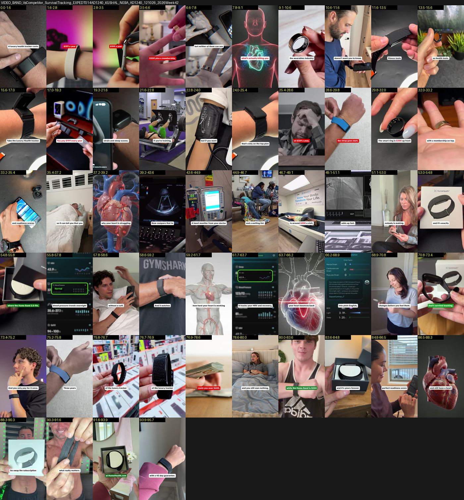

# VIDEO_BAND_VsCompetitor_SurvivalTracking_EXPEDT014AD1240_KUSHAL_NEBA_AD1240_121026_2026Week42

Master: `VIDEO_BAND_VsCompetitor_SurvivalTracking_EXPEDT014AD1240_KUSHAL_NEBA_AD1240_121026_2026Week42_9x16_hook1.mp4` · 95.7s · 1080x1920

**Pacing:** 54 shots · avg 1.771s · median 1.75s · 5.54 cuts/10s · first cut 1.64s · 218.0 wpm · talk ratio 0.96 · cuts on word start 90.6% · cuts in speech gaps 64.2%
**Audio:** {'I_lufs': -13.5, 'LRA': 2.0, 'true_peak_db': 0.4} · BPM≈112.3 · music {'speech_rms_db': -17.0, 'pause_seconds': 0.7, 'pause_rms_db': -14.8, 'bed_minus_voice_db': 2.2, 'music_bed_likely': True} · cuts with SFX/transient 50.9%

**Captions:** 120 cards · 2.0 words/card (median) · y≈0.629 of frame height · text height≈0.0269 · colours {'white': 98, 'red': 11, 'dark/other': 6, 'yellow': 1, 'green': 4} · cards crossing a cut: 1
Highlighted: $199 a year, $300plusamembership,, what's actually killing you., Youpay$199everyyear, at $359 ayear,, the strap goes dark., Thesmartringis$3ooupfront, The smart ring is $30o up front, OCCLUDED, is around $200 a visit,, Normal, that's survival tracking, costs you over $6o0,, costsyou over $600,, while the Hume Band is$224
**Headlines:** TYPE:ACMNP-1 (23.0–23.0s, white) | Cardiom. (41.0–41.0s, dark/other) | 2021May30 (41.0–41.0s, dark/other) | CLE (44.0–44.0s, dark/other) | INUSE (44.0–44.0s, yellow) | Alaris'PC (44.0–44.0s, white) | CareFusion (44.0–44.0s, white) | SOILED (44.0–44.0s, red)

**Hook (0–3s) spoken:** A luxury health tracker costs $199 a
**Hook on-screen:** $199 a year / Aluxuryhealthtrackercosts
**CTA (last 5s):** matters. Get the Hume Band at HumeHealth .com with a 45 day guarantee. · on-screen: Get the Hume Band / Llve Longer.Better. / at HumeHealth.com / what reallymatters. / with a 45 day guarantee.

## Beat sheet

| # | in–out (s) | dur | transition | spoken | on-screen text |
|---|---|---|---|---|---|
| 1 | 0.00–1.64 | 1.64 |  | A luxury health tracker costs | Aluxuryhealthtrackercosts / $199 a year [red] |
| 2 | 1.64–2.84 | 1.2 | cut +SFX hit | $199 a | $199 a year [red] |
| 3 | 2.84–3.48 | 0.64 | cut +SFX hit | year, | $199 a year [red] |
| 4 | 3.48–6.60 | 3.12 | cut | and a smart ring costs $300 plus a membership. | $199 a year [red] / and a smart ring costs / $300plusamembership, [red] |
| 5 | 6.60–7.80 | 1.2 | cut +SFX hit | But neither of them can see | butneither ofthemcansee |
| 6 | 7.80–9.08 | 1.28 | cut | what's actually killing you. | what's actually killing you. [red] / Here's what |
| 7 | 9.08–10.56 | 1.48 | cut | Here's what the wearables industry doesn't | Here's what / the wearablesindustry |
| 8 | 10.56–11.60 | 1.04 | cut +SFX hit | want you to know. Most | doesn'twantyoutoknow. |
| 9 | 11.60–13.48 | 1.88 | cut +SFX hit | of these devices are fitness tools that | Mostofthesedevicesare / fitnesstools |
| 10 | 13.48–15.60 | 2.12 | cut +SFX hit | are being sold to you as health tools. | fitnesstools / that are being sold to you / ashealthtools. |
| 11 | 15.60–16.96 | 1.36 | cut +SFX hit | Take the luxury health tracker. | TaketheLuxuryHealthtracker. |
| 12 | 16.96–19.32 | 2.36 | cut +SFX hit | You pay $199 every year for | Youpay$199everyyear [red] |
| 13 | 19.32–21.60 | 2.28 | cut +SFX hit | recovery, strain, and sleep scores, | Youpay$199everyyear [red] / strainandsleep scores. / neansit'sreadyto / Pmeansit'sreadyto |
| 14 | 21.60–22.84 | 1.24 | cut | which are great if you're training. | if you're training, |
| 15 | 22.84–24.00 | 1.16 | cut | But if you want blood pressure, | TYPE:ACMNP-1 (HEADLINE) / but if you want |
| 16 | 24.00–25.36 | 1.36 | cut | that's only on the top plan | that's only on the topplan |
| 17 | 25.36–28.56 | 3.2 | cut | at $359 a year. And the day you stop paying, | that's only on the topplan / at $359 ayear, [red] / and the day you stop paying, |
| 18 | 28.56–29.76 | 1.2 | cut | the strap goes dark. The | the strap goes dark. [red] |
| 19 | 29.76–31.96 | 2.2 | cut +SFX hit | smart ring is $300 up front with | Thesmartringis$3ooupfront [red] / The smart ring is $30o up front [red] |
| 20 | 31.96–33.16 | 1.2 | cut +SFX hit | a membership on top. | with a membership on top. / Itgivesyousleep stages |
| 21 | 33.16–35.44 | 2.28 | cut +SFX hit | It gives you sleep stages and readiness scores, | Itgivesyousleep stages / and readinessscores |
| 22 | 35.44–37.16 | 1.72 | cut +SFX hit | so it can tell you that you slept badly, | and readinessscores / so it can tell you that you / but it can't tell you |
| 23 | 37.16–39.16 | 2.0 | cut +SFX hit | but it can't tell you why your heart is struggling | but it can't tell you / why your heart is struggling / to recover night after night. |
| 24 | 39.16–43.56 | 4.4 | cut | to recover night after night. Now compare that to what a real heart check costs. | to recover night after night. / Cardiom. (HEADLINE) / 2021May30 (HEADLINE) / Now comparethatto / Whatarealheartcheckcosts. / Med |
| 25 | 43.56–44.88 | 1.32 | cut | A heart monitor from your doctor means | CLE (HEADLINE) / INUSE [yellow] (HEADLINE) / Alaris'PC (HEADLINE) / CareFusion (HEADLINE) / OCCLUDED [yellow] / SOILED [red] (HEADLINE) |
| 26 | 44.88–46.72 | 1.84 | cut | a referral and a waiting list. | meansa referral / and a waiting list. |
| 27 | 46.72–49.12 | 2.4 | cut | A body scan is around $200 a visit and | XDEXAFIT (HEADLINE) / Know Your Body. (HEADLINE) / Transform Your Life. [blue] (HEADLINE) / dexafitnj.com / 201 -351-1591 / Abodyscan |
| 28 | 49.12–51.08 | 1.96 | cut +SFX hit | regular blood work adds up fast. | 88. / and regular blood work / adds up fast. / That's the comparison |
| 29 | 51.08–53.04 | 1.96 | cut | That's the comparison nobody is making and | That's the comparison / nobodyis making. / XHumeHealth (HEADLINE) / and it's exactly |
| 30 | 53.04–54.84 | 1.8 | cut | it's exactly where the HumeBand 2 | XHumeHealth (HEADLINE) / and it's exactly / HumeBand2.0 / where the HumeBand2.0fits. |
| 31 | 54.84–55.84 | 1.0 | cut +SFX hit | .0 fits. It | wheretheHumeBand2.0fits |
| 32 | 55.84–57.84 | 2.0 | cut +SFX hit | tracks your blood pressure trends overnight without | Heart Rate (HEADLINE) / 79bpm (HEADLINE) / Last:29/Jun/26 (HEADLINE) / HRV (HEADLINE) / 43.9 / ms |
| 33 | 57.84–58.56 | 0.72 | cut | a cuff, | without a cuff. |
| 34 | 58.56–59.24 | 0.68 | cut | and it watches how | how hard your heart is working |
| 35 | 59.24–61.72 | 2.48 | cut | hard your heart is working when it should be resting. | how hard your heart is working / when it should be resting. |
| 36 | 61.72–63.68 | 1.96 | cut +SFX hit | It tracks your HRV and recovery, | HumeBand(77%) (HEADLINE) / Connected [green] (HEADLINE) / 110 (HEADLINE) / 14851 (HEADLINE) / Last:20/Aug/26 (HEADLINE) / Sleep (HEADLINE) |
| 37 | 63.68–66.16 | 2.48 | cut +SFX hit | which shows how well your heart bounces back from stress, | howwell / yourheartbouncesback / Yesterday'sResolution [blue] (HEADLINE) / StrainTypes (HEADLINE) / MentalStrain (HEADLINE) / Cardiovascular (HEADLINE) |
| 38 | 66.16–68.92 | 2.76 | cut +SFX hit | and its AI turns all of that into plain English, | Yesterday'sResolution [blue] (HEADLINE) / StrainTypes (HEADLINE) / MentalStrain (HEADLINE) / Cardiovascular (HEADLINE) / Strain (HEADLINE) / MuscularStrain (HEADLINE) |
| 39 | 68.92–70.76 | 1.84 | cut +SFX hit | so you see changes before you feel them. | so you see / changes before youfeelthem. |
| 40 | 70.76–73.44 | 2.68 | cut | That's not fitness tracking, that's survival tracking, | That's not fitness tracking, / that's survival tracking [green] / XHumefeal (HEADLINE) / XHumei-lealth (HEADLINE) |
| 41 | 73.44–75.16 | 1.72 | cut | and you only pay for it once. | that's survival tracking [green] / XHumefeal (HEADLINE) / XHumei-lealth (HEADLINE) / And you only pay for it once. / Three years |
| 42 | 75.16–75.84 | 0.68 | cut +SFX hit | Three years | Three years |
| 43 | 75.84–76.68 | 0.84 | cut +SFX hit | of the luxury tracker | oftheluxurytracker |
| 44 | 76.68–76.88 | 0.2 | cut | costs |  |
| 45 | 76.88–78.64 | 1.76 | cut | you over $600, | costs you over $6o0, [red] / costsyou over $600, [red] |
| 46 | 78.64–79.96 | 1.32 | cut +SFX hit | and you still own nothing. | and you still own nothing, |
| 47 | 79.96–83.56 | 3.6 | cut +SFX hit | While the Hume Band is $224, with code Launch30, | while the Hume Band is$224 [green] / pbil (HEADLINE) / XHuneneath (HEADLINE) / withcodeLAUNCH30 |
| 48 | 83.56–84.84 | 1.28 | cut | and it's yours forever. You | and it's yours forever. |
| 49 | 84.84–86.48 | 1.64 | cut | can have a perfect readiness score | You canhavea / perfect readiness score |
| 50 | 86.48–88.32 | 1.84 | cut | and still have a heart that's struggling. | perfect readiness score / and still have a heart / that's struggling |
| 51 | 88.32–90.32 | 2.0 | cut +SFX hit | So swap the subscription for something that watches | that's struggling / XHumeHealth (HEADLINE) / Soswapthesubscription / for somethingthat watches |
| 52 | 90.32–91.60 | 1.28 | cut | what really matters. | for somethingthat watches / what reallymatters. |
| 53 | 91.60–93.92 | 2.32 | cut | Get the Hume Band at HumeHealth .com with | Llve Longer.Better. / Get the Hume Band [green] / at HumeHealth.com |
| 54 | 93.92–95.66 | 1.74 | cut +SFX hit | a 45 day guarantee. | with a 45 day guarantee. |

## Hook variants

| hook | file | dur | first cut | spoken 0–3s | on-screen 0–3s |
|---|---|---|---|---|---|
| 1 | `14AD1240_KUSHAL_NEBA_AD1240_121026_2026Week42_9x16_hook1.mp4` | 95.7 | 1.64 | A luxury health tracker costs $199 a | $199 a year / Aluxuryhealthtrackercosts |
| 2 | `14AD1240_KUSHAL_NEBA_AD1240_121026_2026Week42_9x16_hook2.mp4` | 92.0 | 2.92 |  |  |
| 3 | `14AD1240_KUSHAL_NEBA_AD1240_121026_2026Week42_9x16_hook3.mp4` | 90.6 | 1.32 |  |  |

## Full transcript

A luxury health tracker costs $199 a year, and a smart ring costs $300 plus a membership. But neither of them can see what's actually killing you. Here's what the wearables industry doesn't want you to know. Most of these devices are fitness tools that are being sold to you as health tools. Take the luxury health tracker. You pay $199 every year for recovery, strain, and sleep scores, which are great if you're training. But if you want blood pressure, that's only on the top plan at $359 a year. And the day you stop paying, the strap goes dark. The smart ring is $300 up front with a membership on top. It gives you sleep stages and readiness scores, so it can tell you that you slept badly, but it can't tell you why your heart is struggling to recover night after night. Now compare that to what a real heart check costs. A heart monitor from your doctor means a referral and a waiting list. A body scan is around $200 a visit and regular blood work adds up fast. That's the comparison nobody is making and it's exactly where the HumeBand 2.0 fits. It tracks your blood pressure trends overnight without a cuff, and it watches how hard your heart is working when it should be resting. It tracks your HRV and recovery, which shows how well your heart bounces back from stress, and its AI turns all of that into plain English, so you see changes before you feel them. That's not fitness tracking, that's survival tracking, and you only pay for it once. Three years of the luxury tracker costs you over $600, and you still own nothing. While the Hume Band is $224, with code Launch30, and it's yours forever. You can have a perfect readiness score and still have a heart that's struggling. So swap the subscription for something that watches what really matters. Get the Hume Band at HumeHealth.com with a 45 day guarantee.