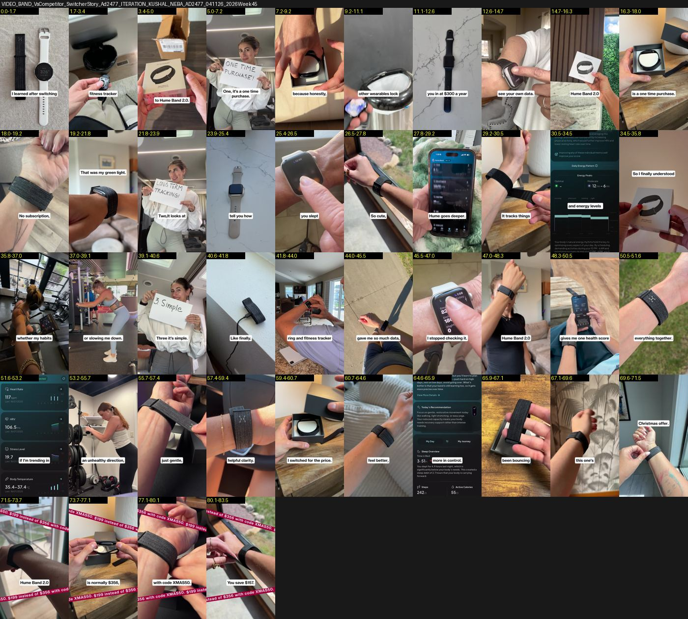

# VIDEO_BAND_VsCompetitor_SwitcherStory_Ad2477_ITERATION_KUSHAL_NEBA_AD2477_041126_2026Week45

Master: `VIDEO_BAND_VsCompetitor_SwitcherStory_Ad2477_ITERATION_KUSHAL_NEBA_AD2477_041126_2026Week45_Hook1_9x16.mp4` · 83.5s · 1080x1920

**Pacing:** 44 shots · avg 1.898s · median 1.68s · 5.15 cuts/10s · first cut 1.68s · 176.0 wpm · talk ratio 0.89 · cuts on word start 60.5% · cuts in speech gaps 65.1%
**Audio:** {'I_lufs': -19.0, 'LRA': 2.2, 'true_peak_db': -4.3} · BPM≈103.4 · music {'speech_rms_db': -23.8, 'pause_seconds': 3.6, 'pause_rms_db': -23.0, 'bed_minus_voice_db': 0.8, 'music_bed_likely': True} · cuts with SFX/transient 34.9%

**Captions:** 145 cards · 2 words/card (median) · y≈0.685 of frame height · text height≈0.0328 · colours {'dark/other': 41, 'white': 103, 'red': 1} · cards crossing a cut: 3
Highlighted: 30SEC
**Headlines:** ONE TIME (5.0–6.0s, white) | PURCHASE! (5.0–6.0s, white) | no guilt. (19.0–19.0s, white) | LONG TERM (22.0–23.0s, white) | TRACKING! (22.0–23.0s, white) | 12:50 (26.0–26.0s, other-colour) | 0:29 (26.0–26.0s, red) | 1:39 (28.0–28.0s, blue)

**Hook (0–3s) spoken:** Three things I learned after switching from my old fitness tracker
**Hook on-screen:** 11:08 / 3265 / 3269 / 326° / 41:08 / I learned after switching / Three things / fitnesstracker / from my old
**CTA (last 5s):** code Xmas 50 you save $157 · on-screen: $356 with code XMAS50. $199 ins / $356with codeXMAS50.$199 inst / 199insteadof$356withcodeXMAs / 99insteadof $356withcodeXMA / You save $157. / d of $356 with code XMAS50. $199 i / ead of $356 with code XMAS50. $ / instead of $356 with code XMAS50 / nsteadof $356withcodeXMAs50 / of $356 with code XMAS50. $199 / tead of $356 with code XMAS50. $1 / withcodeXMAS50.

## Beat sheet

| # | in–out (s) | dur | transition | spoken | on-screen text |
|---|---|---|---|---|---|
| 1 | 0.00–1.68 | 1.68 |  | Three things I learned after switching | 326° / Three things / 3269 / I learned after switching / 3265 / 41:08 |
| 2 | 1.68–3.44 | 1.76 | cut +SFX hit | from my old fitness tracker to | 41:08 / from my old / 11:08 / fitnesstracker |
| 3 | 3.44–5.04 | 1.6 | cut | Humeban 2 .0. | fitnesstracker / HumeBand2.0 / 24/7 HealthTracking / to Hume Band 2.0. / >Humoi-toalth / Hume Uand 2.0 |
| 4 | 5.04–7.18 | 2.14 | cut | One, it's a one -time purchase. | ONE TIME (HEADLINE) / PURCHASE! (HEADLINE) / One, it's a one time / purchase. / Let's start there, |
| 5 | 7.18–9.18 | 2.0 | cut | Let's start there, because honestly, | Let's start there, / because honestly, / CLOUDY8 / otherwearableslock |
| 6 | 9.18–11.06 | 1.88 | cut +SFX hit | other wearables lock you in at | CLOUDY8 / otherwearableslock / you in at $300 a year |
| 7 | 11.06–12.62 | 1.56 | cut +SFX hit | $300 a year just | you in at $300 a year |
| 8 | 12.62–14.68 | 2.06 | cut | so you can see your own data. | rsbo / just so you can / see your own data. |
| 9 | 14.68–16.28 | 1.6 | cut | Humeban 2 .0 is | HumeHeat / Hume Band 2.0 |
| 10 | 16.28–17.96 | 1.68 | cut | a one -time purchase. | Hume Band 2.0 / is a one time purchase. |
| 11 | 17.96–19.18 | 1.22 | cut | No subscription, | No subscription, / no guilt. (HEADLINE) |
| 12 | 19.18–21.76 | 2.58 | cut | no guilt. That was my green light. | no guilt. (HEADLINE) / That was my green light. / KHumeHealihi |
| 13 | 21.76–23.92 | 2.16 | cut | Two, it looks at the long game. | LONG TERM (HEADLINE) / TRACKING! (HEADLINE) / Two,It looks at / the long game. |
| 14 | 23.92–25.42 | 1.5 | cut +SFX hit | Other wearables tell you how | Other wearables / tell you how |
| 15 | 25.42–26.52 | 1.1 | cut | you slept last night. | tell you how / 12:50 [other-colour] (HEADLINE) / 0:29 [red] (HEADLINE) / 30SEC [red] / last night. |
| 16 | 26.52–27.76 | 1.24 | cut | So cute. | So cute, |
| 17 | 27.76–29.20 | 1.44 | cut +SFX hit | Hume goes deeper. It | 1:39 [blue] (HEADLINE) / 188 / Hume goes deeper. / It tracks things |
| 18 | 29.20–30.52 | 1.32 | cut +SFX hit | tracks things like your | It tracks things / like your |
| 19 | 30.52–34.48 | 3.96 | cut | metabolism, recovery, and energy levels over time. | Capacity (HEADLINE) / Body Comp (HEADLINE) / MetabolicCapacity (HEADLINE) / 100 (HEADLINE) / Baseline (HEADLINE) / 16 i (HEADLINE) |
| 20 | 34.48–35.76 | 1.28 | cut +SFX hit | So I finally understood whether | strong cardiovascularfoundationby increasing (HEADLINE) / physicalactivity.whichwouldfurtherimproveHRVand (HEADLINE) / lowerrestingheartrateovertime. (HEADLINE) / Improvinganyoftheseindividualmetricswill (HEADLINE) / DailyEnergyPatternO (HEADLINE) / EnergyPeaks |
| 21 | 35.76–37.00 | 1.24 | cut +SFX hit | my habits were building | whether my habits |
| 22 | 37.00–39.14 | 2.14 | cut | me up or slowing me down. | were building me up / or slowing me down. / Simple (HEADLINE) / Three it's simple. |
| 23 | 39.14–40.60 | 1.46 | cut | 3. It's simple. | Simple (HEADLINE) / Three it's simple. |
| 24 | 40.60–41.76 | 1.16 | cut | Like, finally. | Like finally. |
| 25 | 41.76–44.00 | 2.24 | cut | My old smart ring and fitness tracker gave | My old smart / ring and fitness tracker |
| 26 | 44.00–45.48 | 1.48 | cut | me so much data, | gave me so much data, |
| 27 | 45.48–46.96 | 1.48 | cut | I stopped checking it. | gave me so much data, / 1:08 (HEADLINE) / Today / Ster / Dist / Flight |
| 28 | 46.96–48.34 | 1.38 | cut +SFX hit | HumeBand 2 .0 gives | Hume Band 2.0 |
| 29 | 48.34–50.52 | 2.18 | cut | me one health score that pulls everything | Hume Band 2.0 / gives me one health score / that pulls |
| 30 | 50.52–51.58 | 1.06 | cut +SFX hit | together. | everything together. |
| 31 | 51.58–53.18 | 1.6 | cut | It tells me if I'm trending in | HumeBand(7%) (HEADLINE) / Connected [green] (HEADLINE) / Heart Rate (HEADLINE) / 117 bpm (HEADLINE) / Last:18/07/2025 (HEADLINE) / HRV |
| 32 | 53.18–55.70 | 2.52 | cut +SFX hit | an unhealthy direction and what to change. | NDBO / an unhealthy direction, / and what to change. |
| 33 | 55.70–57.44 | 1.74 | cut | No pressure, just gentle, | No pressure, / just gentle, |
| 34 | 57.44–59.38 | 1.94 | cut | helpful clarity. So yeah, | just gentle, / helpful clarity. / So yeah, |
| 35 | 59.38–60.66 | 1.28 | cut +SFX hit | I switched for the price, | So yeah, / switched for the price. |
| 36 | 60.66–64.58 | 3.92 | cut +SFX hit | but I stayed because it helped me feel better smarter simpler more | But I stayed / because it helped me / smarter, simpler, |
| 37 | 64.58–65.92 | 1.34 | cut | in control So | activitiesaroundyourcapacity-pushhardonhigh (HEADLINE) / days,restonlowdays,avoidgoingover.What's (HEADLINE) / betteristhatyourbandisstilllearningtoo,soitgets (HEADLINE) / morepreciseovertime. (HEADLINE) / ViewMoreDetails→ (HEADLINE) / Today'sRecommendation (HEADLINE) |
| 38 | 65.92–67.12 | 1.2 | cut | if you've been bouncing between | So if you've / between trackers, |
| 39 | 67.12–69.58 | 2.46 | cut | trackers, this one's worth a shot, | between trackers, / this one's / worth a shot. |
| 40 | 69.58–71.48 | 1.9 | cut +SFX hit | especially with the Christmas offer Hume | Especially with the / Christmas offer. |
| 41 | 71.48–73.72 | 2.24 | cut | Band 2 .0 is normally | Christmas offer. / 50.$199insteadof $356withcode) [red] (HEADLINE) / Hume Band 2.0 / 0.$199 instead of $356 with code [red] (HEADLINE) / AS50.$199insteadof$356withco0 [red] (HEADLINE) / is normally $356, |
| 42 | 73.72–77.06 | 3.34 | cut | 356 dollars and right now it's | is normally $356, / XMAS50.$199 instead of $356 with [red] (HEADLINE) / KMAS50.$199insteadof$356witl [red] (HEADLINE) / deXMAS50.$199insteadof$356v [red] (HEADLINE) / deXMAS50.$199insteadof $356 [red] (HEADLINE) / hcodeXMAS50.$199insteadof$35 [red] (HEADLINE) |
| 43 | 77.06–80.08 | 3.02 | cut +SFX hit | $199 with code Xmas 50 | and right now it's $199 / with code XMAS50.$199 instead of [red] (HEADLINE) / vithcodeXMAS50.$199insteadof [red] (HEADLINE) / 56 with code XMAS50.$199 instead [red] (HEADLINE) / 56with codeXMAS50.$199instea [red] (HEADLINE) / $356with codeXMAS50.$199 inst [red] (HEADLINE) |
| 44 | 80.08–83.52 | 3.44 | cut | you save $157 | withcodeXMAS50. / d of $356 with code XMAS50. $199 i [red] (HEADLINE) / of $356 with code XMAS50. $199 [red] (HEADLINE) / tead of $356 with code XMAS50. $1 [red] (HEADLINE) / You save $157. / ead of $356 with code XMAS50. $ [red] (HEADLINE) |

## Hook variants

| hook | file | dur | first cut | spoken 0–3s | on-screen 0–3s |
|---|---|---|---|---|---|
| 1 | `TERATION_KUSHAL_NEBA_AD2477_041126_2026Week45_Hook1_9x16.mp4` | 83.5 | 1.68 | Three things I learned after switching from my old fitness tracker | 11:08 / 3265 / 3269 / 326° / 41:08 / I learned after switching / Three things / fitnesstracker |
| 2 | `TERATION_KUSHAL_NEBA_AD2477_041126_2026Week45_Hook2_9x16.mp4` | 84.1 | 1.94 |  |  |
| 3 | `TERATION_KUSHAL_NEBA_AD2477_041126_2026Week45_Hook3_9x16.mp4` | 85.8 | 1.92 |  |  |

## Full transcript

Three things I learned after switching from my old fitness tracker to Humeban 2.0. One, it's a one-time purchase. Let's start there, because honestly, other wearables lock you in at $300 a year just so you can see your own data. Humeban 2.0 is a one-time purchase. No subscription, no guilt. That was my green light. Two, it looks at the long game. Other wearables tell you how you slept last night. So cute. Hume goes deeper. It tracks things like your metabolism, recovery, and energy levels over time. So I finally understood whether my habits were building me up or slowing me down. 3. It's simple. Like, finally. My old smart ring and fitness tracker gave me so much data, I stopped checking it. HumeBand 2.0 gives me one health score that pulls everything together. It tells me if I'm trending in an unhealthy direction and what to change. No pressure, just gentle, helpful clarity. So yeah, I switched for the price, but I stayed because it helped me feel better smarter simpler more in control So if you've been bouncing between trackers, this one's worth a shot, especially with the Christmas offer Hume Band 2.0 is normally 356 dollars and right now it's $199 with code Xmas 50 you save $157