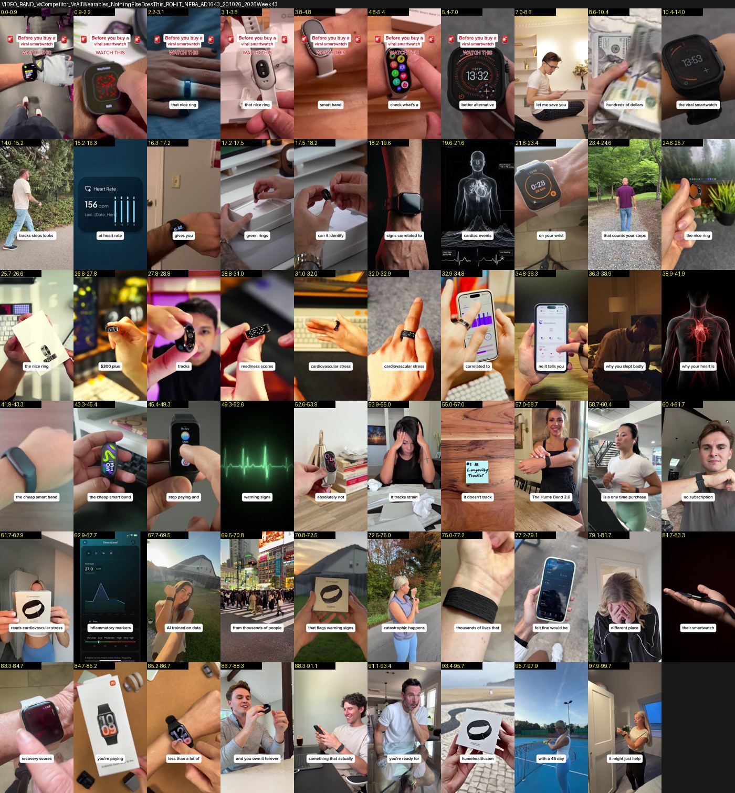

# VIDEO_BAND_VsCompetitor_VsAllWearables_NothingElseDoesThis_ROHIT_NEBA_AD1643_201026_2026Week43

Master: `VIDEO_BAND_VsCompetitor_VsAllWearables_NothingElseDoesThis_ROHIT_NEBA_AD1643_201026_2026Week43_Hook1_9x16.mp4` · 99.7s · 1080x1920

**Pacing:** 59 shots · avg 1.69s · median 1.567s · 5.82 cuts/10s · first cut 0.9s · 154.0 wpm · talk ratio 0.99 · cuts on word start 36.2% · cuts in speech gaps 36.2%
**Audio:** {'I_lufs': -19.7, 'LRA': 4.6, 'true_peak_db': -0.0} · BPM≈129.2 · music {'speech_rms_db': -23.5, 'pause_seconds': 5.1, 'pause_rms_db': -23.8, 'bed_minus_voice_db': -0.3, 'music_bed_likely': True} · cuts with SFX/transient 46.6%

**Captions:** 145 cards · 1 words/card (median) · y≈0.721 of frame height · text height≈0.0304 · colours {'white': 116, 'green': 2, 'dark/other': 21, 'yellow': 1, 'red': 4, 'other-colour': 1} · cards crossing a cut: 12
Highlighted: 34, 10/10, Caiories, 30SEC, L1:08, Move., 460, CAL
**Headlines:** Before you buy a (0.0–6.0s, red) | viral smartwatch (0.0–6.0s, red) | WATCH THIS (0.0–6.0s, red) | xiaomSnartBudn (5.0–5.0s, white) | 13:32 (5.5–6.0s, white) | 13:53 (12.0–13.0s, dark/other) | 156 (15.0–16.0s, white) | 119/79mmHg (20.0–21.0s, white)

**Hook (0–3s) spoken:** Before you buy a viral smartwatch that nice ring or
**Hook on-screen:** Before you buy a / WATCH THIS / that nice ring / viral smartwatch
**CTA (last 5s):** .com with a 45 -day guarantee. It might just help save your life. · on-screen: 24/7 Health Tracking / Hume Band2.0 / XHumeHealth / guarantee / humehealth.com / it might just help / save your life / with a 45 day

## Beat sheet

| # | in–out (s) | dur | transition | spoken | on-screen text |
|---|---|---|---|---|---|
| 1 | 0.00–0.90 | 0.9 |  | Before you buy a | Before you buy a [red] (HEADLINE) / viral smartwatch [red] (HEADLINE) / WATCH THIS [red] (HEADLINE) |
| 2 | 0.90–2.17 | 1.27 | cut | viral smartwatch that | Before you buy a [red] (HEADLINE) / viral smartwatch [red] (HEADLINE) / WATCH THIS [red] (HEADLINE) / that nice ring |
| 3 | 2.17–3.10 | 0.93 | cut +SFX hit | nice ring or | Before you buy a [red] (HEADLINE) / viral smartwatch [red] (HEADLINE) / WATCH THIS [red] (HEADLINE) / that nice ring |
| 4 | 3.10–3.83 | 0.73 | cut | that cheap smart | Before you buy a [red] (HEADLINE) / viral smartwatch [red] (HEADLINE) / WATCH THIS [red] (HEADLINE) / that nice ring / or that cheap |
| 5 | 3.83–4.80 | 0.97 | cut +SFX hit | band check | Before you buy a [red] (HEADLINE) / viral smartwatch [red] (HEADLINE) / WATCH THIS [red] (HEADLINE) / or that cheap / smart band / 34 [green] |
| 6 | 4.80–5.37 | 0.57 | cut +SFX hit | what's a | Before you buy a [red] (HEADLINE) / viral smartwatch [red] (HEADLINE) / WATCH THIS [red] (HEADLINE) / smart band / 34 [green] / 35 |
| 7 | 5.37–6.97 | 1.6 | cut +SFX hit | better alternative right now Let | Before you buy a [red] (HEADLINE) / viral smartwatch [red] (HEADLINE) / WATCH THIS [red] (HEADLINE) / xiaomSnartBudn (HEADLINE) / check what's a / W273° |
| 8 | 6.97–8.60 | 1.63 | cut +SFX hit | me save you months of research | let me save you / months of research and |
| 9 | 8.60–10.40 | 1.8 | cut +SFX hit | and hundreds of dollars the | months of research and / hundreds of dollars |
| 10 | 10.40–14.00 | 3.6 | cut | viral smartwatch $400 plus track | hundreds of dollars / 5% / theviralsmartwatch / 13:53 (HEADLINE) / W259 / R15KM |
| 11 | 14.00–15.20 | 1.2 | cut | steps looks | tracks steps looks / HeartRate / 156 (HEADLINE) / bpm / Last:[Date_Here |
| 12 | 15.20–16.33 | 1.13 | cut +SFX hit | at heart rate gives | tracks steps looks / HeartRate / 156 (HEADLINE) / bpm / Last:[Date_Here / 1678 |
| 13 | 16.33–17.20 | 0.87 | cut | you green rings | HeartRate / 156 (HEADLINE) / bpm / Last:[Date_Here / 1678 / at heart rate |
| 14 | 17.20–17.50 | 0.3 | cut +SFX hit |  | green rings |
| 15 | 17.50–18.17 | 0.67 | cut +SFX hit | Can it identify | can it identify |
| 16 | 18.17–19.57 | 1.4 | cut | signs co -related | can it identify / signs correlated to |
| 17 | 19.57–21.57 | 2.0 | cut +SFX hit | to cardiac events? No, it's | 119/79mmHg (HEADLINE) / cardiac events / LiveReading / 68BPM / no it's a phone |
| 18 | 21.57–23.43 | 1.87 | cut | a phone on your wrist that | 12:50 [other-colour] (HEADLINE) / 0:29 (HEADLINE) / 30SEC [red] / on your wrist / 0:28 (HEADLINE) / that counts your steps |
| 19 | 23.43–24.63 | 1.2 | cut +SFX hit | counts your steps the | 12:50 [other-colour] (HEADLINE) / 30SEC [red] / 0:28 (HEADLINE) / that counts your steps |
| 20 | 24.63–25.73 | 1.1 | cut | nice ring | the nice ring |
| 21 | 25.73–26.57 | 0.83 | cut | 300 dollars | the nice ring / SmartKnd (HEADLINE) |
| 22 | 26.57–27.80 | 1.23 | cut | plus tracks | $300 plus |
| 23 | 27.80–28.77 | 0.97 | cut | sleep stages | tracks |
| 24 | 28.77–31.03 | 2.27 | cut +SFX hit | and readiness scores can | sleep stages and / readiness scores / can it identify |
| 25 | 31.03–32.00 | 0.97 | cut +SFX hit | it identify cardiovascular | can it identify |
| 26 | 32.00–32.87 | 0.87 | cut +SFX hit | stress | cardiovascular stress |
| 27 | 32.87–34.80 | 1.93 | cut | patterns correlated to cardiac | patterns / 15-372 (HEADLINE) / 316.2020-24.2025 (HEADLINE) / correlated to |
| 28 | 34.80–36.27 | 1.47 | cut | events no it | cardiac events / OOHourOOMinute (HEADLINE) / 74 / no it tells you |
| 29 | 36.27–38.90 | 2.63 | cut +SFX hit | tells you why you slept badly it | OOHourOOMinute (HEADLINE) / 74 / no it tells you / why you slept badly |
| 30 | 38.90–41.90 | 3.0 | cut | doesn't tell you why your heart is struggling to recover the | it doesn't tell you / why your heart is / struggling to recover |
| 31 | 41.90–43.27 | 1.37 | cut | cheap smart band | the cheap smart band |
| 32 | 43.27–45.43 | 2.17 | cut | two hundred thirty nine dollars a year | the cheap smart band / AUG. / a year forever |
| 33 | 45.43–49.27 | 3.83 | cut | forever stop paying and your band becomes a bracelet can | a year forever / Workout (HEADLINE) / Stats / History (HEADLINE) / Stats (HEADLINE) / stop paying and |
| 34 | 49.27–52.60 | 3.33 | cut | it flag warning signs correlated to cardiac events? | Stress (HEADLINE) / Weather / a bracelet / warning signs / correlated to / cardiac events |
| 35 | 52.60–53.90 | 1.3 | cut | Absolutely not. | absolutely not |
| 36 | 53.90–55.03 | 1.13 | cut +SFX hit | It tracks strain. | it tracks strain / Longevity / Trocker / it doesn't track |
| 37 | 55.03–57.00 | 1.97 | cut | It doesn't track longevity. | Longevity / Trocker / it doesn't track / Lgev |
| 38 | 57.00–58.73 | 1.73 | cut | The HumeBand 2 .0 | TheHume Band2.0 |
| 39 | 58.73–60.40 | 1.67 | cut +SFX hit | is a one -time purchase. | is a one time purchase |
| 40 | 60.40–61.73 | 1.33 | cut | No subscription. | is a one time purchase / no subscription |
| 41 | 61.73–62.87 | 1.13 | cut +SFX hit | Reads cardiovascular stress | reads cardiovascular stress |
| 42 | 62.87–67.67 | 4.8 | cut | patterns overnight. Inflammatory markers. HRV decline. | reads cardiovascular stress / 10:19 [red] (HEADLINE) / HumeBand(74%) (HEADLINE) / 9！Steps (HEADLINE) / 7,977 (HEADLINE) / TFSSMTW (HEADLINE) |
| 43 | 67.67–69.47 | 1.8 | cut | AI trained on data from | Altrained on data / from thousands of people |
| 44 | 69.47–70.83 | 1.37 | cut +SFX hit | thousands of people that | from thousands of people |
| 45 | 70.83–72.47 | 1.63 | cut +SFX hit | flags warning signs well | XHumeHealth / that flags warning signs / well before something |
| 46 | 72.47–75.03 | 2.57 | cut +SFX hit | before something catastrophic happens. | well before something / catastrophichappens / thousands of lives that |
| 47 | 75.03–77.23 | 2.2 | cut +SFX hit | Thousands of lives that we've helped save. | thousands of lives that / 4.267 (HEADLINE) / 6-45 / 103.9 / we've helped save |
| 48 | 77.23–79.10 | 1.87 | cut +SFX hit | People who fine would | 4.267 (HEADLINE) / 6-45 / 103.9 / we've helped save / 4,267 (HEADLINE) / felt fine wouldbe |
| 49 | 79.10–81.67 | 2.57 | cut | be in a completely different place if they trusted | felt fine wouldbe / differentplace / if they trusted |
| 50 | 81.67–83.27 | 1.6 | cut +SFX hit | their smart watch recovery scores. | theirsmartwatch / recoveryscores |
| 51 | 83.27–84.67 | 1.4 | cut | You're paying less | recoveryscores / L1:08 [other-colour] / Move. [red] / 12PM6PM / 12AM6AM / 460 [red] |
| 52 | 84.67–85.17 | 0.5 | cut | than | less than a lot of |
| 53 | 85.17–86.70 | 1.53 | cut +SFX hit | a lot of these smart watches and | less than a lot of / these smartwatches |
| 54 | 86.70–88.27 | 1.57 | cut | you own it forever. | and you own it forever / something that actually |
| 55 | 88.27–91.13 | 2.87 | cut | Something that actually tracks your longevity instead | something that actually / tracks your longevity / instead ofwhether |
| 56 | 91.13–93.37 | 2.23 | cut | of whether you're ready for leg day. | instead ofwhether / you're ready for / leg day |
| 57 | 93.37–95.67 | 2.3 | cut | Get yours at humehealth .com with | leg day / Hume Band2.0 / 24/7 Health Tracking / get yours at / XHumeHealth / humehealth.com |
| 58 | 95.67–97.90 | 2.23 | cut +SFX hit | a 45 -day guarantee. It | with a 45 day / guarantee |
| 59 | 97.90–99.71 | 1.81 | cut +SFX hit | might just help save your life. | it might just help / save your life |

## Hook variants

| hook | file | dur | first cut | spoken 0–3s | on-screen 0–3s |
|---|---|---|---|---|---|
| 1 | `eDoesThis_ROHIT_NEBA_AD1643_201026_2026Week43_Hook1_9x16.mp4` | 99.7 | 0.9 | Before you buy a viral smartwatch that nice ring or | Before you buy a / WATCH THIS / that nice ring / viral smartwatch |
| 2 | `eDoesThis_ROHIT_NEBA_AD1643_201026_2026Week43_Hook2_9x16.mp4` | 99.4 | 2.633 |  |  |
| 3 | `eDoesThis_ROHIT_NEBA_AD1643_201026_2026Week43_Hook3_9x16.mp4` | 98.3 | 1.633 |  |  |

## Full transcript

Before you buy a viral smartwatch that nice ring or that cheap smart band check what's a better alternative right now Let me save you months of research and hundreds of dollars the viral smartwatch $400 plus track steps looks at heart rate gives you green rings Can it identify signs co-related to cardiac events? No, it's a phone on your wrist that counts your steps the nice ring 300 dollars plus tracks sleep stages and readiness scores can it identify cardiovascular stress patterns correlated to cardiac events no it tells you why you slept badly it doesn't tell you why your heart is struggling to recover the cheap smart band two hundred thirty nine dollars a year forever stop paying and your band becomes a bracelet can it flag warning signs correlated to cardiac events? Absolutely not. It tracks strain. It doesn't track longevity. The HumeBand 2.0 is a one-time purchase. No subscription. Reads cardiovascular stress patterns overnight. Inflammatory markers. HRV decline. AI trained on data from thousands of people that flags warning signs well before something catastrophic happens. Thousands of lives that we've helped save. People who fine would be in a completely different place if they trusted their smart watch recovery scores. You're paying less than a lot of these smart watches and you own it forever. Something that actually tracks your longevity instead of whether you're ready for leg day. Get yours at humehealth.com with a 45-day guarantee. It might just help save your life.