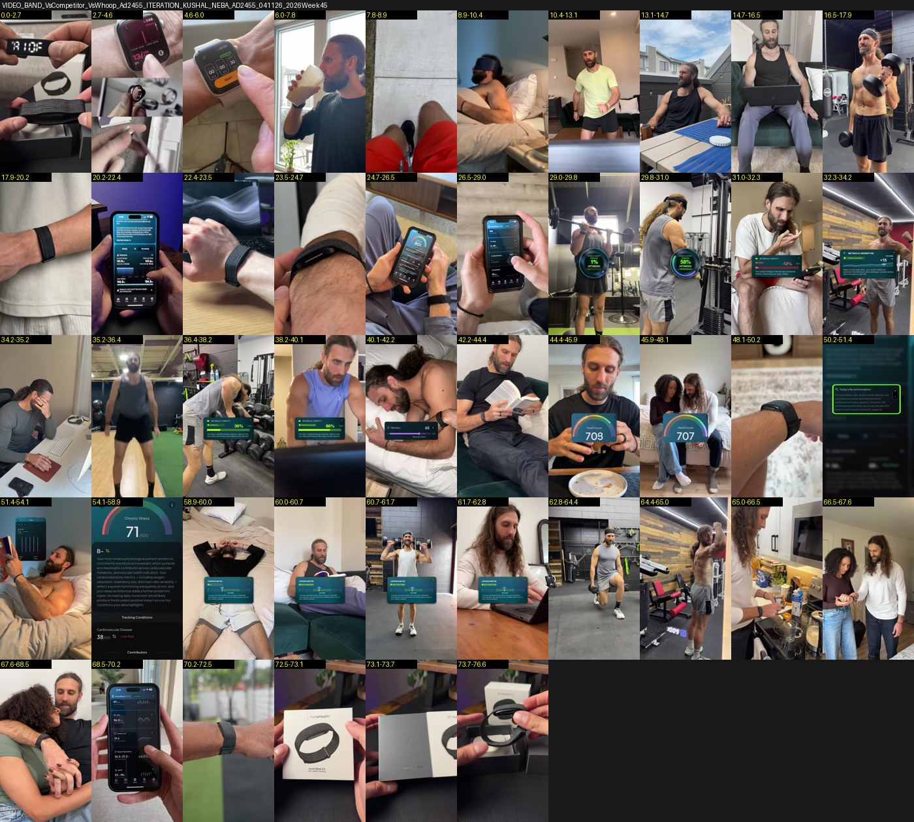

# VIDEO_BAND_VsCompetitor_VsWhoop_Ad2455_ITERATION_KUSHAL_NEBA_AD2455_041126_2026Week45

Master: `VIDEO_BAND_VsCompetitor_VsWhoop_Ad2455_ITERATION_KUSHAL_NEBA_AD2455_041126_2026Week45_9X16_HOOK1.mp4` · 76.6s · 1080x1920

**Pacing:** 46 shots · avg 1.666s · median 1.55s · 5.87 cuts/10s · first cut 2.7s · 212.0 wpm · talk ratio 0.95 · cuts on word start 84.4% · cuts in speech gaps 64.4%
**Audio:** {'I_lufs': -19.5, 'LRA': 1.6, 'true_peak_db': -2.7} · BPM≈99.4 · music {'speech_rms_db': -23.0, 'pause_seconds': 0.3} · cuts with SFX/transient 66.7%

**Captions:** 104 cards · 1.0 words/card (median) · y≈0.56 of frame height · text height≈0.0222 · colours {'dark/other': 50, 'white': 43, 'red': 4, 'blue': 2, 'green': 2, 'yellow': 3} · cards crossing a cut: 1
Highlighted: Start, 30 SEC, 801, HumeBand(100%), 1%, 58%, -10%, -15%, 36%, 75%, 86%
**Headlines:** 0.39. (0.0–0.0s, white) | 0.39 (0.5–0.5s, white) | 8 106 (1.0–1.5s, white) | 1:08 (2.5–3.0s, white) | Move. (2.5–2.5s, red) | 112PM6PM (2.5–2.5s, dark/other) | 12AM6AM (2.5–4.0s, dark/other) | Move: (3.0–3.0s, red)

**Hook (0–3s) spoken:** Fitness trackers versus longevity wearables. What's the difference? Most fitness
**Hook on-screen:** 0.39 / 0.39. / 112PM6PM / 12AM6AM / 1:08 / 2% / 8 106 / Move. / Please / XHumeHealth / XHumeoatth / and charge / beforeuse / tear off
**CTA (last 5s):** -eligible. So take control of how you age and grab your HumeBand 2 .0 today. · on-screen: HumeHealth / HumoHeath

## Beat sheet

| # | in–out (s) | dur | transition | spoken | on-screen text |
|---|---|---|---|---|---|
| 1 | 0.00–2.70 | 2.7 |  | Fitness trackers versus longevity wearables. What's the difference? | 0.39. (HEADLINE) / 0.39 (HEADLINE) / 8 106 (HEADLINE) / XHumeoatth / XHumeHealth / 1:08 (HEADLINE) |
| 2 | 2.70–4.60 | 1.9 | cut +SFX hit | Most fitness trackers focus on your body's | 1:08 (HEADLINE) / Move. [red] (HEADLINE) / 112PM6PM (HEADLINE) / 12AM6AM (HEADLINE) / 2% / Please |
| 3 | 4.60–5.97 | 1.37 | cut | short -term readiness. | 12:50 (HEADLINE) / Seconds (HEADLINE) / 30 (HEADLINE) / 00 / 01 / Start [red] |
| 4 | 5.97–7.77 | 1.8 | cut +SFX hit | They tell you how recovered you are today, | 12:50 (HEADLINE) / 0:29 (HEADLINE) / 30 SEC [red] |
| 5 | 7.77–8.87 | 1.1 | cut +SFX hit | how many steps you took, |  |
| 6 | 8.87–10.43 | 1.57 | cut | or whether you slept well last night. |  |
| 7 | 10.43–13.13 | 2.7 | cut +SFX hit | In other words, they give you snapshots of your current state, |  |
| 8 | 13.13–14.70 | 1.57 | cut +SFX hit | but they miss the big picture of how |  |
| 9 | 14.70–16.50 | 1.8 | cut | your body is actually aging and |  |
| 10 | 16.50–17.93 | 1.43 | cut | adapting over time. |  |
| 11 | 17.93–20.20 | 2.27 | cut +SFX hit | The HumeBand 2 .0 is different. | 147.6ib / 141.9bs |
| 12 | 20.20–22.40 | 2.2 | cut +SFX hit | It's a true AI longevity wearable, | 147.6ib / 141.9bs / MyBay / 141.90s / 147.65 / 154.385 |
| 13 | 22.40–23.50 | 1.1 | cut +SFX hit | the cream of the crop. | 147.6bs / 141.9bs / 146.5bs |
| 14 | 23.50–24.73 | 1.23 | cut +SFX hit | It measures biomarkers 24 |  |
| 15 | 24.73–26.47 | 1.73 | cut +SFX hit | -7 that determine how | 801 [blue] |
| 16 | 26.47–28.97 | 2.5 | cut +SFX hit | you age and gives you a clear picture of whether | 801 [blue] / HumeBand（00%) [blue] (HEADLINE) / HumeBand(100%) [blue] / 5折40m |
| 17 | 28.97–29.80 | 0.83 | cut +SFX hit | you're building long | 1% [green] |
| 18 | 29.80–30.97 | 1.17 | cut +SFX hit | -term resilience or | 58% [green] |
| 19 | 30.97–32.30 | 1.33 | cut +SFX hit | heading towards decline. | -10% [red] / Your body's energy reserves are somewhat / -15% [red] |
| 20 | 32.30–34.20 | 1.9 | cut +SFX hit | It tracks your metabolic momentum to show if | Your body's energy reserves are somewhat / -15% [red] / +15 |
| 21 | 34.20–35.17 | 0.97 | cut | you're aging faster or |  |
| 22 | 35.17–36.40 | 1.23 | cut +SFX hit | slower than you should be, |  |
| 23 | 36.40–38.17 | 1.77 | cut +SFX hit | your metabolic capacity to reveal how | 36% [yellow] / 75% [yellow] |
| 24 | 38.17–40.13 | 1.97 | cut +SFX hit | efficiently your body creates energy, | 75% [yellow] / 86% [yellow] / 831 / PRecovery |
| 25 | 40.13–42.20 | 2.07 | cut +SFX hit | your recovery score to show if your body is | 831 / PRecovery / 65i / RecoveryNeed |
| 26 | 42.20–44.37 | 2.17 | cut +SFX hit | truly rebuilding and adapting over time, |  |
| 27 | 44.37–45.87 | 1.5 | cut +SFX hit | and your health score to track your overall | HealthScore |
| 28 | 45.87–48.07 | 2.2 | cut | resilience and longevity potential. | HealthScore / 707 |
| 29 | 48.07–50.20 | 2.13 | cut +SFX hit | Plus, Hume's AI gives you personalized daily | Metabolic Capacity (HEADLINE) / 34/100+ (HEADLINE) / Low (HEADLINE) / Yourmetaboliccapacitydroppedto34points(from (HEADLINE) / 23%lessstraintoday.Thisreductioncomesfrom (HEADLINE) / momentumpointslostduetoinsufficientbeneficial (HEADLINE) |
| 30 | 50.20–51.37 | 1.17 | cut +SFX hit | actions based on | Metabolic Capacity (HEADLINE) / 34/100+ (HEADLINE) / Low (HEADLINE) / Yourmetaboliccapacitydroppedto34points(from (HEADLINE) / 23%lessstraintoday.Thisreductioncomesfrom (HEADLINE) / momentumpointslostduetoinsufficientbeneficial (HEADLINE) |
| 31 | 51.37–54.07 | 2.7 | cut | your unique data to improve these metrics over time, | Y,Today'sRecommendation (HEADLINE) / Theextended.high-qualitysleephelpedclear / yourprevioussleepdebtandprovided / 418 (HEADLINE) / Average (HEADLINE) / 418 + (HEADLINE) |
| 32 | 54.07–58.93 | 4.87 | cut +SFX hit | and it can help identify early signs correlated with chronic illness before symptoms appear. | 418 (HEADLINE) / Average (HEADLINE) / 418 + (HEADLINE) / HealthScore (HEADLINE) / Youroverallhealthscoremeasures418outof900, (HEADLINE) / whichfallsinthe"Lowcategory.This scorereflects (HEADLINE) |
| 33 | 58.93–59.97 | 1.03 | cut +SFX hit | It's constantly learning from |  |
| 34 | 59.97–60.67 | 0.7 | cut | your routine to |  |
| 35 | 60.67–61.70 | 1.03 | cut | help you slow down your |  |
| 36 | 61.70–62.83 | 1.13 | cut | biological age so |  |
| 37 | 62.83–64.37 | 1.53 | cut +SFX hit | you build lasting energy, |  |
| 38 | 64.37–65.00 | 0.63 | cut | stay strong |  |
| 39 | 65.00–66.47 | 1.47 | cut | and independent for decades, |  |
| 40 | 66.47–67.60 | 1.13 | cut | and future -proof your health |  |
| 41 | 67.60–68.53 | 0.93 | cut | for the long term. |  |
| 42 | 68.53–70.20 | 1.67 | cut +SFX hit | Plus, no subscription needed, | HumeBand(100%) (HEADLINE) / 65bpm (HEADLINE) / 86.0ms / 19.6 / 93-98% |
| 43 | 70.20–72.53 | 2.33 | cut +SFX hit | and it's HSA and FSA -eligible. |  |
| 44 | 72.53–73.13 | 0.6 | cut +SFX hit | So take control |  |
| 45 | 73.13–73.70 | 0.57 | cut +SFX hit | of how you |  |
| 46 | 73.70–76.65 | 2.95 | cut | age and grab your HumeBand 2 .0 today. | HumeHealth / HumoHeath (HEADLINE) |

## Hook variants

| hook | file | dur | first cut | spoken 0–3s | on-screen 0–3s |
|---|---|---|---|---|---|
| 1 | `TERATION_KUSHAL_NEBA_AD2455_041126_2026Week45_9X16_HOOK1.mp4` | 76.6 | 2.7 | Fitness trackers versus longevity wearables. What's the difference? Most fitness | 0.39 / 0.39. / 112PM6PM / 12AM6AM / 1:08 / 2% / 8 106 / Move. |
| 1 | `TERATION_KUSHAL_NEBA_AD2455_041126_2026Week45_9X16_HOOK1.mp4` | 76.6 | 2.7 |  |  |
| 2 | `TERATION_KUSHAL_NEBA_AD2455_041126_2026Week45_9X16_HOOK2.mp4` | 76.2 | 2.233 |  |  |
| 2 | `TERATION_KUSHAL_NEBA_AD2455_041126_2026Week45_9X16_HOOK2.mp4` | 76.2 | 2.233 |  |  |
| 3 | `TERATION_KUSHAL_NEBA_AD2455_041126_2026Week45_9X16_HOOK3.mp4` | 76.5 | 2.567 |  |  |
| 3 | `TERATION_KUSHAL_NEBA_AD2455_041126_2026Week45_9X16_HOOK3.mp4` | 76.5 | 2.567 |  |  |

## Full transcript

Fitness trackers versus longevity wearables. What's the difference? Most fitness trackers focus on your body's short-term readiness. They tell you how recovered you are today, how many steps you took, or whether you slept well last night. In other words, they give you snapshots of your current state, but they miss the big picture of how your body is actually aging and adapting over time. The HumeBand 2.0 is different. It's a true AI longevity wearable, the cream of the crop. It measures biomarkers 24-7 that determine how you age and gives you a clear picture of whether you're building long-term resilience or heading towards decline. It tracks your metabolic momentum to show if you're aging faster or slower than you should be, your metabolic capacity to reveal how efficiently your body creates energy, your recovery score to show if your body is truly rebuilding and adapting over time, and your health score to track your overall resilience and longevity potential. Plus, Hume's AI gives you personalized daily actions based on your unique data to improve these metrics over time, and it can help identify early signs correlated with chronic illness before symptoms appear. It's constantly learning from your routine to help you slow down your biological age so you build lasting energy, stay strong and independent for decades, and future-proof your health for the long term. Plus, no subscription needed, and it's HSA and FSA-eligible. So take control of how you age and grab your HumeBand 2.0 today.