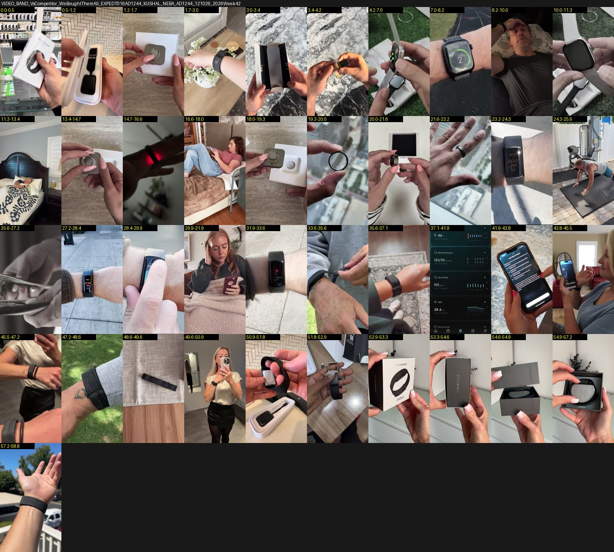

# VIDEO_BAND_VsCompetitor_WeBoughtThemAll_EXPEDT016AD1244_KUSHAL_NEBA_AD1244_121026_2026Week42

Master: `VIDEO_BAND_VsCompetitor_WeBoughtThemAll_EXPEDT016AD1244_KUSHAL_NEBA_121026_2026Week42_9x16_with_Hook1_Raw.mp4` · 58.8s · 1080x1920

**Pacing:** 41 shots · avg 1.434s · median 1.335s · 6.8 cuts/10s · first cut 0.5s · 237.0 wpm · talk ratio 0.97 · cuts on word start 80.0% · cuts in speech gaps 45.0%
**Audio:** {'I_lufs': -16.8, 'LRA': 1.6, 'true_peak_db': -2.2} · BPM≈129.2 · music {'speech_rms_db': -20.2, 'pause_seconds': 0.2} · cuts with SFX/transient 75.0%

**Captions:** 60 cards · 1.0 words/card (median) · y≈0.533 of frame height · text height≈0.0287 · colours {'white': 44, 'dark/other': 14, 'yellow': 1, 'blue': 1} · cards crossing a cut: 0
Highlighted: 2104, SLE
**Headlines:** 08:20 (4.0–4.0s, white) | 10:48 (7.0–7.0s, white) | 2,957 (37.0–37.0s, white) | 5918 (37.0–37.0s, dark/other) | Sleep (37.0–39.0s, white) | 7 h46m (37.0–39.0s, white) | Blood Pressure (38.0–39.0s, white) | 121/70 mmHg (38.0–38.0s, white)

**Hook (0–3s) spoken:** We bought every wearable on the market before we built the 2 .0,
**Hook on-screen:** 
**CTA (last 5s):** with code launch30 at humehealth .com with a 45 -day guarantee. · on-screen: HumeHealth

## Beat sheet

| # | in–out (s) | dur | transition | spoken | on-screen text |
|---|---|---|---|---|---|
| 1 | 0.00–0.50 | 0.5 |  | We bought every |  |
| 2 | 0.50–1.24 | 0.74 | cut +SFX hit | wearable on |  |
| 3 | 1.24–1.74 | 0.5 | cut | the market before |  |
| 4 | 1.74–2.97 | 1.24 | cut +SFX hit | we built the 2 .0, |  |
| 5 | 2.97–3.44 | 0.47 | cut | and here's |  |
| 6 | 3.44–4.17 | 0.73 | cut +SFX hit | what we found. | MUSIC / SUN 01 / 08:20 (HEADLINE) |
| 7 | 4.17–7.01 | 2.84 | cut +SFX hit | The smartwatch looks premium, but it's really a phone on your wrist | MUSIC / SUN 01 / 08:20 (HEADLINE) / 08:28 / Heart Rate / BPM |
| 8 | 7.01–8.18 | 1.17 | cut | that counts your steps. | 10:48 (HEADLINE) / Looks like you'reat / atrack / Choose Lane |
| 9 | 8.18–10.01 | 1.83 | cut +SFX hit | It can't track your blood pressure overnight, | Smarta |
| 10 | 10.01–11.28 | 1.27 | cut +SFX hit | and it dies every night, | Smarta |
| 11 | 11.28–13.38 | 2.1 | cut +SFX hit | so you lose half your sleep data anyway. |  |
| 12 | 13.38–14.71 | 1.33 | cut +SFX hit | The smart ring is beautiful, |  |
| 13 | 14.71–16.65 | 1.93 | cut +SFX hit | but it's a sleep tracker with a membership attached, |  |
| 14 | 16.65–17.98 | 1.34 | cut +SFX hit | and the moment you stop paying, |  |
| 15 | 17.98–19.25 | 1.27 | cut +SFX hit | half the features you bought it for |  |
| 16 | 19.25–19.99 | 0.73 | cut | are gone. |  |
| 17 | 19.99–21.55 | 1.57 | cut +SFX hit | It still can't show you blood pressure or |  |
| 18 | 21.55–23.16 | 1.6 | cut +SFX hit | weekly heart trends either. | 00.37 / 26'36 / Pace / 8:10 |
| 19 | 23.16–24.26 | 1.1 | cut +SFX hit | The luxury health tracker is | 00.37 / 26'36 / Pace / 8:10 / 2441 / 8:11 |
| 20 | 24.26–25.56 | 1.3 | cut +SFX hit | solid for gym recovery, | 00.37 / Pace / 2441 / 8:11 |
| 21 | 25.56–27.19 | 1.63 | cut +SFX hit | but it costs $199 a | 00.37 / 21'04" / Pace |
| 22 | 27.19–28.39 | 1.2 | cut +SFX hit | year forever And | 00.37 / 21'04" / Pace / 2104 [yellow] / 819 |
| 23 | 28.39–29.90 | 1.5 | cut +SFX hit | you never actually own it cancel | Pace / 2104 [yellow] / 819 / SLE [blue] |
| 24 | 29.90–31.90 | 2.0 | cut +SFX hit | it and you're left with a dead strap and |  |
| 25 | 31.90–33.60 | 1.7 | cut +SFX hit | it still couldn't do what we needed So | Walk / 6:48 / Walk Dete / 6:49 |
| 26 | 33.60–35.57 | 1.97 | cut | we built the Hume band 2 .0 to |  |
| 27 | 35.57–37.07 | 1.5 | cut +SFX hit | do everything they couldn't it | 2,957 (HEADLINE) / 5918 (HEADLINE) / Sleep (HEADLINE) / 7 h46m (HEADLINE) / BloodPressure / 121/70 |
| 28 | 37.07–41.88 | 4.8 | cut +SFX hit | tracks your blood pressure overnight without a cuff It shows your biological age next to your real age And | 2,957 (HEADLINE) / 5918 (HEADLINE) / Sleep (HEADLINE) / 7 h46m (HEADLINE) / BloodPressure / 121/70 |
| 29 | 41.88–43.78 | 1.9 | cut +SFX hit | it sends you weekly heart health reports that | 11:30 [blue] (HEADLINE) / MetabolicMomentum [blue] (HEADLINE) / yourstrain / phys / sathtraje / Strain |
| 30 | 43.78–45.51 | 1.73 | cut +SFX hit | actually connect the dots the |  |
| 31 | 45.51–47.25 | 1.73 | cut +SFX hit | battery lasts 14 days So |  |
| 32 | 47.25–48.58 | 1.34 | cut +SFX hit | it never comes off your wrist |  |
| 33 | 48.58–49.65 | 1.07 | cut | and you buy it once and |  |
| 34 | 49.65–50.88 | 1.23 | cut +SFX hit | it's yours forever We |  |
| 35 | 50.88–51.75 | 0.87 | cut | tested them all |  |
| 36 | 51.75–52.92 | 1.17 | cut | so you don't have to get |  |
| 37 | 52.92–53.29 | 0.37 | cut | it for | HumeHealth (HEADLINE) / HumeBand20 |
| 38 | 53.29–54.62 | 1.33 | cut +SFX hit | $224 with | HumeHealth (HEADLINE) / HumeBand20 |
| 39 | 54.62–54.89 | 0.27 | cut +SFX hit | code |  |
| 40 | 54.89–57.22 | 2.34 | cut +SFX hit | launch30 at humehealth .com with |  |
| 41 | 57.22–58.80 | 1.57 | cut | a 45 -day guarantee. |  |

## Hook variants

| hook | file | dur | first cut | spoken 0–3s | on-screen 0–3s |
|---|---|---|---|---|---|
| 1 | `16AD1244_KUSHAL_NEBA_AD1244_121026_2026Week42_Hook1_9x16.mp4` | 58.8 | 0.5 |  |  |
| 1 | `AD1244_KUSHAL_NEBA_121026_2026Week42_9x16_with_Hook1_Raw.mp4` | 58.8 | 0.5 | We bought every wearable on the market before we built the 2 .0, |  |
| 2 | `16AD1244_KUSHAL_NEBA_AD1244_121026_2026Week42_Hook2_9x16.mp4` | 58.8 | 0.667 |  |  |
| 2 | `AD1244_KUSHAL_NEBA_121026_2026Week42_9x16_with_Hook2_Raw.mp4` | 58.8 | 0.067 |  |  |
| 3 | `16AD1244_KUSHAL_NEBA_AD1244_121026_2026Week42_Hook3_9x16.mp4` | 57.4 | 0.868 |  |  |
| 3 | `AD1244_KUSHAL_NEBA_121026_2026Week42_9x16_with_Hook3_Raw.mp4` | 57.4 | 0.868 |  |  |

## Full transcript

We bought every wearable on the market before we built the 2.0, and here's what we found. The smartwatch looks premium, but it's really a phone on your wrist that counts your steps. It can't track your blood pressure overnight, and it dies every night, so you lose half your sleep data anyway. The smart ring is beautiful, but it's a sleep tracker with a membership attached, and the moment you stop paying, half the features you bought it for are gone. It still can't show you blood pressure or weekly heart trends either. The luxury health tracker is solid for gym recovery, but it costs $199 a year forever And you never actually own it cancel it and you're left with a dead strap and it still couldn't do what we needed So we built the Hume band 2.0 to do everything they couldn't it tracks your blood pressure overnight without a cuff It shows your biological age next to your real age And it sends you weekly heart health reports that actually connect the dots the battery lasts 14 days So it never comes off your wrist and you buy it once and it's yours forever We tested them all so you don't have to get it for $224 with code launch30 at humehealth.com with a 45-day guarantee.