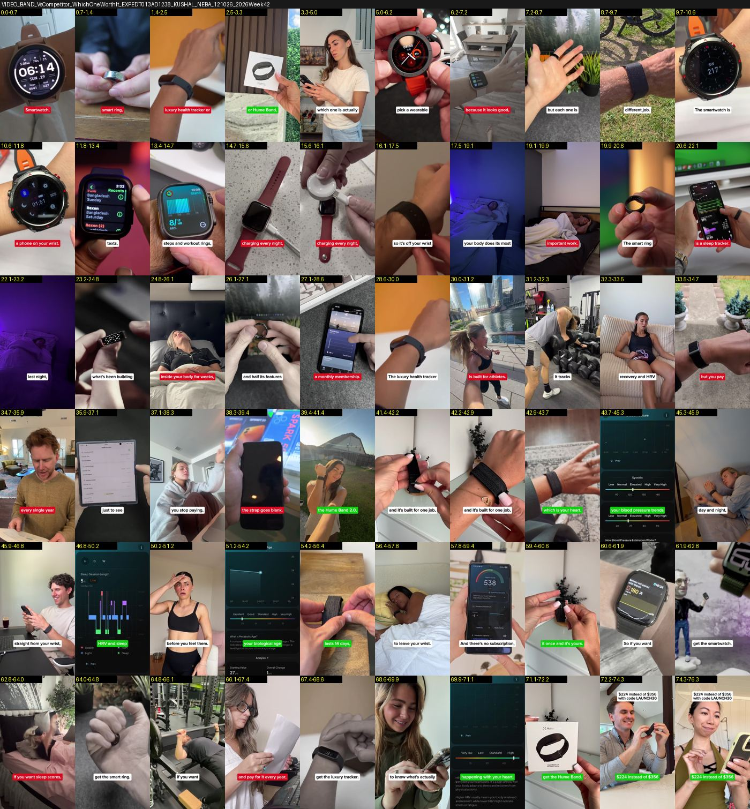

# VIDEO_BAND_VsCompetitor_WhichOneWorthIt_EXPEDT013AD1238_KUSHAL_NEBA_121026_2026Week42

Master: `VIDEO_BAND_VsCompetitor_WhichOneWorthIt_EXPEDT013AD1238_KUSHAL_NEBA_121026_2026Week42_Hook1_9x16.mp4` · 81.2s · 1080x1920

**Pacing:** 64 shots · avg 1.268s · median 1.2s · 7.76 cuts/10s · first cut 0.733s · 235.0 wpm · talk ratio 0.96 · cuts on word start 77.8% · cuts in speech gaps 49.2%
**Audio:** {'I_lufs': -16.7, 'LRA': 2.2, 'true_peak_db': -0.9} · BPM≈123.0 · music {'speech_rms_db': -20.1, 'pause_seconds': 0.4} · cuts with SFX/transient 82.5%

**Captions:** 211 cards · 1 words/card (median) · y≈0.742 of frame height · text height≈0.0269 · colours {'white': 117, 'red': 21, 'green': 14, 'dark/other': 53, 'blue': 6} · cards crossing a cut: 2
Highlighted: Smartwatch,, smart ring,, luxuryhealthtracker or, or Hume Band, worth your money?, because it looks good,, builtfor a completely, a phone on your wrist., Recents, Rexon (2), gaxon(2), 14:09, Stand, 12, 106
**Headlines:** 06:14 (0.0–0.0s, white) | 04:39 (5.0–5.5s, white) | TUE (5.0–5.5s, white) | 85% (5.5–5.5s, red) | 217 (10.0–10.0s, dark/other) | 01:51 (11.0–11.0s, dark/other) | 2:33 (12.0–13.0s, white) | 16:078 (21.0–21.0s, white)

**Hook (0–3s) spoken:** Smartwatch, Smart Ring, Luxury Health Tracker, or Hume Band.
**Hook on-screen:** 06:14 / 20THea.Tack / 2uneneditn / 3.08M / 637 / 6641 / 74% / HumeBand2.0 / Kcal / SUN.29 / Smartwatch, / Steps / luxuryhealthtracker or / or Hume Band / smart ring,
**CTA (last 5s):** code launch 30 and you get a 45 -day guarantee at HumeHealth .com · on-screen: $224 instead of $356 / a45dayguarantee / at HumeHealth.com / with code LAUNCH30, / withcodeLAUNCH30

## Beat sheet

| # | in–out (s) | dur | transition | spoken | on-screen text |
|---|---|---|---|---|---|
| 1 | 0.00–0.73 | 0.73 |  | Smartwatch, Smart | 74% / 3.08M / 06:14 (HEADLINE) / SUN.29 / Kcal / Steps |
| 2 | 0.73–1.43 | 0.7 | cut +SFX hit | Ring, | smart ring, [red] |
| 3 | 1.43–2.47 | 1.03 | cut +SFX hit | Luxury Health Tracker, | smart ring, [red] / luxuryhealthtracker or [red] |
| 4 | 2.47–3.27 | 0.8 | cut +SFX hit | or Hume Band. | luxuryhealthtracker or [red] / 2uneneditn / HumeBand2.0 / 20THea.Tack / or Hume Band [green] / HumeHealth |
| 5 | 3.27–5.03 | 1.77 | cut | Which one is actually worth your money? | or Hume Band [green] / HumeHealth / which one is actually / worth your money? [red] / 04:39 (HEADLINE) / TUE (HEADLINE) |
| 6 | 5.03–6.23 | 1.2 | cut +SFX hit | Most people pick a wearable because | 04:39 (HEADLINE) / TUE (HEADLINE) / Most people / 85% [red] (HEADLINE) / pick a wearable / because it looks good, [red] |
| 7 | 6.23–7.23 | 1.0 | cut +SFX hit | it looks good, but | because it looks good, [red] / but each one is |
| 8 | 7.23–8.67 | 1.43 | cut +SFX hit | each one is built for a completely | but each one is / builtfor a completely [red] |
| 9 | 8.67–9.70 | 1.03 | cut +SFX hit | different job. | different job. |
| 10 | 9.70–10.60 | 0.9 | cut +SFX hit | The Smartwatch is | 217 (HEADLINE) / The smartwatch is |
| 11 | 10.60–11.77 | 1.17 | cut +SFX hit | a phone on your wrist. | SOS / 01:51 (HEADLINE) / a phone on your wrist. [red] |
| 12 | 11.77–13.40 | 1.63 | cut +SFX hit | It's great for texts, calls, | 2:33 (HEADLINE) / Recents [green] / It's great for / Rexon (2) [red] / Bangladesh / 5/8/25 |
| 13 | 13.40–14.67 | 1.27 | cut +SFX hit | steps, and workout rings, | 2:33 (HEADLINE) / Recents [green] / Rexon (2) [red] / Bangladesh / 5/8/25 / Rexon (4) |
| 14 | 14.67–15.60 | 0.93 | cut +SFX hit | but it needs charging every | charging every night, [red] |
| 15 | 15.60–16.10 | 0.5 | cut +SFX hit | night. | so it's off your wrist |
| 16 | 16.10–17.53 | 1.43 | cut +SFX hit | So it's off your wrist for the eight | so it's off your wrist / for the 8 hours |
| 17 | 17.53–19.13 | 1.6 | cut +SFX hit | hours your body does its most important | your body does its most / importantwork [red] |
| 18 | 19.13–19.93 | 0.8 | cut +SFX hit | work. | importantwork [red] |
| 19 | 19.93–20.63 | 0.7 | cut +SFX hit | The Smart Ring is | The smart ring |
| 20 | 20.63–22.13 | 1.5 | cut | a sleep tracker. It tells you | 16:078 (HEADLINE) / Thu,May18 / isa sleeptracker. [red] / how you slept [red] |
| 21 | 22.13–23.20 | 1.07 | cut | how you slept last night, | how you slept [red] / but it can't tell you |
| 22 | 23.20–24.83 | 1.63 | cut +SFX hit | but it can't tell you what's been building inside | but it can't tell you / what's been building |
| 23 | 24.83–26.10 | 1.27 | cut +SFX hit | your body for weeks, and | insideyour body for weeks, [red] / and half its features |
| 24 | 26.10–27.13 | 1.03 | cut +SFX hit | half its features sit | and half its features / 02:36 (HEADLINE) / Health (HEADLINE) / Activity (HEADLINE) / 112 / 0.08 |
| 25 | 27.13–28.60 | 1.47 | cut +SFX hit | behind a monthly membership. The | 02:36 (HEADLINE) / Health (HEADLINE) / Activity (HEADLINE) / 112 / 0.08 / Blood Oxygen [blue] |
| 26 | 28.60–29.97 | 1.37 | cut +SFX hit | luxury health tracker is | The luxury health tracker |
| 27 | 29.97–31.17 | 1.2 | cut +SFX hit | built for athletes. | is built forathletes [red] / It tracks |
| 28 | 31.17–32.30 | 1.13 | cut +SFX hit | It tracks strain, recovery, | It tracks / strain, |
| 29 | 32.30–33.50 | 1.2 | cut +SFX hit | and HRV really | strain, / recovery and HRV |
| 30 | 33.50–34.73 | 1.23 | cut | well, but you pay every | but you pay [red] |
| 31 | 34.73–35.87 | 1.13 | cut +SFX hit | single year just | everysingleyear [red] |
| 32 | 35.87–37.10 | 1.23 | cut +SFX hit | to see your own data. | Health reminders (HEADLINE) / just to see / DIOR / and the day |
| 33 | 37.10–38.30 | 1.2 | cut +SFX hit | And the day you stop paying, | DIOR / and the day / you stop paying, |
| 34 | 38.30–39.40 | 1.1 | cut +SFX hit | the strap goes blank. | DIOR / you stop paying, / the strap goesblank [red] |
| 35 | 39.40–41.43 | 2.03 | cut +SFX hit | Then there's the HumeBand 2 .0, and | the strap goesblank [red] / the Hume Band 2.0 [green] |
| 36 | 41.43–42.23 | 0.8 | cut +SFX hit | it's built for one | the Hume Band 2.0 [green] / and it's built for one job, |
| 37 | 42.23–42.90 | 0.67 | cut | job, | and it's built for one job, |
| 38 | 42.90–43.70 | 0.8 | cut +SFX hit | which is your heart. | whichisyour heart [green] |
| 39 | 43.70–45.30 | 1.6 | cut +SFX hit | It tracks your blood pressure trends day | BloodPressure (HEADLINE) / 26/Aug/26 (HEADLINE) / 10AM / 8AM / 9AM / 11AM |
| 40 | 45.30–45.90 | 0.6 | cut +SFX hit | and night, straight | BloodPressure (HEADLINE) / Systolic / yourblood pressure trends [green] / 120 / 130 / 140 |
| 41 | 45.90–46.83 | 0.93 | cut +SFX hit | from your wrist, and | straight from your wrist |
| 42 | 46.83–50.17 | 3.33 | cut +SFX hit | it watches your heart rate, HRV, and sleep, so it can flag changes | Connected [green] (HEADLINE) / HumeBand(80%) (HEADLINE) / Sleep (HEADLINE) / 18:00 (HEADLINE) / 5h1m (HEADLINE) / Last:02/Apr/26 (HEADLINE) |
| 43 | 50.17–51.17 | 1.0 | cut | before you feel them. | before you feel them. / MetabolicAge (HEADLINE) / 28 yrs (HEADLINE) / Excellent [blue] (HEADLINE) / Updated:20/07 (HEADLINE) / 24 |
| 44 | 51.17–54.17 | 3.0 | cut +SFX hit | It even shows your biological age and whether it's going up or down. | MetabolicAge (HEADLINE) / 28 yrs (HEADLINE) / Excellent [blue] (HEADLINE) / Updated:20/07 (HEADLINE) / 24 / 21/07 |
| 45 | 54.17–56.40 | 2.23 | cut | And because the battery lasts 14 days, It | and because the battery / lasts 14 days, [green] |
| 46 | 56.40–57.83 | 1.43 | cut +SFX hit | never has to leave your wrist and | lasts 14 days, [green] / to leave your wrist. |
| 47 | 57.83–59.43 | 1.6 | cut +SFX hit | there's no subscription. So you buy it | HealthScore (HEADLINE) / 538 (HEADLINE) / HumePlusExclusive / Generateyour HealthReport by / upgradingto Hume Plus / MetabolicMomentum |
| 48 | 59.43–60.60 | 1.17 | cut | once and it's yours So | HealthScore (HEADLINE) / 538 (HEADLINE) / HumePlusExclusive / Generateyour HealthReport by / upgradingto Hume Plus / MetabolicMomentum |
| 49 | 60.60–61.90 | 1.3 | cut +SFX hit | if you want a mini phone get | Sensor not paired (HEADLINE) / withWatch (HEADLINE) / B10:24 (HEADLINE) / mg/dL / So if you want |
| 50 | 61.90–62.83 | 0.93 | cut +SFX hit | the smartwatch if | get the smartwatch. |
| 51 | 62.83–64.03 | 1.2 | cut +SFX hit | you want sleep scores get | If you want sleep scores, [red] / get the smart ring. |
| 52 | 64.03–64.80 | 0.77 | cut +SFX hit | the smart ring | get the smart ring. |
| 53 | 64.80–66.13 | 1.33 | cut +SFX hit | If you want to track workouts and | If you want / and pay for it everyyear, [red] |
| 54 | 66.13–67.37 | 1.23 | cut +SFX hit | pay for it every year | and pay for it everyyear, [red] |
| 55 | 67.37–68.60 | 1.23 | cut | get the luxury tracker But | and pay for it everyyear, [red] / get the luxury tracker. |
| 56 | 68.60–69.93 | 1.33 | cut | if you want to know what's actually | to know what's actually |
| 57 | 69.93–71.07 | 1.13 | cut +SFX hit | happening with your heart get | HRV (HEADLINE) / Average (HEADLINE) / 99.6ms (HEADLINE) / High [blue] (HEADLINE) / 02/Apr/26 (HEADLINE) / 8AM |
| 58 | 71.07–72.20 | 1.13 | cut +SFX hit | the Hume band right | XHumeHealth" / get the Hume Band. [green] / Right now it's |
| 59 | 72.20–74.27 | 2.07 | cut +SFX hit | now It's $224 instead | Right now it's / $224 instead of $356 (HEADLINE) / withcodeLAUNCH30 (HEADLINE) / $224insteadof$356 [green] |
| 60 | 74.27–76.27 | 2.0 | cut | of $356 with | $224 instead of $356 (HEADLINE) / withcodeLAUNCH30 (HEADLINE) / $224insteadof$356 [green] |
| 61 | 76.27–77.77 | 1.5 | cut +SFX hit | code launch 30 and | $224 instead of $356 (HEADLINE) / withcodeLAUNCH30 (HEADLINE) / $224insteadof$356 [green] / with code LAUNCH30, |
| 62 | 77.77–79.20 | 1.43 | cut +SFX hit | you get a 45 -day guarantee | $224 instead of $356 (HEADLINE) / withcodeLAUNCH30 (HEADLINE) / a45dayguarantee [green] |
| 63 | 79.20–79.77 | 0.57 | cut +SFX hit | at | $224 instead of $356 (HEADLINE) / withcodeLAUNCH30 (HEADLINE) / a45dayguarantee [green] |
| 64 | 79.77–81.15 | 1.39 | cut +SFX hit | HumeHealth .com | $224 instead of $356 (HEADLINE) / withcodeLAUNCH30 (HEADLINE) / at HumeHealth.com |

## Hook variants

| hook | file | dur | first cut | spoken 0–3s | on-screen 0–3s |
|---|---|---|---|---|---|
| 1 | `EXPEDT013AD1238_KUSHAL_NEBA_121026_2026Week42_Hook1_9x16.mp4` | 81.2 | 0.733 | Smartwatch, Smart Ring, Luxury Health Tracker, or Hume Band. | 06:14 / 20THea.Tack / 2uneneditn / 3.08M / 637 / 6641 / 74% / HumeBand2.0 |
| 2 | `EXPEDT013AD1238_KUSHAL_NEBA_121026_2026Week42_Hook2_9x16.mp4` | 80.1 | 0.767 | Most people buy the wrong wearable, and they only find out after |  |
| 3 | `EXPEDT013AD1238_KUSHAL_NEBA_121026_2026Week42_Hook3_9x16.mp4` | 79.8 | 1.8 | If you're about to spend $400 on a wearable, watch this | 14:03 / ECHNOGYM / If you're about to spend $400 / onawearable / watch this first |

## Full transcript

Smartwatch, Smart Ring, Luxury Health Tracker, or Hume Band. Which one is actually worth your money? Most people pick a wearable because it looks good, but each one is built for a completely different job. The Smartwatch is a phone on your wrist. It's great for texts, calls, steps, and workout rings, but it needs charging every night. So it's off your wrist for the eight hours your body does its most important work. The Smart Ring is a sleep tracker. It tells you how you slept last night, but it can't tell you what's been building inside your body for weeks, and half its features sit behind a monthly membership. The luxury health tracker is built for athletes. It tracks strain, recovery, and HRV really well, but you pay every single year just to see your own data. And the day you stop paying, the strap goes blank. Then there's the HumeBand 2.0, and it's built for one job, which is your heart. It tracks your blood pressure trends day and night, straight from your wrist, and it watches your heart rate, HRV, and sleep, so it can flag changes before you feel them. It even shows your biological age and whether it's going up or down. And because the battery lasts 14 days, It never has to leave your wrist and there's no subscription. So you buy it once and it's yours So if you want a mini phone get the smartwatch if you want sleep scores get the smart ring If you want to track workouts and pay for it every year get the luxury tracker But if you want to know what's actually happening with your heart get the Hume band right now It's $224 instead of $356 with code launch 30 and you get a 45-day guarantee at HumeHealth.com