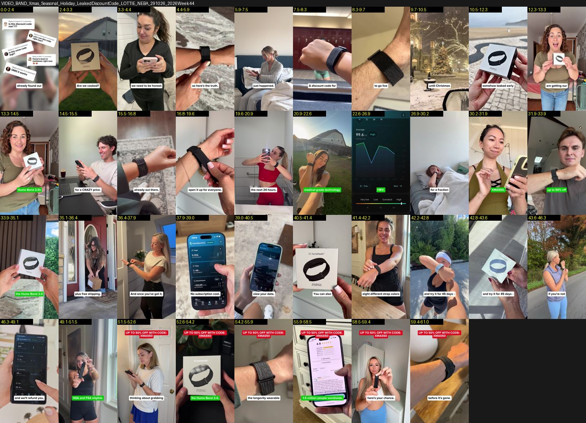

# VIDEO_BAND_Xmas_Seasonal_Holiday_LeakedDiscountCode_LOTTIE_NEBA_291026_2026Week44

Master: `VIDEO_BAND_Xmas_Seasonal_Holiday_LeakedDiscountCode_LOTTIE_NEBA_291026_2026Week44_Hook1_9x16.mp4` · 61.0s · 1080x1920

**Pacing:** 38 shots · avg 1.606s · median 1.433s · 6.06 cuts/10s · first cut 2.4s · 234.0 wpm · talk ratio 0.9 · cuts on word start 83.8% · cuts in speech gaps 64.9%
**Audio:** {'I_lufs': -19.3, 'LRA': 3.0, 'true_peak_db': -3.3} · BPM≈117.5 · music {'speech_rms_db': -23.5, 'pause_seconds': 0.2} · cuts with SFX/transient 45.9%

**Hook (0–3s) spoken:** Some customers already found our holiday sale code. Are we cooked?
**Hook on-screen:** 
**CTA (last 5s):** .5 million people worldwide? Here's your chance. Use the code before it's gone. · on-screen: 

## Beat sheet

| # | in–out (s) | dur | transition | spoken | on-screen text |
|---|---|---|---|---|---|
| 1 | 0.00–2.40 | 2.4 |  | Some customers already found our holiday sale code. |  |
| 2 | 2.40–3.27 | 0.87 | cut +SFX hit | Are we cooked? |  |
| 3 | 3.27–4.37 | 1.1 | cut +SFX hit | Okay, we need to be honest with |  |
| 4 | 4.37–5.90 | 1.53 | cut | you guys, so here's the truth. |  |
| 5 | 5.90–7.47 | 1.57 | cut | Something crazy just happened. |  |
| 6 | 7.47–8.30 | 0.83 | cut +SFX hit | A discount code for |  |
| 7 | 8.30–9.70 | 1.4 | cut +SFX hit | that wasn't supposed to go live until |  |
| 8 | 9.70–10.47 | 0.77 | cut | Christmas somehow |  |
| 9 | 10.47–12.27 | 1.8 | cut | leaked early, and now people are |  |
| 10 | 12.27–13.30 | 1.03 | cut | getting our Humband 2 |  |
| 11 | 13.30–14.47 | 1.17 | cut +SFX hit | .0s for a crazy |  |
| 12 | 14.47–15.50 | 1.03 | cut +SFX hit | price. |  |
| 13 | 15.50–16.77 | 1.27 | cut +SFX hit | So since it's already out there, |  |
| 14 | 16.77–19.60 | 2.83 | cut | we decided to open it up for everyone, but only for the next |  |
| 15 | 19.60–20.90 | 1.3 | cut +SFX hit | 24 hours. |  |
| 16 | 20.90–22.63 | 1.73 | cut | You can get our medical grade technology that |  |
| 17 | 22.63–26.90 | 4.27 | cut +SFX hit | tracks your blood pressure patterns, HRV, stress, recovery, and sleep around |  |
| 18 | 26.90–30.23 | 3.33 | cut +SFX hit | the clock for a fraction of what we'd normally charge. |  |
| 19 | 30.23–31.90 | 1.67 | cut +SFX hit | The code is Xmas50 and |  |
| 20 | 31.90–33.90 | 2.0 | cut | it gives you up to 50 % off the HumeBand |  |
| 21 | 33.90–35.10 | 1.2 | cut | 2 .0 plus |  |
| 22 | 35.10–36.40 | 1.3 | cut | free shipping. |  |
| 23 | 36.40–37.87 | 1.47 | cut +SFX hit | And once you've got it, that's it. |  |
| 24 | 37.87–39.00 | 1.13 | cut | No subscription cost, |  |
| 25 | 39.00–40.53 | 1.53 | cut | no paying to view your data. |  |
| 26 | 40.53–41.40 | 0.87 | cut +SFX hit | You can also choose from |  |
| 27 | 41.40–42.20 | 0.8 | cut +SFX hit | eight different strap colors |  |
| 28 | 42.20–42.80 | 0.6 | cut | and try |  |
| 29 | 42.80–43.63 | 0.83 | cut | it for 45 |  |
| 30 | 43.63–46.30 | 2.67 | cut +SFX hit | days. If you're not in love with our longevity data, |  |
| 31 | 46.30–49.07 | 2.77 | cut | send it back and we'll refund you. No questions asked. |  |
| 32 | 49.07–51.50 | 2.43 | cut +SFX hit | It's even HSA and FSA eligible. |  |
| 33 | 51.50–52.63 | 1.13 | cut | So if you've been thinking about grabbing |  |
| 34 | 52.63–54.20 | 1.57 | cut +SFX hit | the HumeBand 2 .0, |  |
| 35 | 54.20–55.90 | 1.7 | cut | the longevity wearable loved by over |  |
| 36 | 55.90–58.47 | 2.57 | cut | 1 .5 million people worldwide? |  |
| 37 | 58.47–59.37 | 0.9 | cut | Here's your chance. |  |
| 38 | 59.37–61.02 | 1.66 | cut | Use the code before it's gone. |  |

## Hook variants

| hook | file | dur | first cut | spoken 0–3s | on-screen 0–3s |
|---|---|---|---|---|---|
| 1 | `kedDiscountCode_LOTTIE_NEBA_291026_2026Week44_Hook1_9x16.mp4` | 61.0 | 2.4 | Some customers already found our holiday sale code. Are we cooked? |  |
| 2 | `kedDiscountCode_LOTTIE_NEBA_291026_2026Week44_Hook2_9x16.mp4` | 62.0 | 1.433 |  |  |
| 3 | `kedDiscountCode_LOTTIE_NEBA_291026_2026Week44_Hook3_9x16.mp4` | 61.4 | 0.9 |  |  |

## Full transcript

Some customers already found our holiday sale code. Are we cooked? Okay, we need to be honest with you guys, so here's the truth. Something crazy just happened. A discount code for that wasn't supposed to go live until Christmas somehow leaked early, and now people are getting our Humband 2.0s for a crazy price. So since it's already out there, we decided to open it up for everyone, but only for the next 24 hours. You can get our medical grade technology that tracks your blood pressure patterns, HRV, stress, recovery, and sleep around the clock for a fraction of what we'd normally charge. The code is Xmas50 and it gives you up to 50% off the HumeBand 2.0 plus free shipping. And once you've got it, that's it. No subscription cost, no paying to view your data. You can also choose from eight different strap colors and try it for 45 days. If you're not in love with our longevity data, send it back and we'll refund you. No questions asked. It's even HSA and FSA eligible. So if you've been thinking about grabbing the HumeBand 2.0, the longevity wearable loved by over 1.5 million people worldwide? Here's your chance. Use the code before it's gone.