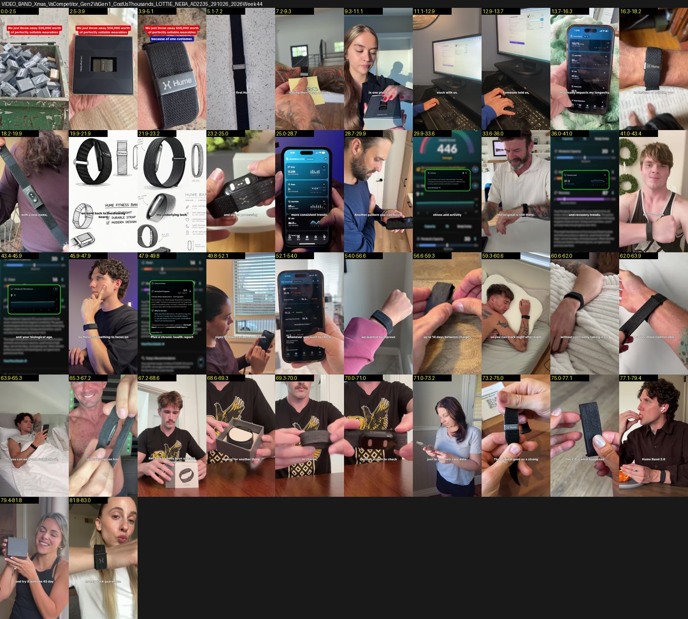

# VIDEO_BAND_Xmas_VsCompetitor_Gen2VsGen1_CostUsThousands_LOTTIE_NEBA_AD2235_291026_2026Week44

Master: `VIDEO_BAND_Xmas_VsCompetitor_Gen2VsGen1_CostUsThousands_LOTTIE_NEBA_AD2235_291026_2026Week44_9x16_hook1.mp4` · 83.0s · 1080x1920

**Pacing:** 42 shots · avg 1.975s · median 1.88s · 4.94 cuts/10s · first cut 2.52s · 236.0 wpm · talk ratio 0.97 · cuts on word start 73.2% · cuts in speech gaps 48.8%
**Audio:** {'I_lufs': -24.0, 'LRA': 4.3, 'true_peak_db': -5.4} · BPM≈117.5 · music {'speech_rms_db': -31.2, 'pause_seconds': 0.0} · cuts with SFX/transient 34.1%

**Captions:** 181 cards · 1 words/card (median) · y≈0.678 of frame height · text height≈0.0258 · colours {'white': 143, 'red': 7, 'blue': 3, 'dark/other': 23, 'green': 1, 'other-colour': 2, 'yellow': 2} · cards crossing a cut: 1
Highlighted: having their sleep,activity, 4.METRICS, 99Steps, 12,218, Normal, All in the Humeapp,, whenever you want to check., And of course,, we wanted to improve, your user experience too., First,the battery, upto14daysbetween charges, so you can track nightafter night, The original gave us a strong, and try it with the 45 day
**Headlines:** Wejustthrewaway$50,000worth (0.0–4.5s, red) | ofperfectlysellablewearables (0.0–4.5s, red) | LiveLonger.Better. (3.0–3.0s, white) | XHume (3.0–4.5s, white) | LiveLonger.Better (3.5–3.5s, white) | becauseofonecustomer. (4.0–4.5s, blue) | KHumeHealh (11.0–11.0s, white) | HHumeHeatn (12.0–12.0s, white)

**Hook (0–3s) spoken:** We just threw away $50 ,000 worth of perfectly sellable
**Hook on-screen:** HumeBand / Wejustthrewaway$50,000worth / XHume / ofperfectlysellablewearables
**CTA (last 5s):** .0 through the link below, see the current offer, and try it with the 45 day money back guarantee. · on-screen: HumeBand2.0 / See the currentoffer / and try it with the 45 day / money back guarantee. / through the link below.

## Beat sheet

| # | in–out (s) | dur | transition | spoken | on-screen text |
|---|---|---|---|---|---|
| 1 | 0.00–2.52 | 2.52 |  | We just threw away $50 ,000 worth of | Wejustthrewaway$50,000worth [red] (HEADLINE) / ofperfectlysellablewearables [red] (HEADLINE) / XHume / HumeBand |
| 2 | 2.52–3.92 | 1.4 | cut +SFX hit | perfectly sellable wearables because | Wejustthrewaway$50,000worth [red] (HEADLINE) / ofperfectlysellablewearables [red] (HEADLINE) / XHume / HumeBand / LiveLonger.Better. (HEADLINE) / XHume (HEADLINE) |
| 3 | 3.92–5.08 | 1.16 | cut | of one customer. | Wejustthrewaway$50,000worth [red] (HEADLINE) / ofperfectlysellablewearables [red] (HEADLINE) / XHume (HEADLINE) / LiveLonger.Better (HEADLINE) / becauseofonecustomer. [blue] (HEADLINE) / XHume |
| 4 | 5.08–7.16 | 2.08 | cut | Look, our first human band did a lot right. | XHume / Look, our first Hume Band / Hume / XHume / People loved |
| 5 | 7.16–9.28 | 2.12 | cut | People loved having their sleep, activity, | XHume / People loved / TRICS / having their sleep,activity [red] / Hume / 4.METRICS [blue] |
| 6 | 9.28–11.08 | 1.8 | cut +SFX hit | and recovery information in one place. | having their sleep,activity [red] / Hume / 4.METRICS [blue] / in one place. / KHumeHealh (HEADLINE) / But onepiece of feedback |
| 7 | 11.08–12.92 | 1.84 | cut | But one piece of feedback stuck with us. | KHumeHealh (HEADLINE) / But onepiece of feedback / HHumeHeatn (HEADLINE) / stuck with us. |
| 8 | 12.92–13.68 | 0.76 | cut | Someone told us, | HumeHealth' (HEADLINE) / Someone told us, |
| 9 | 13.68–16.32 | 2.64 | cut | I just want more of the stuff that really impacts my longevity. | HumeBand [blue] (HEADLINE) / 99Steps (HEADLINE) / Sleep / 9n1m / Last:17/lun/26 / CoBloodPressure |
| 10 | 16.32–18.20 | 1.88 | cut | Fair enough. So, instead of building you another | BodyTemperature / 1:394 [blue] (HEADLINE) / 42.5 (HEADLINE) / 35.4-36.6c / 94-98% / Thenutrition,sleep.activity.bodycomposition |
| 11 | 18.20–19.92 | 1.72 | cut +SFX hit | fitness tracker with a new name, we | anotherfitnesstracker / with a new name, |
| 12 | 19.92–21.88 | 1.96 | cut +SFX hit | went back to the drawing board to completely overhaul | XHume (HEADLINE) / HUMEFITNESSBAND / LIGHTWEIGHT / XHur / werwentback tothedrawingTRAP / board |
| 13 | 21.88–23.20 | 1.32 | cut | the underlying tech. We | SLEEK& (HEADLINE) / MINIMAL (HEADLINE) / DESIGN (HEADLINE) / HUME / HUMESENSOR / MODULE |
| 14 | 23.20–25.04 | 1.84 | cut +SFX hit | improved the sensors and signal processing to | HumelHealth (HEADLINE) / We improved the sensors / and signal processing / 99Steps [blue] / 12,218 [blue] / 65bpm |
| 15 | 25.04–28.68 | 3.64 | cut +SFX hit | give you clearer, more consistent trends. We added blood pressure trend insights. Another | 99Steps [blue] / 12,218 [blue] / 65bpm / 8to.give you clearer, / 9:36 [blue] (HEADLINE) / 99 steps [blue] (HEADLINE) |
| 16 | 28.68–29.88 | 1.2 | cut +SFX hit | pattern you can follow alongside | Anotherpatternyou canfollow |
| 17 | 29.88–33.60 | 3.72 | cut | your sleep stress and activity that helps detect potential red flags Everything | HealthScore (HEADLINE) / 446 (HEADLINE) / Average (HEADLINE) / We'vejustpreparedyour HealthReport- (HEADLINE) / Check it out now! (HEADLINE) / MetabolicMomentum |
| 18 | 33.60–36.00 | 2.4 | cut | people liked about the original is still there sleep | Everything peopleliked about / the original is still there |
| 19 | 36.00–41.04 | 5.04 | cut | tracking heart rate hrv activity stress and recovery trends metabolic capacity so | 心Sleep / 5n47m / Sleep tracking, heart rate, HRV / 79bpm / Activity / Youractivityscoreneedsmprovement,Youhave |
| 20 | 41.04–43.40 | 2.36 | cut +SFX hit | you have another reference point for how much you've got in the tank metabolic | so you have another reference / point / for how much / you've got in the tank. / pbibi (HEADLINE) |
| 21 | 43.40–45.92 | 2.52 | cut | momentum and your biological age So | you've got in the tank. / pbibi (HEADLINE) / MetabolicMomentum (HEADLINE) / Metabolicmomentum / BiologicalAge 36yrs / and your biological age |
| 22 | 45.92–47.92 | 2.0 | cut +SFX hit | there's something to focus on beyond today's workout plus | Sothere's something to focuson / beyond today's workout. |
| 23 | 47.92–49.80 | 1.88 | cut | a chronic health report that tells you | 14 i (HEADLINE) / Strain (HEADLINE) / 100 (HEADLINE) / Target (HEADLINE) / Recovery (HEADLINE) / YourMetabolicCapacity3Oisyourdailylimitforall |
| 24 | 49.80–52.12 | 2.32 | cut | if your body is showing signs of more serious conditions all | if your body is showing / signs of more serious conditions. / 12:12# (HEADLINE) / HumePod (HEADLINE) / 34198 (HEADLINE) / 23/96 (HEADLINE) |
| 25 | 52.12–54.00 | 1.88 | cut | in the humap whenever you want to check and | 12:12# (HEADLINE) / HumePod (HEADLINE) / 34198 (HEADLINE) / 23/96 (HEADLINE) / Wantdeeeerinsighisinteyou / Weight |
| 26 | 54.00–56.56 | 2.56 | cut +SFX hit | of course we wanted to improve your user experience to first | And of course, [red] / we wanted to improve [other-colour] / your user experience too. [other-colour] |
| 27 | 56.56–59.28 | 2.72 | cut | the battery up to 14 days between charges so | First,the battery [yellow] / upto14daysbetween charges [yellow] |
| 28 | 59.28–60.64 | 1.36 | cut | you can track night after night without | upto14daysbetween charges [yellow] / so you can track nightafter night [red] |
| 29 | 60.64–62.00 | 1.36 | cut | constantly taking it off. | without constantly taking it off. |
| 30 | 62.00–63.88 | 1.88 | cut | A softer, more comfortable fit and strap you | Asofter, more comfortable / fit and strap |
| 31 | 63.88–65.28 | 1.4 | cut | can wear and forget about. Still | you can wear and forget about. / you can wear and forget about |
| 32 | 65.28–67.16 | 1.88 | cut +SFX hit | screenless, still subscription free. | you can wear and forget about / still subscription free. / Because nobody buys a health / band |
| 33 | 67.16–68.64 | 1.48 | cut +SFX hit | Because nobody buys a health ban hoping | Because nobody buys a health / band |
| 34 | 68.64–69.28 | 0.64 | cut | for another thing | hoping for another thing |
| 35 | 69.28–70.00 | 0.72 | cut | to charge, | hoping for another thing |
| 36 | 70.00–71.00 | 1.0 | cut | another screen to check, | anotherscreento check |
| 37 | 71.00–73.16 | 2.16 | cut +SFX hit | and another monthly bill just to see their core data. | and another monthly bill / just to see their core data. / XHume / The original gave us a strong [red] |
| 38 | 73.16–75.04 | 1.88 | cut | The original gave us a strong starting point. | XHume / The original gave us a strong [red] / The 2.0 is what happened |
| 39 | 75.04–77.08 | 2.04 | cut | The 2 .0 is what happened when we listened. | The 2.0 is what happened / Check out |
| 40 | 77.08–79.36 | 2.28 | cut | Check out HumeBan 2 .0 through the link below, | Check out / HumeBand2.0 / through the link below. |
| 41 | 79.36–81.76 | 2.4 | cut | see the current offer, and try it with the 45 day | through the link below. / See the currentoffer / and try it with the 45 day [red] |
| 42 | 81.76–82.97 | 1.2 | cut +SFX hit | money back guarantee. | money back guarantee. |

## Hook variants

| hook | file | dur | first cut | spoken 0–3s | on-screen 0–3s |
|---|---|---|---|---|---|
| 1 | `housands_LOTTIE_NEBA_AD2235_291026_2026Week44_9x16_hook1.mp4` | 83.0 | 2.52 | We just threw away $50 ,000 worth of perfectly sellable | HumeBand / Wejustthrewaway$50,000worth / XHume / ofperfectlysellablewearables |
| 1 | `housands_LOTTIE_NEBA_AD2235_291026_2026Week44_9x16_hook1.mp4` | 83.0 | 2.52 |  |  |
| 2 | `housands_LOTTIE_NEBA_AD2235_291026_2026Week44_9x16_hook2.mp4` | 81.1 | 1.72 |  |  |
| 2 | `housands_LOTTIE_NEBA_AD2235_291026_2026Week44_9x16_hook2.mp4` | 81.1 | 1.72 |  |  |
| 3 | `housands_LOTTIE_NEBA_AD2235_291026_2026Week44_9x16_hook3.mp4` | 80.1 | 1.0 |  |  |
| 3 | `housands_LOTTIE_NEBA_AD2235_291026_2026Week44_9x16_hook3.mp4` | 80.1 | 1.0 |  |  |

## Full transcript

We just threw away $50,000 worth of perfectly sellable wearables because of one customer. Look, our first human band did a lot right. People loved having their sleep, activity, and recovery information in one place. But one piece of feedback stuck with us. Someone told us, I just want more of the stuff that really impacts my longevity. Fair enough. So, instead of building you another fitness tracker with a new name, we went back to the drawing board to completely overhaul the underlying tech. We improved the sensors and signal processing to give you clearer, more consistent trends. We added blood pressure trend insights. Another pattern you can follow alongside your sleep stress and activity that helps detect potential red flags Everything people liked about the original is still there sleep tracking heart rate hrv activity stress and recovery trends metabolic capacity so you have another reference point for how much you've got in the tank metabolic momentum and your biological age So there's something to focus on beyond today's workout plus a chronic health report that tells you if your body is showing signs of more serious conditions all in the humap whenever you want to check and of course we wanted to improve your user experience to first the battery up to 14 days between charges so you can track night after night without constantly taking it off. A softer, more comfortable fit and strap you can wear and forget about. Still screenless, still subscription free. Because nobody buys a health ban hoping for another thing to charge, another screen to check, and another monthly bill just to see their core data. The original gave us a strong starting point. The 2.0 is what happened when we listened. Check out HumeBan 2.0 through the link below, see the current offer, and try it with the 45 day money back guarantee.