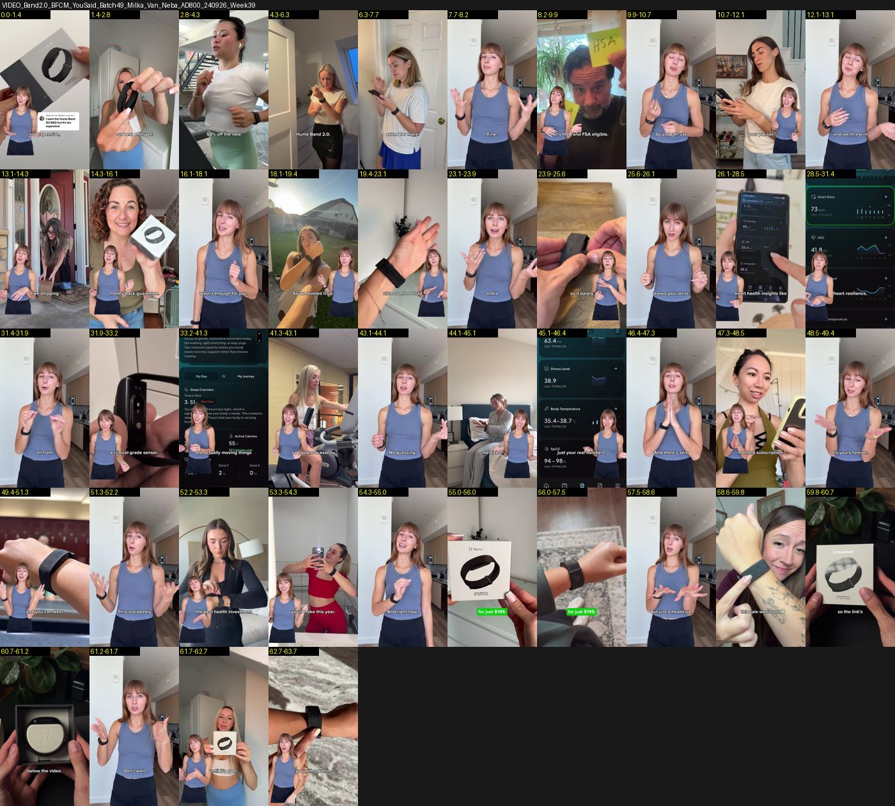

# VIDEO_Band2.0_BFCM_YouSaid_Batch49_Milka_Van_Neba_AD800_240926_Week39

Master: `VIDEO_Band2.0_BFCM_YouSaid_Batch49_Milka_Van_Neba_AD800_240926_Week39_Hook1_9x16.mp4` · 63.7s · 1080x1920

**Pacing:** 44 shots · avg 1.448s · median 1.151s · 6.75 cuts/10s · first cut 1.4s · 217.0 wpm · talk ratio 0.93 · cuts on word start 72.1% · cuts in speech gaps 58.1%
**Audio:** {'I_lufs': -18.9, 'LRA': 1.7, 'true_peak_db': -1.7} · BPM≈129.2 · music {'speech_rms_db': -23.9, 'pause_seconds': 0.6, 'pause_rms_db': -24.7, 'bed_minus_voice_db': -0.8, 'music_bed_likely': True} · cuts with SFX/transient 58.1%

**Captions:** 220 cards · 1.0 words/card (median) · y≈0.684 of frame height · text height≈0.0246 · colours {'white': 179, 'other-colour': 1, 'yellow': 2, 'red': 3, 'dark/other': 35} · cards crossing a cut: 1
Highlighted: So we leveled it up, So we leveled it up., that's sleeker and thinner,, leaves your wrist., Verylow, you'll make this year.
**Headlines:** HumeHealth (1.0–1.0s, white) | Livo Lontitt.Boitet. (1.0–1.0s, dark/other) | HSA (8.0–9.0s, yellow) | 11:28600 (26.0–26.0s, dark/other) | HumeBand(75%) (26.0–28.0s, dark/other) | Connected (26.0–26.0s, dark/other) | 9 steps (26.0–26.0s, dark/other) | 201 (26.0–26.0s, white)

**Hook (0–3s) spoken:** You said it was too expensive, so we launched our best offer yet,
**Hook on-screen:** HumeHealth / IwanttheHumeBand / Livo Lontitt.Boitet. / SOBADbutit'stoo / WurmeBand2.0 / You said it was / expensive! / our best offer yet: / so we launched / too expensive,
**CTA (last 5s):** sale won't last, so the links below the video. Don't wait until it's over, you will regret it. · on-screen: 24/7Heaith Tracking / Don't wait / XHumeHealth / so the link's / this sale won't last, / until it's over, / you will regret it.

## Beat sheet

| # | in–out (s) | dur | transition | spoken | on-screen text |
|---|---|---|---|---|---|
| 1 | 0.00–1.40 | 1.4 |  | You said it was too expensive, | WurmeBand2.0 / IwanttheHumeBand / SOBADbutit'stoo / expensive! / You said it was / too expensive, |
| 2 | 1.40–2.83 | 1.43 | cut +SFX hit | so we launched our best offer yet, | IwanttheHumeBand / SOBADbutit'stoo / expensive! / too expensive, / HumeHealth (HEADLINE) / Livo Lontitt.Boitet. (HEADLINE) |
| 3 | 2.83–4.27 | 1.43 | cut +SFX hit | 50 % off | our best offer yet: / 50%offthenew |
| 4 | 4.27–6.33 | 2.07 | cut +SFX hit | the new Hume Band 2 .0. | 50%offthenew / Hume Band 2.0. |
| 5 | 6.33–7.67 | 1.33 | cut | Then you asked for more. | Hume Band 2.0. / asked for more. |
| 6 | 7.67–8.23 | 0.57 | cut +SFX hit | Fine, | HSA [yellow] (HEADLINE) / it's HSA and FSA eligible. |
| 7 | 8.23–9.90 | 1.67 | cut +SFX hit | it's HSA and FSA eligible, | HSA [yellow] (HEADLINE) / it's HSA and FSA eligible. |
| 8 | 9.90–10.67 | 0.77 | cut +SFX hit | so you can use | So you can use |
| 9 | 10.67–12.13 | 1.47 | cut | your pre -tax health dollars, | REME / your pre-tax / health dollars, |
| 10 | 12.13–13.13 | 1.0 | cut | and we threw in | health dollars, / free shipping |
| 11 | 13.13–14.30 | 1.17 | cut | free shipping and a 45 | free shipping / and a 45-day |
| 12 | 14.30–16.13 | 1.83 | cut +SFX hit | -day money -back guarantee, | and a 45-day / money-back guarantee. / But that still |
| 13 | 16.13–18.07 | 1.93 | cut +SFX hit | but that still wasn't enough for you. | But that still / wasn't enough for you. / So we leveled it up [other-colour] |
| 14 | 18.07–19.40 | 1.33 | cut +SFX hit | So we leveled it up. | So we leveled it up [other-colour] / So we leveled it up. [yellow] |
| 15 | 19.40–23.07 | 3.67 | cut +SFX hit | A new patented ultra -comfort strap that's sleeker and thinner and | So we leveled it up. [yellow] / Anew patented / ultra-comfort strap / that's sleeker and thinner, [red] / and a |
| 16 | 23.07–23.90 | 0.83 | cut +SFX hit | a 14 -day | and a |
| 17 | 23.90–25.60 | 1.7 | cut | battery life so it barely leaves your | 14-day battery life, / leaves your wrist. [yellow] |
| 18 | 25.60–26.07 | 0.47 | cut | wrist. | 11:28600 (HEADLINE) / HumeBand(75%) (HEADLINE) / Connected (HEADLINE) / 9 steps (HEADLINE) / 201 (HEADLINE) / Las:30/08/2025 (HEADLINE) |
| 19 | 26.07–28.47 | 2.4 | cut | You get 24 -7 heart health insights like HRV, | 11:28600 (HEADLINE) / HumeBand(75%) (HEADLINE) / Connected (HEADLINE) / 9 steps (HEADLINE) / 201 (HEADLINE) / Las:30/08/2025 (HEADLINE) |
| 20 | 28.47–31.43 | 2.97 | cut +SFX hit | heart resilience, and blood pressure insights all | HumeBand(75%) (HEADLINE) / 53.4ms / 38.5 / heart health insights like / 11:28800. (HEADLINE) / Heart Rate (HEADLINE) |
| 21 | 31.43–31.87 | 0.43 | cut +SFX hit | from a | Last:17/Aug/26 (HEADLINE) / BloodPressure (HEADLINE) / 121/70 (HEADLINE) / mmHg (HEADLINE) / Heart Rate / and BP insights, |
| 22 | 31.87–33.23 | 1.37 | cut | clinical grade sensor plus | a clinical-grade sensor. / MetabolicMomentum (HEADLINE) / LifeAddedWithHume (HEADLINE) / Overall / 0.0d / You'reaging a bit faster than you should be due to not |
| 23 | 33.23–41.33 | 8.1 | cut | metabolic momentum. So you can see if your habits are actually moving things in the right direction. The Prof AI turns all of it into personalized coaching so | MetabolicMomentum (HEADLINE) / LifeAddedWithHume (HEADLINE) / Overall / 0.0d / You'reaging a bit faster than you should be due to not / being arnn enough.You're not at theworst level |
| 24 | 41.33–43.13 | 1.8 | cut | you know exactly what to work on. | HealthReport (HEADLINE) / Vi / Yourbodycompositionscoreisgood.Youhavehealthy (HEADLINE) / bodyfatlevels. (HEADLINE) / ViewAllDetails→ (HEADLINE) / CardiovascularHealth (HEADLINE) |
| 25 | 43.13–44.13 | 1.0 | cut +SFX hit | No guessing, no | No guessing, / no tricks, |
| 26 | 44.13–45.07 | 0.93 | cut | tricks, | no tricks, / Connecting. [green] (HEADLINE) / Hume Band (HEADLINE) / HRV (HEADLINE) / 63.4ms (HEADLINE) / Last:19/Mar/26 (HEADLINE) |
| 27 | 45.07–46.40 | 1.33 | cut | just your real numbers. And | Connecting. [green] (HEADLINE) / Hume Band (HEADLINE) / HRV (HEADLINE) / 63.4ms (HEADLINE) / Last:19/Mar/26 (HEADLINE) / StressLevel (HEADLINE) |
| 28 | 46.40–47.30 | 0.9 | cut +SFX hit | there's zero monthly | Connecting. [green] (HEADLINE) / Hume Band (HEADLINE) / Last:19/Mar/26 (HEADLINE) / StressLevel (HEADLINE) / Last:19/Mar/26 / BodyTemperature |
| 29 | 47.30–48.47 | 1.17 | cut | subscription. | And there's zero / monthly subscription |
| 30 | 48.47–49.43 | 0.97 | cut +SFX hit | It's yours forever and | monthly subscription / It's yours forever, |
| 31 | 49.43–51.27 | 1.83 | cut | you can wear it every single day. | It's yours forever, / and you can wear / it every single day. |
| 32 | 51.27–52.20 | 0.93 | cut +SFX hit | This is probably the | it every single day. / the best health investment |
| 33 | 52.20–53.27 | 1.07 | cut | best health investment you'll | the best health investment |
| 34 | 53.27–54.27 | 1.0 | cut | make this year. | the best health investment / you'll make this year. [red] |
| 35 | 54.27–54.97 | 0.7 | cut +SFX hit | And right now you | you'll make this year. [red] |
| 36 | 54.97–56.03 | 1.07 | cut | can get it for just $199, | XHumeHealih / And right now, |
| 37 | 56.03–57.53 | 1.5 | cut +SFX hit | But |  |
| 38 | 57.53–58.63 | 1.1 | cut +SFX hit | just a heads up, this | But just a heads up, |
| 39 | 58.63–59.77 | 1.13 | cut +SFX hit | sale won't last, | this sale won't last, |
| 40 | 59.77–60.70 | 0.93 | cut +SFX hit | so the links below the | XHumeHealth / 24/7Heaith Tracking / so the link's |
| 41 | 60.70–61.20 | 0.5 | cut +SFX hit | video. | Don't wait |
| 42 | 61.20–61.73 | 0.53 | cut +SFX hit | Don't wait until | Don't wait |
| 43 | 61.73–62.67 | 0.93 | cut | it's over, | until it's over, |
| 44 | 62.67–63.72 | 1.05 | cut +SFX hit | you will regret it. | you will regret it. |

## Hook variants

| hook | file | dur | first cut | spoken 0–3s | on-screen 0–3s |
|---|---|---|---|---|---|
| 1 | `id_Batch49_Milka_Van_Neba_AD800_240926_Week39_Hook1_9x16.mp4` | 63.7 | 1.4 | You said it was too expensive, so we launched our best offer yet, | HumeHealth / IwanttheHumeBand / Livo Lontitt.Boitet. / SOBADbutit'stoo / WurmeBand2.0 / You said it was / expensive! / our best offer yet: |
| 2 | `id_Batch49_Milka_Van_Neba_AD800_240926_Week39_Hook2_9x16.mp4` | 63.5 | 1.733 |  |  |
| 3 | `id_Batch49_Milka_Van_Neba_AD800_240926_Week39_Hook3_9x16.mp4` | 63.5 | 1.633 | You kept leaving the Humeban 2 .0 in your cart, so |  |

## Full transcript

You said it was too expensive, so we launched our best offer yet, 50% off the new Hume Band 2.0. Then you asked for more. Fine, it's HSA and FSA eligible, so you can use your pre-tax health dollars, and we threw in free shipping and a 45-day money-back guarantee, but that still wasn't enough for you. So we leveled it up. A new patented ultra-comfort strap that's sleeker and thinner and a 14-day battery life so it barely leaves your wrist. You get 24-7 heart health insights like HRV, heart resilience, and blood pressure insights all from a clinical grade sensor plus metabolic momentum. So you can see if your habits are actually moving things in the right direction. The Prof AI turns all of it into personalized coaching so you know exactly what to work on. No guessing, no tricks, just your real numbers. And there's zero monthly subscription. It's yours forever and you can wear it every single day. This is probably the best health investment you'll make this year. And right now you can get it for just $199, But just a heads up, this sale won't last, so the links below the video. Don't wait until it's over, you will regret it.