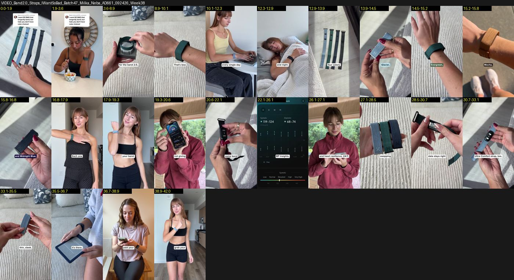

# VIDEO_Band2.0_Straps_IWantSoBad_Batch47_Milka_Neba_AD661_092426_Week38

Master: `VIDEO_Band2.0_Straps_IWantSoBad_Batch47_Milka_Neba_AD661_092426_Week38_Hook1_9x16.mp4` · 42.0s · 1080x1920

**Pacing:** 24 shots · avg 1.749s · median 1.367s · 5.48 cuts/10s · first cut 1.9s · 215.0 wpm · talk ratio 0.94 · cuts on word start 82.6% · cuts in speech gaps 78.3%
**Audio:** {'I_lufs': -20.7, 'LRA': 1.6, 'true_peak_db': -6.2} · BPM≈123.0 · music {'speech_rms_db': -23.8, 'pause_seconds': 0.9, 'pause_rms_db': -23.8, 'bed_minus_voice_db': 0.0, 'music_bed_likely': True} · cuts with SFX/transient 39.1%

**Captions:** 62 cards · 2.0 words/card (median) · y≈0.632 of frame height · text height≈0.0258 · colours {'white': 53, 'blue': 1, 'dark/other': 8} · cards crossing a cut: 1
Highlighted: your lucky day.
**Headlines:** longevityband,but (0.0–3.0s, white) | hateyoudon'thave (0.0–3.0s, white) | colorchoices! (0.0–0.5s, white) | Reply toHannah976's comment (1.0–1.5s, white) | IwantSOBADthat (1.0–1.5s, white) | colorchoices! (1.5–3.0s, white) | HumeHealth (4.5–4.5s, white) | 526 (20.0–20.0s, white)

**Hook (0–3s) spoken:** I want to so bad that longevity band, but hate you don't have color choices.
**Hook on-screen:** IwantSOBADthat / Reply toHannah976's comment / colorchoices! / hateyoudon'thave / longevityband,but
**CTA (last 5s):** scroll past your new favorite look. Click now and grab your color for $49. · on-screen: Click now and / Don't scroll / color for $49. / grab your / newfavorite

## Beat sheet

| # | in–out (s) | dur | transition | spoken | on-screen text |
|---|---|---|---|---|---|
| 1 | 0.00–1.90 | 1.9 |  | I want to so bad that longevity band, | longevityband,but (HEADLINE) / hateyoudon'thave (HEADLINE) / colorchoices! (HEADLINE) / Reply toHannah976's comment (HEADLINE) / IwantSOBADthat (HEADLINE) / colorchoices! (HEADLINE) |
| 2 | 1.90–3.60 | 1.7 | cut +SFX hit | but hate you don't have color choices. | longevityband,but (HEADLINE) / hateyoudon'thave (HEADLINE) / Reply toHannah976's comment (HEADLINE) / IwantSOBADthat (HEADLINE) / colorchoices! (HEADLINE) / Well, it's |
| 3 | 3.60–8.90 | 5.3 | cut | Well, it's your lucky day. Hume just dropped new straps for the band 2 .0, and they're only $49. | Well, it's / your lucky day. [blue] / HumeHealth (HEADLINE) / Hume just dropped / new straps / for the band 2.0, |
| 4 | 8.90–10.07 | 1.17 | cut +SFX hit | That's less than a dinner out, | That's less / and you're |
| 5 | 10.07–12.27 | 2.2 | cut | and you're getting something you'll wear every single day and | and you're / every single day |
| 6 | 12.27–12.87 | 0.6 | cut +SFX hit | night. | every single day |
| 7 | 12.87–13.90 | 1.03 | cut +SFX hit | There are four colors, | four colors: |
| 8 | 13.90–14.53 | 0.63 | cut | Glacier, | Glacier, |
| 9 | 14.53–15.20 | 0.67 | cut | Evergreen, | Mocha, |
| 10 | 15.20–15.77 | 0.57 | cut | Mocha, | Mocha, |
| 11 | 15.77–16.80 | 1.03 | cut +SFX hit | and Midnight Blue. | and Midnight Blue. |
| 12 | 16.80–17.93 | 1.13 | cut | Each one completely changes | Each one |
| 13 | 17.93–19.30 | 1.37 | cut | the look of your band, | changes / your band. |
| 14 | 19.30–20.60 | 1.3 | cut +SFX hit | and you're not giving anything up. | your band. / 526 (HEADLINE) / anything up |
| 15 | 20.60–22.10 | 1.5 | cut | It's the same band underneath, | same band / Sleep (HEADLINE) / TimeAsleep (HEADLINE) / 6h44m (HEADLINE) / Standard [green] (HEADLINE) / 22/08/2025 (HEADLINE) |
| 16 | 22.10–26.13 | 4.03 | cut | still tracking your sleep, HRV, VP Insights, and Heart Resilience 24 | Sleep (HEADLINE) / TimeAsleep (HEADLINE) / 6h44m (HEADLINE) / Standard [green] (HEADLINE) / 22/08/2025 (HEADLINE) / still tracking |
| 17 | 26.13–27.13 | 1.0 | cut +SFX hit | -7. You're | andheartresilience,24/7. / You're just |
| 18 | 27.13–28.50 | 1.37 | cut +SFX hit | just swapping the strap, | You're just / the strap |
| 19 | 28.50–30.73 | 2.23 | cut | and all your data stays right where it was. | data stays right / where it was. |
| 20 | 30.73–33.10 | 2.37 | cut | It's their patented Ultra Comfort Strap too, | patented / Ultra Comfort strap,too, / so it's |
| 21 | 33.10–35.53 | 2.43 | cut | so it's thin, sleek, and so soft that | so it's / thin, sleek, / and so soft |
| 22 | 35.53–36.70 | 1.17 | cut +SFX hit | you forget it's there. | it's there. |
| 23 | 36.70–38.90 | 2.2 | cut | Don't scroll past your new favorite look. | Don't scroll / newfavorite |
| 24 | 38.90–41.98 | 3.08 | cut | Click now and grab your color for $49. | Click now and / grab your / color for $49. |

## Hook variants

| hook | file | dur | first cut | spoken 0–3s | on-screen 0–3s |
|---|---|---|---|---|---|
| 1 | `tSoBad_Batch47_Milka_Neba_AD661_092426_Week38_Hook1_9x16.mp4` | 42.0 | 1.9 | I want to so bad that longevity band, but hate you don't have color choices. | IwantSOBADthat / Reply toHannah976's comment / colorchoices! / hateyoudon'thave / longevityband,but |
| 2 | `tSoBad_Batch47_Milka_Neba_AD661_092426_Week38_Hook2_9x16.mp4` | 42.1 | 1.133 | I've wanted the Hume band forever, but I needed it to match | Bandforever,buti / I've wanted the Hume / ReplytoGrace_Sh'scomment / needed itto match my / style. |
| 3 | `tSoBad_Batch47_Milka_Neba_AD661_092426_Week38_Hook3_9x16.mp4` | 41.5 | 1.7 | Love everything about the Hume Band. Just wish it came in more colors. | Loveeverythingabout / colors. / theHumeBand.Just / wishitcameinmore |
| 4 | `tSoBad_Batch47_Milka_Neba_AD661_092426_Week38_Hook4_9x16.mp4` | 41.5 | 1.333 | The only thing stopping me from getting the Hume Band is the strap color. | HumeBand isthe strap / The only thing stopping / color lol / mefromgettingthe |

## Full transcript

I want to so bad that longevity band, but hate you don't have color choices. Well, it's your lucky day. Hume just dropped new straps for the band 2.0, and they're only $49. That's less than a dinner out, and you're getting something you'll wear every single day and night. There are four colors, Glacier, Evergreen, Mocha, and Midnight Blue. Each one completely changes the look of your band, and you're not giving anything up. It's the same band underneath, still tracking your sleep, HRV, VP Insights, and Heart Resilience 24-7. You're just swapping the strap, and all your data stays right where it was. It's their patented Ultra Comfort Strap too, so it's thin, sleek, and so soft that you forget it's there. Don't scroll past your new favorite look. Click now and grab your color for $49.