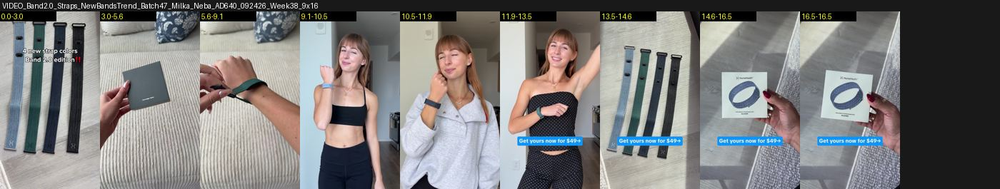

# VIDEO_Band2.0_Straps_NewBandsTrend_Batch47_Milka_Neba_AD640_092426_Week38_9x16

Master: `VIDEO_Band2.0_Straps_NewBandsTrend_Batch47_Milka_Neba_AD640_092426_Week38_9x16_Hook1.mp4` · 16.5s · 1080x1920

**Pacing:** 9 shots · avg 1.835s · median 1.666s · 4.84 cuts/10s · first cut 3.0s · None wpm · talk ratio 0.0 · cuts on word start 0.0% · cuts in speech gaps 100.0%
**Audio:** {'I_lufs': -14.7, 'LRA': 9.5, 'true_peak_db': -0.9} · BPM≈89.1 · music None · cuts with SFX/transient 75.0%

**Captions:** 9 cards · 1 words/card (median) · y≈0.555 of frame height · text height≈0.0293 · colours {'white': 6, 'blue': 3} · cards crossing a cut: 0
Highlighted: Getyoursnowfor$49-→, Getyoursnowfor $49-, Get yours nowfor$49-→
**Headlines:** 4new strapcolors (0.0–2.5s, white) | Band 2.0 edition!! (0.0–0.5s, white) | Band 2.0 edition! (1.0–1.0s, white) | Band 2.0 edition!! (1.5–2.5s, white) | XHumeHealth" (3.0–3.0s, white) | >HumeHealth" (3.5–3.5s, white)

**Hook (0–3s) spoken:** 
**Hook on-screen:** 4new strapcolors / Band 2.0 edition! / Band 2.0 edition!!
**CTA (last 5s):**  · on-screen: GLACIER / Get yours nowfor$49-→ / Getyoursnowfor $49- / Getyoursnowfor$49-→ / HumeBand2.oPidomanee Xit / HuneBand2.0PerfurmaeceKnt / XHumeHealth"

## Beat sheet

| # | in–out (s) | dur | transition | spoken | on-screen text |
|---|---|---|---|---|---|
| 1 | 0.00–3.00 | 3.0 |  |  | 4new strapcolors (HEADLINE) / Band 2.0 edition!! (HEADLINE) / Band 2.0 edition! (HEADLINE) / Band 2.0 edition!! (HEADLINE) |
| 2 | 3.00–5.60 | 2.6 | cut |  | XHumeHealth" (HEADLINE) / EVERGREEN / >HumeHealth" (HEADLINE) / Lrs Longu. Bene. |
| 3 | 5.60–9.10 | 3.5 | cut +SFX hit |  |  |
| 4 | 9.10–10.53 | 1.43 | cut |  |  |
| 5 | 10.53–11.87 | 1.33 | cut +SFX hit |  |  |
| 6 | 11.87–13.53 | 1.67 | cut +SFX hit |  | Getyoursnowfor$49-→ [blue] |
| 7 | 13.53–14.63 | 1.1 | cut +SFX hit |  | Getyoursnowfor $49- [blue] |
| 8 | 14.63–16.47 | 1.83 | cut +SFX hit |  | XHumeHealth" / HumeBand2.oPidomanee Xit / GLACIER / Get yours nowfor$49-→ [blue] / HuneBand2.0PerfurmaeceKnt |
| 9 | 16.47–16.51 | 0.05 | cut +SFX hit |  | XHumeHealth" / GLACIER / Get yours nowfor$49-→ [blue] / HuneBand2.0PerfurmaeceKnt |

## Hook variants

| hook | file | dur | first cut | spoken 0–3s | on-screen 0–3s |
|---|---|---|---|---|---|
| 1 | `sTrend_Batch47_Milka_Neba_AD640_092426_Week38_9x16_Hook1.mp4` | 16.5 | 3.0 |  | 4new strapcolors / Band 2.0 edition! / Band 2.0 edition!! |
| 1 | `sTrend_Batch47_Milka_Neba_AD640_092426_Week38_9x16_Hook1.mp4` | 16.5 | 3.0 |  |  |
| 2 | `sTrend_Batch47_Milka_Neba_AD640_092426_Week38_9x16_Hook2.mp4` | 16.5 | 1.933 |  | 2.0STRAPS / MEET THE NEW BAND / We listened. / You asked for colors. |
| 2 | `sTrend_Batch47_Milka_Neba_AD640_092426_Week38_9x16_Hook2.mp4` | 16.5 | 1.933 |  |  |
| 3 | `sTrend_Batch47_Milka_Neba_AD640_092426_Week38_9x16_Hook3.mp4` | 16.5 | 1.8 |  | New straps just dropped. / Nowin 4 colors. |
| 3 | `sTrend_Batch47_Milka_Neba_AD640_092426_Week38_9x16_Hook3.mp4` | 16.5 | 1.8 |  |  |

## Full transcript

