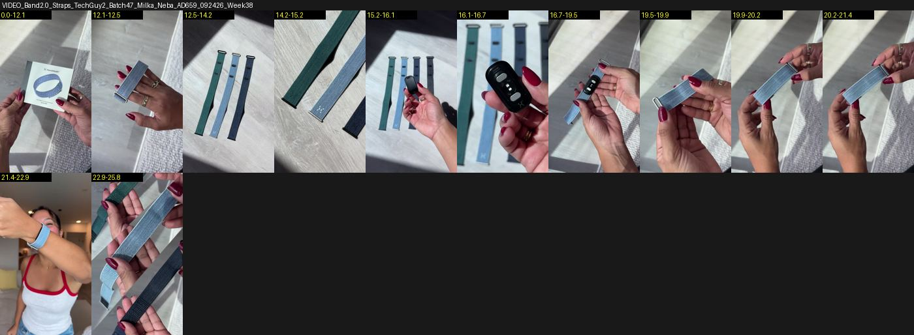

# VIDEO_Band2.0_Straps_TechGuy2_Batch47_Milka_Neba_AD659_092426_Week38

Master: `VIDEO_Band2.0_Straps_TechGuy2_Batch47_Milka_Neba_AD659_092426_Week38_9X16_HOOK1.mp4` · 25.8s · 1080x1920

**Pacing:** 12 shots · avg 2.154s · median 1.117s · 4.26 cuts/10s · first cut 12.1s · None wpm · talk ratio 0.0 · cuts on word start 0.0% · cuts in speech gaps 100.0%
**Audio:** {'I_lufs': -10.9, 'LRA': 5.2, 'true_peak_db': 1.0} · BPM≈89.1 · music None · cuts with SFX/transient 90.9%

**Captions:** 14 cards · 1.0 words/card (median) · y≈0.528 of frame height · text height≈0.0363 · colours {'white': 14} · cards crossing a cut: 0
**Headlines:** Let's (0.0–0.0s, white) | XHumeHealth" (0.0–1.0s, white) | Let'sunboxmynew (0.5–1.0s, white) | HumeBand2.0Str (1.0–1.0s, blue) | X HumeHealth" (2.0–2.0s, white) | XHumeHealth (2.5–2.5s, white) | HumeHealth" (3.0–3.5s, white) | XHumeHealth" (4.0–4.0s, white)

**Hook (0–3s) spoken:** 
**Hook on-screen:** GLACIER / HumeBand2.0Str / Let's / Let'sunboxmynew / X HumeHealth" / XHumeHealth / XHumeHealth" / me Band 2.0Par
**CTA (last 5s):**  · on-screen: 

## Beat sheet

| # | in–out (s) | dur | transition | spoken | on-screen text |
|---|---|---|---|---|---|
| 1 | 0.00–12.10 | 12.1 |  |  | Let's (HEADLINE) / XHumeHealth" (HEADLINE) / GLACIER / Let'sunboxmynew (HEADLINE) / me Band 2.0Par / HumeBand2.0Str [blue] (HEADLINE) |
| 2 | 12.10–12.47 | 0.37 | cut +SFX hit |  |  |
| 3 | 12.47–14.17 | 1.7 | cut +SFX hit |  |  |
| 4 | 14.17–15.17 | 1.0 | cut +SFX hit |  |  |
| 5 | 15.17–16.07 | 0.9 | cut +SFX hit |  |  |
| 6 | 16.07–16.67 | 0.6 | cut +SFX hit |  |  |
| 7 | 16.67–19.47 | 2.8 | cut |  |  |
| 8 | 19.47–19.90 | 0.43 | cut +SFX hit |  |  |
| 9 | 19.90–20.20 | 0.3 | cut +SFX hit |  |  |
| 10 | 20.20–21.43 | 1.23 | cut +SFX hit |  |  |
| 11 | 21.43–22.93 | 1.5 | cut +SFX hit |  |  |
| 12 | 22.93–25.84 | 2.91 | cut +SFX hit |  |  |

## Hook variants

| hook | file | dur | first cut | spoken 0–3s | on-screen 0–3s |
|---|---|---|---|---|---|
| 1 | `chGuy2_Batch47_Milka_Neba_AD659_092426_Week38_9X16_HOOK1.mp4` | 25.8 | 12.1 |  | GLACIER / HumeBand2.0Str / Let's / Let'sunboxmynew / X HumeHealth" / XHumeHealth / XHumeHealth" / me Band 2.0Par |
| 1 | `chGuy2_Batch47_Milka_Neba_AD659_092426_Week38_9X16_HOOK1.mp4` | 25.8 | 12.1 |  | GLACIER / X HumeHealth" / XHumeHealth |
| 2 | `chGuy2_Batch47_Milka_Neba_AD659_092426_Week38_9X16_HOOK2.mp4` | 26.3 | 12.567 |  |  |
| 2 | `chGuy2_Batch47_Milka_Neba_AD659_092426_Week38_9X16_HOOK2.mp4` | 26.3 | 12.567 |  | X HumeHealth |
| 3 | `chGuy2_Batch47_Milka_Neba_AD659_092426_Week38_9X16_HOOK3.mp4` | 27.1 | 13.333 |  | New Hum / New Humestrapsjust / arrived, Let's open th / arrived.Let's open them. |
| 3 | `chGuy2_Batch47_Milka_Neba_AD659_092426_Week38_9X16_HOOK3.mp4` | 27.1 | 13.333 | You |  |
| 4 | `chGuy2_Batch47_Milka_Neba_AD659_092426_Week38_9X16_HOOK4.mp4` | 26.5 | 12.8 |  |  |
| 4 | `chGuy2_Batch47_Milka_Neba_AD659_092426_Week38_9X16_HOOK4.mp4` | 26.5 | 12.8 |  |  |

## Full transcript

