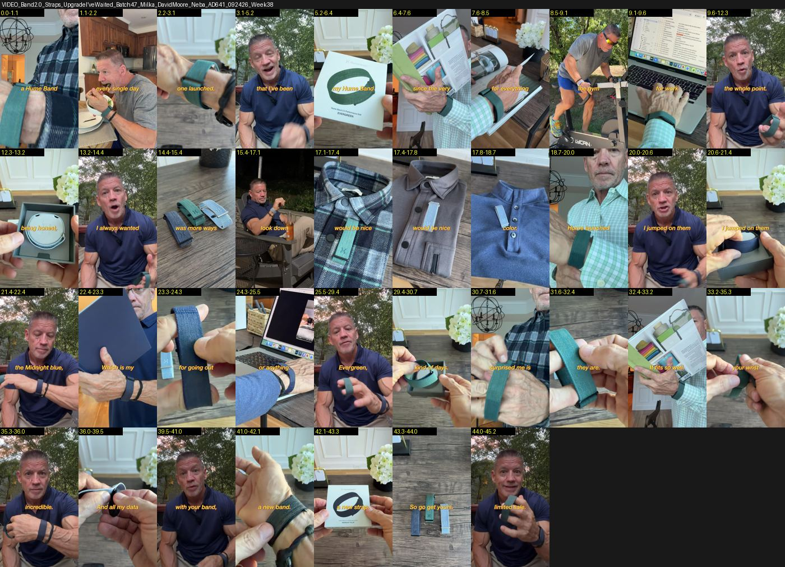

# VIDEO_Band2.0_Straps_UpgradeI’veWaited_Batch47_Milka_DavidMoore_Neba_AD641_092426_Week38

Master: `VIDEO_Band2.0_Straps_UpgradeI’veWaited_Batch47_Milka_DavidMoore_Neba_AD641_092426_Week38 Hook 1_9x16.mp4` · 45.2s · 1080x1920

**Pacing:** 37 shots · avg 1.222s · median 1.06s · 7.96 cuts/10s · first cut 1.06s · 305.0 wpm · talk ratio 0.96 · cuts on word start 91.7% · cuts in speech gaps 72.2%
**Audio:** {'I_lufs': -11.8, 'LRA': 3.6, 'true_peak_db': 0.3} · BPM≈123.0 · music {'speech_rms_db': -17.5, 'pause_seconds': 0.0} · cuts with SFX/transient 27.8%

**Captions:** 55 cards · 2 words/card (median) · y≈0.552 of frame height · text height≈0.0422 · colours {'yellow': 48, 'white': 7} · cards crossing a cut: 0
Highlighted: I've worn, a Hume Band, every single day, since the first, one launched,, and this is, the upgrade, that I've been, waiting for., SoI'vehad, myHumeBand, first one launched., for everything, for work, But that's
**Headlines:** HumeBand2.0PerformanceKnit (5.5–6.0s, white) | Important anduresd (9.0–9.0s, white) | OutofoffceodayBeArtheraus [video) (9.0–9.0s, white) | Ashipmesttomordelsutfodelvery (9.0–9.0s, red) | RE:Meta loroice3TSE389 (9.0–9.0s, red) | Atchedisyormolee1205202 (9.0–9.0s, red) | 'embnjdeSpanishCictiansrycomWordoftheDay (9.0–9.0s, white) | Ashipoentfremorderw3te10hasbeendelivered (9.0–9.0s, white)

**Hook (0–3s) spoken:** I've worn a Hume Band every single day since the first one launched
**Hook on-screen:** I've worn / a Hume Band / every single day / one launched, / since the first
**CTA (last 5s):** with your band, you don't need a new band. You just need a new strap. So go get yours whether they're on a limited sale. · on-screen: XHumalHealth / a new strap. / you don't need / you're on a

## Beat sheet

| # | in–out (s) | dur | transition | spoken | on-screen text |
|---|---|---|---|---|---|
| 1 | 0.00–1.06 | 1.06 |  | I've worn a Hume Band every | I've worn [yellow] / a Hume Band [yellow] / every single day [yellow] |
| 2 | 1.06–2.16 | 1.1 | cut | single day since | every single day [yellow] / since the first [yellow] |
| 3 | 2.16–3.12 | 0.96 | cut | the first one launched and | since the first [yellow] / one launched, [yellow] / and this is [yellow] |
| 4 | 3.12–5.22 | 2.1 | cut +SFX hit | this is the upgrade that I've been waiting for. | and this is [yellow] / the upgrade [yellow] / that I've been [yellow] / waiting for. [yellow] / KHumeHealth / SoI'vehad [yellow] |
| 5 | 5.22–6.40 | 1.18 | cut | So I've had my Hume Band since | KHumeHealth / SoI'vehad [yellow] / HumeBand2.0PerformanceKnit / EVERGREEN / myHumeBand [yellow] / HumeBand2.0PerformanceKnit (HEADLINE) |
| 6 | 6.40–7.56 | 1.16 | cut +SFX hit | the very first one launched | EVERGREEN / myHumeBand [yellow] / HumeBand2.0PerformanceKnit (HEADLINE) / KHumeHealth / EFC / first one launched. [yellow] |
| 7 | 7.56–8.52 | 0.96 | cut +SFX hit | and I wear it for everything to | for everything [yellow] |
| 8 | 8.52–9.08 | 0.56 | cut | gym, | Important anduresd (HEADLINE) / OutofoffceodayBeArtheraus [video) (HEADLINE) / Ashipmesttomordelsutfodelvery [red] (HEADLINE) / RE:Meta loroice3TSE389 [red] (HEADLINE) / Atchedisyormolee1205202 [red] (HEADLINE) / 'embnjdeSpanishCictiansrycomWordoftheDay (HEADLINE) |
| 9 | 9.08–9.56 | 0.48 | cut | for work, | Important anduresd (HEADLINE) / OutofoffceodayBeArtheraus [video) (HEADLINE) / Ashipmesttomordelsutfodelvery [red] (HEADLINE) / RE:Meta loroice3TSE389 [red] (HEADLINE) / Atchedisyormolee1205202 [red] (HEADLINE) / 'embnjdeSpanishCictiansrycomWordoftheDay (HEADLINE) |
| 10 | 9.56–12.34 | 2.78 | cut | for sleep, but that's the whole point. It's supposed to track everything. | But that's [yellow] / It'ssupposed [yellow] / everything [yellow] |
| 11 | 12.34–13.16 | 0.82 | cut | But if I'm being honest, | everything [yellow] / the one thing [yellow] |
| 12 | 13.16–14.36 | 1.2 | cut +SFX hit | the one thing I always wanted was | the one thing [yellow] / Ialways wanted [yellow] |
| 13 | 14.36–15.44 | 1.08 | cut | more ways to style it. | Ialways wanted [yellow] / to style it [yellow] |
| 14 | 15.44–17.06 | 1.62 | cut +SFX hit | I'd go out to dinner, look down and think, | to style it [yellow] / look down [yellow] / would be nice [yellow] |
| 15 | 17.06–17.38 | 0.32 | cut | you know, would | would be nice [yellow] |
| 16 | 17.38–17.76 | 0.38 | cut | it be nice | would be nice [yellow] |
| 17 | 17.76–18.66 | 0.9 | cut | to have a different color? | color. [yellow] |
| 18 | 18.66–20.04 | 1.38 | cut +SFX hit | So when Hume launched the new straps, | Hume launched [yellow] / I jumpedonthem [yellow] |
| 19 | 20.04–20.58 | 0.54 | cut | I jumped on | I jumpedonthem [yellow] |
| 20 | 20.58–21.36 | 0.78 | cut +SFX hit | them right away. | right away. [yellow] |
| 21 | 21.36–22.40 | 1.04 | cut | I got the Midnight Blue, | right away. [yellow] / the Midnight blue, [yellow] |
| 22 | 22.40–23.34 | 0.94 | cut +SFX hit | which is my go -to strap | the Midnight blue, [yellow] / go-to strap [yellow] |
| 23 | 23.34–24.30 | 0.96 | cut +SFX hit | for going out, | go-to strap [yellow] / for going out [yellow] |
| 24 | 24.30–25.46 | 1.16 | cut | for work or anything. | for going out [yellow] / oranything. [yellow] |
| 25 | 25.46–29.44 | 3.98 | cut | I just want to look a little bit sharper in the Evergreen, which is perfect for the outdoorsy | oranything. [yellow] / sharper. [yellow] / Evergreen [yellow] / whichisperfect [yellow] / outdoorsy [yellow] |
| 26 | 29.44–30.66 | 1.22 | cut | weekend kind of days. | outdoorsy [yellow] / kind of days. [yellow] |
| 27 | 30.66–31.60 | 0.94 | cut | You want to surprise me is | surprised me is [yellow] |
| 28 | 31.60–32.42 | 0.82 | cut | how soft they are. | they are. [yellow] |
| 29 | 32.42–33.18 | 0.76 | cut | It fits so well. | they are. [yellow] / that I kind [yellow] |
| 30 | 33.18–35.30 | 2.12 | cut | Just kind of forget it's on your wrist and at the same time looks | that I kind [yellow] / yourwrist [yellow] / at the same time. [yellow] |
| 31 | 35.30–36.00 | 0.7 | cut | incredible. | at the same time. [yellow] |
| 32 | 36.00–39.50 | 3.5 | cut +SFX hit | Swapping colors, quick and easy and all my data stays exactly where it was. | Swapping colors. [yellow] / quick and easy. [yellow] / stays exactly [yellow] / where it was. [yellow] |
| 33 | 39.50–40.98 | 1.48 | cut | So if you're a little bored with your band, | with your band, [yellow] |
| 34 | 40.98–42.06 | 1.08 | cut | you don't need a new band. | you don't need [yellow] |
| 35 | 42.06–43.26 | 1.2 | cut | You just need a new strap. | XHumalHealth / a new strap. [yellow] |
| 36 | 43.26–44.00 | 0.74 | cut | So go get yours whether | XHumalHealth / a new strap. [yellow] |
| 37 | 44.00–45.23 | 1.23 | cut | they're on a limited sale. | you're on a [yellow] |

## Hook variants

| hook | file | dur | first cut | spoken 0–3s | on-screen 0–3s |
|---|---|---|---|---|---|
| 1 | `47_Milka_DavidMoore_Neba_AD641_092426_Week38 Hook 1_9x16.mp4` | 45.2 | 1.06 | I've worn a Hume Band every single day since the first one launched | I've worn / a Hume Band / every single day / one launched, / since the first |
| 2 | `47_Milka_DavidMoore_Neba_AD641_092426_Week38 Hook 2_9x16.mp4` | 44.1 | 0.84 | Day one human user here and I finally got the thing that | Day-one / Hume Banduser here, / andI finally got.. |
| 3 | `47_Milka_DavidMoore_Neba_AD641_092426_Week38 Hook 3_9x16.mp4` | 44.1 | 1.66 | If you're a little bored of how your band looks, you might not need a new band, you just | If you're a little bored of / how your band looks, / you might not need |
| 4 | `47_Milka_DavidMoore_Neba_AD641_092426_Week38 Hook 4_9x16.mp4` | 46.6 | 2.3 | Everywhere I've owned has had the same problem and it's the strap | And it's the strap. / EverywearableI've owned / has had the same / problem. |

## Full transcript

I've worn a Hume Band every single day since the first one launched and this is the upgrade that I've been waiting for. So I've had my Hume Band since the very first one launched and I wear it for everything to gym, for work, for sleep, but that's the whole point. It's supposed to track everything. But if I'm being honest, the one thing I always wanted was more ways to style it. I'd go out to dinner, look down and think, you know, would it be nice to have a different color? So when Hume launched the new straps, I jumped on them right away. I got the Midnight Blue, which is my go-to strap for going out, for work or anything. I just want to look a little bit sharper in the Evergreen, which is perfect for the outdoorsy weekend kind of days. You want to surprise me is how soft they are. It fits so well. Just kind of forget it's on your wrist and at the same time looks incredible. Swapping colors, quick and easy and all my data stays exactly where it was. So if you're a little bored with your band, you don't need a new band. You just need a new strap. So go get yours whether they're on a limited sale.