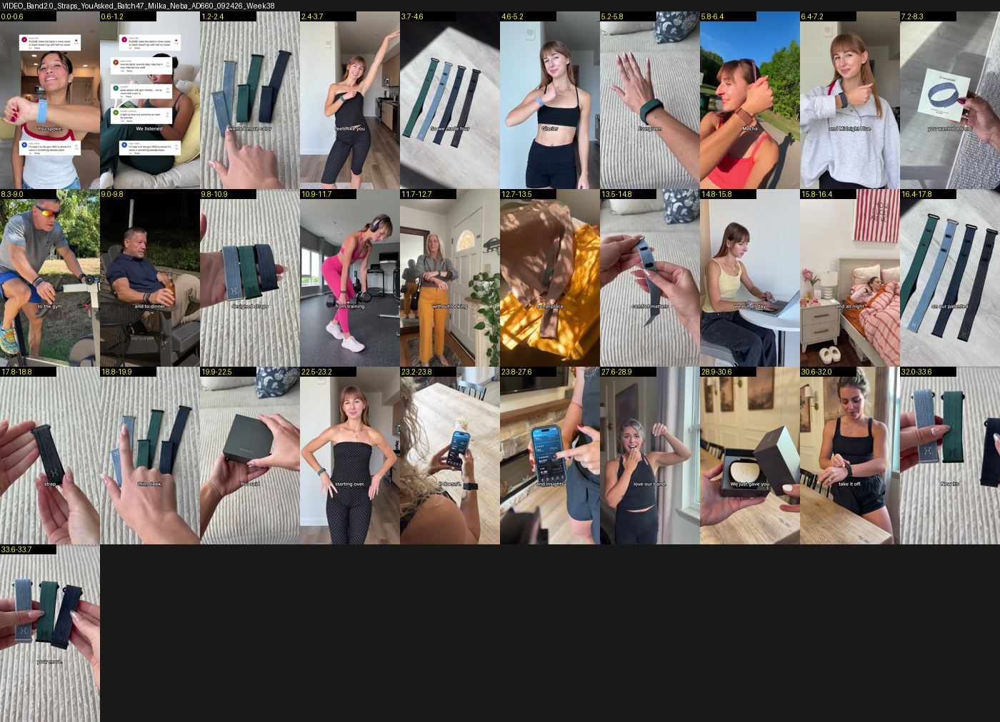

# VIDEO_Band2.0_Straps_YouAsked_Batch47_Milka_Neba_AD660_092426_Week38

Master: `VIDEO_Band2.0_Straps_YouAsked_Batch47_Milka_Neba_AD660_092426_Week38_Hook1_9x16.mp4` · 33.7s · 1080x1920

**Pacing:** 31 shots · avg 1.087s · median 0.967s · 8.91 cuts/10s · first cut 0.6s · 275.0 wpm · talk ratio 0.9 · cuts on word start 86.7% · cuts in speech gaps 80.0%
**Audio:** {'I_lufs': -13.4, 'LRA': 3.1, 'true_peak_db': -0.8} · BPM≈117.5 · music {'speech_rms_db': -18.0, 'pause_seconds': 0.0} · cuts with SFX/transient 43.3%

**Captions:** 51 cards · 2 words/card (median) · y≈0.645 of frame height · text height≈0.0293 · colours {'white': 44, 'red': 4, 'yellow': 1, 'blue': 2} · cards crossing a cut: 1
Highlighted: Mocha, from training, without looking, outofplace, and all night, -124/72mrg, 96.6-97.9
**Headlines:** PLEASE make this band in more colors (0.0–0.5s, white) | blackdoesn'tgowith halfmy closet (0.0–0.5s, white) | Reply (0.5–0.5s, white)

**Hook (0–3s) spoken:** You spoke, we listened. You said you wanted more color, something that feels
**Hook on-screen:** 2w Reply / I'd wear it to the gym AND to dinner if it / PLEASE make this band in more colors / Reply / Something that / We listened. / You said you / Youspoke. / blackdoesn'tgowith halfmy closet / wanted more color
**CTA (last 5s):** So we hear you. We just gave you a new reason to never take it off. We listened. Now it's your move. · on-screen: Hume Band 2.0 / So we hear you. / We just gave you / We listened. / XHumeHealth / take it off. / your move.

## Beat sheet

| # | in–out (s) | dur | transition | spoken | on-screen text |
|---|---|---|---|---|---|
| 1 | 0.00–0.60 | 0.6 |  | You spoke, | PLEASE make this band in more colors (HEADLINE) / blackdoesn'tgowith halfmy closet (HEADLINE) / Youspoke. / Reply / Reply (HEADLINE) / 2w Reply |
| 2 | 0.60–1.20 | 0.6 | cut | we listened. | PLEASE make this band in more colors (HEADLINE) / blackdoesn'tgowith halfmy closet (HEADLINE) / Reply / Reply (HEADLINE) / 2w Reply / We listened. |
| 3 | 1.20–2.43 | 1.23 | cut | You said you wanted more color, | You said you / wanted more color |
| 4 | 2.43–3.70 | 1.27 | cut +SFX hit | something that feels like you. | wanted more color / Something that / feels.likeyou / So we made four |
| 5 | 3.70–4.63 | 0.93 | cut | So we made four, | So we made four / Glacier |
| 6 | 4.63–5.20 | 0.57 | cut +SFX hit | Glacier, | Glacier / Evergreen |
| 7 | 5.20–5.83 | 0.63 | cut +SFX hit | Evergreen, | Evergreen |
| 8 | 5.83–6.37 | 0.53 | cut +SFX hit | Mocha, | Evergreen / Mocha [red] |
| 9 | 6.37–7.23 | 0.87 | cut +SFX hit | and Midnight Blue. | Mocha [red] / XHumeHealth" / GLACIER / ples non |
| 10 | 7.23–8.27 | 1.03 | cut +SFX hit | You said you wanted a band you | XHumeHealth" / GLACIER / ples non / XHumeHealth / you could wear |
| 11 | 8.27–9.03 | 0.77 | cut | could wear to the gym | GLACIER / XHumeHealth / you could wear / and to dinner |
| 12 | 9.03–9.77 | 0.73 | cut | and to dinner. | and to dinner |
| 13 | 9.77–10.90 | 1.13 | cut | So we designed straps that go | designed straps |
| 14 | 10.90–11.73 | 0.83 | cut +SFX hit | from training to | from training [red] |
| 15 | 11.73–12.73 | 1.0 | cut +SFX hit | going out without looking out | without looking [red] |
| 16 | 12.73–13.50 | 0.77 | cut | of place. | outofplace [yellow] |
| 17 | 13.50–14.77 | 1.27 | cut +SFX hit | You said comfort matters because | comfortmatters |
| 18 | 14.77–15.80 | 1.03 | cut +SFX hit | you wear it all day | wear it all day |
| 19 | 15.80–16.40 | 0.6 | cut | and all night. | and all night [red] |
| 20 | 16.40–17.80 | 1.4 | cut | So we built them on our patented ultra | and all night [red] / onour patented |
| 21 | 17.80–18.77 | 0.97 | cut | comfort strap. | strap |
| 22 | 18.77–19.93 | 1.17 | cut | Thin, sleek and | thin, sleek, |
| 23 | 19.93–22.47 | 2.53 | cut | soft enough to sleep in. You said switching shouldn't mean starting | enough / You said / shouldn't mean |
| 24 | 22.47–23.17 | 0.7 | cut +SFX hit | over. | shouldn't mean / It doesn't. |
| 25 | 23.17–23.77 | 0.6 | cut | It doesn't. | It doesn't. |
| 26 | 23.77–27.63 | 3.87 | cut +SFX hit | Swap in seconds and your data, streaks and insights stay exactly where they are. | -124/72mrg [blue] / Swapin seconds, / 96.6-97.9* / 96-100- / streaks / 96.6-97.9 [blue] |
| 27 | 27.63–28.87 | 1.23 | cut | You said you love our band. | love our band. |
| 28 | 28.87–30.57 | 1.7 | cut +SFX hit | So we hear you. We just gave you a new | XHumeHealth / Hume Band 2.0 / So we hear you. / We just gave you |
| 29 | 30.57–31.97 | 1.4 | cut | reason to never take it off. | take it off. |
| 30 | 31.97–33.63 | 1.67 | cut | We listened. Now it's your move. | We listened. / your move. |
| 31 | 33.63–33.69 | 0.05 | cut |  |  |

## Hook variants

| hook | file | dur | first cut | spoken 0–3s | on-screen 0–3s |
|---|---|---|---|---|---|
| 1 | `uAsked_Batch47_Milka_Neba_AD660_092426_Week38_Hook1_9x16.mp4` | 33.7 | 0.6 | You spoke, we listened. You said you wanted more color, something that feels | 2w Reply / I'd wear it to the gym AND to dinner if it / PLEASE make this band in more colors / Reply / Something that / We listened. / You said you / Youspoke. |
| 1 | `uAsked_Batch47_Milka_Neba_AD660_092426_Week38_Hook1_9x16.mp4` | 33.7 | 0.6 | You spoke, we listened. You said you wanted more color, something that feels |  |
| 2 | `uAsked_Batch47_Milka_Neba_AD660_092426_Week38_Hook2_9x16.mp4` | 34.4 | 1.9 | You asked for colors, so we listened. You said you wanted more color, |  |
| 2 | `uAsked_Batch47_Milka_Neba_AD660_092426_Week38_Hook2_9x16.mp4` | 34.4 | 1.9 | You asked for colors, so we listened. You said you wanted more color, |  |
| 3 | `uAsked_Batch47_Milka_Neba_AD660_092426_Week38_Hook3_9x16.mp4` | 38.8 | 1.767 | Every comment, every DM, every review, we read them |  |
| 3 | `uAsked_Batch47_Milka_Neba_AD660_092426_Week38_Hook3_9x16.mp4` | 38.8 | 1.767 | Every comment, every DM, every review, we read them |  |

## Full transcript

You spoke, we listened. You said you wanted more color, something that feels like you. So we made four, Glacier, Evergreen, Mocha, and Midnight Blue. You said you wanted a band you could wear to the gym and to dinner. So we designed straps that go from training to going out without looking out of place. You said comfort matters because you wear it all day and all night. So we built them on our patented ultra comfort strap. Thin, sleek and soft enough to sleep in. You said switching shouldn't mean starting over. It doesn't. Swap in seconds and your data, streaks and insights stay exactly where they are. You said you love our band. So we hear you. We just gave you a new reason to never take it off. We listened. Now it's your move.