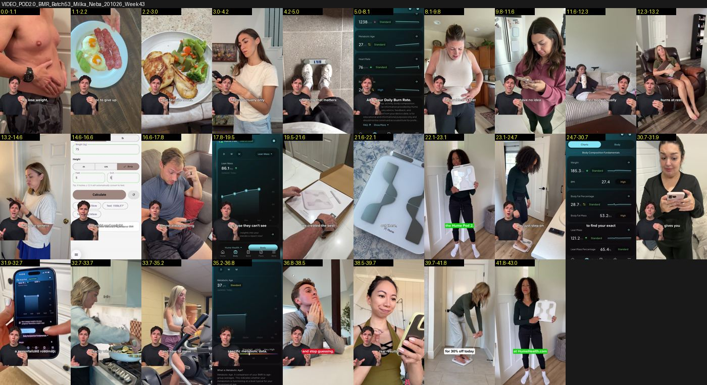

# VIDEO_POD2.0_BMR_Batch53_Milka_Neba_201026_Week43

Master: `VIDEO_POD2.0_BMR_Batch53_Milka_Neba_201026_Week43_Hook1_9x16 (2).mp4` · 43.0s · 1080x1920

**Pacing:** 28 shots · avg 1.536s · median 1.25s · 6.28 cuts/10s · first cut 1.133s · 231.0 wpm · talk ratio 0.97 · cuts on word start 77.8% · cuts in speech gaps 59.3%
**Audio:** {'I_lufs': -19.3, 'LRA': 2.8, 'true_peak_db': -1.7} · BPM≈112.3 · music {'speech_rms_db': -23.9, 'pause_seconds': 0.0} · cuts with SFX/transient 70.4%

**Captions:** 166 cards · 1.0 words/card (median) · y≈0.718 of frame height · text height≈0.0246 · colours {'white': 95, 'red': 5, 'dark/other': 62, 'blue': 1, 'green': 3} · cards crossing a cut: 0
Highlighted: your favorite foods., There's actually only, Overweight, almost always wrong, Body, the Hume Pod2., BMRwith99%accuracy., and stop guessing., at HumeHealth.com
**Headlines:** 0.6kg (5.0–5.0s, white) | MineralMass (5.0–5.0s, dark/other) | Standard (5.0–6.0s, dark/other) | Metaboliclndicators (5.0–5.0s, white) | BasalMetabolicRate (5.0–5.0s, white) | 1238 (5.0–6.0s, white) | MetabolicIndicators (5.5–6.0s, dark/other) | Basal MetabolicRate (6.0–6.0s, white)

**Hook (0–3s) spoken:** To lose weight, you don't need a strict diet or to give up your favorite foods. There's
**Hook on-screen:** To lose weight, / a strict diet / or to give up / your favorite foods / your favorite foods.
**CTA (last 5s):** You can get real results. Get yours for 30 % off today at humehealth .com. · on-screen: Get yours / at HumeHealth.com / for 30% off today / realresults!

## Beat sheet

| # | in–out (s) | dur | transition | spoken | on-screen text |
|---|---|---|---|---|---|
| 1 | 0.00–1.13 | 1.13 |  | To lose weight, you don't need a | To lose weight, / a strict diet |
| 2 | 1.13–2.17 | 1.03 | cut +SFX hit | strict diet or to give up your | a strict diet / or to give up / your favorite foods |
| 3 | 2.17–2.97 | 0.8 | cut +SFX hit | favorite foods. | your favorite foods / your favorite foods. [red] |
| 4 | 2.97–4.17 | 1.2 | cut +SFX hit | There's actually only one thing | your favorite foods. [red] / There's actually only [red] / 8785 / one thing that matters: |
| 5 | 4.17–4.97 | 0.8 | cut +SFX hit | that matters. | 8785 / one thing that matters: / 7610 |
| 6 | 4.97–8.13 | 3.17 | cut | Knowing your metabolic norm, aka your daily burn rate. | one thing that matters: / 7610 / 0.6kg (HEADLINE) / MineralMass (HEADLINE) / Standard (HEADLINE) / Metaboliclndicators (HEADLINE) |
| 7 | 8.13–9.80 | 1.67 | cut +SFX hit | The problem is that 90 % of people have | The problem is that / 90%ofpe0ple |
| 8 | 9.80–11.63 | 1.83 | cut +SFX hit | no idea how many calories their | have no idea / how many calories |
| 9 | 11.63–12.30 | 0.67 | cut +SFX hit | body actually burns | their body actually |
| 10 | 12.30–13.20 | 0.9 | cut +SFX hit | at rest. They | their body actually / They use generic |
| 11 | 13.20–14.57 | 1.37 | cut +SFX hit | use generic online calculators | They use generic / online calculators |
| 12 | 14.57–16.63 | 2.07 | cut +SFX hit | that only look at height and weight, which are almost | kg (HEADLINE) / Weight (kg) (HEADLINE) / 75 (HEADLINE) / Height (HEADLINE) / ft+in (HEADLINE) / cm (HEADLINE) |
| 13 | 16.63–17.80 | 1.17 | cut | always wrong because | almost always wrong [red] |
| 14 | 17.80–19.47 | 1.67 | cut +SFX hit | they can't see your muscle mass. | Hume Pod (HEADLINE) / 86.1bs (HEADLINE) / Updated:Today (HEADLINE) / 90 / 85 / Apr |
| 15 | 19.47–21.60 | 2.13 | cut +SFX hit | That's why we created the best 3D body scanner out | Updated:Today (HEADLINE) / Mar / Left Leg Muscle Mass (HEADLINE) / 14.4 bs (HEADLINE) / Standard [green] (HEADLINE) / Feb |
| 16 | 21.60–22.13 | 0.53 | cut | there, | the Hume Pod2. [green] |
| 17 | 22.13–23.13 | 1.0 | cut +SFX hit | the Hume Pod 2. | the Hume Pod2. [green] / You just step on |
| 18 | 23.13–24.70 | 1.57 | cut | You just step on and grab the handles. | You just step on / and grab the handles |
| 19 | 24.70–30.70 | 6.0 | cut +SFX hit | In 30 seconds, it analyzes your body composition to find your exact BMR with 99 % accuracy. | Heignt (HEADLINE) / Age (HEADLINE) / MetabolicAge (HEADLINE) / 175 (HEADLINE) / yrs (HEADLINE) / Right Arm (HEADLINE) |
| 20 | 30.70–31.93 | 1.23 | cut +SFX hit | Then the app gives you a personalized | gives you |
| 21 | 31.93–32.70 | 0.77 | cut | roadmap, | 10:09元 [blue] (HEADLINE) / StepOnScale [blue] (HEADLINE) / Ca BodyPod [blue] (HEADLINE) / 133.988 [blue] (HEADLINE) / Updatedifeday (HEADLINE) / 14/91 |
| 22 | 32.70–33.73 | 1.03 | cut +SFX hit | exactly what to eat and | exactlywhatto eat |
| 23 | 33.73–35.20 | 1.47 | cut | how to move based on your specific | andhowto move / COR / 15.5kg (HEADLINE) / 0.6kg (HEADLINE) / Standard (HEADLINE) / MineralMass (HEADLINE) |
| 24 | 35.20–36.80 | 1.6 | cut +SFX hit | metabolic data. Please | 15.5kg (HEADLINE) / 0.6kg (HEADLINE) / Standard (HEADLINE) / MineralMass (HEADLINE) / Metabolic Indicators (HEADLINE) / 1159 |
| 25 | 36.80–38.47 | 1.67 | cut +SFX hit | hear me out and stop guessing. | Please hearme out / and stop guessing. [red] |
| 26 | 38.47–39.73 | 1.27 | cut | You can get real results. | and stop guessing. [red] / realresults! |
| 27 | 39.73–41.83 | 2.1 | cut +SFX hit | Get yours for 30 % off today at humehealth | Get yours / for 30% off today |
| 28 | 41.83–43.00 | 1.17 | cut | .com. | at HumeHealth.com [green] |

## Hook variants

| hook | file | dur | first cut | spoken 0–3s | on-screen 0–3s |
|---|---|---|---|---|---|
| 1 | `O_POD2.0_BMR_Batch53_Milka_Neba_201026_Week43_Hook1_9x16.mp4` | 54.1 | 1.467 | To lose weight, you don't need a strict diet or to give up your favorite | To lose weight, / a strict diet / or to give up / you don't need |
| 1 | `D2.0_BMR_Batch53_Milka_Neba_201026_Week43_Hook1_9x16 (2).mp4` | 43.0 | 1.133 | To lose weight, you don't need a strict diet or to give up your favorite foods. There's | To lose weight, / a strict diet / or to give up / your favorite foods / your favorite foods. |
| 2 | `O_POD2.0_BMR_Batch53_Milka_Neba_201026_Week43_Hook2_9x16.mp4` | 52.8 | 1.5 | I'm going to drop this and go, you don't need to give up your favorite |  |
| 2 | `D2.0_BMR_Batch53_Milka_Neba_201026_Week43_Hook2_9x16 (2).mp4` | 41.6 | 1.3 | I'm gonna drop this and go. You don't need to give up your favorite foods to lose weight. | 130 / I'm gonna / drop this and go: / need to give up / to lose weight. / your favorite foods |
| 3 | `O_POD2.0_BMR_Batch53_Milka_Neba_201026_Week43_Hook3_9x16.mp4` | 53.0 | 1.967 | If you really want to lose weight, stop obsessing on how many calories | If you really / STOPOBSESSING / on how many calories / wanna lose weight. |
| 3 | `D2.0_BMR_Batch53_Milka_Neba_201026_Week43_Hook3_9x16 (2).mp4` | 43.4 | 1.4 | If you really want to lose weight, stop obsessing over how many calories |  |

## Full transcript

To lose weight, you don't need a strict diet or to give up your favorite foods. There's actually only one thing that matters. Knowing your metabolic norm, aka your daily burn rate. The problem is that 90% of people have no idea how many calories their body actually burns at rest. They use generic online calculators that only look at height and weight, which are almost always wrong because they can't see your muscle mass. That's why we created the best 3D body scanner out there, the Hume Pod 2. You just step on and grab the handles. In 30 seconds, it analyzes your body composition to find your exact BMR with 99% accuracy. Then the app gives you a personalized roadmap, exactly what to eat and how to move based on your specific metabolic data. Please hear me out and stop guessing. You can get real results. Get yours for 30% off today at humehealth.com.