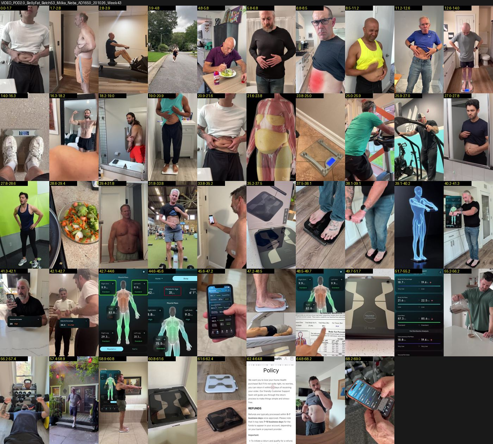

# VIDEO_POD2.0_BellyFat_Batch53_Milka_Neba_AD1650_201026_Week43

Master: `VIDEO_POD2.0_BellyFat_Batch53_Milka_Neba_AD1650_201026_Week43_9X16_HOOK1.mp4` · 69.0s · 1080x1920

**Pacing:** 48 shots · avg 1.438s · median 1.134s · 6.81 cuts/10s · first cut 1.667s · 239.0 wpm · talk ratio 0.96 · cuts on word start 93.6% · cuts in speech gaps 80.9%
**Audio:** {'I_lufs': -20.2, 'LRA': 1.6, 'true_peak_db': -3.3} · BPM≈117.5 · music {'speech_rms_db': -23.8, 'pause_seconds': 0.3} · cuts with SFX/transient 91.5%

**Captions:** 127 cards · 1 words/card (median) · y≈0.67 of frame height · text height≈0.0246 · colours {'dark/other': 15, 'red': 1, 'white': 107, 'yellow': 1, 'green': 1, 'blue': 2} · cards crossing a cut: 2
Highlighted: premier, ePro, Standard, Muscle(lbs), High
**Headlines:** FUF (26.0–26.0s, white) | 2056. (35.0–35.0s, white) | 2056 (36.0–37.0s, white) | Hume Pod (43.0–44.0s, dark/other) | MuscleMass (43.0–44.0s, white) | Right Arm (43.0–44.0s, white) | Left Arm (43.0–44.0s, white) | 9.9bs (43.0–43.0s, white)

**Hook (0–3s) spoken:** If you've got belly fat that won't move no matter what you try, you could
**Hook on-screen:** 
**CTA (last 5s):** guarantee. Stubborn belly fat is just fat you haven't been able to see yet. Now you can. · on-screen: 1. 1. 1.

## Beat sheet

| # | in–out (s) | dur | transition | spoken | on-screen text |
|---|---|---|---|---|---|
| 1 | 0.00–1.67 | 1.67 |  | If you've got belly fat that won't move no |  |
| 2 | 1.67–2.77 | 1.1 | cut +SFX hit | matter what you try, |  |
| 3 | 2.77–3.90 | 1.13 | cut +SFX hit | you could try exercising, | AVIRON |
| 4 | 3.90–4.77 | 0.87 | cut +SFX hit | you could try running, | AVIRON |
| 5 | 4.77–5.77 | 1.0 | cut +SFX hit | you could try dieting, | premier [red] |
| 6 | 5.77–6.77 | 1.0 | cut +SFX hit | and you'd still have it, | premier [red] |
| 7 | 6.77–8.50 | 1.73 | cut +SFX hit | and you'd call it stubborn belly fat, |  |
| 8 | 8.50–11.20 | 2.7 | cut +SFX hit | like it's some special kind of fat that just won't listen. |  |
| 9 | 11.20–12.63 | 1.43 | cut +SFX hit | It's not. It's only stubborn because |  |
| 10 | 12.63–14.03 | 1.4 | cut | you're working blind. | 774062 |
| 11 | 14.03–16.33 | 2.3 | cut +SFX hit | Think about it. Your scale gives you one number. | 774062 / 7 7002 |
| 12 | 16.33–18.17 | 1.83 | cut +SFX hit | It can't tell you if you're losing fat or |  |
| 13 | 18.17–19.00 | 0.83 | cut +SFX hit | losing muscle. |  |
| 14 | 19.00–20.93 | 1.93 | cut +SFX hit | It can't tell you if your belly is the fat you |  |
| 15 | 20.93–21.63 | 0.7 | cut +SFX hit | can pinch or |  |
| 16 | 21.63–23.83 | 2.2 | cut +SFX hit | the fat packed deep around your organs. | ePro [yellow] / SdiePro |
| 17 | 23.83–24.97 | 1.13 | cut +SFX hit | And it definitely can't tell |  |
| 18 | 24.97–25.90 | 0.93 | cut | you if all that effort |  |
| 19 | 25.90–26.97 | 1.07 | cut +SFX hit | is actually working. so | FUF (HEADLINE) |
| 20 | 26.97–27.83 | 0.87 | cut +SFX hit | you keep guessing. |  |
| 21 | 27.83–28.57 | 0.73 | cut | More cardio, |  |
| 22 | 28.57–29.40 | 0.83 | cut +SFX hit | fewer calories, |  |
| 23 | 29.40–31.77 | 2.37 | cut +SFX hit | and if some of that is costing you muscle, you'd never know. |  |
| 24 | 31.77–33.83 | 2.07 | cut +SFX hit | And less muscle can mean a slower metabolism, |  |
| 25 | 33.83–35.17 | 1.33 | cut +SFX hit | which makes everything harder. | 2056. (HEADLINE) / HumePod2.0 |
| 26 | 35.17–37.50 | 2.33 | cut +SFX hit | That's what the HumePod 2 .0 fixes. | 2056. (HEADLINE) / HumePod2.0 / 2056 (HEADLINE) |
| 27 | 37.50–38.13 | 0.63 | cut +SFX hit | You step on, |  |
| 28 | 38.13–39.13 | 1.0 | cut +SFX hit | grab the handles, and 30 |  |
| 29 | 39.13–40.20 | 1.07 | cut +SFX hit | seconds later, |  |
| 30 | 40.20–41.33 | 1.13 | cut +SFX hit | you can see all your body. |  |
| 31 | 41.33–42.13 | 0.8 | cut | Visceral fat, | 36.3% |
| 32 | 42.13–42.73 | 0.6 | cut +SFX hit | body fat, | 36.3% |
| 33 | 42.73–44.57 | 1.83 | cut +SFX hit | muscle in each arm and each leg, | Hume Pod (HEADLINE) / MuscleMass (HEADLINE) / Right Arm (HEADLINE) / Left Arm (HEADLINE) / 9.9bs (HEADLINE) / Standard [green] (HEADLINE) |
| 34 | 44.57–45.60 | 1.03 | cut +SFX hit | metabolic age, | Trunk / Standard [green] / Body (HEADLINE) / Hume (HEADLINE) / MetabolicAge (HEADLINE) / Height (HEADLINE) |
| 35 | 45.60–47.17 | 1.57 | cut +SFX hit | 45 plus metrics, | 白HumePod [blue] (HEADLINE) / BodyratPercentage [blue] (HEADLINE) / 19.1#+ (HEADLINE) / BodyFatMass / SubcutaneousFatMass / 32.3 |
| 36 | 47.17–48.53 | 1.37 | cut +SFX hit | all with 99 % |  |
| 37 | 48.53–49.67 | 1.13 | cut +SFX hit | dexa accuracy, | Hume Pod (HEADLINE) / LeftArm (HEADLINE) / Right Arm (HEADLINE) / 9.9ibs (HEADLINE) / Standard [green] (HEADLINE) / Trunk |
| 38 | 49.67–51.73 | 2.07 | cut +SFX hit | the golden standard for body composition. | Pteasechargefor / 5minsormore / if it's not turming on / XHume |
| 39 | 51.73–55.17 | 3.43 | cut +SFX hit | Then the app tells you what changed since your last scan and what to do next. | Progress Report (HEADLINE) / Sep12th-Sep17th [blue] (HEADLINE) / Weight (HEADLINE) / MetabolicAge (HEADLINE) / 54yrs (HEADLINE) / 115.0bs+ (HEADLINE) |
| 40 | 55.17–56.23 | 1.07 | cut +SFX hit | Maybe it's more protein, |  |
| 41 | 56.23–57.37 | 1.13 | cut +SFX hit | maybe it's strength training, |  |
| 42 | 57.37–58.93 | 1.57 | cut +SFX hit | maybe it's just a walk after dinner. |  |
| 43 | 58.93–60.80 | 1.87 | cut +SFX hit | Then you re -scan and see if it's working. | 9.9m (HEADLINE) / 9.9os (HEADLINE) / 29.3bs / 17.5 |
| 44 | 60.80–61.63 | 0.83 | cut +SFX hit | It's 30 % off | Hume |
| 45 | 61.63–62.43 | 0.8 | cut +SFX hit | right now and |  |
| 46 | 62.43–64.77 | 2.33 | cut +SFX hit | with a 45 -day money -back guarantee. | X HumeHealth"0 (HEADLINE) / Policy (HEADLINE) / WewantyoutoloveyourHumeHealth (HEADLINE) / purchase! But if it's not quite right, no worries, (HEADLINE) / you can return it within 45idays of receiving / yourorder.OurfriendlyCustomerSupport |
| 47 | 64.77–68.17 | 3.4 | cut +SFX hit | Stubborn belly fat is just fat you haven't been able to see yet. | 1. 1. 1. [red] (HEADLINE) |
| 48 | 68.17–69.01 | 0.84 | cut +SFX hit | Now you can. | 1. 1. 1. [red] (HEADLINE) |

## Hook variants

| hook | file | dur | first cut | spoken 0–3s | on-screen 0–3s |
|---|---|---|---|---|---|
| 1 | `lyFat_Batch53_Milka_Neba_AD1650_201026_Week43_9X16_HOOK1.mp4` | 69.0 | 1.667 | If you've got belly fat that won't move no matter what you try, you could |  |
| 1 | `lyFat_Batch53_Milka_Neba_AD1650_201026_Week43_9X16_HOOK1.mp4` | 69.0 | 1.667 |  |  |
| 2 | `lyFat_Batch53_Milka_Neba_AD1650_201026_Week43_9X16_HOOK2.mp4` | 69.2 | 1.633 |  |  |
| 2 | `lyFat_Batch53_Milka_Neba_AD1650_201026_Week43_9X16_HOOK2.mp4` | 69.2 | 1.633 |  |  |
| 3 | `lyFat_Batch53_Milka_Neba_AD1650_201026_Week43_9X16_HOOK3.mp4` | 69.5 | 1.733 |  |  |
| 3 | `lyFat_Batch53_Milka_Neba_AD1650_201026_Week43_9X16_HOOK3.mp4` | 69.5 | 1.733 |  |  |

## Full transcript

If you've got belly fat that won't move no matter what you try, you could try exercising, you could try running, you could try dieting, and you'd still have it, and you'd call it stubborn belly fat, like it's some special kind of fat that just won't listen. It's not. It's only stubborn because you're working blind. Think about it. Your scale gives you one number. It can't tell you if you're losing fat or losing muscle. It can't tell you if your belly is the fat you can pinch or the fat packed deep around your organs. And it definitely can't tell you if all that effort is actually working. so you keep guessing. More cardio, fewer calories, and if some of that is costing you muscle, you'd never know. And less muscle can mean a slower metabolism, which makes everything harder. That's what the HumePod 2.0 fixes. You step on, grab the handles, and 30 seconds later, you can see all your body. Visceral fat, body fat, muscle in each arm and each leg, metabolic age, 45 plus metrics, all with 99% dexa accuracy, the golden standard for body composition. Then the app tells you what changed since your last scan and what to do next. Maybe it's more protein, maybe it's strength training, maybe it's just a walk after dinner. Then you re-scan and see if it's working. It's 30% off right now and with a 45-day money-back guarantee. Stubborn belly fat is just fat you haven't been able to see yet. Now you can.