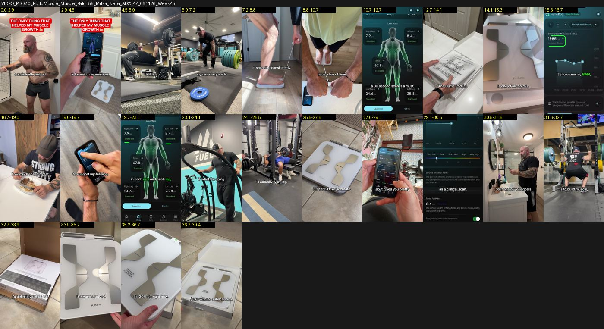

# VIDEO_POD2.0_BuildMuscle_Muscle_Batch55_Milka_Neba_AD2347_061126_Week45

Master: `VIDEO_POD2.0_BuildMuscle_Muscle_Batch55_Milka_Neba_AD2347_061126_Week45_Hook1_9x16.mp4` · 39.4s · 1080x1920

**Pacing:** 24 shots · avg 1.641s · median 1.45s · 5.84 cuts/10s · first cut 2.92s · 229.0 wpm · talk ratio 0.94 · cuts on word start 91.3% · cuts in speech gaps 73.9%
**Audio:** {'I_lufs': -18.5, 'LRA': 1.2, 'true_peak_db': -5.9} · BPM≈136.0 · music {'speech_rms_db': -20.7, 'pause_seconds': 0.2} · cuts with SFX/transient 43.5%

**Captions:** 121 cards · 1 words/card (median) · y≈0.651 of frame height · text height≈0.0246 · colours {'red': 4, 'white': 74, 'dark/other': 38, 'blue': 2, 'green': 3} · cards crossing a cut: 1
Highlighted: Theonething, thathas, Lean(lbs), ItshowsmemyBMR,, to support my training., Lean(lbs), in each arm and each leg,, in each arm and each leg, soitgivesyoupretty
**Headlines:** THEONLY THINGTHAT (0.0–4.0s, red) | HELPEDMYMUSCLE (0.0–4.0s, red) | GROWTH (0.0–4.0s, red) | Hume Pod (11.0–12.0s, dark/other) | 23yrs (11.0–11.0s, white) | 24yrs (11.0–11.0s, white) | 5'10"ft (11.0–11.0s, white) | LeanMass (11.0–12.0s, white)

**Hook (0–3s) spoken:** The one thing that has consistently helped my muscle growth is
**Hook on-screen:** GROWTH / HELPEDMYMUSCLE / THEONLY THINGTHAT / Theonething / consistentlyhelped / mymusclegrowth / thathas
**CTA (last 5s):** .0. It's 30 % off right now, $249 with no subscription. · on-screen: $249 with no subscription. / It's30%off right now, / XHume / chargefor / echargef / ime / mins

## Beat sheet

| # | in–out (s) | dur | transition | spoken | on-screen text |
|---|---|---|---|---|---|
| 1 | 0.00–2.92 | 2.92 |  | The one thing that has consistently helped my muscle growth is | THEONLY THINGTHAT [red] (HEADLINE) / HELPEDMYMUSCLE [red] (HEADLINE) / GROWTH [red] (HEADLINE) / Theonething [red] / thathas [red] / consistentlyhelped |
| 2 | 2.92–4.46 | 1.54 | cut | knowing my numbers. | THEONLY THINGTHAT [red] (HEADLINE) / HELPEDMYMUSCLE [red] (HEADLINE) / GROWTH [red] (HEADLINE) / mymusclegrowth / is knowing my numbers. / is knowing my-numbers. |
| 3 | 4.46–5.92 | 1.46 | cut +SFX hit | The one thing that has consistently | THEONLY THINGTHAT [red] (HEADLINE) / HELPEDMYMUSCLE [red] (HEADLINE) / GROWTH [red] (HEADLINE) / isknowingmy numbers. / The one thing / that has |
| 4 | 5.92–7.22 | 1.3 | cut +SFX hit | helped my muscle growth | consistentlyhelped / is scanning consistently |
| 5 | 7.22–8.78 | 1.56 | cut | is scanning consistently. | is scanning consistently / is scanning consistently. |
| 6 | 8.78–10.70 | 1.92 | cut | And as someone who doesn't have a ton of time, | Andassomeonewho doesn't / have a ton of time, |
| 7 | 10.70–12.68 | 1.98 | cut +SFX hit | a 30 second scan is a must. | Hume Pod (HEADLINE) / 23yrs (HEADLINE) / 24yrs (HEADLINE) / 5'10"ft (HEADLINE) / LeanMass (HEADLINE) / Right Arm (HEADLINE) |
| 8 | 12.68–14.12 | 1.44 | cut | The HumePod 2 .0 is | The HumePod2.0 / XHume / is one of my go to's. |
| 9 | 14.12–15.28 | 1.16 | cut +SFX hit | one of my go -tos. | XHume / is one of my go to's. |
| 10 | 15.28–16.66 | 1.38 | cut | It shows me my BMR, | XHume / is one of my go to's. / Hume Pod (HEADLINE) / StepOnScale [green] (HEADLINE) / BMR(BasalMetab... (HEADLINE) / BMR(Basal MetabolicRate) (HEADLINE) |
| 11 | 16.66–19.02 | 2.36 | cut +SFX hit | so I know roughly how much I need to eat to support | so I know roughly / howmuchI needtoeat / to support my training. [red] |
| 12 | 19.02–19.74 | 0.72 | cut | my training. | to support my training. [red] |
| 13 | 19.74–23.06 | 3.32 | cut | And it shows the muscle in each arm and each leg, so | LeanMass (HEADLINE) / LeftArm (HEADLINE) / RightArm (HEADLINE) / 7.9ibs (HEADLINE) / 8.4ibs (HEADLINE) / Standard (HEADLINE) |
| 14 | 23.06–24.10 | 1.04 | cut +SFX hit | I can see if what I'm doing | FUEL (HEADLINE) / solcan see / is actually working. |
| 15 | 24.10–25.48 | 1.38 | cut +SFX hit | is actually working. It's | is actually working. |
| 16 | 25.48–27.56 | 2.08 | cut | 99 % DEXA accurate, | is actually working. / XHume / It's99%Dexaaccurate, |
| 17 | 27.56–29.14 | 1.58 | cut | so it gives you pretty much the same | 185.6 / 26.5 / 165cs / Bodyfatars / 65.60m / 109.1 |
| 18 | 29.14–30.52 | 1.38 | cut | data as a clinical scan. | + %66 (HEADLINE) / Very low (HEADLINE) / Updated:Today (HEADLINE) / 29/09 / 30/09 / 01/10 |
| 19 | 30.52–31.58 | 1.06 | cut | So if one of your goals | So if one of your goals |
| 20 | 31.58–32.66 | 1.08 | cut +SFX hit | is to build muscle, | GATLANTIS (HEADLINE) / is to buildmuscle |
| 21 | 32.66–33.92 | 1.26 | cut | I'd definitely check out the | I'd definitely check out |
| 22 | 33.92–35.20 | 1.28 | cut +SFX hit | HumePod 2 .0. | the Hume Pod 2.0. / XHume / chargefor / ime / It's30%off right now, |
| 23 | 35.20–36.70 | 1.5 | cut | It's 30 % off right now, | chargefor / ime / It's30%off right now, / mins / echargef |
| 24 | 36.70–39.38 | 2.68 | cut +SFX hit | $249 with no subscription. | XHume / $249 with no subscription. |

## Hook variants

| hook | file | dur | first cut | spoken 0–3s | on-screen 0–3s |
|---|---|---|---|---|---|
| 1 | `uscle_Batch55_Milka_Neba_AD2347_061126_Week45_Hook1_9x16.mp4` | 39.4 | 2.92 | The one thing that has consistently helped my muscle growth is | GROWTH / HELPEDMYMUSCLE / THEONLY THINGTHAT / Theonething / consistentlyhelped / mymusclegrowth / thathas |
| 1 | `uscle_Batch55_Milka_Neba_AD2347_061126_Week45_Hook1_9x16.mp4` | 39.4 | 2.92 |  |  |
| 2 | `uscle_Batch55_Milka_Neba_AD2347_061126_Week45_Hook2_9x16.mp4` | 38.7 | 1.64 |  |  |
| 2 | `uscle_Batch55_Milka_Neba_AD2347_061126_Week45_Hook2_9x16.mp4` | 38.7 | 1.64 |  |  |
| 3 | `uscle_Batch55_Milka_Neba_AD2347_061126_Week45_Hook3_9x16.mp4` | 38.8 | 2.04 |  |  |
| 3 | `uscle_Batch55_Milka_Neba_AD2347_061126_Week45_Hook3_9x16.mp4` | 38.8 | 2.04 | If you're trying to build muscle and you don't know your BMR, |  |
| 4 | `uscle_Batch55_Milka_Neba_AD2347_061126_Week45_Hook4_9x16.mp4` | 40.8 | 1.4 |  |  |
| 4 | `uscle_Batch55_Milka_Neba_AD2347_061126_Week45_Hook4_9x16.mp4` | 40.8 | 1.4 |  |  |

## Full transcript

The one thing that has consistently helped my muscle growth is knowing my numbers. The one thing that has consistently helped my muscle growth is scanning consistently. And as someone who doesn't have a ton of time, a 30 second scan is a must. The HumePod 2.0 is one of my go-tos. It shows me my BMR, so I know roughly how much I need to eat to support my training. And it shows the muscle in each arm and each leg, so I can see if what I'm doing is actually working. It's 99% DEXA accurate, so it gives you pretty much the same data as a clinical scan. So if one of your goals is to build muscle, I'd definitely check out the HumePod 2.0. It's 30% off right now, $249 with no subscription.