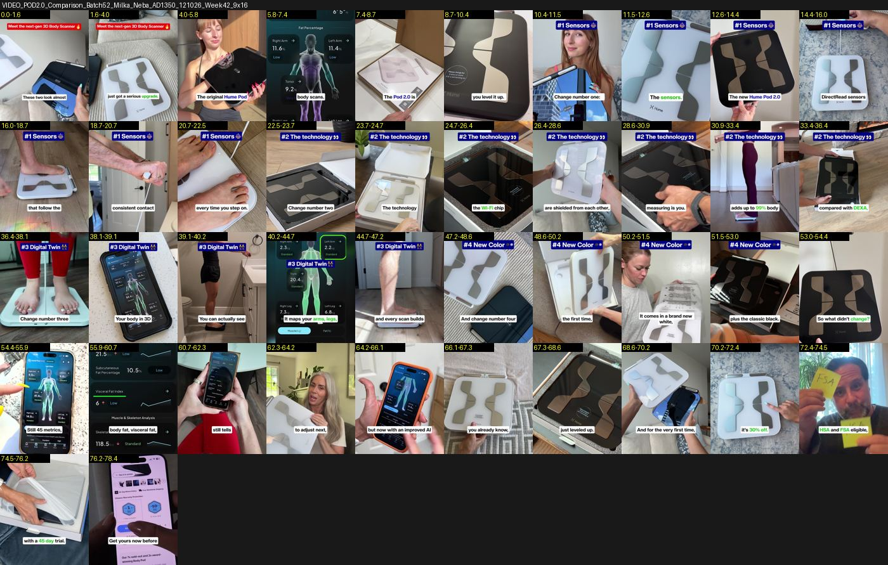

# VIDEO_POD2.0_Comparison_Batch52_Milka_Neba_AD1350_121026_Week42_9x16

Master: `VIDEO_POD2.0_Comparison_Batch52_Milka_Neba_AD1350_121026_Week42_9x16_Hook1_4x5.mp4` · 78.4s · 1080x1350

**Pacing:** 42 shots · avg 1.867s · median 1.68s · 5.23 cuts/10s · first cut 1.58s · 198.0 wpm · talk ratio 0.93 · cuts on word start 75.6% · cuts in speech gaps 68.3%
**Audio:** {'I_lufs': -13.0, 'LRA': 3.0, 'true_peak_db': 0.3} · BPM≈123.0 · music {'speech_rms_db': -17.8, 'pause_seconds': 0.9, 'pause_rms_db': -22.3, 'bed_minus_voice_db': -4.6, 'music_bed_likely': True} · cuts with SFX/transient 31.7%

**Captions:** 202 cards · 1.0 words/card (median) · y≈0.757 of frame height · text height≈0.0417 · colours {'white': 147, 'green': 12, 'blue': 11, 'dark/other': 32} · cards crossing a cut: 2
Highlighted: just got a serious upgrade., The original Hume Pod, Fat(%), The Pod 2.0 is, The sensors., The new Hume Pod 2.0, Thedisplay,, the Wi-Fichip, adds up to 99% body, compared with DEXA,, It maps your arms, legs,, Muscle(kg), and trunk separately,, So what didn't change?, Mutcle(bt)
**Headlines:** Meetthenext-gen3DBodyScanner (0.0–3.5s, red) | XHume (3.0–3.5s, white) | 11.0% (6.0–6.0s, white) | 11.4% (6.0–7.0s, white) | Low (6.0–6.0s, blue) | Torso (6.0–6.0s, white) | 36yrs (7.0–7.0s, white) | 27 yrs (7.0–7.0s, white)

**Hook (0–3s) spoken:** These two look almost the same, but one of them just got a serious
**Hook on-screen:** Hutne / Meetthenext-gen3DBodyScanner / Thesetwolookalmost / XHume / butoneofthem / just got a serious upgrade. / the same,
**CTA (last 5s):** eligible with a 45 -day trial. Get yours now before this sells out. · on-screen: -outand2xaward- / 10 / 10:09 / 10:090 / 10Years$35 / 1Year Included / 30 / 30-Day Return Policy / 30-Day ReturnPolicy / AD / ADDTOCART / ChooseWarrantyProtection:

## Beat sheet

| # | in–out (s) | dur | transition | spoken | on-screen text |
|---|---|---|---|---|---|
| 1 | 0.00–1.58 | 1.58 |  | These two look almost the same, | Meetthenext-gen3DBodyScanner [red] (HEADLINE) / Thesetwolookalmost / Hutne / the same, / butoneofthem |
| 2 | 1.58–4.04 | 2.46 | cut | but one of them just got a serious upgrade. | Meetthenext-gen3DBodyScanner [red] (HEADLINE) / butoneofthem / just got a serious upgrade. [green] / XHume / XHume (HEADLINE) / The original Hume Pod [blue] |
| 3 | 4.04–5.80 | 1.76 | cut +SFX hit | The original HumePod set the bar | The original Hume Pod [blue] / set the bar for at home |
| 4 | 5.80–7.42 | 1.62 | cut | for at -home body scans. | set the bar for at home / 11.0% (HEADLINE) / 11.4% (HEADLINE) / Low [blue] (HEADLINE) / Torso (HEADLINE) / 9.2% |
| 5 | 7.42–8.70 | 1.28 | cut | The Pod 2 .0 is | 11.4% (HEADLINE) / 9.2% / 36yrs (HEADLINE) / 27 yrs (HEADLINE) / Fat Percentage (HEADLINE) / LeftArm (HEADLINE) |
| 6 | 8.70–10.40 | 1.7 | cut +SFX hit | what happens when you level it up. | leasechargefor / minsormore / snotturningon / ime / what happens when / Pleasechargefor |
| 7 | 10.40–11.54 | 1.14 | cut +SFX hit | Change number one, | Pleasechargefor / 5minsormore / ifit'snotturningon / XHume / you level it up. / #1Sensors [blue] (HEADLINE) |
| 8 | 11.54–12.60 | 1.06 | cut | the sensors. | #1Sensors [blue] (HEADLINE) / The sensors. [green] / XHume (HEADLINE) |
| 9 | 12.60–14.36 | 1.76 | cut | The new HumePod 2 .0 has | #1Sensors [blue] (HEADLINE) / XHume / The new Hume Pod 2.0 [blue] |
| 10 | 14.36–16.00 | 1.64 | cut | new direct -read sensors made | #1Sensors [blue] (HEADLINE) / The new Hume Pod 2.0 [blue] / DirectRead sensors / XHume |
| 11 | 16.00–18.74 | 2.74 | cut | of solid metal that follow the shape of your feet, | #1Sensors [blue] (HEADLINE) / made of solid metal / #1Sensors坐 [blue] (HEADLINE) / that follow the / #1Sensors [blue] (HEADLINE) / shape of your feet, |
| 12 | 18.74–20.68 | 1.94 | cut +SFX hit | so you get strong, consistent contact | #1Sensors [blue] (HEADLINE) / so you get strong, / consistent contact |
| 13 | 20.68–22.50 | 1.82 | cut | every time you step on. | #1Sensors [blue] (HEADLINE) / every time you step on. |
| 14 | 22.50–23.70 | 1.2 | cut | Change number two, | #2 The technology0 [blue] (HEADLINE) / Changenumbertwo / hameoath (HEADLINE) |
| 15 | 23.70–24.70 | 1.0 | cut | the technology. | #2 The technology00 [blue] (HEADLINE) / The technology / Humo |
| 16 | 24.70–26.36 | 1.66 | cut | The display, the Wi -Fi chip, | #2 The technology00 [blue] (HEADLINE) / Thedisplay, [green] / XHume (HEADLINE) / the Wi-Fichip [green] |
| 17 | 26.36–28.60 | 2.24 | cut | and the sensors are shielded from each other, So | #2 The technology00 [blue] (HEADLINE) / XHume (HEADLINE) / the Wi-Fichip [green] / #2Thetechnology0o [blue] (HEADLINE) / XHume / are shielded from each other, |
| 18 | 28.60–30.88 | 2.28 | cut | the only thing it's measuring is you. | #2The technology00 [blue] (HEADLINE) / so the only thing it's / measuring is you. |
| 19 | 30.88–33.38 | 2.5 | cut | All of that adds up to 99 % body fat | #2The technology00 [blue] (HEADLINE) / All of that / adds up to 99% body [green] |
| 20 | 33.38–36.44 | 3.06 | cut | accuracy compared with DEXA, right from home. | #2The technology00 [blue] (HEADLINE) / adds up to 99% body [green] / fat accuracy / compared with DEXA, [green] / right from home. |
| 21 | 36.44–38.12 | 1.68 | cut +SFX hit | Change number three, your body in | #2The technology00 [blue] (HEADLINE) / right from home. / #3Digital Twin [blue] (HEADLINE) / Change number three / 12:12 [blue] (HEADLINE) / Height (HEADLINE) |
| 22 | 38.12–39.12 | 1.0 | cut | 3D. | #3Digital Twin [blue] (HEADLINE) / 12:12 [blue] (HEADLINE) / Height (HEADLINE) / Metabolic Age (HEADLINE) / Age (HEADLINE) / Lean Mass |
| 23 | 39.12–40.16 | 1.04 | cut +SFX hit | You can actually see | #3Digital Twin [blue] (HEADLINE) / You can actually see / LeanMass (HEADLINE) / RightArm (HEADLINE) / LeftArm (HEADLINE) / 10.libs (HEADLINE) |
| 24 | 40.16–44.70 | 4.54 | cut | your body in 3D. It maps your arms, legs, and trunk separately, | #3Digital Twin [blue] (HEADLINE) / LeanMass (HEADLINE) / RightArm (HEADLINE) / LeftArm (HEADLINE) / 10.libs (HEADLINE) / 10.4ibs (HEADLINE) |
| 25 | 44.70–47.22 | 2.52 | cut | and every scan builds your digital twin. | #3Digital Twin [blue] (HEADLINE) / and every scan builds / your Digital Twin. / #4NewColor [blue] (HEADLINE) / And change numberfour |
| 26 | 47.22–48.56 | 1.34 | cut | And change number four, | #4NewColor [blue] (HEADLINE) / And change numberfour |
| 27 | 48.56–50.24 | 1.68 | cut +SFX hit | for the first time it comes in a | #4NewColor [blue] (HEADLINE) / the first time, / It comes in a brand new / white, |
| 28 | 50.24–51.48 | 1.24 | cut +SFX hit | brand new white, plus | #4NewColor [blue] (HEADLINE) / It comes in a brand new / white, |
| 29 | 51.48–52.96 | 1.48 | cut | the classic black. | #4NewColor [blue] (HEADLINE) / It comes in a brand new / white, / plus the classic black. |
| 30 | 52.96–54.44 | 1.48 | cut +SFX hit | So what didn't change? still | So what didn't change? [green] / XHume |
| 31 | 54.44–55.88 | 1.44 | cut | 45 metrics like | So what didn't change? [green] / XHume / 11:50 [blue] (HEADLINE) / HumePodoo [blue] (HEADLINE) / Cornected [blue] (HEADLINE) / Lean Mass [blue] (HEADLINE) |
| 32 | 55.88–60.74 | 4.86 | cut +SFX hit | muscle mass, body fat, visceral fat, hydration, and metabolic age. | Standard / VisceralFatIndex (HEADLINE) / Low [blue] (HEADLINE) / Muscle&SkeletonAnalysis (HEADLINE) / SkeletalMuscleMass / 118.5ibs |
| 33 | 60.74–62.26 | 1.52 | cut +SFX hit | And Prof. AI still tells | 78.7* / 13.9 / and Prof Al / 13.9元 (HEADLINE) / 17.6m / still tells |
| 34 | 62.26–64.24 | 1.98 | cut | you exactly what to adjust next, | 13.9元 (HEADLINE) / 17.6m / still tells / to adjust next, / 11:480 [blue] (HEADLINE) / 41.4 |
| 35 | 64.24–66.06 | 1.82 | cut | but now with an improved AI. | 11:480 [blue] (HEADLINE) / 41.4 / Rigt Lag / 14.3ms / Stundard / LeftLeg |
| 36 | 66.06–67.30 | 1.24 | cut | It's the pod you already know, | Hume / it's the Pod [blue] / you already know |
| 37 | 67.30–68.62 | 1.32 | cut +SFX hit | just leveled up. | you already know / XHume (HEADLINE) / just leveled up. |
| 38 | 68.62–70.20 | 1.58 | cut +SFX hit | And for the very first time, | KHume / And for the very first time, / it's 30% off. [green] |
| 39 | 70.20–72.40 | 2.2 | cut | it's 30 % off. Plus, it's | it's 30% off. [green] / Hime / Plus, it's |
| 40 | 72.40–74.50 | 2.1 | cut | HSA and FSA eligible with | Hime / Plus, it's / HSA and FSA eligible, [green] / HSA [yellow] (HEADLINE) |
| 41 | 74.50–76.24 | 1.74 | cut | a 45 -day trial. | with a 45 day trial. [green] / 10:09 (HEADLINE) / D Seeitinaction (HEADLINE) / FreeWorldwideShipping / 30-Day Return Policy / 30 |
| 42 | 76.24–78.42 | 2.18 | cut | Get yours now before this sells out. | 10:09 (HEADLINE) / D Seeitinaction (HEADLINE) / FreeWorldwideShipping / 30-Day Return Policy / 30 / ChooseWarrantyProtection: |

## Hook variants

| hook | file | dur | first cut | spoken 0–3s | on-screen 0–3s |
|---|---|---|---|---|---|
| 1 | `n_Batch52_Milka_Neba_AD1350_121026_Week42_9x16_Hook1_4x5.mp4` | 78.4 | 1.58 | These two look almost the same, but one of them just got a serious | Hutne / Meetthenext-gen3DBodyScanner / Thesetwolookalmost / XHume / butoneofthem / just got a serious upgrade. / the same, |
| 1 | `_Batch52_Milka_Neba_AD1350_121026_Week42_9x16_Hook1_9x16.mp4` | 78.4 | 1.58 |  |  |
| 2 | `_Batch52_Milka_Neba_AD1350_121026_Week42_9x16_Hook2_9x16.mp4` | 78.3 | 1.26 |  |  |
| 3 | `_Batch52_Milka_Neba_AD1350_121026_Week42_9x16_Hook3_9x16.mp4` | 78.4 | 1.82 |  |  |
| 4 | `_Batch52_Milka_Neba_AD1350_121026_Week42_9x16_Hook4_9x16.mp4` | 78.4 | 2.52 |  |  |
| 5 | `_Batch52_Milka_Neba_AD1350_121026_Week42_9x16_Hook5_9x16.mp4` | 78.8 | 1.22 |  |  |

## Full transcript

These two look almost the same, but one of them just got a serious upgrade. The original HumePod set the bar for at-home body scans. The Pod 2.0 is what happens when you level it up. Change number one, the sensors. The new HumePod 2.0 has new direct-read sensors made of solid metal that follow the shape of your feet, so you get strong, consistent contact every time you step on. Change number two, the technology. The display, the Wi-Fi chip, and the sensors are shielded from each other, So the only thing it's measuring is you. All of that adds up to 99% body fat accuracy compared with DEXA, right from home. Change number three, your body in 3D. You can actually see your body in 3D. It maps your arms, legs, and trunk separately, and every scan builds your digital twin. And change number four, for the first time it comes in a brand new white, plus the classic black. So what didn't change? still 45 metrics like muscle mass, body fat, visceral fat, hydration, and metabolic age. And Prof. AI still tells you exactly what to adjust next, but now with an improved AI. It's the pod you already know, just leveled up. And for the very first time, it's 30% off. Plus, it's HSA and FSA eligible with a 45-day trial. Get yours now before this sells out.