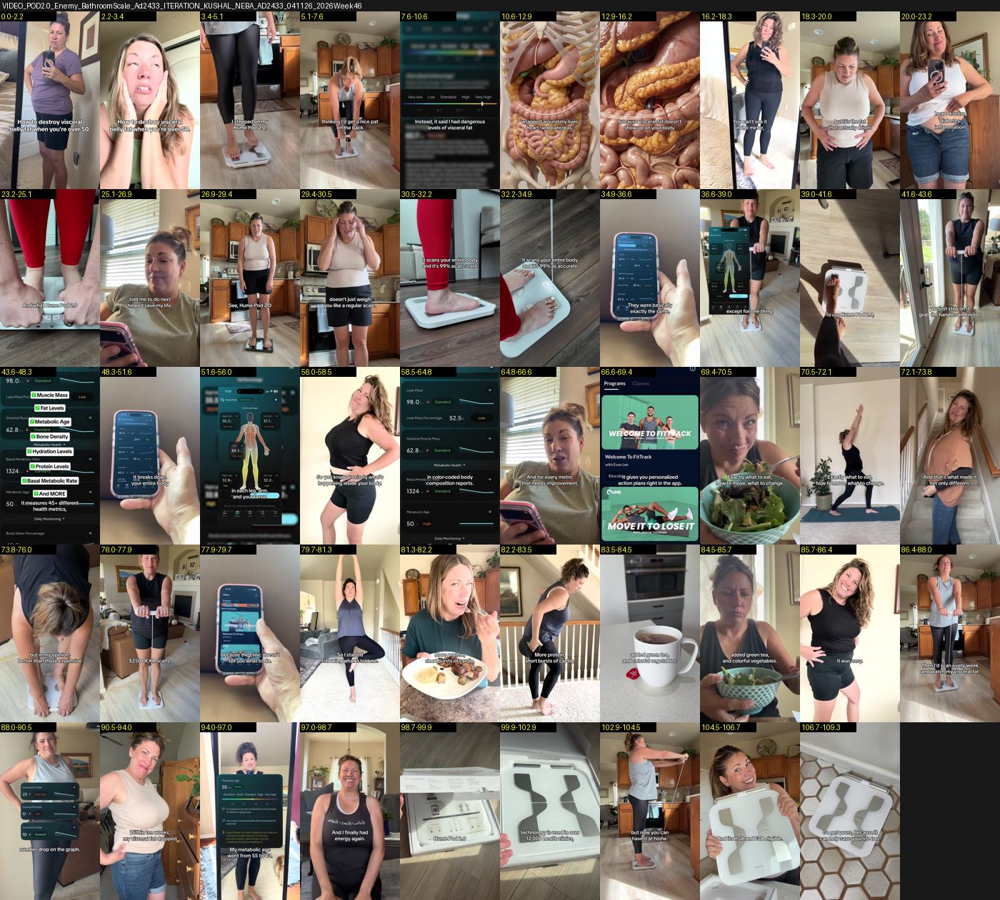

# VIDEO_POD2.0_Enemy_BathroomScale_Ad2433_ITERATION_KUSHAL_NEBA_AD2433_041126_2026Week46

Master: `VIDEO_POD2.0_Enemy_BathroomScale_Ad2433_ITERATION_KUSHAL_NEBA_AD2433_041126_2026Week46_Hook1_9x16.mp4` · 109.3s · 1080x1920

**Pacing:** 49 shots · avg 2.231s · median 2.033s · 4.39 cuts/10s · first cut 2.233s · 229.0 wpm · talk ratio 0.93 · cuts on word start 83.3% · cuts in speech gaps 83.3%
**Audio:** {'I_lufs': -20.1, 'LRA': 2.6, 'true_peak_db': -4.0} · BPM≈129.2 · music {'speech_rms_db': -24.5, 'pause_seconds': 0.3} · cuts with SFX/transient 22.9%

**Captions:** 254 cards · 1.0 words/card (median) · y≈0.638 of frame height · text height≈0.0293 · colours {'white': 197, 'red': 8, 'dark/other': 36, 'other-colour': 1, 'green': 2, 'blue': 10} · cards crossing a cut: 13
Highlighted: thinking I'd get a nice pat, wrapped around my liver,, heart,andpancreas., I had no idea, showup onyourbody., It scansyourentire body, youhaveseparately, Lean(lbs), eandyourtorso., High, Red meansyou need, to work on it., MUME, MuME it gives you personalized, UME
**Headlines:** 1294. (32.0–32.0s, white) | 1386. (33.0–33.0s, white) | 1199. (34.0–34.0s, white) | CgNoDevcePalredr (36.0–36.0s, blue) | BodyFat Percentage (44.0–44.0s, white) | 44.8% (44.0–44.0s, white) | MuscleMass (44.0–48.0s, white) | Fat Levels (44.0–48.0s, white)

**Hook (0–3s) spoken:** How to destroy visceral belly fat when you're over 50.
**Hook on-screen:** How to destroy visceral / Howto-destroy visceral / belly fat when you're over 50. / bellyfatwhenyou're over50. / bellyfatwhenyou'reover50
**CTA (last 5s):** and it's HSA and FSA -eligible. Go get yours, because it can help save your life too. · on-screen: And its HSAand FSA eligible. / Go getyours,because it / XHume / can help save your life too. / can helpsaveyour lifetoo / canhelp saveyour lifetoo.

## Beat sheet

| # | in–out (s) | dur | transition | spoken | on-screen text |
|---|---|---|---|---|---|
| 1 | 0.00–2.23 | 2.23 |  | How to destroy visceral belly fat when | How to destroy visceral / belly fat when you're over 50. / bellyfatwhenyou'reover50 |
| 2 | 2.23–3.37 | 1.13 | cut | you're over 50. | How to destroy visceral / bellyfatwhenyou'reover50 / Howto-destroy visceral / bellyfatwhenyou're over50. / Howto destroy visceral |
| 3 | 3.37–5.10 | 1.73 | cut +SFX hit | I stepped on my HumePod 2 .0, | bellyfatwhenyou're over50. / Howto destroy visceral / I stepped onmy / HumePod2.0. / HumePod2.0, / thinking I'd get a nice pat [red] |
| 4 | 5.10–7.57 | 2.47 | cut +SFX hit | thinking I'd get a nice pat on the back for my morning walks. | thinking I'd get a nice pat [red] / ontheback / frommy morning walks |
| 5 | 7.57–10.60 | 3.03 | cut | Instead, it said I had dangerous levels of visceral fat, | High / Very High / VerylowLow / Standard / 25.7 / 11.7 |
| 6 | 10.60–12.93 | 2.33 | cut +SFX hit | wrapped around my liver, heart, and pancreas. | wrapped around my liver, [other-colour] / heart,andpancreas. [red] |
| 7 | 12.93–16.20 | 3.27 | cut | I had no idea, because visceral fat doesn't show up on your body. | I had no idea [red] / becausevisceral fatdoesn't / showup onyourbody. [red] / You can't pinch it. |
| 8 | 16.20–18.30 | 2.1 | cut | You can't pinch it. You can't see it in the mirror. | You can't pinch it. / You can't see it / in themirror, |
| 9 | 18.30–19.97 | 1.67 | cut | But it's the fat that actually drives heart | You can't see it / in themirror, / butit'sthefat / that actually drives |
| 10 | 19.97–23.23 | 3.27 | cut +SFX hit | disease, diabetes, inflammation, and even cancer. | heartdisease / diabetes / inflammation / And what Hume Pod 2.0 |
| 11 | 23.23–25.10 | 1.87 | cut | And what HumePod 2 .0 told me | And what Hume Pod 2.0 / told me to do next / helped save my life. |
| 12 | 25.10–26.93 | 1.83 | cut | to do next helped save my life. | told me to do next / helped save my life. |
| 13 | 26.93–29.43 | 2.5 | cut | See, HumePod 2 .0 doesn't just weigh you | See,HumePod2.0 / doesn't just weigh / you like a regular scale. |
| 14 | 29.43–30.50 | 1.07 | cut | like a regular scale. | doesn't just weigh / you like a regular scale. |
| 15 | 30.50–32.20 | 1.7 | cut | It scans your entire body and | It scansyourentire body [red] / andit's99%asaccurate / 1294. (HEADLINE) |
| 16 | 32.20–34.87 | 2.67 | cut +SFX hit | it's 99 % as accurate as a DEXA scan. | It scansyourentire body [red] / andit's99%asaccurate / 1294. (HEADLINE) / 1386. (HEADLINE) / asaDEXAscan / 1199. (HEADLINE) |
| 17 | 34.87–36.60 | 1.73 | cut | They were basically exactly the same, | 29.5 / 28.4kg / They were basically / exactlythesamer / CgNoDevcePalredr [blue] (HEADLINE) / 28.4g |
| 18 | 36.60–39.00 | 2.4 | cut | except for one thing, which I'll explain in a moment. | 46.3c4 / 15.2c / 15.4b / except for one thing, / whichI'llexplain / in a moment. |
| 19 | 39.00–41.57 | 2.57 | cut | To use HumePod 2 .0, you just step on it, | TouseHume Pod2.0, / To use Hume Pod2.0. / youjuststepon it, / grab the handles and in 30s |
| 20 | 41.57–43.60 | 2.03 | cut | grab the handles, and in 30 seconds, | youjuststepon it, / grab the handles and in 30s |
| 21 | 43.60–48.33 | 4.73 | cut | it measures 45 plus different health metrics, including how much visceral fat you're hiding. | BodyFat Percentage (HEADLINE) / 44.8% (HEADLINE) / MuscleMass (HEADLINE) / Fat Levels (HEADLINE) / Very High (HEADLINE) / BodyFatMass (HEADLINE) |
| 22 | 48.33–51.63 | 3.3 | cut +SFX hit | It breaks down your entire body into five parts and shows you | MuscleMass (HEADLINE) / Fat Levels (HEADLINE) / MetabolicAge (HEADLINE) / Bone Density / BasalMetabolicRate / HydrationLevels |
| 23 | 51.63–56.00 | 4.37 | cut | how much muscle and fat you have separately in each leg, arm, and your torso, | LeanMass (HEADLINE) / LeftArm (HEADLINE) / Right Arm (HEADLINE) / 4.9ibs (HEADLINE) / 4.91bs (HEADLINE) / Standard (HEADLINE) |
| 24 | 56.00–58.53 | 2.53 | cut | so you know precisely what's happening inside your body. | So youknow preciselywhat's / happening inside your body. / happening inside your body |
| 25 | 58.53–64.83 | 6.3 | cut | The app breaks everything down in color -coded body composition reports. Green means you're good. Red means you need to work on it. | 186.6ibs +Very High (HEADLINE) / 32.2 (HEADLINE) / Very High (HEADLINE) / BMI (HEADLINE) / 1601bs (HEADLINE) / Goal Weight (HEADLINE) |
| 26 | 64.83–66.57 | 1.73 | cut | And for every metric that needs improvement, | Andforeverymetric / that needs improvement, |
| 27 | 66.57–69.37 | 2.8 | cut | it gives you personalized action plans right in the app. | Plans (HEADLINE) / Programs (HEADLINE) / Classes (HEADLINE) / New&Featured (HEADLINE) / WELCOMETOFITTRACK / actionplans right intheapp. |
| 28 | 69.37–70.50 | 1.13 | cut +SFX hit | Exactly what to eat, | Plans (HEADLINE) / Programs (HEADLINE) / Classes (HEADLINE) / MOVEITTOLOSEIT / WELCOMETO FITTRACK (HEADLINE) / withJedTavernier/26videos |
| 29 | 70.50–72.07 | 1.57 | cut | how to move, what to change. | Exactlywhattoeat, / how to move, what to change. / And that's what madeit / notonlydifferent, |
| 30 | 72.07–73.77 | 1.7 | cut +SFX hit | And that's what made it not only different, | And that's what madeit / notonlydifferent, |
| 31 | 73.77–76.03 | 2.27 | cut +SFX hit | but in my opinion, better than those expensive $250 | butinmyopinion, / betterthan thoseexpensive / $250DEXAscans. |
| 32 | 76.03–77.93 | 1.9 | cut | dexa scans. | $250DEXAscans. |
| 33 | 77.93–79.73 | 1.8 | cut | Because the clinic doesn't tell you what to do. | Plans (HEADLINE) / WELOOMETOFITLACK [blue] / WelcomeToFitTrack / Because the clinic doesn't [blue] / tell you what to do. [blue] / WELCONETOFILLACK [blue] |
| 34 | 79.73–81.33 | 1.6 | cut +SFX hit | So I started following what it told me. | SoIstarted / following what it told me. |
| 35 | 81.33–82.23 | 0.9 | cut | More protein, | SoIstarted / following what it told me. / Moreprotein, / shortburstsofcardio |
| 36 | 82.23–83.50 | 1.27 | cut | short bursts of cardio, | Moreprotein, / shortburstsofcardio |
| 37 | 83.50–84.47 | 0.97 | cut | added green tea, | added green tea, / and colorful vegetables. |
| 38 | 84.47–85.67 | 1.2 | cut | and colorful vegetables. | added green tea, / and colorful vegetables. |
| 39 | 85.67–86.37 | 0.7 | cut | It was easy. Then | It was easy. |
| 40 | 86.37–87.97 | 1.6 | cut | I'd re -scan every week and | It was easy. / Then I'd scan every week / andwatch myvisceralfat |
| 41 | 87.97–90.53 | 2.57 | cut | watch my visceral fat number drop on the graph. | Then I'd scan every week / andwatch myvisceralfat / 22个VeryHigh / 22→VeryHigh / number drop on the graph. / 22+Very High |
| 42 | 90.53–93.97 | 3.43 | cut | Within 10 weeks, my visceral fat dropped below the danger range. | Withintenweeks, / myvisceral fat dropped / below the danger range. |
| 43 | 93.97–96.97 | 3.0 | cut | My metabolic age went from 55 to 43, | MetabolicAge (HEADLINE) / 55yrs / Mymetabolicage / wentfrom55to43. / Excellent Good Standard High VeryHigh / 43yrs |
| 44 | 96.97–98.70 | 1.73 | cut | and I finally had energy again. | And I finally had / energy again. |
| 45 | 98.70–99.87 | 1.17 | cut | HumePod 2 .0's | Hume Pod 2.0 |
| 46 | 99.87–102.87 | 3.0 | cut | technology is used in over 12 ,000 health clinics, | Download the (HEADLINE) / 8888 (HEADLINE) / SCANME (HEADLINE) / Takeyourfestscan (HEADLINE) / Connect to Bluetooth via the / Bace feel merigurot |
| 47 | 102.87–104.53 | 1.67 | cut +SFX hit | but now you can have it at home, | butnow you can / have it at home. |
| 48 | 104.53–106.70 | 2.17 | cut | and it's HSA and FSA -eligible. | And its HSAand FSA eligible. |
| 49 | 106.70–109.31 | 2.61 | cut | Go get yours, because it can help save your life too. | Go getyours,because it / canhelp saveyour lifetoo. / can helpsaveyour lifetoo / can help save your life too. / XHume |

## Full transcript

How to destroy visceral belly fat when you're over 50. I stepped on my HumePod 2.0, thinking I'd get a nice pat on the back for my morning walks. Instead, it said I had dangerous levels of visceral fat, wrapped around my liver, heart, and pancreas. I had no idea, because visceral fat doesn't show up on your body. You can't pinch it. You can't see it in the mirror. But it's the fat that actually drives heart disease, diabetes, inflammation, and even cancer. And what HumePod 2.0 told me to do next helped save my life. See, HumePod 2.0 doesn't just weigh you like a regular scale. It scans your entire body and it's 99% as accurate as a DEXA scan. They were basically exactly the same, except for one thing, which I'll explain in a moment. To use HumePod 2.0, you just step on it, grab the handles, and in 30 seconds, it measures 45 plus different health metrics, including how much visceral fat you're hiding. It breaks down your entire body into five parts and shows you how much muscle and fat you have separately in each leg, arm, and your torso, so you know precisely what's happening inside your body. The app breaks everything down in color-coded body composition reports. Green means you're good. Red means you need to work on it. And for every metric that needs improvement, it gives you personalized action plans right in the app. Exactly what to eat, how to move, what to change. And that's what made it not only different, but in my opinion, better than those expensive $250 dexa scans. Because the clinic doesn't tell you what to do. So I started following what it told me. More protein, short bursts of cardio, added green tea, and colorful vegetables. It was easy. Then I'd re-scan every week and watch my visceral fat number drop on the graph. Within 10 weeks, my visceral fat dropped below the danger range. My metabolic age went from 55 to 43, and I finally had energy again. HumePod 2.0's technology is used in over 12,000 health clinics, but now you can have it at home, and it's HSA and FSA-eligible. Go get yours, because it can help save your life too.