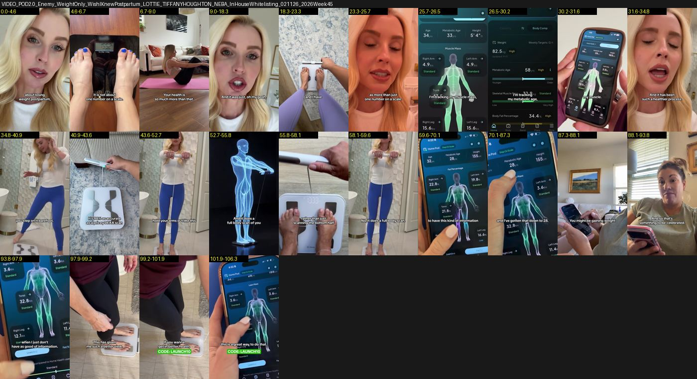

# VIDEO_POD2.0_Enemy_WeightOnly_WishIKnewPostpartum_LOTTIE_TIFFANYHOUGHTON_NEBA_InHouseWhitelisting_021126_2026Week45

Master: `VIDEO_POD2.0_Enemy_WeightOnly_WishIKnewPostpartum_LOTTIE_TIFFANYHOUGHTON_NEBA_InHouseWhitelisting_021126_2026Week45_Hook1_9x16.mp4` · 106.3s · 1080x1920

**Pacing:** 24 shots · avg 4.43s · median 3.136s · 2.16 cuts/10s · first cut 4.571s · 216.0 wpm · talk ratio 0.94 · cuts on word start 56.5% · cuts in speech gaps 30.4%
**Audio:** {'I_lufs': -19.8, 'LRA': 5.3, 'true_peak_db': -4.1} · BPM≈99.4 · music {'speech_rms_db': -26.2, 'pause_seconds': 3.0, 'pause_rms_db': -27.4, 'bed_minus_voice_db': -1.2, 'music_bed_likely': True} · cuts with SFX/transient 69.6%

**Captions:** 350 cards · 1.0 words/card (median) · y≈0.704 of frame height · text height≈0.0316 · colours {'white': 257, 'red': 6, 'green': 5, 'dark/other': 57, 'blue': 22, 'other-colour': 2, 'yellow': 1} · cards crossing a cut: 9
Highlighted: asmorethanjust, onenumberonascale., I'mtrackingmymusclemass,, Standard, meHeanth, Andithasbeen, suchahealthierprocess., Anditdoesa, full bodyscan of you, ratherthanjust, scanningthebottomhalf, Lean(tbs), soempowering, Lean(lbs), Low
**Headlines:** 155元 (5.5–5.5s, dark/other) | Body Pod (26.0–26.0s, white) | Connected (26.0–26.0s, green) | Age (26.0–26.0s, white) | Height (26.0–26.0s, white) | MetabolicAge (26.0–27.0s, white) | 34yrs (26.0–26.0s, white) | 33yrs (26.0–26.0s, white)

**Hook (0–3s) spoken:** If I could go back and talk to my younger self about losing weight postpartum,
**Hook on-screen:** IfIcouldgoback / aboutlosing / andtalk tomyyoungerself / weightpostpartum / weightpostpartum,
**CTA (last 5s):** more full view of your health this is a great way to do that I'll get here for you. · on-screen: 11.4 / 11.41bs / 20yrs / 2Oyrs / 3.61bs / 3.6bs / 3.6ibs / 3.6lbs / 32.8bs / 32.8ibs / 32.8lbs / 4:22

## Beat sheet

| # | in–out (s) | dur | transition | spoken | on-screen text |
|---|---|---|---|---|---|
| 1 | 0.00–4.57 | 4.57 |  | If I could go back and talk to my younger self about losing weight postpartum, this is what I would say. | IfIcouldgoback / andtalk tomyyoungerself / aboutlosing / weightpostpartum / weightpostpartum, / thisiswhatIwould say |
| 2 | 4.57–6.74 | 2.17 | cut +SFX hit | It is not about one number on a scale. Your health | Max.150kgd=100g / Itisnotabout / onenumberonascale. / 155元 (HEADLINE) / Max,150kgd=100g |
| 3 | 6.74–9.04 | 2.3 | cut | is so much more than that. | Yourhealthis / so much more than that. / AndwithLilly,Ifeltlike / Iwasjustweighingmyself |
| 4 | 9.04–18.25 | 9.21 | cut | And with Lilly, I felt like I was just weighing myself and weighing myself and like, oh, have I gone down a pound? And it was just, oh my gosh, this fuller coaster. And with Jackson, I | AndwithLilly,Ifeltlike / Iwasjustweighingmyself / AndwithLily,Ifeltlike / andweighing myself and like / oh,haveIgonedownapound? / oh,havegonedownapound? |
| 5 | 18.25–23.32 | 5.07 | cut +SFX hit | have been using the Hume Body Pod and I have recognized my progress as | AndwithJackson, / Ihavebeenusing / the Humebodypod / andhave / recognizedmyprogress |
| 6 | 23.32–25.73 | 2.4 | cut +SFX hit | more than just one number on a scale. I'm tracking my muscle | recognizedmyprogress / asmorethanjust [red] / onenumberonascale. [red] / I'mtrackingmymusclemass, [red] |
| 7 | 25.73–26.49 | 0.77 | cut +SFX hit |  | I'mtrackingmymusclemass, [red] / Body Pod (HEADLINE) / Connected [green] (HEADLINE) / Age (HEADLINE) / Height (HEADLINE) / MetabolicAge (HEADLINE) |
| 8 | 26.49–30.16 | 3.67 | cut +SFX hit | mass. my | I'mtrackingmymusclemass, [red] / Body Pod (HEADLINE) / Connected [green] (HEADLINE) / Age (HEADLINE) / Height (HEADLINE) / MetabolicAge (HEADLINE) |
| 9 | 30.16–31.57 | 1.4 | cut +SFX hit | muscle, and | Standard [green] / HumePod (HEADLINE) / 1-25 [blue] (HEADLINE) / meHeanth [blue] / 59.5g / BMI |
| 10 | 31.57–34.77 | 3.2 | cut +SFX hit | it has been such a healthier process. | Andithasbeen [red] / suchahealthierprocess. [red] |
| 11 | 34.77–40.94 | 6.17 | cut +SFX hit | The way that the Hume Body Pod works is you step on it barefoot. It's 98 % as accurate | Thewaythatthe / Humebodypod worksis / MT / youstepon it barefoot. / MT / It's98%asaccurate |
| 12 | 40.94–43.58 | 2.64 | cut | as a pricey dexter scan that | It's98%asaccurate / asapriceyDExAscan / XHume / It's98%6asaccurate |
| 13 | 43.58–52.72 | 9.14 | cut | you would get in a medical office who stand on the sensors, holds your arms out like this, or I don't know, it's usually like what, a minute or so, and | thatyou would / get inamedicaloffice. / You stand onthesensors, / hold yourarms outlikethis / I don't know, / it'susuallylike |
| 14 | 52.72–55.79 | 3.07 | cut +SFX hit | it does a full body scan of you rather than just scanning | Anditdoesa [blue] / full bodyscan of you [blue] / ratherthanjust [blue] / scanningthebottomhalf [blue] |
| 15 | 55.79–58.06 | 2.27 | cut | the bottom half and guessing the top. No, | ratherthanjust [blue] / scanningthebottomhalf [blue] / and guessing thetop. / No,it doesafullbodyscan. |
| 16 | 58.06–59.59 | 1.54 | cut +SFX hit | it does a full body scan. | No,it doesafullbodyscan. |
| 17 | 59.59–70.10 | 10.51 | cut +SFX hit | Everything syncs to this app immediately and it is so empowering to have this kind of information where I can see the muscle mass that I've been able to build. | 4:21 [blue] (HEADLINE) / Step On Scale [blue] (HEADLINE) / HumePod [blue] (HEADLINE) / Height (HEADLINE) / MetabolicAge (HEADLINE) / 155cm (HEADLINE) |
| 18 | 70.10–87.32 | 17.22 | cut +SFX hit | A lot of these were in the red after my pregnancy. I had just let my muscles really go. This metabolic age used to be significantly higher and I've gotten that down to 28. That's so exciting for me. I also like being able to see the difference in my fat percentage versus my muscle percentage. like you | StepOnScale [blue] (HEADLINE) / Height (HEADLINE) / MetabolicAge (HEADLINE) / 155cm (HEADLINE) / 28yrs (HEADLINE) / Lean Mass [blue] (HEADLINE) |
| 19 | 87.32–88.12 | 0.8 | cut | might be gaining | MetabolicAge (HEADLINE) / Standard / Torso / StepOnScale [blue] (HEADLINE) / HumePod [blue] (HEADLINE) / Age (HEADLINE) |
| 20 | 88.12–93.83 | 5.71 | cut | weight but you're actually gaining muscle and so that's something to be celebrated you don't need to be stressing out the | You mightbegaining weight / butyou're / actuallygaining muscle. / Andsothat's / somethingtobecelebrated. / You don't need |
| 21 | 93.83–97.93 | 4.1 | cut +SFX hit | way that I have in the past when I just don't have as good of information. This | Slandard (HEADLINE) / 3.61bs (HEADLINE) / piepueis (HEADLINE) / Torse (HEADLINE) / 32.8108 (HEADLINE) / Standard (HEADLINE) |
| 22 | 97.93–99.20 | 1.27 | cut +SFX hit | has given me such a | Thishasgiven / mesuchabetterview. |
| 23 | 99.20–101.87 | 2.67 | cut +SFX hit | better view they want to get in better health have a better more full | Thishasgiven / mesuchabetterview. / Ifyouwanna / getin betterhealth, / CODE:LAUNCH10 [green] / haveabetter,morefull view |
| 24 | 101.87–106.33 | 4.46 | cut +SFX hit | view of your health this is a great way to do that I'll get here for you. | haveabetter,morefull view / 4:224 [blue] (HEADLINE) / StepOnScale [blue] (HEADLINE) / HumePod [blue] (HEADLINE) / 2Oyrs [blue] (HEADLINE) / 5yrs [blue] (HEADLINE) |

## Hook variants

| hook | file | dur | first cut | spoken 0–3s | on-screen 0–3s |
|---|---|---|---|---|---|
| 1 | `ON_NEBA_InHouseWhitelisting_021126_2026Week45_Hook1_9x16.mp4` | 106.3 | 4.571 | If I could go back and talk to my younger self about losing weight postpartum, | IfIcouldgoback / aboutlosing / andtalk tomyyoungerself / weightpostpartum / weightpostpartum, |
| 2 | `ON_NEBA_InHouseWhitelisting_021126_2026Week45_Hook2_9x16.mp4` | 103.0 | 3.237 |  |  |
| 3 | `ON_NEBA_InHouseWhitelisting_021126_2026Week45_Hook3_9x16.mp4` | 103.4 | 0.934 |  |  |

## Full transcript

If I could go back and talk to my younger self about losing weight postpartum, this is what I would say. It is not about one number on a scale. Your health is so much more than that. And with Lilly, I felt like I was just weighing myself and weighing myself and like, oh, have I gone down a pound? And it was just, oh my gosh, this fuller coaster. And with Jackson, I have been using the Hume Body Pod and I have recognized my progress as more than just one number on a scale. I'm tracking my muscle mass. my muscle, and it has been such a healthier process. The way that the Hume Body Pod works is you step on it barefoot. It's 98% as accurate as a pricey dexter scan that you would get in a medical office who stand on the sensors, holds your arms out like this, or I don't know, it's usually like what, a minute or so, and it does a full body scan of you rather than just scanning the bottom half and guessing the top. No, it does a full body scan. Everything syncs to this app immediately and it is so empowering to have this kind of information where I can see the muscle mass that I've been able to build. A lot of these were in the red after my pregnancy. I had just let my muscles really go. This metabolic age used to be significantly higher and I've gotten that down to 28. That's so exciting for me. I also like being able to see the difference in my fat percentage versus my muscle percentage. like you might be gaining weight but you're actually gaining muscle and so that's something to be celebrated you don't need to be stressing out the way that I have in the past when I just don't have as good of information. This has given me such a better view they want to get in better health have a better more full view of your health this is a great way to do that I'll get here for you.