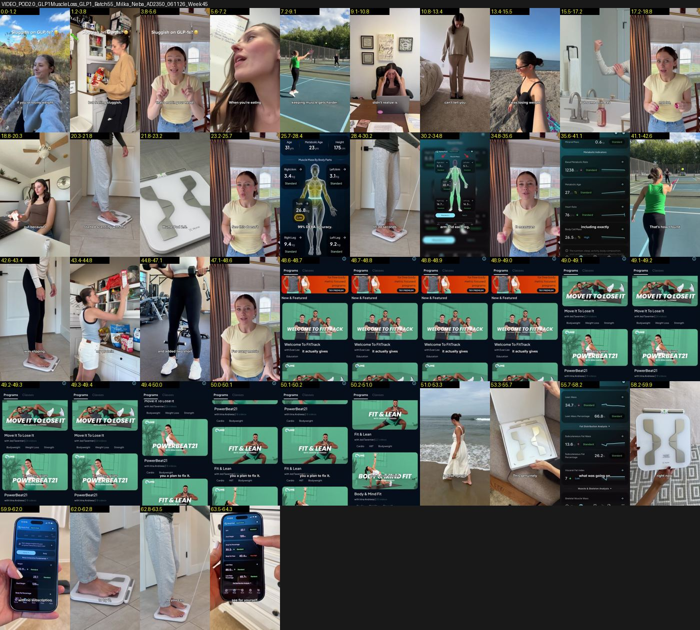

# VIDEO_POD2.0_GLP1MuscleLoss_GLP1_Batch55_Milka_Neba_AD2350_061126_Week45

Master: `VIDEO_POD2.0_GLP1MuscleLoss_GLP1_Batch55_Milka_Neba_AD2350_061126_Week45_Hook1_9x16.mp4` · 64.3s · 1080x1920

**Pacing:** 44 shots · avg 1.462s · median 1.55s · 6.68 cuts/10s · first cut 1.233s · 195.0 wpm · talk ratio 0.97 · cuts on word start 86.0% · cuts in speech gaps 60.5%
**Audio:** {'I_lufs': -21.3, 'LRA': 2.9, 'true_peak_db': -4.0} · BPM≈129.2 · music {'speech_rms_db': -27.8, 'pause_seconds': 0.2} · cuts with SFX/transient 69.8%

**Captions:** 182 cards · 1.0 words/card (median) · y≈0.744 of frame height · text height≈0.0269 · colours {'blue': 5, 'white': 129, 'dark/other': 39, 'other-colour': 1, 'yellow': 1, 'green': 7} · cards crossing a cut: 2
Highlighted: if you're losing weight, LKSD, Low, Lean(lbs), Body, That's how I found, FegelOrisps, CUME, it actually gives, POWERBEAT21, FIT&LEAN, UME, Body, Standard
**Headlines:** Sluggish on GLP-1s? (0.0–5.0s, blue) | achDayWithA (1.0–3.5s, white) | POPCORNERS (1.0–3.5s, white) | D-Di (5.5–5.5s, white) | ConnorD-Deorte (6.0–6.0s, white) | to (10.0–10.0s, dark/other) | MetabolicAge (26.0–27.0s, white) | Height (26.0–27.0s, white)

**Hook (0–3s) spoken:** If you're losing weight on a GLP -1 but feeling
**Hook on-screen:** POPCORNERS / Sluggish on GLP-1s? / achDayWithA / but feeling sluggish, / dwith / if you're losing weight / love / love. / on a GLP-1 / tails, / tails.
**CTA (last 5s):** with no subscription and 45 days to try it so you can see for yourself · on-screen: 10:08 / 10:08% / 10:09# / 1251bs / 125bs / 133.9bs / 1518 / 23.1 / 231 / 30.2%+Standard / 40.4ibs / 40:418

## Beat sheet

| # | in–out (s) | dur | transition | spoken | on-screen text |
|---|---|---|---|---|---|
| 1 | 0.00–1.23 | 1.23 |  | If you're losing weight on | Sluggish on GLP-1s? [blue] (HEADLINE) / if you're losing weight [blue] / achDayWithA (HEADLINE) / POPCORNERS (HEADLINE) / tails, / love |
| 2 | 1.23–3.83 | 2.6 | cut +SFX hit | a GLP -1 but feeling sluggish, | Sluggish on GLP-1s? [blue] (HEADLINE) / achDayWithA (HEADLINE) / POPCORNERS (HEADLINE) / tails, / love / on a GLP-1 |
| 3 | 3.83–5.63 | 1.8 | cut +SFX hit | that's not in your head. | Sluggish on GLP-1s? [blue] (HEADLINE) / achDayWithA (HEADLINE) / POPCORNERS (HEADLINE) / dwith / but feeling sluggish, / tails, |
| 4 | 5.63–7.20 | 1.57 | cut +SFX hit | When you're eating a lot less, | D-Di (HEADLINE) / When you're eating / ConnorD-Deorte (HEADLINE) / keeping muscle gets harder. |
| 5 | 7.20–9.07 | 1.87 | cut +SFX hit | keeping muscle gets harder. | keeping muscle gets harder. / walk / ithyodrGo / And what I / LKSD [other-colour] |
| 6 | 9.07–10.77 | 1.7 | cut +SFX hit | And what I didn't realize is | walk / ithyodrGo / And what I / LKSD [other-colour] / to (HEADLINE) / didn't realize is |
| 7 | 10.77–13.43 | 2.67 | cut +SFX hit | that the scale can't tell you what's coming off. | that the scale / can't tell you / what's coming off. |
| 8 | 13.43–15.47 | 2.03 | cut +SFX hit | Like guys, I was losing weight, | what's coming off. / I was losing weight, |
| 9 | 15.47–17.20 | 1.73 | cut +SFX hit | but some of it was muscle, | I was losing weight, / butsome of it was / not fat, |
| 10 | 17.20–18.77 | 1.57 | cut | not fat, muscle. | not fat, / muscle. |
| 11 | 18.77–20.33 | 1.57 | cut +SFX hit | I only found out because I | Ionly found / out becausel |
| 12 | 20.33–21.77 | 1.43 | cut +SFX hit | started scanning with the Hume | out becausel / started scanning with the |
| 13 | 21.77–23.23 | 1.47 | cut | Pod 2 .0. | HumePod 2.0. / See this doesn't |
| 14 | 23.23–25.73 | 2.5 | cut +SFX hit | See, this doesn't just weigh you, it scans your body with | See this doesn't / it scans your |
| 15 | 25.73–28.43 | 2.7 | cut +SFX hit | 99 % DEXA accuracy. In | MetabolicAge (HEADLINE) / Height (HEADLINE) / 175 cm (HEADLINE) / 23 (HEADLINE) / yrs (HEADLINE) / Right Arm (HEADLINE) |
| 16 | 28.43–30.17 | 1.73 | cut +SFX hit | 30 seconds, you see your body | Right Arm (HEADLINE) / LeftArm (HEADLINE) / Standard / Trunk / Low [yellow] / 99% DEXAaccuracy. |
| 17 | 30.17–34.80 | 4.63 | cut +SFX hit | fat, the muscle in each arm and each leg, and your visceral fat. | 22.1% (HEADLINE) / 22.1% / LeftLeg / 17.4% / 16.6% / body fat, |
| 18 | 34.80–35.60 | 0.8 | cut +SFX hit | It measures 45 | Itmeasures |
| 19 | 35.60–41.07 | 5.47 | cut | different health metrics, including exactly how much muscle versus fat you're losing. | Hydration&Minerals (HEADLINE) / BodyWaterPercentage (HEADLINE) / 55.5% (HEADLINE) / Standard (HEADLINE) / 11.3kg (HEADLINE) / 18.3kg |
| 20 | 41.07–42.63 | 1.57 | cut +SFX hit | That's how I found out my muscle | That's how I found [green] / out my muscle |
| 21 | 42.63–43.37 | 0.73 | cut +SFX hit | was slipping, | was slipping, |
| 22 | 43.37–44.80 | 1.43 | cut | so I raised my protein and | was slipping, / FegelOrisps [blue] / my protein |
| 23 | 44.80–47.07 | 2.27 | cut | added two short strength days a week. | and added two short / strength days a week. / For every metric |
| 24 | 47.07–48.60 | 1.53 | cut +SFX hit | For every metric that needs work, | For every metric / that needs work |
| 25 | 48.60–48.73 | 0.13 | cut +SFX hit | it |  |
| 26 | 48.73–48.83 | 0.1 | cut +SFX hit | actually |  |
| 27 | 48.83–48.93 | 0.1 | cut +SFX hit |  |  |
| 28 | 48.93–49.03 | 0.1 | cut +SFX hit |  | Plans (HEADLINE) / Programs (HEADLINE) / Classes (HEADLINE) / MOVEITTOLOSEIT (HEADLINE) / MoveItToLoseIt / withJedTavernier/26videos |
| 29 | 49.03–49.13 | 0.1 | cut +SFX hit |  | Plans (HEADLINE) / Programs (HEADLINE) / Classes (HEADLINE) / MOVEITTOLOSEIT (HEADLINE) / MoveItToLoseIt / withJedTavernier/26videos |
| 30 | 49.13–49.23 | 0.1 | cut |  | Plans (HEADLINE) / Programs (HEADLINE) / Classes (HEADLINE) / MOVEITTOLOSEIT (HEADLINE) / MoveItToLoseIt / withJedTavernier/26videos |
| 31 | 49.23–49.33 | 0.1 | cut | gives | Plans (HEADLINE) / Programs (HEADLINE) / Classes (HEADLINE) / MOVEITTOLOSEIT (HEADLINE) / MoveItToLoseIt / withJedTavernier/26videos |
| 32 | 49.33–49.43 | 0.1 | cut +SFX hit |  | Plans (HEADLINE) / Programs (HEADLINE) / Classes (HEADLINE) / MOVEITTOLOSEIT (HEADLINE) / MoveItToLoseIt / withJedTavernier/26videos |
| 33 | 49.43–50.03 | 0.6 | cut +SFX hit | you a plan | Plans (HEADLINE) / Programs (HEADLINE) / Classes (HEADLINE) / MOVEITTOLOSEIT (HEADLINE) / MoveItToLoseIt / withJedTavernier/26videos |
| 34 | 50.03–50.13 | 0.1 | cut +SFX hit |  | Plans (HEADLINE) / Programs (HEADLINE) / Classes (HEADLINE) / Bodyweight / CUME [green] / PowerBeat2l (HEADLINE) |
| 35 | 50.13–50.23 | 0.1 | cut +SFX hit | to | Plans (HEADLINE) / Programs (HEADLINE) / Classes (HEADLINE) / Bodyweight / CUME [green] / PowerBeat2l (HEADLINE) |
| 36 | 50.23–50.97 | 0.73 | cut | fix it. | Plans (HEADLINE) / Programs (HEADLINE) / Classes (HEADLINE) / Bodyweight / CUME [green] / PowerBeat2l (HEADLINE) |
| 37 | 50.97–53.30 | 2.33 | cut +SFX hit | You don't have to lose muscle to lose weight. | You don't have / to lose muscle / to lose weight |
| 38 | 53.30–55.67 | 2.37 | cut +SFX hit | This genuinely helped me understand what | to lose weight / This genuinely / helped me understand |
| 39 | 55.67–58.23 | 2.57 | cut +SFX hit | was going on, and it can help you too. It's | 15.6kg (HEADLINE) / High (HEADLINE) / BodyFat Mass (HEADLINE) / 34.7kg (HEADLINE) / Standard (HEADLINE) / 66.8% |
| 40 | 58.23–59.90 | 1.67 | cut | 30 % off right now with | It's30%off / XHume / right now, |
| 41 | 59.90–61.97 | 2.07 | cut | no subscription and 45 days | 10:08 [blue] (HEADLINE) / BodyPod [blue] (HEADLINE) / StepOnScale [blue] (HEADLINE) / Wantdeeperinsightsintoyour / progress?Generateareportnowi / Body [blue] |
| 42 | 61.97–62.83 | 0.87 | cut | to try it so | to try it, |
| 43 | 62.83–63.50 | 0.67 | cut | you can see | so you can |
| 44 | 63.50–64.34 | 0.84 | cut | for yourself | 10:09# [blue] (HEADLINE) / StepOnScale [blue] (HEADLINE) / BodyPod [blue] (HEADLINE) / Standard (HEADLINE) / 23.1 (HEADLINE) / 125bs (HEADLINE) |

## Hook variants

| hook | file | dur | first cut | spoken 0–3s | on-screen 0–3s |
|---|---|---|---|---|---|
| 1 | `_GLP1_Batch55_Milka_Neba_AD2350_061126_Week45_Hook1_9x16.mp4` | 64.3 | 1.233 | If you're losing weight on a GLP -1 but feeling | POPCORNERS / Sluggish on GLP-1s? / achDayWithA / but feeling sluggish, / dwith / if you're losing weight / love / love. |
| 2 | `_GLP1_Batch55_Milka_Neba_AD2350_061126_Week45_Hook2_9x16.mp4` | 65.2 | 2.067 |  |  |
| 3 | `_GLP1_Batch55_Milka_Neba_AD2350_061126_Week45_Hook3_9x16.mp4` | 64.9 | 2.933 |  |  |
| 4 | `_GLP1_Batch55_Milka_Neba_AD2350_061126_Week45_Hook4_9x16.mp4` | 64.6 | 1.9 |  |  |

## Full transcript

If you're losing weight on a GLP-1 but feeling sluggish, that's not in your head. When you're eating a lot less, keeping muscle gets harder. And what I didn't realize is that the scale can't tell you what's coming off. Like guys, I was losing weight, but some of it was muscle, not fat, muscle. I only found out because I started scanning with the Hume Pod 2.0. See, this doesn't just weigh you, it scans your body with 99% DEXA accuracy. In 30 seconds, you see your body fat, the muscle in each arm and each leg, and your visceral fat. It measures 45 different health metrics, including exactly how much muscle versus fat you're losing. That's how I found out my muscle was slipping, so I raised my protein and added two short strength days a week. For every metric that needs work, it actually gives you a plan to fix it. You don't have to lose muscle to lose weight. This genuinely helped me understand what was going on, and it can help you too. It's 30% off right now with no subscription and 45 days to try it so you can see for yourself