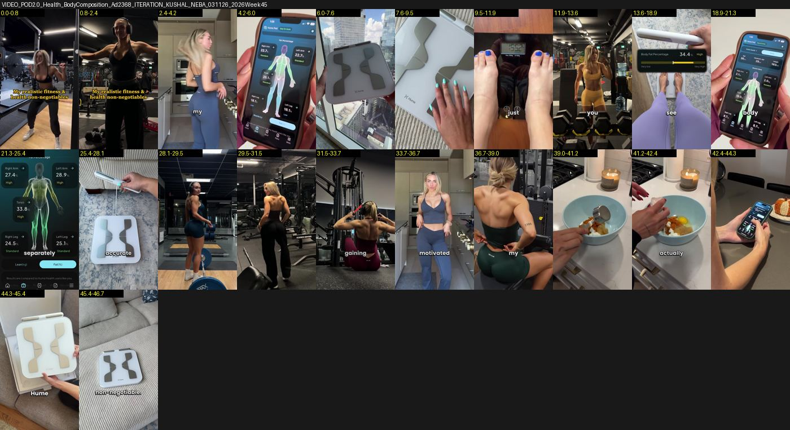

# VIDEO_POD2.0_Health_BodyComposition_Ad2368_ITERATION_KUSHAL_NEBA_031126_2026Week45

Master: `VIDEO_POD2.0_Health_BodyComposition_Ad2368_ITERATION_KUSHAL_NEBA_031126_2026Week45_Hook1_9x16.mp4` · 46.7s · 1080x1920

**Pacing:** 22 shots · avg 2.121s · median 1.885s · 4.5 cuts/10s · first cut 0.834s · 270.0 wpm · talk ratio 0.93 · cuts on word start 90.5% · cuts in speech gaps 76.2%
**Audio:** {'I_lufs': -22.8, 'LRA': 3.7, 'true_peak_db': -6.3} · BPM≈152.0 · music {'speech_rms_db': -26.4, 'pause_seconds': 0.0} · cuts with SFX/transient 61.9%

**Captions:** 109 cards · 1 words/card (median) · y≈0.717 of frame height · text height≈0.0328 · colours {'yellow': 3, 'white': 85, 'dark/other': 21} · cards crossing a cut: 7
Highlighted: Myrealisticfitness&, health non-negotiables, 1969
**Headlines:** 1:25 (4.0–4.5s, blue) | Hume Pod (4.0–5.5s, blue) | StepOn Seale (4.0–4.0s, blue) | Fat Percentage (4.0–5.5s, blue) | Right Arm (4.0–5.5s, white) | 22.7% (4.0–5.5s, white) | LeftArm (4.0–5.5s, white) | Standard (4.0–5.5s, dark/other)

**Hook (0–3s) spoken:** Having a solid routine has been a huge help on my fitness journey, so let's chat through
**Hook on-screen:** Myrealisticfitness& / health non-negotiables / let's
**CTA (last 5s):** working. So yeah, tracking my body composition with the HumePod 2 .0 is a non -negotiable. · on-screen: 2.0 / XHume / non-negotidble

## Beat sheet

| # | in–out (s) | dur | transition | spoken | on-screen text |
|---|---|---|---|---|---|
| 1 | 0.00–0.83 | 0.83 |  | Having a solid routine | Myrealisticfitness& [yellow] / health non-negotiables [yellow] |
| 2 | 0.83–2.44 | 1.6 | cut +SFX hit | has been a huge help on my fitness journey, | Myrealisticfitness& [yellow] / health non-negotiables [yellow] |
| 3 | 2.44–4.17 | 1.74 | cut | so let's chat through my non -negotiables. | Myrealisticfitness& [yellow] / health non-negotiables [yellow] / let's / my / non-negotiables. / 1:25 [blue] (HEADLINE) |
| 4 | 4.17–6.04 | 1.87 | cut +SFX hit | First up, I track my body composition with | 1:25 [blue] (HEADLINE) / Hume Pod [blue] (HEADLINE) / StepOn Seale [blue] (HEADLINE) / Fat Percentage [blue] (HEADLINE) / Right Arm (HEADLINE) / 22.7% (HEADLINE) |
| 5 | 6.04–7.61 | 1.57 | cut | Hugh Podd 2 .0, | XHume / Hume / 2.0. |
| 6 | 7.61–9.48 | 1.87 | cut +SFX hit | and here's why this is such a game changer. | XHume (HEADLINE) / this / changer. |
| 7 | 9.48–11.91 | 2.44 | cut | Most of us think health is just about the number on the scale, | XHume (HEADLINE) / changer. / Max.150kg (HEADLINE) / d=100g (HEADLINE) |
| 8 | 11.91–13.65 | 1.73 | cut | but that doesn't tell you the whole story. | story |
| 9 | 13.65–18.89 | 5.24 | cut +SFX hit | I step on, hold the handles, and in 30 seconds I see my body fat percentage muscle mass and bone density. | on, / Hume / and / 34.4% (HEADLINE) / BodyFat Percentage (HEADLINE) / High (HEADLINE) |
| 10 | 18.89–21.32 | 2.44 | cut +SFX hit | It breaks down my entire body into five parts and | 19.0 / breaks / 6.7mg / LofLoo / 6.7ko / Band |
| 11 | 21.32–25.39 | 4.07 | cut +SFX hit | shows me how much muscle and fat I have separately in each leg, arm, and my torso. | Band / Plans / More / 1:25 [blue] (HEADLINE) / Step On Scate [blue] (HEADLINE) / Right Arm |
| 12 | 25.39–28.09 | 2.7 | cut +SFX hit | And it's 99 % as accurate as a DEXA scan. | Standard / Right Leg / Left Leg / Fat(%) / 27.4% (HEADLINE) / 28.9% (HEADLINE) |
| 13 | 28.09–29.50 | 1.4 | cut +SFX hit | This means I'm not guessing. I | This / guessing |
| 14 | 29.50–31.50 | 2.0 | cut +SFX hit | actually know if I'm progressing the right way, | guessing / TRSEMMAH / HIDBSTRSBMMAH / RSEMMAH / way. |
| 15 | 31.50–33.67 | 2.17 | cut | whether it's losing fat, gaining muscle, or both. | RSEMMAH / way. / fat, / or |
| 16 | 33.67–36.74 | 3.07 | cut +SFX hit | And the best part? It keeps me motivated because I can see the changes that | part, / motivated |
| 17 | 36.74–39.01 | 2.27 | cut +SFX hit | actually matter for my health and fitness goals. | 1969 [yellow] / DPYNE / matter / DFYNE |
| 18 | 39.01–41.24 | 2.23 | cut +SFX hit | I also love that I can see how my diet and exercise | exercise |
| 19 | 41.24–42.41 | 1.17 | cut | are actually working. | exercise |
| 20 | 42.41–44.31 | 1.9 | cut +SFX hit | So yeah, tracking my body composition with |  |
| 21 | 44.31–45.45 | 1.13 | cut | the HumePod 2 .0 | XHume / 2.0 |
| 22 | 45.45–46.66 | 1.21 | cut | is a non -negotiable. | XHume / 2.0 / non-negotidble |

## Hook variants

| hook | file | dur | first cut | spoken 0–3s | on-screen 0–3s |
|---|---|---|---|---|---|
| 1 | `d2368_ITERATION_KUSHAL_NEBA_031126_2026Week45_Hook1_9x16.mp4` | 46.7 | 0.834 | Having a solid routine has been a huge help on my fitness journey, so let's chat through | Myrealisticfitness& / health non-negotiables / let's |
| 2 | `d2368_ITERATION_KUSHAL_NEBA_031126_2026Week45_Hook2_9x16.mp4` | 46.1 | 1.301 |  |  |
| 3 | `d2368_ITERATION_KUSHAL_NEBA_031126_2026Week45_Hook3_9x16.mp4` | 45.4 | 1.535 |  |  |

## Full transcript

Having a solid routine has been a huge help on my fitness journey, so let's chat through my non-negotiables. First up, I track my body composition with Hugh Podd 2.0, and here's why this is such a game changer. Most of us think health is just about the number on the scale, but that doesn't tell you the whole story. I step on, hold the handles, and in 30 seconds I see my body fat percentage muscle mass and bone density. It breaks down my entire body into five parts and shows me how much muscle and fat I have separately in each leg, arm, and my torso. And it's 99% as accurate as a DEXA scan. This means I'm not guessing. I actually know if I'm progressing the right way, whether it's losing fat, gaining muscle, or both. And the best part? It keeps me motivated because I can see the changes that actually matter for my health and fitness goals. I also love that I can see how my diet and exercise are actually working. So yeah, tracking my body composition with the HumePod 2.0 is a non-negotiable.