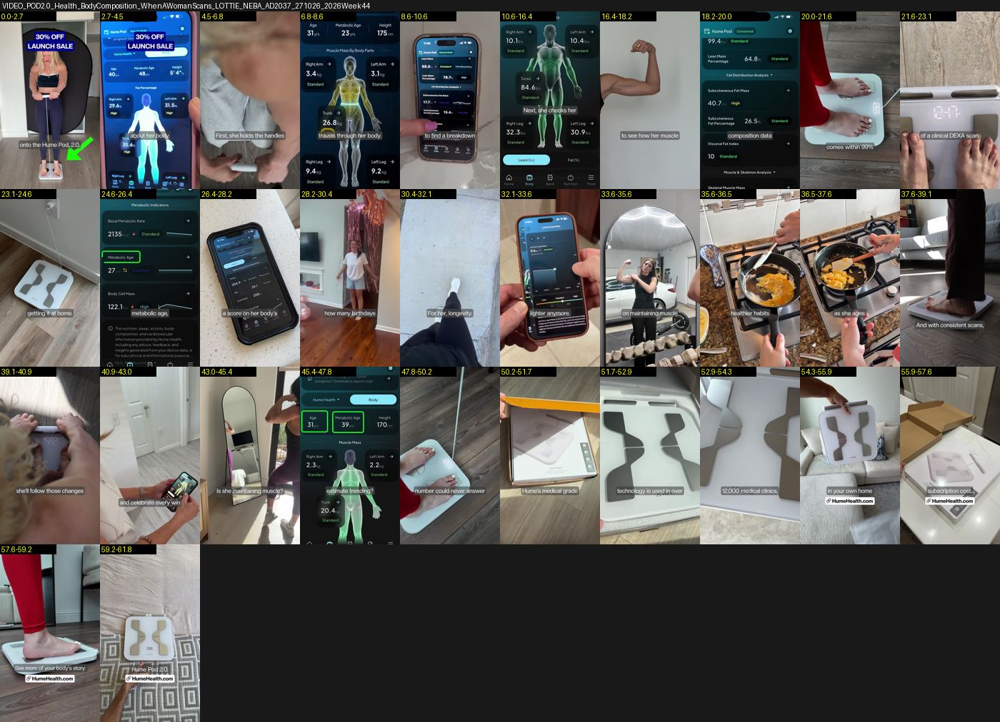

# VIDEO_POD2.0_Health_BodyComposition_WhenAWomanScans_LOTTIE_NEBA_AD2037_271026_2026Week44

Master: `VIDEO_POD2.0_Health_BodyComposition_WhenAWomanScans_LOTTIE_NEBA_AD2037_271026_2026Week44_HOOK1_1x16.mp4` · 61.8s · 1080x1920

**Pacing:** 32 shots · avg 1.93s · median 1.8s · 5.02 cuts/10s · first cut 2.66s · 215.0 wpm · talk ratio 0.94 · cuts on word start 83.9% · cuts in speech gaps 67.7%
**Audio:** {'I_lufs': -19.0, 'LRA': 2.0, 'true_peak_db': -3.8} · BPM≈123.0 · music {'speech_rms_db': -22.3, 'pause_seconds': 0.0} · cuts with SFX/transient 48.4%

**Captions:** 219 cards · 1 words/card (median) · y≈0.681 of frame height · text height≈0.0281 · colours {'white': 158, 'blue': 31, 'dark/other': 28, 'green': 1, 'other-colour': 1} · cards crossing a cut: 5
Highlighted: 31.5%, 29.6%, 35.6%, Right Leg, Left Leg, B24.0=, Body, Home, Plans, Height, MetabolicAge, Age, 40yrs, FatPercentage, LeftArm
**Headlines:** 30%OFF (0.0–4.0s, blue) | LAUNCHSALE (0.0–4.0s, blue) | 12:02* (2.5–2.5s, blue) | eHum (2.5–2.5s, blue) | HumeHealth (2.5–4.0s, blue) | Height (2.5–2.5s, blue) | 5'4"t (2.5–2.5s, blue) | 48yrs (2.5–2.5s, blue)

**Hook (0–3s) spoken:** A woman stepped onto the Hume Pod 2 .0. This is what
**Hook on-screen:** 12:02* / 29.6% / 30%OFF / 31.5% / 35.6% / 40yrs / 48yrs / 5'4"t / Awoman stepped / B24.0= / Body / Height / High / Home / HumeHealth / LAUNCHSALE / Left Leg / Plans / Right Leg / This is what she discovered / eHum / onto the Hume Pod.2.0
**CTA (last 5s):** cost. See more of your body's story with the brand new Hume Pod 2 .0. · on-screen: HumeHealth.com / HumePod2.0 / HumePod2.0. / See more of your body's story / subscriptioncost / withthebrandnew

## Beat sheet

| # | in–out (s) | dur | transition | spoken | on-screen text |
|---|---|---|---|---|---|
| 1 | 0.00–2.66 | 2.66 |  | A woman stepped onto the Hume Pod 2 .0. | 30%OFF [blue] (HEADLINE) / LAUNCHSALE [blue] (HEADLINE) / Awoman stepped / onto the Hume Pod.2.0 / 12:02* [blue] (HEADLINE) / eHum [blue] (HEADLINE) |
| 2 | 2.66–4.50 | 1.84 | cut | This is what she discovered about her body. | 30%OFF [blue] (HEADLINE) / LAUNCHSALE [blue] (HEADLINE) / 12:02* [blue] (HEADLINE) / eHum [blue] (HEADLINE) / HumeHealth [blue] (HEADLINE) / Height [blue] (HEADLINE) |
| 3 | 4.50–6.76 | 2.26 | cut | First, she holds the handles as a gentle electrical | First, she holds the handles / as a gentle |
| 4 | 6.76–8.64 | 1.88 | cut +SFX hit | signal travels through her body. | Metabolic Age (HEADLINE) / Height (HEADLINE) / Age (HEADLINE) / 23 yrs (HEADLINE) / 31y (HEADLINE) / 175 (HEADLINE) |
| 5 | 8.64–10.60 | 1.96 | cut | Then she opens the app to find a breakdown of | 11:06 [blue] (HEADLINE) / 76.7% (HEADLINE) / High [blue] (HEADLINE) / Percentage (HEADLINE) / 17.7ibs / Very low [blue] |
| 6 | 10.60–16.42 | 5.82 | cut +SFX hit | her body fat, muscle, and water, not just her weight. Next, she checks her arms, legs, and torso to | Lean Mass / FatDistribution Analysis / Subcutaneous / HumeP...(100%) (HEADLINE) / Connected (HEADLINE) / 12.1% 个 (HEADLINE) |
| 7 | 16.42–18.22 | 1.8 | cut +SFX hit | see how her muscle is distributed. | Standard / Standard (HEADLINE) / LeanMass (HEADLINE) / Right Arm (HEADLINE) / LeftArm (HEADLINE) / 10.4ibs (HEADLINE) |
| 8 | 18.22–20.02 | 1.8 | cut +SFX hit | And all this body composition data comes | 10:00 (HEADLINE) / Hume Pod (HEADLINE) / 46.71bs (HEADLINE) / BodyFatMass (HEADLINE) / Very High [red] (HEADLINE) / LeanMass (HEADLINE) |
| 9 | 20.02–21.62 | 1.6 | cut +SFX hit | within 99 % of | comeswithin99% / 1269 (HEADLINE) |
| 10 | 21.62–23.12 | 1.5 | cut | a clinical DEXA scan, | 1247 (HEADLINE) / of a clinical DEXA scan, / exceptshe's |
| 11 | 23.12–24.64 | 1.52 | cut +SFX hit | except she's getting it at home. | exceptshe's / getting it at home |
| 12 | 24.64–26.38 | 1.74 | cut | Then comes her metabolic age, | MetabolicIndicators (HEADLINE) / BasalMetabolicRate (HEADLINE) / 2135 (HEADLINE) / Standard (HEADLINE) / kcal (HEADLINE) / Metabolic Age |
| 13 | 26.38–28.22 | 1.84 | cut | a score on her body's actual health, | MetabolicIndicators (HEADLINE) / BasalMetabolicRate (HEADLINE) / 2135 (HEADLINE) / Standard (HEADLINE) / kcal (HEADLINE) / Metabolic Age |
| 14 | 28.22–30.38 | 2.16 | cut | rather than how many birthdays she'd celebrated. | rather than / how many birthdays / she'd celebrated. |
| 15 | 30.38–32.08 | 1.7 | cut | For her, longevity doesn't mean | she'd celebrated. / For her, longevity / 5:08 [blue] (HEADLINE) / StepOnScale [blue] (HEADLINE) / HumePod [blue] (HEADLINE) / Height (HEADLINE) |
| 16 | 32.08–33.58 | 1.5 | cut | trying to get lighter anymore. | 5:08 [blue] (HEADLINE) / StepOnScale [blue] (HEADLINE) / HumePod [blue] (HEADLINE) / Height (HEADLINE) / MetabolicAge (HEADLINE) / 5'10"" (HEADLINE) |
| 17 | 33.58–35.56 | 1.98 | cut +SFX hit | She's focusing on maintaining muscle and | onmaintainingmuscle |
| 18 | 35.56–36.48 | 0.92 | cut +SFX hit | building healthier habits | healthierhabits |
| 19 | 36.48–37.58 | 1.1 | cut +SFX hit | as she ages. | healthierhabits / as she ages |
| 20 | 37.58–39.06 | 1.48 | cut | And with consistent scans, | And with consistent scans / she'll follow those changes |
| 21 | 39.06–40.88 | 1.82 | cut | she'll follow those changes over time and | she'll follow those changes / over time, |
| 22 | 40.88–43.02 | 2.14 | cut | celebrate every win along the way. | and celebrate every win / along the way / Is she losing fat? |
| 23 | 43.02–45.36 | 2.34 | cut +SFX hit | Is she losing fat? Is she maintaining muscle? | Is she losing fat? / Is shemaintainingmuscle? |
| 24 | 45.36–47.76 | 2.4 | cut +SFX hit | How is her metabolic age estimate trending? | Is shemaintainingmuscle? / HumePod (HEADLINE) / Wantdeeperinsightsintoyour (HEADLINE) / progress?Generateareportnow! (HEADLINE) / Body [blue] (HEADLINE) / HumeHealth (HEADLINE) |
| 25 | 47.76–50.22 | 2.46 | cut +SFX hit | One weight number could never answer those questions. | 1269 (HEADLINE) / number could never answer / 1269. (HEADLINE) / HumeHealth / FRAGILE [other-colour] / Hume's medical grade |
| 26 | 50.22–51.72 | 1.5 | cut | Hume's medical grade technology | HumeHealth / FRAGILE [other-colour] / Hume's medical grade / HumePod2.0 / technology is used in over |
| 27 | 51.72–52.94 | 1.22 | cut | is used in over 12 ,000 | technology is used in over |
| 28 | 52.94–54.30 | 1.36 | cut | medical clinics, | 12,000 medical clinics, / Hume |
| 29 | 54.30–55.94 | 1.64 | cut +SFX hit | but you can have it in your own home with | 12,000 medical clinics, / Hume / inyourownhome / HumeHealth.com |
| 30 | 55.94–57.56 | 1.62 | cut | no hidden subscription cost. See | HumeHealth.com / withnohidden / subscriptioncost |
| 31 | 57.56–59.22 | 1.66 | cut +SFX hit | more of your body's story with the | HumeHealth.com / See more of your body's story / withthebrandnew |
| 32 | 59.22–61.76 | 2.54 | cut +SFX hit | brand new Hume Pod 2 .0. | HumeHealth.com / withthebrandnew / HumePod2.0 / HumePod2.0. |

## Hook variants

| hook | file | dur | first cut | spoken 0–3s | on-screen 0–3s |
|---|---|---|---|---|---|
| 1 | `manScans_LOTTIE_NEBA_AD2037_271026_2026Week44_HOOK1_1x16.mp4` | 61.8 | 2.66 | A woman stepped onto the Hume Pod 2 .0. This is what | 12:02* / 29.6% / 30%OFF / 31.5% / 35.6% / 40yrs / 48yrs / 5'4"t |
| 2 | `manScans_LOTTIE_NEBA_AD2037_271026_2026Week44_HOOK2_1x16.mp4` | 62.7 | 1.72 |  |  |
| 3 | `manScans_LOTTIE_NEBA_AD2037_271026_2026Week44_HOOK3_1x16.mp4` | 63.9 | 2.3 |  |  |

## Full transcript

A woman stepped onto the Hume Pod 2.0. This is what she discovered about her body. First, she holds the handles as a gentle electrical signal travels through her body. Then she opens the app to find a breakdown of her body fat, muscle, and water, not just her weight. Next, she checks her arms, legs, and torso to see how her muscle is distributed. And all this body composition data comes within 99% of a clinical DEXA scan, except she's getting it at home. Then comes her metabolic age, a score on her body's actual health, rather than how many birthdays she'd celebrated. For her, longevity doesn't mean trying to get lighter anymore. She's focusing on maintaining muscle and building healthier habits as she ages. And with consistent scans, she'll follow those changes over time and celebrate every win along the way. Is she losing fat? Is she maintaining muscle? How is her metabolic age estimate trending? One weight number could never answer those questions. Hume's medical grade technology is used in over 12,000 medical clinics, but you can have it in your own home with no hidden subscription cost. See more of your body's story with the brand new Hume Pod 2.0.