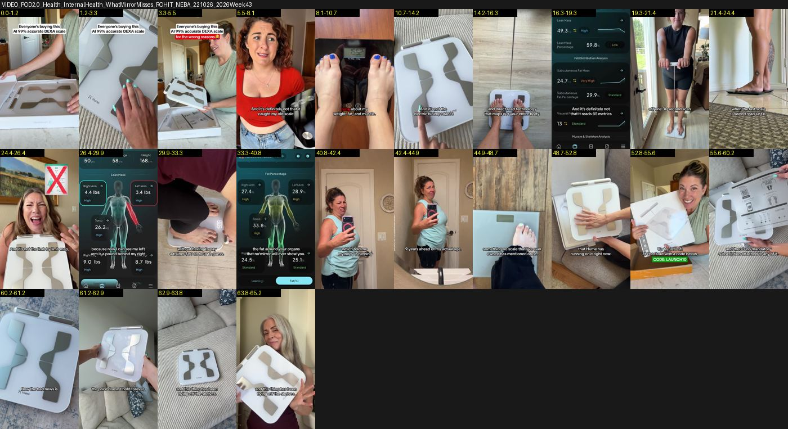

# VIDEO_POD2.0_Health_InternalHealth_WhatMirrorMisses_ROHIT_NEBA_221026_2026Week43

Master: `VIDEO_POD2.0_Health_InternalHealth_WhatMirrorMisses_ROHIT_NEBA_221026_2026Week43_Hook1_9x16.mp4` · 65.2s · 1080x1920

**Pacing:** 24 shots · avg 2.715s · median 2.57s · 3.53 cuts/10s · first cut 1.235s · 207.0 wpm · talk ratio 0.93 · cuts on word start 78.3% · cuts in speech gaps 39.1%
**Audio:** {'I_lufs': -19.6, 'LRA': 1.7, 'true_peak_db': -3.2} · BPM≈99.4 · music {'speech_rms_db': -23.1, 'pause_seconds': 0.6, 'pause_rms_db': -32.1, 'bed_minus_voice_db': -9.1, 'music_bed_likely': True} · cuts with SFX/transient 82.6%

**Captions:** 127 cards · 1 words/card (median) · y≈0.7 of frame height · text height≈0.0293 · colours {'red': 3, 'white': 109, 'dark/other': 11, 'blue': 2, 'green': 2} · cards crossing a cut: 5
Highlighted: And it'sdefinitelynot that it, lyingaboutmy, weight,fat,and muscle., Low, Fat(%), CODE:LAUNCH10O, CODE:LAUNCH10
**Headlines:** Everyone'sbuyingthis (0.0–5.0s, white) | Al99%accurateDEXAscale (0.0–1.0s, white) | AI99%accurateDEXAscale (1.5–1.5s, white) | Hume (1.5–1.5s, white) | Al99% accurateDEXAscale (2.0–3.0s, white) | XHume (2.0–3.0s, white) | AI99%accurateDEXA scale (3.5–5.0s, white) | forthewrongreasons (4.0–5.0s, red)

**Hook (0–3s) spoken:** Everyone's buying this AI 99 % accurate
**Hook on-screen:** AI99%accurateDEXAscale / Al99% accurateDEXAscale / Al99%accurateDEXAscale / Everyone'sbuyingthis / Hume / XHume
**CTA (last 5s):** Now the bad news is, the price doesn't hold forever, and this thing has been flying off the shelves. · on-screen: XHume / andthisthinghasbeen / flyingofftheshelves. / theprice doesn't hold forever,

## Beat sheet

| # | in–out (s) | dur | transition | spoken | on-screen text |
|---|---|---|---|---|---|
| 1 | 0.00–1.24 | 1.24 |  | Everyone's buying this AI | Everyone'sbuyingthis (HEADLINE) / Al99%accurateDEXAscale (HEADLINE) |
| 2 | 1.24–3.34 | 2.1 | cut +SFX hit | 99 % accurate dexa | Everyone'sbuyingthis (HEADLINE) / Al99%accurateDEXAscale (HEADLINE) / AI99%accurateDEXAscale (HEADLINE) / Hume (HEADLINE) / Al99% accurateDEXAscale (HEADLINE) / XHume (HEADLINE) |
| 3 | 3.34–5.47 | 2.14 | cut +SFX hit | -scale for the wrong reasons. | Everyone'sbuyingthis (HEADLINE) / Al99% accurateDEXAscale (HEADLINE) / XHume (HEADLINE) / AI99%accurateDEXA scale (HEADLINE) / forthewrongreasons [red] (HEADLINE) |
| 4 | 5.47–8.14 | 2.67 | cut +SFX hit | And it's definitely not that it caught my old scale lying | Everyone'sbuyingthis (HEADLINE) / AI99%accurateDEXA scale (HEADLINE) / forthewrongreasons [red] (HEADLINE) / And it'sdefinitelynot that it [red] / caughtmyoldscale / lyingaboutmy [red] |
| 5 | 8.14–10.74 | 2.6 | cut +SFX hit | about my weight, fat, and muscle. And | lyingaboutmy [red] / weight,fat,and muscle. [red] / 1552 (HEADLINE) / Max.150kgd=100g |
| 6 | 10.74–14.18 | 3.44 | cut +SFX hit | it's not the electric bioimpedance and direct read technology | And it'snotthe / electricbioimpedance / Hume / and direct read technology, / thatmaps out your entirebody. / and directreadtechnology |
| 7 | 14.18–16.28 | 2.1 | cut | that maps out your entire body. And | thatmaps out your entirebody. / and directreadtechnology |
| 8 | 16.28–19.29 | 3.0 | cut +SFX hit | it's definitely not that it reads 45 metrics off | thatmaps out your entirebody. / and directreadtechnology / LeanMass (HEADLINE) / 59.8% (HEADLINE) / Low (HEADLINE) / Percentage (HEADLINE) |
| 9 | 19.29–21.42 | 2.13 | cut +SFX hit | 130 second scan when | Very High / And it's definitely not / that itreads45metrics / High (HEADLINE) / LeanMass / 59.8% |
| 10 | 21.42–24.39 | 2.97 | cut +SFX hit | the last scale I owned read just 6. And | offone30secondscan / whenthelastscale / Iownedreadjust6. |
| 11 | 24.39–26.39 | 2.0 | cut +SFX hit | it's not the limb by limb map, because | whenthelastscale / Iownedreadjust6. / And it's not the limb by limb map, |
| 12 | 26.39–29.86 | 3.47 | cut +SFX hit | now I can see my left arm is a pound behind my right, without | And it's not the limb by limb map, / Age (HEADLINE) / MetabolicAge (HEADLINE) / Height (HEADLINE) / 50yrs (HEADLINE) / 58yrs (HEADLINE) |
| 13 | 29.86–33.33 | 3.47 | cut | having to pay a trainer $80 an hour to guess. | XHume / withouthavingtopay / atrainer$8Oan hourtoguess. / atrainer$80anhourtoguess. |
| 14 | 33.33–40.84 | 7.51 | cut +SFX hit | It's not the visceral fat number either, the fat around your organs that no mirror will ever show you. And it's surely not the metabolic age, which | withouthavingtopay / atrainer$80anhourtoguess. / Hume Pod (HEADLINE) / StepOnScale [green] (HEADLINE) / SubcutaneousFatMass (HEADLINE) / 26.0lbs个 (HEADLINE) |
| 15 | 40.84–42.41 | 1.57 | cut +SFX hit | told me my body is running | whichtold me / my body is running |
| 16 | 42.41–44.95 | 2.54 | cut | nine years ahead of my actual age, | whichtold me / my body is running / 9years ahead ofmyactualage. / 9years ahead of'my actual age. |
| 17 | 44.95–48.68 | 3.74 | cut +SFX hit | something no scale that I've ever owned has mentioned once. But | something no scalethatIveever / owned hasmentioned once. / TAYLOR / somethingno scale that I've ever / somethingnoscalethatl'veever / 2145 |
| 18 | 48.68–52.79 | 4.1 | cut | nobody's talking about the deal that Hume has running on it right now. | Butnobody's / talking about the deal / XHme / Hume / that Hume has / running on it right now |
| 19 | 52.79–55.62 | 2.84 | cut +SFX hit | Up to 30 % off at checkout with a code below, 45 | Upto30%off / at checkout withacode below / CODE:LAUNCH10O [green] / atcheckout with acode below, / CODE:LAUNCH10 [green] |
| 20 | 55.62–60.16 | 4.54 | cut +SFX hit | -day return guarantee, and there's no mandatory subscription attached to any of it. | 45dayreturnguarantee, / 8888 (HEADLINE) / 45dayreturngvarantee / andthere'snomandatory / subscriptionattachedtoanyof it. / XHume |
| 21 | 60.16–61.23 | 1.07 | cut +SFX hit | Now the bad news is, | XHume / Nowthebad newsis / theprice doesn't hold forever, |
| 22 | 61.23–62.86 | 1.63 | cut +SFX hit | the price doesn't hold forever, | theprice doesn't hold forever, / XHume |
| 23 | 62.86–63.83 | 0.97 | cut +SFX hit | and this thing has been flying | XHume / andthisthinghasbeen / flyingofftheshelves. |
| 24 | 63.83–65.15 | 1.32 | cut +SFX hit | off the shelves. | andthisthinghasbeen / flyingofftheshelves. |

## Hook variants

| hook | file | dur | first cut | spoken 0–3s | on-screen 0–3s |
|---|---|---|---|---|---|
| 1 | `WhatMirrorMisses_ROHIT_NEBA_221026_2026Week43_Hook1_9x16.mp4` | 65.2 | 1.235 | Everyone's buying this AI 99 % accurate | AI99%accurateDEXAscale / Al99% accurateDEXAscale / Al99%accurateDEXAscale / Everyone'sbuyingthis / Hume / XHume |
| 2 | `WhatMirrorMisses_ROHIT_NEBA_221026_2026Week43_Hook2_9x16.mp4` | 65.2 | 0.667 | Everybody's buying this AI 99 % accurate dexa |  |
| 3 | `WhatMirrorMisses_ROHIT_NEBA_221026_2026Week43_Hook3_9x16.mp4` | 66.8 | 1.535 |  |  |

## Full transcript

Everyone's buying this AI 99% accurate dexa-scale for the wrong reasons. And it's definitely not that it caught my old scale lying about my weight, fat, and muscle. And it's not the electric bioimpedance and direct read technology that maps out your entire body. And it's definitely not that it reads 45 metrics off 130 second scan when the last scale I owned read just 6. And it's not the limb by limb map, because now I can see my left arm is a pound behind my right, without having to pay a trainer $80 an hour to guess. It's not the visceral fat number either, the fat around your organs that no mirror will ever show you. And it's surely not the metabolic age, which told me my body is running nine years ahead of my actual age, something no scale that I've ever owned has mentioned once. But nobody's talking about the deal that Hume has running on it right now. Up to 30% off at checkout with a code below, 45-day return guarantee, and there's no mandatory subscription attached to any of it. Now the bad news is, the price doesn't hold forever, and this thing has been flying off the shelves.