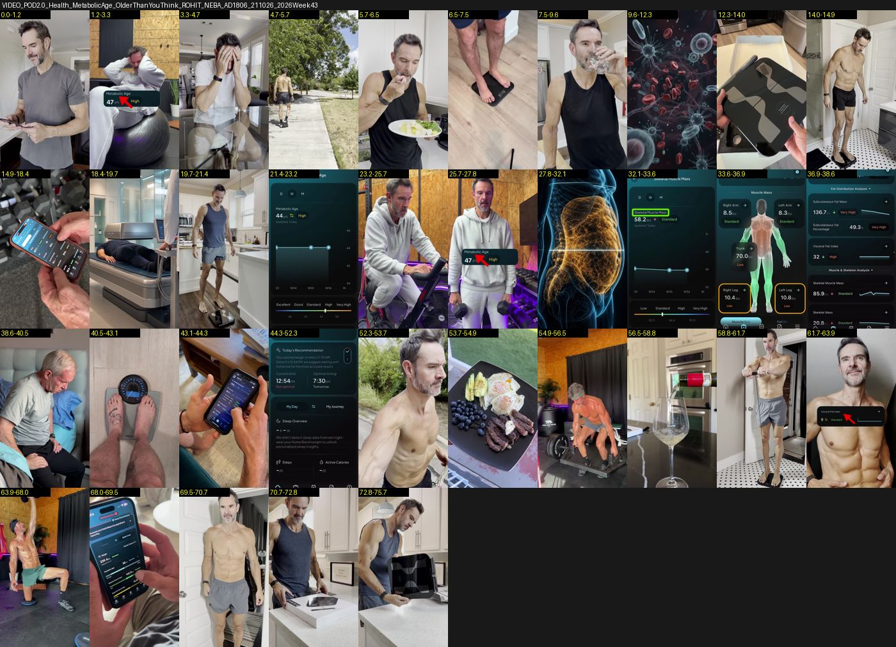

# VIDEO_POD2.0_Health_MetabolicAge_OlderThanYouThink_ROHIT_NEBA_AD1806_211026_2026Week43

Master: `VIDEO_POD2.0_Health_MetabolicAge_OlderThanYouThink_ROHIT_NEBA_AD1806_211026_2026Week43_Hook1_9x16.mov` · 75.7s · 1080x1920

**Pacing:** 35 shots · avg 2.163s · median 1.8s · 4.49 cuts/10s · first cut 1.167s · 252.0 wpm · talk ratio 0.95 · cuts on word start 94.1% · cuts in speech gaps 88.2%
**Audio:** {'I_lufs': -15.8, 'LRA': 2.4, 'true_peak_db': -0.2} · BPM≈136.0 · music {'speech_rms_db': -19.3, 'pause_seconds': 0.0} · cuts with SFX/transient 82.4%

**Captions:** 153 cards · 1 words/card (median) · y≈0.593 of frame height · text height≈0.0234 · colours {'white': 103, 'dark/other': 45, 'red': 3, 'blue': 2} · cards crossing a cut: 1
Highlighted: 47yrs, yrs, 207., yrs, 7888
**Headlines:** Metabolic Age (22.0–22.0s, white) | 44yrs (22.0–22.0s, white) | High (22.0–22.0s, dark/other) | Updated:Today (22.0–22.0s, dark/other) | SkeletalMuscleMass (32.0–33.0s, white) | 58.2 ibs (32.0–33.0s, white) | Standard (32.0–37.0s, dark/other) | HumePod (34.0–36.0s, white)

**Hook (0–3s) spoken:** I was 38 years old, but my body was telling me I was 47.
**Hook on-screen:** 47 / 47yrs / High / MetabolicAge / yrs
**CTA (last 5s):** The pod 2 .0 is 10 % off right now, and it's HSA and FSA eligible. Use the code below. · on-screen: GOOD DAY / ISA / TODAY

## Beat sheet

| # | in–out (s) | dur | transition | spoken | on-screen text |
|---|---|---|---|---|---|
| 1 | 0.00–1.17 | 1.17 |  | I was 38 years old, |  |
| 2 | 1.17–3.30 | 2.13 | cut +SFX hit | but my body was telling me I was 47. | MetabolicAge / High / 47 / yrs / 47yrs [red] / 47) |
| 3 | 3.30–4.70 | 1.4 | cut +SFX hit | I thought I was doing everything right. | MetabolicAge / High / 47) / yrs [red] |
| 4 | 4.70–5.70 | 1.0 | cut +SFX hit | I walked every day, |  |
| 5 | 5.70–6.47 | 0.77 | cut +SFX hit | I ate clean, |  |
| 6 | 6.47–7.47 | 1.0 | cut | and I watched the scale. |  |
| 7 | 7.47–9.63 | 2.17 | cut +SFX hit | The scale said I was fine, so I assumed I was fine. |  |
| 8 | 9.63–12.33 | 2.7 | cut +SFX hit | I had no idea what was actually going on inside my body. |  |
| 9 | 12.33–13.97 | 1.63 | cut +SFX hit | Then I got the HumePod 2 .0. |  |
| 10 | 13.97–14.90 | 0.93 | cut +SFX hit | I scanned my body and |  |
| 11 | 14.90–18.43 | 3.53 | cut +SFX hit | got over 45 health metrics with 99 % body fat accuracy compared | 207. [blue] |
| 12 | 18.43–19.67 | 1.23 | cut +SFX hit | to a DEXA scan, |  |
| 13 | 19.67–21.43 | 1.77 | cut +SFX hit | except I do it at home whenever I want. |  |
| 14 | 21.43–23.23 | 1.8 | cut | One of those metrics is metabolic age, | Metabolic Age (HEADLINE) / 44yrs (HEADLINE) / High (HEADLINE) / Updated:Today (HEADLINE) / 46 / 44 |
| 15 | 23.23–25.67 | 2.43 | cut +SFX hit | which compares your body's condition to your actual age. |  |
| 16 | 25.67–27.80 | 2.13 | cut +SFX hit | Mine said 47. I was 38. My | MetabolicAge / High / yrs [red] |
| 17 | 27.80–32.10 | 4.3 | cut +SFX hit | visceral fat, the deep fat around your organs that you can't see in the mirror, was in the red, | SkeletalMuscleMass (HEADLINE) / 58.2 ibs (HEADLINE) / Standard (HEADLINE) / Updated:Today / 65 / 52 |
| 18 | 32.10–33.60 | 1.5 | cut +SFX hit | and my skeletal muscle was low, | SkeletalMuscleMass (HEADLINE) / 58.2 ibs (HEADLINE) / Standard (HEADLINE) / Updated:Today / 65 / 52 |
| 19 | 33.60–36.87 | 3.27 | cut +SFX hit | especially in my legs. That's the connection nobody is really talking about. | Standard (HEADLINE) / Low / HumePod (HEADLINE) / Muscle Mass (HEADLINE) / Right Arm (HEADLINE) / LeftArm (HEADLINE) |
| 20 | 36.87–38.57 | 1.7 | cut | Less muscle and more visceral fat make | Standard (HEADLINE) / LeanMass (HEADLINE) / 126.0bs (HEADLINE) / 45.4% (HEADLINE) / Low (HEADLINE) / Percentage (HEADLINE) |
| 21 | 38.57–40.53 | 1.97 | cut | your body function older than you are. |  |
| 22 | 40.53–43.10 | 2.57 | cut +SFX hit | And you can look completely normal on a scale while it happens. | 7888 [blue] / NEMEDiCS / BOMEDiCS / 2152 / 68.2 / 86.9 |
| 23 | 43.10–44.30 | 1.2 | cut +SFX hit | The app makes it easy to read. | 2152 / 68.2 / 86.9 / 86.9. |
| 24 | 44.30–52.30 | 8.0 | cut | It color codes everything. Red means fix this, green means you're good. Then Prof. AI gives you a personalized plan based on your actual numbers, not generic advice. | 68.2 / 86.9. / Weight (HEADLINE) / 277.3ibs (HEADLINE) / Very High (HEADLINE) / 42.5 (HEADLINE) |
| 25 | 52.30–53.67 | 1.37 | cut +SFX hit | So I changed what I was doing. I | Sleep / Yoursleepscoreneedsimprovement.You / havegoodsleepquality,butneedto / addressinsufficientsleepdurationand / irregularsleeppatterns. / Activity (HEADLINE) |
| 26 | 53.67–54.93 | 1.27 | cut +SFX hit | prioritized protein, |  |
| 27 | 54.93–56.47 | 1.53 | cut +SFX hit | started lifting 3 days a week, | POLAR DIVE |
| 28 | 56.47–58.83 | 2.37 | cut +SFX hit | reduced alcohol intake, and tightened up my sleep. |  |
| 29 | 58.83–61.67 | 2.83 | cut +SFX hit | Then I re -scanned every few weeks and watched the numbers move. |  |
| 30 | 61.67–63.90 | 2.23 | cut +SFX hit | My muscle came back, my visceral fat dropped, | 110.81bs / Standard / 9Standard |
| 31 | 63.90–68.00 | 4.1 | cut +SFX hit | and my metabolic age came down, not on paper, in my actual body composition. | Metabolic Age / 34yrs |
| 32 | 68.00–69.53 | 1.53 | cut | Many users saw a measured improvement | ewg / 239.4c / 142.8mt / HumePius (HEADLINE) / BodyComp (HEADLINE) / CWeight |
| 33 | 69.53–70.73 | 1.2 | cut +SFX hit | in metabolic age. |  |
| 34 | 70.73–72.83 | 2.1 | cut +SFX hit | The pod 2 .0 is 10 % off right now, | TODAY / ISA / GOOD DAY |
| 35 | 72.83–75.71 | 2.88 | cut +SFX hit | and it's HSA and FSA eligible. Use the code below. |  |

## Hook variants

| hook | file | dur | first cut | spoken 0–3s | on-screen 0–3s |
|---|---|---|---|---|---|
| 1 | `nYouThink_ROHIT_NEBA_AD1806_211026_2026Week43_Hook1_9x16.mov` | 75.7 | 1.167 | I was 38 years old, but my body was telling me I was 47. | 47 / 47yrs / High / MetabolicAge / yrs |
| 1 | `nYouThink_ROHIT_NEBA_AD1806_211026_2026Week43_Hook1_9x16.mov` | 75.7 | 1.167 |  |  |
| 2 | `nYouThink_ROHIT_NEBA_AD1806_211026_2026Week43_Hook2_9x16.mov` | 77.2 | 1.3 |  |  |
| 2 | `nYouThink_ROHIT_NEBA_AD1806_211026_2026Week43_Hook2_9x16.mov` | 77.2 | 1.3 |  |  |
| 3 | `nYouThink_ROHIT_NEBA_AD1806_211026_2026Week43_Hook3_9x16.mov` | 77.1 | 1.233 |  |  |
| 3 | `nYouThink_ROHIT_NEBA_AD1806_211026_2026Week43_Hook3_9x16.mov` | 77.1 | 1.233 |  |  |

## Full transcript

I was 38 years old, but my body was telling me I was 47. I thought I was doing everything right. I walked every day, I ate clean, and I watched the scale. The scale said I was fine, so I assumed I was fine. I had no idea what was actually going on inside my body. Then I got the HumePod 2.0. I scanned my body and got over 45 health metrics with 99% body fat accuracy compared to a DEXA scan, except I do it at home whenever I want. One of those metrics is metabolic age, which compares your body's condition to your actual age. Mine said 47. I was 38. My visceral fat, the deep fat around your organs that you can't see in the mirror, was in the red, and my skeletal muscle was low, especially in my legs. That's the connection nobody is really talking about. Less muscle and more visceral fat make your body function older than you are. And you can look completely normal on a scale while it happens. The app makes it easy to read. It color codes everything. Red means fix this, green means you're good. Then Prof. AI gives you a personalized plan based on your actual numbers, not generic advice. So I changed what I was doing. I prioritized protein, started lifting 3 days a week, reduced alcohol intake, and tightened up my sleep. Then I re-scanned every few weeks and watched the numbers move. My muscle came back, my visceral fat dropped, and my metabolic age came down, not on paper, in my actual body composition. Many users saw a measured improvement in metabolic age. The pod 2.0 is 10% off right now, and it's HSA and FSA eligible. Use the code below.