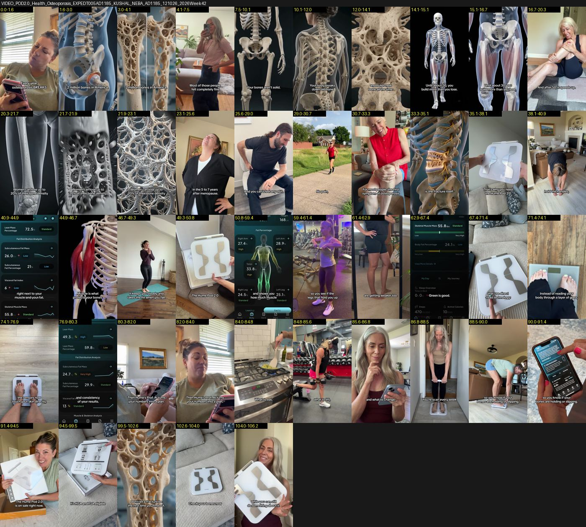

# VIDEO_POD2.0_Health_Osteoporosis_EXPEDT005AD1185_KUSHAL_NEBA_AD1185_121026_2026Week42

Master: `VIDEO_POD2.0_Health_Osteoporosis_EXPEDT005AD1185_KUSHAL_NEBA_AD1185_121026_2026Week42_Hook1_9x16.mp4` · 106.2s · 1080x1920

**Pacing:** 45 shots · avg 2.36s · median 2.002s · 4.14 cuts/10s · first cut 1.568s · 201.0 wpm · talk ratio 0.91 · cuts on word start 79.5% · cuts in speech gaps 68.2%
**Audio:** {'I_lufs': -19.3, 'LRA': 2.5, 'true_peak_db': -3.0} · BPM≈99.4 · music {'speech_rms_db': -23.2, 'pause_seconds': 1.9, 'pause_rms_db': -23.8, 'bed_minus_voice_db': -0.6, 'music_bed_likely': True} · cuts with SFX/transient 79.5%

**Captions:** 254 cards · 1.0 words/card (median) · y≈0.753 of frame height · text height≈0.0316 · colours {'white': 205, 'dark/other': 37, 'blue': 6, 'red': 5, 'green': 1} · cards crossing a cut: 9
Highlighted: 17.2ibs ≤High, High, Low, Fat(%), Fat(%), OhOm Verylow, OhOm Verylow, 9530Stepsleft, 490Caloriesleft, 8:56, all strain, bonesareholding orslipping
**Headlines:** HumePod (41.0–44.0s, white) | StepOnScale (41.0–44.0s, green) | VisceralFatIndex (41.0–41.0s, white) | Low (41.0–41.0s, blue) | Muscle&SkeletonAnalysis (42.0–42.0s, white) | SkeletalMuscleMass (42.0–42.0s, white) | 55.8bs (42.0–42.0s, white) | Standard (42.0–42.0s, dark/other)

**Hook (0–3s) spoken:** Every year, osteoporosis breaks two million bones
**Hook on-screen:** 2million bonesinAmerica. / Everyyear, / osteoporosisBREAKS
**CTA (last 5s):** time you find out. Check your bones now while you can still do something about it. · on-screen: Checkyourbonesnow / Don't letafracturebe / XHume / dosomethingabout it. / dosomethingaboutit / thefirsttime youfind out. / whileyoucanstill

## Beat sheet

| # | in–out (s) | dur | transition | spoken | on-screen text |
|---|---|---|---|---|---|
| 1 | 0.00–1.57 | 1.57 |  | Every year, osteoporosis | Everyyear, / osteoporosisBREAKS |
| 2 | 1.57–3.00 | 1.44 | cut +SFX hit | breaks two million bones | Everyyear, / osteoporosisBREAKS / 2million bonesinAmerica. |
| 3 | 3.00–4.14 | 1.13 | cut +SFX hit | in America. Most | 2million bonesinAmerica. / Mostofthosepeople / feltcompletelyfine |
| 4 | 4.14–7.47 | 3.34 | cut | of those people felt completely fine the day before. | Mostofthosepeople / feltcompletelyfine / the day before. |
| 5 | 7.47–10.14 | 2.67 | cut +SFX hit | Your bones aren't solid. They're living tissue. | the day before. / Yourbonesaren'tsolid / They're living tissue. / Yourbodybreaks / downoldbone |
| 6 | 10.14–11.98 | 1.84 | cut +SFX hit | Your body breaks down old bone and | Yourbodybreaks / downoldbone |
| 7 | 11.98–14.11 | 2.14 | cut +SFX hit | builds new bone all the time. | and buildsnew / boneall thetime. / Untilabout3o,you / buildmorethanyoulose. |
| 8 | 14.11–15.08 | 0.97 | cut +SFX hit | Until about 30, | Untilabout3o,you / buildmorethanyoulose. / Untilabout30,you |
| 9 | 15.08–16.72 | 1.63 | cut +SFX hit | you build more than you lose. | buildmorethanyoulose. / Untilabout30,you / Untilabout3O,you |
| 10 | 16.72–20.29 | 3.57 | cut +SFX hit | After that, it flips. And after 50, it speeds up. | Afterthat,itflips. / Andafter50,itspeedsup. |
| 11 | 20.29–21.69 | 1.4 | cut +SFX hit | Women can lose up to 20 % | Andafter50,itspeedsup. / Womencanloseupto / 20%of theirbonedensity |
| 12 | 21.69–21.86 | 0.17 | cut +SFX hit |  | Womencanloseupto / 20%of theirbonedensity |
| 13 | 21.86–23.06 | 1.2 | cut | of their bone density in | Womencanloseupto / 20%of theirbonedensity / in the 5 to 7 years / after menopause. |
| 14 | 23.06–25.63 | 2.57 | cut +SFX hit | the five to seven years after menopause. | in the 5 to 7 years / after menopause. |
| 15 | 25.63–28.96 | 3.34 | cut +SFX hit | Men aren't far behind and you can't feel any of it. No | Menaren'tfarbehind / Andyoucan'tfeelanyofit. |
| 16 | 28.96–30.66 | 1.7 | cut | pain, no warning. | No pain, / no warning. |
| 17 | 30.66–33.33 | 2.67 | cut +SFX hit | For most people, the first symptom of osteoporosis is | Formostpeople,thefirst / symptomofosteoporosis |
| 18 | 33.33–35.07 | 1.73 | cut +SFX hit | the fracture itself. | Formostpeople,thefirst / symptomofosteoporosis / isthefractureitself. / That'swhyyou need / theHumePod2.0. |
| 19 | 35.07–38.10 | 3.04 | cut | That's why you need the Hume Pod 2 .0. | That'swhyyou need / theHumePod2.0. / theHumePod2.0 / Hume / theHumePod2.0. / Step on it, |
| 20 | 38.10–40.87 | 2.77 | cut +SFX hit | Step on it, hold the handles, and in 30 seconds it | Step on it, / hold the handles, / andin30secondsitshows / youyourbonedensityh |
| 21 | 40.87–44.91 | 4.04 | cut +SFX hit | shows you your bone density, right next to your muscle and your fat. | andin30secondsitshows / HumePod (HEADLINE) / StepOnScale [green] (HEADLINE) / VisceralFatIndex (HEADLINE) / Low [blue] (HEADLINE) / Muscle&SkeletonAnalysis |
| 22 | 44.91–46.75 | 1.84 | cut +SFX hit | Muscle is what protects your bones. | Muscleiswhat / protects your bones. |
| 23 | 46.75–49.32 | 2.57 | cut | It keeps you steady and takes the hit when you fall. | Itkeepsyousteadyand / takesthehitwhen youfall / takes the hit when you fall. |
| 24 | 49.32–50.82 | 1.5 | cut +SFX hit | The Hume Pod 2 .0 breaks | Itkeepsyousteadyand / takes the hit when you fall. / TheHumePod2.0 |
| 25 | 50.82–59.39 | 8.58 | cut +SFX hit | down your entire body into five parts and shows you how much muscle and fat you have separately in each leg, arm, and your torso. | 50yrs (HEADLINE) / 58yrs (HEADLINE) / 168 (HEADLINE) / cm (HEADLINE) / FatPercentage (HEADLINE) / RightArm (HEADLINE) |
| 26 | 59.39–61.43 | 2.03 | cut +SFX hit | So you see if the legs that hold you up | RightArm (HEADLINE) / LeftArm (HEADLINE) / 33.8% / High / Plans / 27.4% (HEADLINE) |
| 27 | 61.43–62.93 | 1.5 | cut +SFX hit | are getting weaker too. | soyou seeifthe / legsthatholdyouup / aregettingweakertoo. |
| 28 | 62.93–67.37 | 4.44 | cut +SFX hit | Everything is color -coded. Green is good, red needs attention. | Capacity (HEADLINE) / BodyComp (HEADLINE) / Weight (HEADLINE) / WeeklyTargets:0/4 (HEADLINE) / 124.0ibs (HEADLINE) / Standard (HEADLINE) |
| 29 | 67.37–71.37 | 4.0 | cut +SFX hit | It comes with next -gen sensors that use direct -read technology. | Steps / ActiveCalories / 10/500 / ViewMoreDetails→ (HEADLINE) / MyDay (HEADLINE) / MyJourney (HEADLINE) |
| 30 | 71.37–74.07 | 2.7 | cut | Instead of reading your body through a layer of glass, | thatusedirect / -read technology. / Instead of reading your / bodythrough a layer of glass, / 2168 / thesensorsnow |
| 31 | 74.07–76.88 | 2.8 | cut +SFX hit | the sensors now touch your skin directly, | thesensorsnow / touch your skin directly, / touchyour skindirectly / touchyourskindirectlyh |
| 32 | 76.88–80.31 | 3.44 | cut +SFX hit | which increases the accuracy and consistency of your results. | VisceralFatIndex (HEADLINE) / 13 (HEADLINE) / Standard (HEADLINE) / Muscle&SkeletonAnalysis (HEADLINE) / SkeletalMuscleMass (HEADLINE) / 32.9kg≤ |
| 33 | 80.31–81.98 | 1.67 | cut +SFX hit | Then Hume's Prof AI turns | LeanMass / 59.8% / Low / Percentage / andconsistency / BodyCompositionFundamentals (HEADLINE) |
| 34 | 81.98–83.98 | 2.0 | cut +SFX hit | your numbers into a plan. What | ThenHume'sProf.Alturns / yournumbersintoaplan / yournumbersintoaplan. |
| 35 | 83.98–84.75 | 0.77 | cut +SFX hit | to eat, | 8:56 [green] / What to eat, |
| 36 | 84.75–85.55 | 0.8 | cut +SFX hit | what to lift, | What to lift, |
| 37 | 85.55–86.82 | 1.27 | cut | and what to change. | and what to change. |
| 38 | 86.82–88.49 | 1.67 | cut +SFX hit | You re -scan every week so | Youre-scan every week |
| 39 | 88.49–89.99 | 1.5 | cut +SFX hit | you know if your bones are holding | Youre-scan every week / soyouknowifyour / bonesareholding orslipping. |
| 40 | 89.99–91.39 | 1.4 | cut | or slipping. | soyouknowifyour / 11:30 [blue] (HEADLINE) / Recovely Need [blue] (HEADLINE) / all strain [blue] / Thsmghtelracttfruyuem (HEADLINE) / toplan acthitiesaroundyourcapacity- (HEADLINE) |
| 41 | 91.39–94.53 | 3.14 | cut +SFX hit | The HumePod 2 .0 is on sale right now. | soyouknowifyour / 11:30 [blue] (HEADLINE) / musclesandheart. / My loumey / MyDay / Band |
| 42 | 94.53–99.47 | 4.94 | cut +SFX hit | It's HSA and FSA eligible with a 45 -day money -back guarantee. | It'sHSAandFSAeligible / XHume / witha45-day / money-backguarantee. |
| 43 | 99.47–102.64 | 3.17 | cut | Don't let a fracture be the first time you find out. | witha45-day / money-backguarantee. / Don't letafracturebe / thefirsttime youfind out. |
| 44 | 102.64–104.00 | 1.37 | cut +SFX hit | Check your bones now while | XHume / Checkyourbonesnow / whileyoucanstill / dosomethingaboutit |
| 45 | 104.00–106.22 | 2.21 | cut +SFX hit | you can still do something about it. | whileyoucanstill / dosomethingaboutit / dosomethingabout it. |

## Hook variants

| hook | file | dur | first cut | spoken 0–3s | on-screen 0–3s |
|---|---|---|---|---|---|
| 1 | `05AD1185_KUSHAL_NEBA_AD1185_121026_2026Week42_Hook1_9x16.mp4` | 106.2 | 1.568 | Every year, osteoporosis breaks two million bones | 2million bonesinAmerica. / Everyyear, / osteoporosisBREAKS |
| 2 | `05AD1185_KUSHAL_NEBA_AD1185_121026_2026Week42_Hook2_9x16.mp4` | 103.6 | 2.903 |  |  |
| 3 | `05AD1185_KUSHAL_NEBA_AD1185_121026_2026Week42_Hook3_9x16.mp4` | 105.3 | 3.203 | There's a test most people over 50 never take. |  |

## Full transcript

Every year, osteoporosis breaks two million bones in America. Most of those people felt completely fine the day before. Your bones aren't solid. They're living tissue. Your body breaks down old bone and builds new bone all the time. Until about 30, you build more than you lose. After that, it flips. And after 50, it speeds up. Women can lose up to 20% of their bone density in the five to seven years after menopause. Men aren't far behind and you can't feel any of it. No pain, no warning. For most people, the first symptom of osteoporosis is the fracture itself. That's why you need the Hume Pod 2.0. Step on it, hold the handles, and in 30 seconds it shows you your bone density, right next to your muscle and your fat. Muscle is what protects your bones. It keeps you steady and takes the hit when you fall. The Hume Pod 2.0 breaks down your entire body into five parts and shows you how much muscle and fat you have separately in each leg, arm, and your torso. So you see if the legs that hold you up are getting weaker too. Everything is color-coded. Green is good, red needs attention. It comes with next-gen sensors that use direct-read technology. Instead of reading your body through a layer of glass, the sensors now touch your skin directly, which increases the accuracy and consistency of your results. Then Hume's Prof AI turns your numbers into a plan. What to eat, what to lift, and what to change. You re-scan every week so you know if your bones are holding or slipping. The HumePod 2.0 is on sale right now. It's HSA and FSA eligible with a 45-day money-back guarantee. Don't let a fracture be the first time you find out. Check your bones now while you can still do something about it.