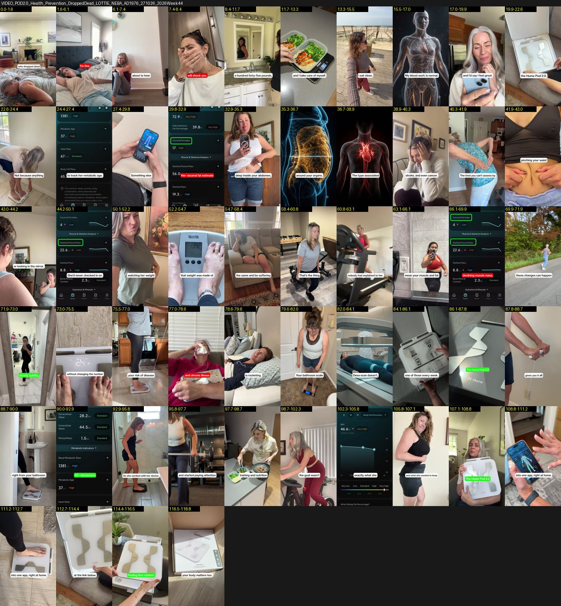

# VIDEO_POD2.0_Health_Prevention_DroppedDead_LOTTIE_NEBA_AD1976_271026_2026Week44

Master: `VIDEO_POD2.0_Health_Prevention_DroppedDead_LOTTIE_NEBA_AD1976_271026_2026Week44_Hook1_9x16.mp4` · 118.8s · 1080x1920

**Pacing:** 54 shots · avg 2.2s · median 2.08s · 4.46 cuts/10s · first cut 1.64s · 193.0 wpm · talk ratio 0.91 · cuts on word start 64.2% · cuts in speech gaps 64.2%
**Audio:** {'I_lufs': -15.7, 'LRA': 3.1, 'true_peak_db': 0.3} · BPM≈107.7 · music {'speech_rms_db': -21.8, 'pause_seconds': 2.4, 'pause_rms_db': -23.8, 'bed_minus_voice_db': -2.0, 'music_bed_likely': True} · cuts with SFX/transient 43.4%

**Captions:** 241 cards · 1 words/card (median) · y≈0.678 of frame height · text height≈0.0281 · colours {'white': 170, 'red': 12, 'dark/other': 49, 'green': 7, 'blue': 3} · cards crossing a cut: 4
Highlighted: I'm fine,, will shock you., was wrong., High, Hervisceral fatestimate, athermusclemass., Bonedensitytoo., in her body composition?, Visceralfat,, declining musclemass,, droppingbonedensity, slowly,quietly, slowly,quietly,, and chronic illness, The Hume Pod 2.0
**Headlines:** 285 (13.0–13.0s, blue) | HumePod (25.0–27.0s, white) | StepOnScale (25.0–27.0s, green) | 1381cal (25.0–25.0s, white) | High (25.0–27.0s, blue) | MetabolicAge (25.0–27.0s, white) | 37 yrs (25.0–27.0s, white) | 1381cal. (26.0–27.0s, white)

**Hook (0–3s) spoken:** Every woman who dropped dead this year said the same two words,
**Hook on-screen:** Every woman / saidthe sametwo words, / this year / who dropped dead
**CTA (last 5s):** below. Feeling fine matters. Knowing more about your body matters too. · on-screen: Feeling fine matters / Feeling finematters. / HumePod2.0 / Knowing more about / Smarttodycooston.wraly / XHume / at the link below. / your body matters too.

## Beat sheet

| # | in–out (s) | dur | transition | spoken | on-screen text |
|---|---|---|---|---|---|
| 1 | 0.00–1.64 | 1.64 |  | Every woman who dropped dead this year said | Every woman / who dropped dead / this year / saidthe sametwo words, |
| 2 | 1.64–6.12 | 4.48 | cut +SFX hit | the same two words, I'm fine. We had this customer email us the following, | saidthe sametwo words, / I'm fine, [red] / Wehadthis customer / email us the following, / and what you're |
| 3 | 6.12–7.42 | 1.3 | cut | and what you're about to hear will | and what you're / about to hear |
| 4 | 7.42–8.42 | 1.0 | cut | shock you. | about to hear / will shock you. [red] |
| 5 | 8.42–11.68 | 3.26 | cut | She said, I'm 51, 145 pounds, | will shock you. [red] / I'm fifty-one, / a hundred forty-five pounds |
| 6 | 11.68–13.26 | 1.58 | cut +SFX hit | and I take care of myself. | and I take care of myself. / 285 [blue] (HEADLINE) / I eat clean, |
| 7 | 13.26–15.52 | 2.26 | cut +SFX hit | I eat clean, I walk every day. | 285 [blue] (HEADLINE) / I eat clean, / I walk every day. |
| 8 | 15.52–17.04 | 1.52 | cut | My blood work is normal. | My blood work is normal. / Askmelastmonth |
| 9 | 17.04–19.92 | 2.88 | cut | Ask me last month, and I'd say I feel great. | Askmelastmonth / and I'd say I feel great. |
| 10 | 19.92–22.62 | 2.7 | cut +SFX hit | Then she got the Hume Pod 2 .0, | XHume / Then she got / the Hume Pod 2.0 |
| 11 | 22.62–24.36 | 1.74 | cut | not because anything was wrong. | Not because anything / was wrong. [red] |
| 12 | 24.36–27.38 | 3.02 | cut | At first, she just wanted to track her metabolic age. | was wrong. [red] / HumePod (HEADLINE) / StepOnScale [green] (HEADLINE) / 1381cal (HEADLINE) / High [blue] (HEADLINE) / MetabolicAge (HEADLINE) |
| 13 | 27.38–29.80 | 2.42 | cut | First scan, something else caught her attention. her | HumePod (HEADLINE) / StepOnScale [green] (HEADLINE) / High [blue] (HEADLINE) / MetabolicAge (HEADLINE) / 37 yrs (HEADLINE) / Heart Rate |
| 14 | 29.80–32.86 | 3.06 | cut | visceral fat estimate was dangerously high. | 72.9bs (HEADLINE) / Very High (HEADLINE) / Subcutaneous (HEADLINE) / 39.8% (HEADLINE) / Fat Percentage (HEADLINE) / VisceralFat Index |
| 15 | 32.86–35.32 | 2.46 | cut | That's the fat stored deep inside your abdomen, | That'sthefatstored / deep inside your abdomen, / deep inside your abdomen |
| 16 | 35.32–36.70 | 1.38 | cut | around your organs, | deep inside your abdomen / around your organs. |
| 17 | 36.70–38.94 | 2.24 | cut | the type associated with heart disease, stroke, | The type associated / with heart disease, |
| 18 | 38.94–40.30 | 1.36 | cut +SFX hit | and even cancer. | stroke, and even cancer. |
| 19 | 40.30–41.90 | 1.6 | cut | The kind you can't assess by | stroke, and even cancer. / The kind you can't assess by |
| 20 | 41.90–42.98 | 1.08 | cut +SFX hit | pinching your waist or | pinching your waist |
| 21 | 42.98–44.22 | 1.24 | cut | looking in the mirror. | or looking in the mirror. / VisceralFatIndex (HEADLINE) / Low (HEADLINE) / Muscle&SkeletonAnalysis (HEADLINE) / SkeletalMuscleMass / 22.6kg |
| 22 | 44.22–50.10 | 5.88 | cut | Then she looked at her muscle mass, another number she'd never checked in on, bone density too. | VisceralFatIndex (HEADLINE) / Low (HEADLINE) / Muscle&SkeletonAnalysis (HEADLINE) / SkeletalMuscleMass / 22.6kg / Low |
| 23 | 50.10–52.24 | 2.14 | cut | She'd spent years watching her weight without | She'd spent years / watching her weight / TANITA (HEADLINE) / 1338 (HEADLINE) / withoutknowing what |
| 24 | 52.24–54.72 | 2.48 | cut | knowing what that weight was made of. | TANITA (HEADLINE) / 1338 (HEADLINE) / withoutknowing what / 1342 (HEADLINE) / that weight was made of |
| 25 | 54.72–58.40 | 3.68 | cut | How could she weigh the same and be suffering such a dangerous decline in | How could she weigh / the same and be suffering / such a dangerous decline |
| 26 | 58.40–60.80 | 2.4 | cut | her body composition. That's the thing nobody | such a dangerous decline / in her body composition? [red] / That's the thing |
| 27 | 60.80–63.06 | 2.26 | cut +SFX hit | had explained to her. A stable weight doesn't | nobody had explained to her. / A stable weight doesn't |
| 28 | 63.06–66.08 | 3.02 | cut +SFX hit | mean your muscle and fat have stayed the same. | A stable weight doesn't / mean your muscle and fat / have stayed the same. / VisceralFatIndex (HEADLINE) / Low (HEADLINE) / Muscle&SkeletonAnalysis (HEADLINE) |
| 29 | 66.08–69.90 | 3.82 | cut | Visceral fat, declining muscle mass, dropping bone density. | VisceralFatIndex (HEADLINE) / Low (HEADLINE) / Muscle&SkeletonAnalysis (HEADLINE) / SkeletalMuscleMass / 22.6kg / Low |
| 30 | 69.90–71.92 | 2.02 | cut | These changes can happen slowly, | these changes can happen / slowly,quietly [green] |
| 31 | 71.92–73.00 | 1.08 | cut | quietly, | slowly,quietly, [green] |
| 32 | 73.00–75.50 | 2.5 | cut +SFX hit | without changing the number you see every morning. | without changing the number / you see every morning |
| 33 | 75.50–76.98 | 1.48 | cut | Meanwhile, your risk of disease | your risk of disease |
| 34 | 76.98–78.62 | 1.64 | cut +SFX hit | and chronic illness is | your risk of disease / and chronic illness [red] |
| 35 | 78.62–79.60 | 0.98 | cut +SFX hit | rocketing. | is rocketing. |
| 36 | 79.60–82.04 | 2.44 | cut | Your bathroom scale misses it. | Your bathroom scale / A hospital |
| 37 | 82.04–84.14 | 2.1 | cut | A hospital dexa scan doesn't, | A hospital / Dexa scan doesn't, / 8888 / but you can't afford / Questionsorconc |
| 38 | 84.14–86.12 | 1.98 | cut +SFX hit | but you can't afford one of those every week. The | 8888 / but you can't afford / Questionsorconc / one of those every week. / The Hume Pod 2.0 [green] / XHume (HEADLINE) |
| 39 | 86.12–87.76 | 1.64 | cut +SFX hit | HumePod 2 .0 gives | The Hume Pod 2.0 [green] / XHume (HEADLINE) / Hume (HEADLINE) |
| 40 | 87.76–88.66 | 0.9 | cut +SFX hit | you it all right | gives you it all |
| 41 | 88.66–90.04 | 1.38 | cut | from your bathroom, | right from your bathroom. / Hydration&Minerals (HEADLINE) / BodyWaterPercentage (HEADLINE) / 39.7% (HEADLINE) / Low (HEADLINE) / Extracellular (HEADLINE) |
| 42 | 90.04–92.94 | 2.9 | cut | 45 plus biomarkers every morning. | Hydration&Minerals (HEADLINE) / BodyWaterPercentage (HEADLINE) / 39.7% (HEADLINE) / Low (HEADLINE) / Extracellular (HEADLINE) / 28.2ibs (HEADLINE) |
| 43 | 92.94–95.84 | 2.9 | cut | So she worked with her doctor, adjusted her routine, | So she worked with her doctor, / adjusted her routine, |
| 44 | 95.84–97.68 | 1.84 | cut +SFX hit | and started paying attention to strength training | andstartedpayingattention / to strength |
| 45 | 97.68–98.70 | 1.02 | cut +SFX hit | and nutrition. | training and nutrition |
| 46 | 98.70–102.26 | 3.56 | cut +SFX hit | For the first time, the goal wasn't simply staying slim. | for the first time, / the goal wasn't / simply staying slim |
| 47 | 102.26–105.80 | 3.54 | cut +SFX hit | It was understanding exactly what she needed to lose and | simply staying slim / Hume Pod (HEADLINE) / StepOnScale [green] (HEADLINE) / Weight (HEADLINE) / GoalWeight (HEADLINE) / 130 ibs (HEADLINE) |
| 48 | 105.80–107.12 | 1.32 | cut +SFX hit | what she needed to keep. | and what she needed to keep / TheHume Pod 2.0 [green] |
| 49 | 107.12–108.82 | 1.7 | cut +SFX hit | The HumePod 2 .0 brings | TheHume Pod 2.0 [green] / Hume |
| 50 | 108.82–111.20 | 2.38 | cut +SFX hit | that information into one app | 2:018 [blue] / brings that information / 70m [blue] / 14.5 / into one app, right at home. / into one app, right at home |
| 51 | 111.20–112.72 | 1.52 | cut | right at home. Check out the current | into one app, right at home / Check out the current offer |
| 52 | 112.72–114.44 | 1.72 | cut +SFX hit | offer at the link below. Feeling | Check out the current offer / XHume / at the link below. |
| 53 | 114.44–116.50 | 2.06 | cut +SFX hit | fine matters. | XHume / at the link below. / Feeling finematters. [green] / Feeling fine matters [green] |
| 54 | 116.50–118.81 | 2.31 | cut | Knowing more about your body matters too. | HumePod2.0 / Knowing more about / Smarttodycooston.wraly / your body matters too. |

## Hook variants

| hook | file | dur | first cut | spoken 0–3s | on-screen 0–3s |
|---|---|---|---|---|---|
| 1 | `ppedDead_LOTTIE_NEBA_AD1976_271026_2026Week44_Hook1_9x16.mp4` | 118.8 | 1.64 | Every woman who dropped dead this year said the same two words, | Every woman / saidthe sametwo words, / this year / who dropped dead |
| 2 | `ppedDead_LOTTIE_NEBA_AD1976_271026_2026Week44_Hook2_9x16.mp4` | 119.1 | 1.44 |  |  |
| 3 | `ppedDead_LOTTIE_NEBA_AD1976_271026_2026Week44_Hook3_9x16.mp4` | 121.0 | 2.68 |  |  |
| 4 | `ppedDead_LOTTIE_NEBA_AD1976_271026_2026Week44_Hook4_9x16.mp4` | 118.6 | 1.52 |  |  |

## Full transcript

Every woman who dropped dead this year said the same two words, I'm fine. We had this customer email us the following, and what you're about to hear will shock you. She said, I'm 51, 145 pounds, and I take care of myself. I eat clean, I walk every day. My blood work is normal. Ask me last month, and I'd say I feel great. Then she got the Hume Pod 2.0, not because anything was wrong. At first, she just wanted to track her metabolic age. First scan, something else caught her attention. her visceral fat estimate was dangerously high. That's the fat stored deep inside your abdomen, around your organs, the type associated with heart disease, stroke, and even cancer. The kind you can't assess by pinching your waist or looking in the mirror. Then she looked at her muscle mass, another number she'd never checked in on, bone density too. She'd spent years watching her weight without knowing what that weight was made of. How could she weigh the same and be suffering such a dangerous decline in her body composition. That's the thing nobody had explained to her. A stable weight doesn't mean your muscle and fat have stayed the same. Visceral fat, declining muscle mass, dropping bone density. These changes can happen slowly, quietly, without changing the number you see every morning. Meanwhile, your risk of disease and chronic illness is rocketing. Your bathroom scale misses it. A hospital dexa scan doesn't, but you can't afford one of those every week. The HumePod 2.0 gives you it all right from your bathroom, 45 plus biomarkers every morning. So she worked with her doctor, adjusted her routine, and started paying attention to strength training and nutrition. For the first time, the goal wasn't simply staying slim. It was understanding exactly what she needed to lose and what she needed to keep. The HumePod 2.0 brings that information into one app right at home. Check out the current offer at the link below. Feeling fine matters. Knowing more about your body matters too.