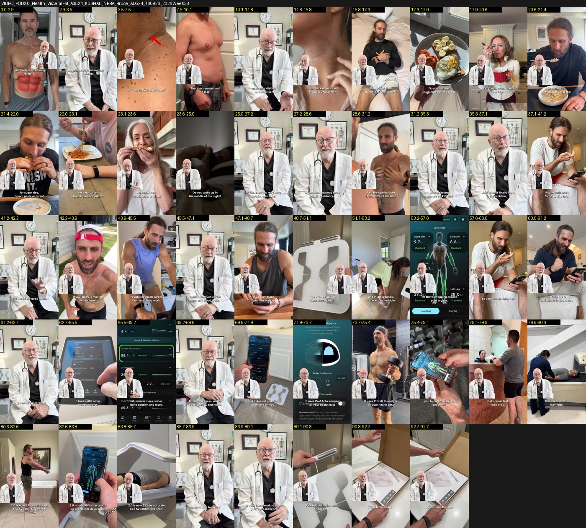

# VIDEO_POD2.0_Health_VisceralFat_Ad524_KUSHAL_NEBA_Bruce_AD524_160926_2026Week38

Master: `VIDEO_POD2.0_Health_VisceralFat_Ad524_KUSHAL_NEBA_Bruce_AD524_160926_2026Week38_Hook1_9x16.mp4` · 92.7s · 1080x1920

**Pacing:** 48 shots · avg 1.932s · median 1.733s · 5.07 cuts/10s · first cut 2.867s · 199.0 wpm · talk ratio 0.95 · cuts on word start 72.3% · cuts in speech gaps 70.2%
**Audio:** {'I_lufs': -21.6, 'LRA': 4.6, 'true_peak_db': -2.3} · BPM≈117.5 · music {'speech_rms_db': -25.9, 'pause_seconds': 0.0} · cuts with SFX/transient 46.8%

**Captions:** 172 cards · 1.0 words/card (median) · y≈0.771 of frame height · text height≈0.0281 · colours {'white': 147, 'red': 8, 'dark/other': 12, 'blue': 5} · cards crossing a cut: 18
Highlighted: forhelp., on your neck or underarms?, Do you have dark, velvety, Andthescariestpart, isthat90%of thetime, If youjusttrack, your visceral fat., Lean(lbs), Lean(Ibs), Low, Lean(lbs), Excellent, LeanMass
**Headlines:** 1112 (3.0–3.0s, white) | 10 (3.0–3.0s, white) | 12 (10.0–10.0s, white) | 10 (10.0–11.0s, white) | 11 (11.0–11.0s, white) | 4. (25.0–26.0s, white) | 1112 (26.0–26.0s, white) | 1112 (32.0–32.0s, white)

**Hook (0–3s) spoken:** If you notice these, your body is screaming for
**Hook on-screen:** If you notice these, / forhelp. / your bodyis screaming
**CTA (last 5s):** show your pre -diabetic. Pick up the hidden signs today with HumePod 2 .0. · on-screen: .8 / Pick up the hidden signs / WithHume Pod2.0 / XHume / oryourblood work toshow / today. / you're pre-diabetic.

## Beat sheet

| # | in–out (s) | dur | transition | spoken | on-screen text |
|---|---|---|---|---|---|
| 1 | 0.00–2.87 | 2.87 |  | If you notice these, your body is screaming for | If you notice these, / your bodyis screaming / forhelp. [red] |
| 2 | 2.87–3.53 | 0.67 | cut | help. | your bodyis screaming / forhelp. [red] / 1112 (HEADLINE) / 10 (HEADLINE) / Do you have small skin / tags likethis |
| 3 | 3.53–7.50 | 3.97 | cut +SFX hit | You have small skin tags like this on your neck or underarms. | Do you have small skin / tags likethis / on your neck or underarms? [red] |
| 4 | 7.50–10.10 | 2.6 | cut | Do you have belly fat that's extremely hard to lose even | Do you have belly fat? / That's extremely hard / to lose / 12 (HEADLINE) / 10 (HEADLINE) / even after dieting |
| 5 | 10.10–11.80 | 1.7 | cut +SFX hit | after dieting and exercise? | 12 (HEADLINE) / 10 (HEADLINE) / even after dieting / and exercise? / 11 (HEADLINE) |
| 6 | 11.80–15.80 | 4.0 | cut +SFX hit | You have dark velvety patches on the back of your neck or under your arms. | Do you have dark, velvety [red] / patches / onthebackofyourneck / orunder yourarms? |
| 7 | 15.80–17.27 | 1.47 | cut +SFX hit | You get tired 30 minutes after | Do you get tired / 30 minutes aftera meal? |
| 8 | 17.27–17.90 | 0.63 | cut +SFX hit | a meal. | Do you get tired / 30 minutes aftera meal? |
| 9 | 17.90–20.57 | 2.67 | cut +SFX hit | You have constant cravings for sugar, | Do you have constant / cravings / for sugar, rice, / bread, pasta or pizza? |
| 10 | 20.57–21.40 | 0.83 | cut | rice, | bread, pasta or pizza? / for sugar,rice |
| 11 | 21.40–22.03 | 0.63 | cut | bread, | bread, pasta or pizza? / for sugar,rice / for sugar,rice, |
| 12 | 22.03–23.10 | 1.07 | cut +SFX hit | pasta or pizza. | bread, pasta or pizza? / for sugar,rice, |
| 13 | 23.10–23.60 | 0.5 | cut +SFX hit |  | bread, pasta or pizza? / for sugar,rice, |
| 14 | 23.60–25.03 | 1.43 | cut +SFX hit | You wake up in the middle of the night. | Do you wake up in / the middle of the night? / 4. (HEADLINE) / If yes, then you may have / insulinresistance, |
| 15 | 25.03–27.23 | 2.2 | cut | If yes, then you may have | 4. (HEADLINE) / If yes, then you may have / insulinresistance, / 1112 (HEADLINE) / insulinresistance |
| 16 | 27.23–28.63 | 1.4 | cut | insulin resistance. And | If yes, then you may have / insulinresistance / insulinresistance. |
| 17 | 28.63–31.17 | 2.53 | cut | the scariest part is that 90 % of | Andthescariestpart [red] / isthat90%of thetime [red] / isthat90%0f thetime |
| 18 | 31.17–35.33 | 4.17 | cut | the time, your fasting glucose or A1C test shows everything normal. | Andthescariestpart [red] / isthat90%0f thetime / 1112 (HEADLINE) / 4. (HEADLINE) / you'refasting / glucoseorA1Ctest |
| 19 | 35.33–37.10 | 1.77 | cut | And when it finally flags a problem, | 111 (HEADLINE) / 10 (HEADLINE) / shows everything normal. / And when it finally flags / theproblem, / you may have already been |
| 20 | 37.10–41.17 | 4.07 | cut | you may have already been insulin resistant for 10 to 15 years. | you may have already been / insulin resistance / for 10 to 15 years. / 12 (HEADLINE) / 111 (HEADLINE) / 10 (HEADLINE) |
| 21 | 41.17–42.17 | 1.0 | cut | Here's the good news. | 12 (HEADLINE) / 111 (HEADLINE) / 10 (HEADLINE) / But here's the good news. / You can tell |
| 22 | 42.17–43.87 | 1.7 | cut +SFX hit | You can tell if your body is moving towards | You can tell / if your body is moving / towards insulin |
| 23 | 43.87–45.47 | 1.6 | cut +SFX hit | insulin resistance much | if your body is moving / towards insulin / resistancemuchearlier / than any blood work. |
| 24 | 45.47–47.13 | 1.67 | cut | earlier than any blood work. | resistancemuchearlier / than any blood work. / 111 (HEADLINE) / 10 (HEADLINE) / than any blbod work, / If youjusttrack [red] |
| 25 | 47.13–48.70 | 1.57 | cut | If you just track your visceral fat, | If youjusttrack [red] / your visceral fat. [red] |
| 26 | 48.70–51.13 | 2.43 | cut | the Hume Pod 2 .0 does exactly that. | TheHume Pod 2.0 / doesiexactly that. / You just step on it, |
| 27 | 51.13–53.20 | 2.07 | cut | You just step on it and in 30 seconds, | You just step on it, / and in30seconds, / it trackstheinvisible / Hume... (97%) (HEADLINE) / Connected [green] (HEADLINE) / LeanMass (HEADLINE) |
| 28 | 53.20–57.60 | 4.4 | cut +SFX hit | it tracks the invisible fat that's wrapping around your organs. Everything is color -coded so | and in30seconds, / Hume... (97%) (HEADLINE) / Connected [green] (HEADLINE) / LeanMass (HEADLINE) / RightArm (HEADLINE) / LeftArm (HEADLINE) |
| 29 | 57.60–60.03 | 2.43 | cut +SFX hit | you can instantly see what's in the red and | so you can instantlysee / what's inthered / and what's in the green. |
| 30 | 60.03–61.17 | 1.13 | cut | what's in the green. | what's inthered / and what's in the green. / 111 (HEADLINE) / 10 (HEADLINE) / 4. (HEADLINE) / And besidesvisceral fat |
| 31 | 61.17–62.73 | 1.57 | cut +SFX hit | And besides visceral fat, | 111 (HEADLINE) / 10 (HEADLINE) / 4. (HEADLINE) / And besidesvisceral fat / 1112 (HEADLINE) |
| 32 | 62.73–65.50 | 2.77 | cut +SFX hit | it tracks 40 plus other health matrix like | 17.4ms / 87.6% / Activity / it tracks 40+other / healthmetrics / 25.3 |
| 33 | 65.50–69.20 | 3.7 | cut +SFX hit | body fat, muscle mass, water, bone density, | Weight (HEADLINE) / 164.8bs+ (HEADLINE) / Standard (HEADLINE) / 23.8 (HEADLINE) / BMI (HEADLINE) / BodyFatPercentage (HEADLINE) |
| 34 | 69.20–69.80 | 0.6 | cut | and more. | fat, muscle mass, water, / 1112 (HEADLINE) / 4. (HEADLINE) / bone density, and more. |
| 35 | 69.80–71.87 | 2.07 | cut | But it doesn't just drop numbers on you. | 164.8 (HEADLINE) / 18.5 / But it doesn't just drop / numbers on you. / eHumePod [blue] (HEADLINE) / 11.2+ow (HEADLINE) |
| 36 | 71.87–73.67 | 1.8 | cut | It uses PROF AI to | Pro.FActivelntelligence (HEADLINE) / Unlockreal-timeinsightsandtimely (HEADLINE) / recommendationspoweredby (HEADLINE) / continuous monitoring (HEADLINE) / ActiveIntelligence / Default |
| 37 | 73.67–75.37 | 1.7 | cut +SFX hit | analyze all your health data, | ItusesProfAltoanalyze / all yourhealthdata |
| 38 | 75.37–79.10 | 3.73 | cut | lag important changes, and alert you to potential health problems that | ItusesProfAltoanalyze / all yourhealthdata / flag important changes, / andalert / you to potential health / problems |
| 39 | 79.10–79.90 | 0.8 | cut +SFX hit | normal tests | that normal tests / may miss. |
| 40 | 79.90–80.57 | 0.67 | cut | may miss. | that normal tests / may miss. |
| 41 | 80.57–82.57 | 2.0 | cut | The HumePod 2 .0 is now 99 % | 2.0isnow99%as accurate / asa$20,000Dexascan, |
| 42 | 82.57–83.77 | 1.2 | cut +SFX hit | as accurate as | 2.0isnow99%as accurate / asa$20,000Dexascan, / 6-20L [blue] (HEADLINE) / CsHomePod [blue] (HEADLINE) / 24m (HEADLINE) / LeanMass [blue] |
| 43 | 83.77–85.70 | 1.93 | cut +SFX hit | the $20 ,000 DEXA scan. So | 2.0isnow99%as accurate / asa$20,000Dexascan, |
| 44 | 85.70–86.90 | 1.2 | cut +SFX hit | don't wait for years for | 10 (HEADLINE) / 4. (HEADLINE) / so don't wait for years |
| 45 | 86.90–89.07 | 2.17 | cut +SFX hit | your blood work to show your pre -diabetic. | oryourblood work toshow / you're pre-diabetic. / .8 (HEADLINE) / Pick up the hidden signs / today. / XHume |
| 46 | 89.07–90.83 | 1.77 | cut | Pick up the hidden signs today with | Pick up the hidden signs / today. / XHume |
| 47 | 90.83–92.67 | 1.83 | cut | HumePod 2 .0. | WithHume Pod2.0 |
| 48 | 92.67–92.72 | 0.05 | cut |  |  |

## Hook variants

| hook | file | dur | first cut | spoken 0–3s | on-screen 0–3s |
|---|---|---|---|---|---|
| 1 | `524_KUSHAL_NEBA_Bruce_AD524_160926_2026Week38_Hook1_9x16.mp4` | 92.7 | 2.867 | If you notice these, your body is screaming for | If you notice these, / forhelp. / your bodyis screaming |
| 1 | `524_KUSHAL_NEBA_Bruce_AD524_160926_2026Week38_Hook1_9x16.mp4` | 92.7 | 2.867 | If you notice these, your body is screaming for |  |
| 2 | `524_KUSHAL_NEBA_Bruce_AD524_160926_2026Week38_Hook2_9x16.mp4` | 92.6 | 3.433 | Six signs you might have insulin resistance. | 6signsyou might / @signsyou might / have insulin resistance. |
| 2 | `524_KUSHAL_NEBA_Bruce_AD524_160926_2026Week38_Hook2_9x16.mp4` | 92.6 | 3.433 | Six signs you might have insulin resistance. |  |
| 3 | `524_KUSHAL_NEBA_Bruce_AD524_160926_2026Week38_Hook3_9x16.mp4` | 92.0 | 2.867 | Here's how to know if you have insulin resistance. You have |  |
| 3 | `524_KUSHAL_NEBA_Bruce_AD524_160926_2026Week38_Hook3_9x16.mp4` | 92.0 | 2.867 | Here's how to know if you have insulin resistance. You have |  |

## Full transcript

If you notice these, your body is screaming for help. You have small skin tags like this on your neck or underarms. Do you have belly fat that's extremely hard to lose even after dieting and exercise? You have dark velvety patches on the back of your neck or under your arms. You get tired 30 minutes after a meal. You have constant cravings for sugar, rice, bread, pasta or pizza. You wake up in the middle of the night. If yes, then you may have insulin resistance. And the scariest part is that 90% of the time, your fasting glucose or A1C test shows everything normal. And when it finally flags a problem, you may have already been insulin resistant for 10 to 15 years. Here's the good news. You can tell if your body is moving towards insulin resistance much earlier than any blood work. If you just track your visceral fat, the Hume Pod 2.0 does exactly that. You just step on it and in 30 seconds, it tracks the invisible fat that's wrapping around your organs. Everything is color-coded so you can instantly see what's in the red and what's in the green. And besides visceral fat, it tracks 40 plus other health matrix like body fat, muscle mass, water, bone density, and more. But it doesn't just drop numbers on you. It uses PROF AI to analyze all your health data, lag important changes, and alert you to potential health problems that normal tests may miss. The HumePod 2.0 is now 99% as accurate as the $20,000 DEXA scan. So don't wait for years for your blood work to show your pre-diabetic. Pick up the hidden signs today with HumePod 2.0.