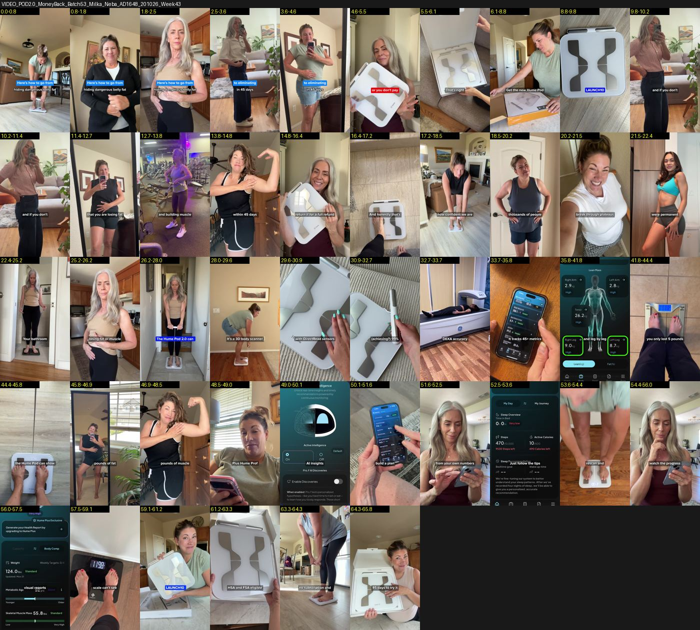

# VIDEO_POD2.0_MoneyBack_Batch53_Milka_Neba_AD1648_201026_Week43

Master: `VIDEO_POD2.0_MoneyBack_Batch53_Milka_Neba_AD1648_201026_Week43_Hook1_9x16.mp4` · 65.8s · 1080x1920

**Pacing:** 46 shots · avg 1.431s · median 1.2s · 6.84 cuts/10s · first cut 0.767s · 204.0 wpm · talk ratio 0.96 · cuts on word start 84.4% · cuts in speech gaps 60.0%
**Audio:** {'I_lufs': -11.6, 'LRA': 2.6, 'true_peak_db': 0.2} · BPM≈123.0 · music {'speech_rms_db': -17.1, 'pause_seconds': 0.2} · cuts with SFX/transient 55.6%

**Captions:** 200 cards · 1.0 words/card (median) · y≈0.646 of frame height · text height≈0.0281 · colours {'blue': 15, 'white': 150, 'red': 3, 'dark/other': 32} · cards crossing a cut: 6
Highlighted: Here's how to go from, to eliminating, or you don't pay, with30%off, LAUNCH10, The HumePod 2.0 can, Comected, Loan Mass, Conected, Btandard, Lean(kg), 8888, 88889, 17.6, 10.7m
**Headlines:** EBVCIE (6.0–6.0s, red) | 9:456 (34.0–35.0s, blue) | C BodyPod (35.0–35.0s, blue) | Body Pod (36.0–36.0s, white) | StepOnScale (36.0–36.0s, green) | FatDistributionAnalysis (36.0–36.0s, white) | SubcutaneousFatMass (36.0–36.0s, white) | 24.0 (36.0–36.0s, white)

**Hook (0–3s) spoken:** Here's how to go from hiding dangerous belly fat to eliminating
**Hook on-screen:** Here's how to go from / hiding dangerous belly fat / in 45 days / to eliminating
**CTA (last 5s):** HSA and FSA -eligible, no subscription, and 45 days to try it. · on-screen: 45 days to try it / HSA and FSA eligible / Hume / no subscription and

## Beat sheet

| # | in–out (s) | dur | transition | spoken | on-screen text |
|---|---|---|---|---|---|
| 1 | 0.00–0.77 | 0.77 |  | Here's how to go from | Here's how to go from [blue] / hiding dangerous belly fat |
| 2 | 0.77–1.80 | 1.03 | cut +SFX hit | hiding dangerous belly | Here's how to go from [blue] / hiding dangerous belly fat |
| 3 | 1.80–2.50 | 0.7 | cut | fat to | Here's how to go from [blue] / hiding dangerous belly fat |
| 4 | 2.50–3.60 | 1.1 | cut +SFX hit | eliminating in 45 | to eliminating [blue] / in 45 days |
| 5 | 3.60–4.60 | 1.0 | cut | days or | to eliminating [blue] / in 45 days / or you don't pay [red] |
| 6 | 4.60–5.53 | 0.93 | cut | you don't pay. | or you don't pay [red] / XHume / That's right |
| 7 | 5.53–6.10 | 0.57 | cut | That's right, | That's right / Get the new Hume Pod / EBVCIE [red] (HEADLINE) |
| 8 | 6.10–8.83 | 2.73 | cut | get the new Hume Pod with 30 % off using the | Get the new Hume Pod / EBVCIE [red] (HEADLINE) / with30%off [blue] |
| 9 | 8.83–9.77 | 0.93 | cut | code launch10. | LAUNCH10 [blue] |
| 10 | 9.77–10.23 | 0.47 | cut +SFX hit |  | and if you don't |
| 11 | 10.23–11.37 | 1.13 | cut | And if you don't see clear evidence | and if you don't / see clear evidence |
| 12 | 11.37–12.73 | 1.37 | cut | that you are losing fat and | see clear evidence / that you are losing fat |
| 13 | 12.73–13.80 | 1.07 | cut | building muscle within 45 | and building muscle |
| 14 | 13.80–14.83 | 1.03 | cut +SFX hit | days, | within 45 days |
| 15 | 14.83–16.43 | 1.6 | cut | return it for a full refund. | return if for a full refund / HHume |
| 16 | 16.43–17.23 | 0.8 | cut | And honestly, | return if for a full refund / HHume / And honestly that's |
| 17 | 17.23–18.50 | 1.27 | cut +SFX hit | that's how confident we are because | And honestly that's / how confident we are |
| 18 | 18.50–20.20 | 1.7 | cut | we've watched thousands of people | thousands of people / break through plateaus |
| 19 | 20.20–21.50 | 1.3 | cut +SFX hit | break through plateaus they thought | break through plateaus |
| 20 | 21.50–22.40 | 0.9 | cut +SFX hit | were permanent. | were permanent |
| 21 | 22.40–25.23 | 2.83 | cut +SFX hit | Here's the problem. Your bathroom scale can't tell if you're losing fat | were permanent / Your bathroom / scale can't / losing fat or muscle |
| 22 | 25.23–26.20 | 0.97 | cut | or muscle. | losing fat or muscle / The HumePod 2.0 can [blue] |
| 23 | 26.20–27.97 | 1.77 | cut +SFX hit | The Hume Pod 2 .0 can. It's | The HumePod 2.0 can [blue] |
| 24 | 27.97–29.63 | 1.67 | cut +SFX hit | a 3D body scanner with | It's a 3D body scanner |
| 25 | 29.63–30.93 | 1.3 | cut +SFX hit | direct read sensors, | withDirectRead sensors |
| 26 | 30.93–32.67 | 1.73 | cut +SFX hit | achieving 99 % DEXA | (achieving?)99% |
| 27 | 32.67–33.73 | 1.07 | cut +SFX hit | accuracy. | DEXA accuracy |
| 28 | 33.73–35.77 | 2.03 | cut +SFX hit | It tracks 45 plus metrics, | 9:456 [blue] (HEADLINE) / Comected [blue] / Loan Mass [blue] / 94.5s+ / Stendard / LeanMass |
| 29 | 35.77–41.83 | 6.07 | cut +SFX hit | visceral fat, muscle mass arm by arm and leg by leg, metabolic age, body fat percentage, all of it. | Standard / FatPercentage / Body Pod (HEADLINE) / StepOnScale [green] (HEADLINE) / FatDistributionAnalysis (HEADLINE) / SubcutaneousFatMass (HEADLINE) |
| 30 | 41.83–44.37 | 2.53 | cut | So when your scale says you only lost 5 pounds, | So when your scale says / 8888 [blue] / you only lost 5 pounds / 88889 [blue] |
| 31 | 44.37–45.83 | 1.47 | cut +SFX hit | the Hume Pod can show you lost 12 | you only lost 5 pounds / 88889 [blue] / the Hume Pod can show |
| 32 | 45.83–46.90 | 1.07 | cut | pounds of fat and | pounds of fat |
| 33 | 46.90–48.53 | 1.63 | cut +SFX hit | gained 7 pounds of muscle. | and gained 7 / pounds of muscle |
| 34 | 48.53–49.00 | 0.47 | cut +SFX hit | Plus, |  |
| 35 | 49.00–50.13 | 1.13 | cut +SFX hit | Hume Prof AI Insights | Pro.FActiveIntelligence (HEADLINE) / Unlockreal-timeinsightsandtimely (HEADLINE) / recommendationspoweredby (HEADLINE) / continuousmonitoring (HEADLINE) / ActiveIntelligence / Default |
| 36 | 50.13–51.63 | 1.5 | cut | build a plan from your | 17.6 [blue] / 10.7m [blue] / 14.0- / 12.3 / Al insights / CoBodyPod [blue] (HEADLINE) |
| 37 | 51.63–52.47 | 0.83 | cut | own numbers. | from your own numbers |
| 38 | 52.47–53.60 | 1.13 | cut +SFX hit | Just follow the tips, | from your own numbers / ViewMoreDetails→ (HEADLINE) / MyDay (HEADLINE) / My Journey (HEADLINE) / SleepOverview (HEADLINE) / TimeinBed (HEADLINE) |
| 39 | 53.60–54.37 | 0.77 | cut | re -scan, | rescanand |
| 40 | 54.37–56.03 | 1.67 | cut +SFX hit | and watch the progress show up in the | rescanand / watchtheprogress / HealthScore (HEADLINE) / 799 (HEADLINE) / Very High [blue] (HEADLINE) / HumePlusExclusive |
| 41 | 56.03–57.50 | 1.47 | cut +SFX hit | visual reports and charts your | HealthScore (HEADLINE) / 799 (HEADLINE) / Very High [blue] (HEADLINE) / HumePlusExclusive / GenerateyourHealthReportby / upgradingtoHumePlus |
| 42 | 57.50–59.07 | 1.57 | cut | regular scale can't see. | 8611 (HEADLINE) / scale can't see / ETEKCITY / Get yours |
| 43 | 59.07–61.23 | 2.17 | cut +SFX hit | Get yours now with code launch10, | Get yours / LAUNCH10 [blue] / HSA and FSA eligible |
| 44 | 61.23–63.33 | 2.1 | cut +SFX hit | HSA and FSA -eligible, | HSA and FSA eligible / Hume |
| 45 | 63.33–64.30 | 0.97 | cut | no subscription, | HSA and FSA eligible / Hume / no subscription and |
| 46 | 64.30–65.81 | 1.51 | cut +SFX hit | and 45 days to try it. | no subscription and / 45 days to try it |

## Hook variants

| hook | file | dur | first cut | spoken 0–3s | on-screen 0–3s |
|---|---|---|---|---|---|
| 1 | `yBack_Batch53_Milka_Neba_AD1648_201026_Week43_Hook1_9x16.mp4` | 65.8 | 0.767 | Here's how to go from hiding dangerous belly fat to eliminating | Here's how to go from / hiding dangerous belly fat / in 45 days / to eliminating |
| 1 | `yBack_Batch53_Milka_Neba_AD1648_201026_Week43_Hook1_9x16.mp4` | 65.8 | 0.767 |  |  |
| 2 | `yBack_Batch53_Milka_Neba_AD1648_201026_Week43_Hook2_9x16.mp4` | 67.1 | 1.667 |  |  |
| 2 | `yBack_Batch53_Milka_Neba_AD1648_201026_Week43_Hook2_9x16.mp4` | 67.1 | 1.667 |  |  |
| 3 | `yBack_Batch53_Milka_Neba_AD1648_201026_Week43_Hook3_9x16.mp4` | 69.9 | 4.033 |  |  |
| 3 | `yBack_Batch53_Milka_Neba_AD1648_201026_Week43_Hook3_9x16.mp4` | 69.9 | 4.033 |  |  |

## Full transcript

Here's how to go from hiding dangerous belly fat to eliminating in 45 days or you don't pay. That's right, get the new Hume Pod with 30% off using the code launch10. And if you don't see clear evidence that you are losing fat and building muscle within 45 days, return it for a full refund. And honestly, that's how confident we are because we've watched thousands of people break through plateaus they thought were permanent. Here's the problem. Your bathroom scale can't tell if you're losing fat or muscle. The Hume Pod 2.0 can. It's a 3D body scanner with direct read sensors, achieving 99% DEXA accuracy. It tracks 45 plus metrics, visceral fat, muscle mass arm by arm and leg by leg, metabolic age, body fat percentage, all of it. So when your scale says you only lost 5 pounds, the Hume Pod can show you lost 12 pounds of fat and gained 7 pounds of muscle. Plus, Hume Prof AI Insights build a plan from your own numbers. Just follow the tips, re-scan, and watch the progress show up in the visual reports and charts your regular scale can't see. Get yours now with code launch10, HSA and FSA-eligible, no subscription, and 45 days to try it.