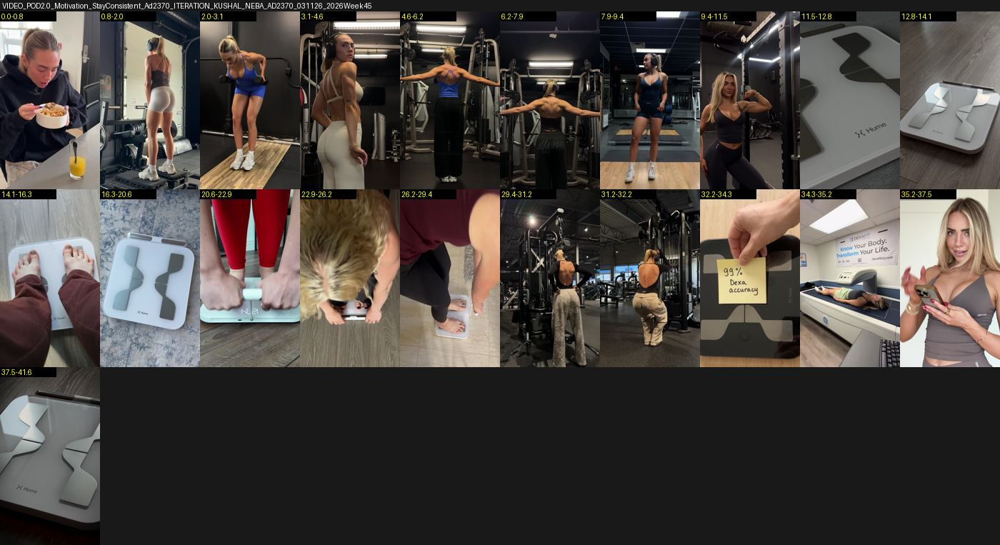

# VIDEO_POD2.0_Motivation_StayConsistent_Ad2370_ITERATION_KUSHAL_NEBA_AD2370_031126_2026Week45

Master: `VIDEO_POD2.0_Motivation_StayConsistent_Ad2370_ITERATION_KUSHAL_NEBA_AD2370_031126_2026Week45_9x16_hook1.mp4` · 41.6s · 1080x1920

**Pacing:** 21 shots · avg 1.981s · median 1.76s · 4.81 cuts/10s · first cut 0.76s · 192.0 wpm · talk ratio 0.88 · cuts on word start 75.0% · cuts in speech gaps 70.0%
**Audio:** {'I_lufs': -13.1, 'LRA': 3.2, 'true_peak_db': 0.3} · BPM≈107.7 · music {'speech_rms_db': -18.4, 'pause_seconds': 4.8, 'pause_rms_db': -17.1, 'bed_minus_voice_db': 1.2, 'music_bed_likely': True} · cuts with SFX/transient 45.0%

**Captions:** 11 cards · 1 words/card (median) · y≈0.686 of frame height · text height≈0.0363 · colours {'white': 7, 'dark/other': 3, 'yellow': 1} · cards crossing a cut: 0
Highlighted: 99%
**Headlines:** SIOH (4.0–4.0s, white) | Hume (12.0–12.0s, dark/other) | 99% (32.0–32.0s, dark/other) | XHume (32.0–34.0s, dark/other)

**Hook (0–3s) spoken:** Girl, get back on track, regain your focus and
**Hook on-screen:** 
**CTA (last 5s):** you make. · on-screen: DFYN / Hume

## Beat sheet

| # | in–out (s) | dur | transition | spoken | on-screen text |
|---|---|---|---|---|---|
| 1 | 0.00–0.76 | 0.76 |  | Girl, |  |
| 2 | 0.76–2.00 | 1.24 | cut +SFX hit | get back on track, |  |
| 3 | 2.00–3.12 | 1.12 | cut | regain your focus and |  |
| 4 | 3.12–4.64 | 1.52 | cut +SFX hit | give the rest of this year everything | SIOH (HEADLINE) |
| 5 | 4.64–6.16 | 1.52 | cut +SFX hit | you have got. |  |
| 6 | 6.16–7.92 | 1.76 | cut | Focus on feeling stronger, |  |
| 7 | 7.92–9.36 | 1.44 | cut +SFX hit | healthier and having more energy |  |
| 8 | 9.36–11.48 | 2.12 | cut +SFX hit | for the things and people you love. |  |
| 9 | 11.48–12.80 | 1.32 | cut +SFX hit | And start with the new HumePod | Hume (HEADLINE) |
| 10 | 12.80–14.08 | 1.28 | cut | 2 .0. | XHume / Hume |
| 11 | 14.08–16.28 | 2.2 | cut +SFX hit | It just launched with next -gen sensors that | Hume / XHume / Hume |
| 12 | 16.28–20.60 | 4.32 | cut +SFX hit | use direct read technology. Instead of reading your body through a layer of glass, | Hume / Hume / XHume |
| 13 | 20.60–22.92 | 2.32 | cut | the sensors now touch your skin directly, |  |
| 14 | 22.92–26.24 | 3.32 | cut | which increases the accuracy and consistency of your results. Step |  |
| 15 | 26.24–29.40 | 3.16 | cut | on, hold the handles, and in 30 seconds you |  |
| 16 | 29.40–31.16 | 1.76 | cut | see your muscle, body fat, |  |
| 17 | 31.16–32.16 | 1.0 | cut +SFX hit | and visceral fat. | 99% (HEADLINE) / Dexa / XHume (HEADLINE) |
| 18 | 32.16–34.32 | 2.16 | cut | It's 99 % as accurate as a | 99% (HEADLINE) / Dexa / XHume (HEADLINE) / 99% [yellow] |
| 19 | 34.32–35.20 | 0.88 | cut | DEXA scan, | Dexa / XHume (HEADLINE) / 99% [yellow] / DFYNE |
| 20 | 35.20–37.48 | 2.28 | cut | so you see every bit of progress you make. | DFYNE / DFYN |
| 21 | 37.48–41.60 | 4.12 | cut |  | DFYN / Hume |

## Hook variants

| hook | file | dur | first cut | spoken 0–3s | on-screen 0–3s |
|---|---|---|---|---|---|
| 1 | `TERATION_KUSHAL_NEBA_AD2370_031126_2026Week45_9x16_hook1.mp4` | 41.6 | 0.76 | Girl, get back on track, regain your focus and |  |
| 1 | `TERATION_KUSHAL_NEBA_AD2370_031126_2026Week45_9x16_hook1.mp4` | 41.6 | 0.76 |  |  |
| 2 | `TERATION_KUSHAL_NEBA_AD2370_031126_2026Week45_9x16_hook2.mp4` | 38.7 | 0.68 |  |  |
| 2 | `TERATION_KUSHAL_NEBA_AD2370_031126_2026Week45_9x16_hook2.mp4` | 38.7 | 0.68 |  |  |
| 3 | `TERATION_KUSHAL_NEBA_AD2370_031126_2026Week45_9x16_hook3.mp4` | 38.4 | 3.0 |  |  |
| 3 | `TERATION_KUSHAL_NEBA_AD2370_031126_2026Week45_9x16_hook3.mp4` | 38.4 | 3.0 |  |  |

## Full transcript

Girl, get back on track, regain your focus and give the rest of this year everything you have got. Focus on feeling stronger, healthier and having more energy for the things and people you love. And start with the new HumePod 2.0. It just launched with next-gen sensors that use direct read technology. Instead of reading your body through a layer of glass, the sensors now touch your skin directly, which increases the accuracy and consistency of your results. Step on, hold the handles, and in 30 seconds you see your muscle, body fat, and visceral fat. It's 99% as accurate as a DEXA scan, so you see every bit of progress you make.