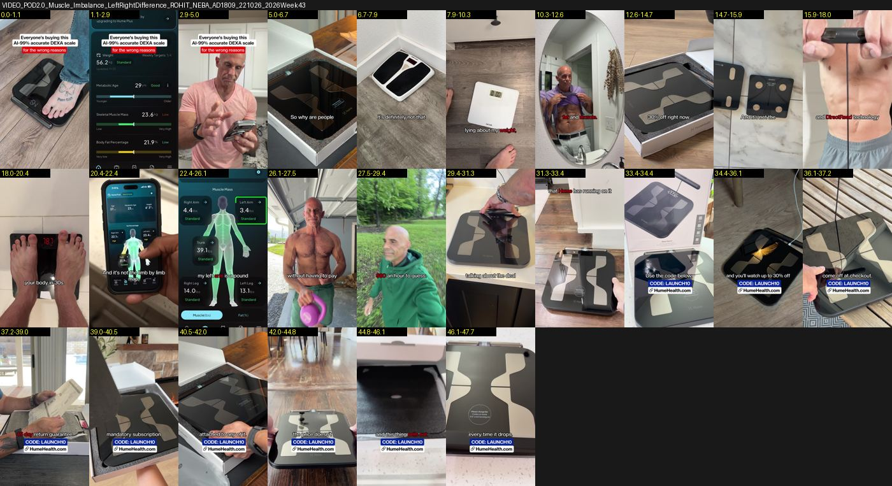

# VIDEO_POD2.0_Muscle_Imbalance_LeftRightDifference_ROHIT_NEBA_AD1809_221026_2026Week43

Master: `VIDEO_POD2.0_Muscle_Imbalance_LeftRightDifference_ROHIT_NEBA_AD1809_221026_2026Week43_Hook1_9x16.mp4` · 47.7s · 1080x1920

**Pacing:** 26 shots · avg 1.834s · median 1.79s · 5.24 cuts/10s · first cut 1.08s · 212.0 wpm · talk ratio 0.95 · cuts on word start 72.0% · cuts in speech gaps 48.0%
**Audio:** {'I_lufs': -19.4, 'LRA': 2.7, 'true_peak_db': -3.3} · BPM≈129.2 · music {'speech_rms_db': -24.1, 'pause_seconds': 0.0} · cuts with SFX/transient 52.0%

**Captions:** 98 cards · 1.0 words/card (median) · y≈0.658 of frame height · text height≈0.0304 · colours {'white': 60, 'dark/other': 24, 'red': 10, 'green': 1, 'blue': 2, 'other-colour': 1} · cards crossing a cut: 2
Highlighted: lying about my weight,, fat and muscle., and DirectRead technology, 78.7, 78.3, map,, myleftarmisapound, Muscle(lbs), without having to pay, a trainer, $80 an hour to guess., CODE:LAUNCH10, 45 day return guarantee, attached to any of it.
**Headlines:** Everyone'sbuyingthis (0.0–4.5s, white) | Al-99%accurateDEXAscale (0.0–4.5s, white) | forthewrongreasons (0.0–4.5s, red) | 149 (0.5–0.5s, dark/other) | Low (1.0–1.0s, dark/other) | HumePlus Exclusive (1.0–1.0s, dark/other) | Capacity (1.0–1.0s, dark/other) | Body Comp (1.0–1.0s, white)

**Hook (0–3s) spoken:** Everyone's buying this AI 99 % accurate dexa
**Hook on-screen:** 149 / 21.9% / 218% / 23.6 kg / 29 yrs / 29yrs / 56.2 kg / 56.2kg / 56.2kg Standard / Al-99%accurateDEXAscale / Body Comp / BodyComp / BodyFatPercentage / Capacity / Everyone'sbuyingthis / GenerateyourHealthReport by / Good / HumePlus Exclusive / Low / Metabolic Age / MetabolicAge / Older / SkeletalMuscleMass / Standard / Updated:Fri13 / Very High / Verylow / ViewMoreDetails→ / WeeklyTargets:1/4 / Weigh / Weight / WoolvTargets:1/4 / Younger / dapacity / dyFatPersntage / eers:1/4 / forthewrongreasons / upgradingtoHumePlus
**CTA (last 5s):** is the price doesn't hold forever and this thing sells out every time it drops. · on-screen: 5minsormore / CODE:LAUNCH10 / HumeHealth.com / KHume / Pleasechargefor / XHur every time it drops. / every time it drops. / hold forever, / ifit'snotturningon / the price doesn't

## Beat sheet

| # | in–out (s) | dur | transition | spoken | on-screen text |
|---|---|---|---|---|---|
| 1 | 0.00–1.08 | 1.08 |  | Everyone's buying this AI | Everyone'sbuyingthis (HEADLINE) / Al-99%accurateDEXAscale (HEADLINE) / forthewrongreasons [red] (HEADLINE) / 149 (HEADLINE) / Low (HEADLINE) / HumePlus Exclusive (HEADLINE) |
| 2 | 1.08–2.90 | 1.82 | cut +SFX hit | 99 % accurate dexa | Everyone'sbuyingthis (HEADLINE) / Al-99%accurateDEXAscale (HEADLINE) / forthewrongreasons [red] (HEADLINE) / Low (HEADLINE) / HumePlus Exclusive (HEADLINE) / Capacity (HEADLINE) |
| 3 | 2.90–5.04 | 2.14 | cut +SFX hit | scale for the wrong reasons. | Everyone'sbuyingthis (HEADLINE) / Al-99%accurateDEXAscale (HEADLINE) / forthewrongreasons [red] (HEADLINE) / Older / Younger / 23.6 kg |
| 4 | 5.04–6.72 | 1.68 | cut +SFX hit | So why are people buying this? | XHume / So why are people / buying this? |
| 5 | 6.72–7.94 | 1.22 | cut | It's definitely not that | It's definitely not that |
| 6 | 7.94–10.30 | 2.36 | cut +SFX hit | it caught my old scale lying about my weight, | 00 / it caught my old scale / TAYLOR / lying about my weight, [red] |
| 7 | 10.30–12.56 | 2.26 | cut +SFX hit | fat and muscle. It's definitely not | lying about my weight, [red] / fat and muscle. [red] / It's definitely not |
| 8 | 12.56–14.72 | 2.16 | cut +SFX hit | that it's up to 30 % off right now. | 30% off right now. / HumeHealth (HEADLINE) / 30% off right now |
| 9 | 14.72–15.88 | 1.16 | cut | And it's not the electrical | And it's not the |
| 10 | 15.88–18.04 | 2.16 | cut +SFX hit | impedance and direct read technology that | electrical impedance / and DirectRead technology [red] / 78.7 [red] / that maps out |
| 11 | 18.04–20.40 | 2.36 | cut +SFX hit | maps out your body in 30 seconds. | 78.7 [red] / that maps out / your body in 30s. / 78.3 [red] |
| 12 | 20.40–22.38 | 1.98 | cut | And it's not the limb by limb map because | your body in 30s. / 78.3 [red] / 3:440 [blue] (HEADLINE) / HumePod [blue] (HEADLINE) / MetabolicAge (HEADLINE) / 6'3"t (HEADLINE) |
| 13 | 22.38–26.06 | 3.68 | cut | now I can see my left arm is a pound behind my right without | HumePod [blue] (HEADLINE) / 21.9% / map, [green] / 3:44 [blue] (HEADLINE) / StepOnScale [green] (HEADLINE) / 23.4% (HEADLINE) |
| 14 | 26.06–27.54 | 1.48 | cut | having to pay a trainer $80 | without having to pay [red] / a trainer [red] |
| 15 | 27.54–29.44 | 1.9 | cut | an hour to guess. But | $80 an hour to guess. [other-colour] |
| 16 | 29.44–31.32 | 1.88 | cut | nobody's talking about the deal that | $80 an hour to guess. [other-colour] / Hlume / talking about the deal / XHume |
| 17 | 31.32–33.38 | 2.06 | cut +SFX hit | Hume has running on it right now. | talking about the deal / XHume / that Hume has running on it [red] (HEADLINE) / XHum / right now. (HEADLINE) |
| 18 | 33.38–34.38 | 1.0 | cut +SFX hit | Use the code below and | right now. (HEADLINE) / 2056. (HEADLINE) / Hume (HEADLINE) / HumePod 2.0 / Use the-code below, / CODE:LAUNCH10 [blue] |
| 19 | 34.38–36.14 | 1.76 | cut | you'll watch up to 30 % off, | 2056. (HEADLINE) / Hume (HEADLINE) / HumePod 2.0 / Use the-code below, / CODE:LAUNCH10 [blue] / HumeHealth.com |
| 20 | 36.14–37.22 | 1.08 | cut | come off at checkout. | CODE:LAUNCH10 [blue] / HumeHealth.com / come off at checkout / 45 day return guarantee [red] |
| 21 | 37.22–38.98 | 1.76 | cut | 45 day return guarantee and | CODE:LAUNCH10 [blue] / HumeHealth.com / 45 day return guarantee [red] |
| 22 | 38.98–40.46 | 1.48 | cut | there's no mandatory subscription | CODE:LAUNCH10 [blue] / HumeHealth.com / and there's no / mandatory subscription |
| 23 | 40.46–42.00 | 1.54 | cut +SFX hit | attached to any of it. | CODE:LAUNCH10 [blue] / HumeHealth.com / mandatory subscription / attached to any of it. [red] |
| 24 | 42.00–44.78 | 2.78 | cut +SFX hit | Now the bad news is the price doesn't hold forever and | CODE:LAUNCH10 [blue] / HumeHealth.com / Now,thebad newsis / the price doesn't / hold forever, / KHume |
| 25 | 44.78–46.12 | 1.34 | cut +SFX hit | this thing sells out | CODE:LAUNCH10 [blue] / HumeHealth.com / Pleasechargefor / 5minsormore / ifit'snotturningon / XHur every time it drops. |
| 26 | 46.12–47.68 | 1.56 | cut | every time it drops. | CODE:LAUNCH10 [blue] / HumeHealth.com / Pleasechargefor / 5minsormore / ifit'snotturningon / XHur every time it drops. |

## Hook variants

| hook | file | dur | first cut | spoken 0–3s | on-screen 0–3s |
|---|---|---|---|---|---|
| 1 | `ifference_ROHIT_NEBA_AD1809_221026_2026Week43_Hook1_9x16.mp4` | 47.7 | 1.08 | Everyone's buying this AI 99 % accurate dexa | 149 / 21.9% / 218% / 23.6 kg / 29 yrs / 29yrs / 56.2 kg / 56.2kg |
| 2 | `ifference_ROHIT_NEBA_AD1809_221026_2026Week43_Hook2_9x16.mp4` | 48.8 | 1.54 |  |  |
| 3 | `ifference_ROHIT_NEBA_AD1809_221026_2026Week43_Hook3_9x16.mp4` | 47.8 | 1.68 |  |  |

## Full transcript

Everyone's buying this AI 99% accurate dexa scale for the wrong reasons. So why are people buying this? It's definitely not that it caught my old scale lying about my weight, fat and muscle. It's definitely not that it's up to 30% off right now. And it's not the electrical impedance and direct read technology that maps out your body in 30 seconds. And it's not the limb by limb map because now I can see my left arm is a pound behind my right without having to pay a trainer $80 an hour to guess. But nobody's talking about the deal that Hume has running on it right now. Use the code below and you'll watch up to 30% off, come off at checkout. 45 day return guarantee and there's no mandatory subscription attached to any of it. Now the bad news is the price doesn't hold forever and this thing sells out every time it drops.