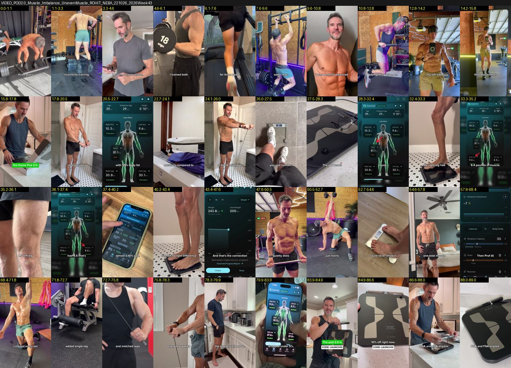

# VIDEO_POD2.0_Muscle_Imbalance_UnevenMuscle_ROHIT_NEBA_221026_2026Week43

Master: `VIDEO_POD2.0_Muscle_Imbalance_UnevenMuscle_ROHIT_NEBA_221026_2026Week43_Hook1_9x16.mp4` · 89.0s · 1080x1920

**Pacing:** 40 shots · avg 2.224s · median 1.867s · 4.38 cuts/10s · first cut 1.133s · 220.0 wpm · talk ratio 0.95 · cuts on word start 92.3% · cuts in speech gaps 59.0%
**Audio:** {'I_lufs': -19.7, 'LRA': 2.5, 'true_peak_db': -2.4} · BPM≈129.2 · music {'speech_rms_db': -23.3, 'pause_seconds': 0.2} · cuts with SFX/transient 66.7%

**Captions:** 331 cards · 1 words/card (median) · y≈0.724 of frame height · text height≈0.0293 · colours {'white': 203, 'red': 6, 'dark/other': 110, 'blue': 8, 'other-colour': 1, 'green': 3} · cards crossing a cut: 4
Highlighted: I trained both, the same, and I thought, Iwas perfectly balanced., But my right side, my left side, the Hume Pod 2.0, FatMass, Body, progress?, Charts, flagged right away, Charts, So I flipped my approach., Wantdeeperinsights intoyourprogress?
**Headlines:** 18 (5.0–5.0s, white) | origin (5.5–5.5s, white) | HumePod (21.0–22.0s, white) | StepOnScale (21.0–22.0s, green) | Age (21.0–22.0s, dark/other) | Metabolic Age (21.0–22.0s, white) | Height (21.0–22.0s, white) | 29yrs (21.0–22.0s, white)

**Hook (0–3s) spoken:** I wasted 3 years incorrectly training, and I only found
**Hook on-screen:** I wasted / and I only found out / incorrectly training, / three years
**CTA (last 5s):** pod 2 .0 is 10 % off right now, and it's HSA and FSA eligible. · on-screen: 10% off right now, / CODE:LAUNCH10 / DAY / HSA and FSA-eligible / HSA and FSA-eligible. / ISA / KHume / Pleasecharge for / TODAY / Thepod2.0is / XHume / ifit'snottumingon

## Beat sheet

| # | in–out (s) | dur | transition | spoken | on-screen text |
|---|---|---|---|---|---|
| 1 | 0.00–1.13 | 1.13 |  | I wasted 3 years | I wasted / three years / incorrectly training, |
| 2 | 1.13–3.27 | 2.13 | cut | incorrectly training, and I only found out | incorrectly training, / and I only found out |
| 3 | 3.27–4.60 | 1.33 | cut | because of one reason. | and I only found out / because of one reason. / I trained both [red] |
| 4 | 4.60–6.10 | 1.5 | cut +SFX hit | I trained both sides of my body the | I trained both [red] / 18 (HEADLINE) / origin (HEADLINE) / sides of my body / the same [red] |
| 5 | 6.10–7.60 | 1.5 | cut +SFX hit | same for 3 years. | the same [red] / for three years. |
| 6 | 7.60–9.60 | 2.0 | cut +SFX hit | Same weights, same reps, and I thought I was | Same weights / OSUCFITNESS / and I thought [blue] |
| 7 | 9.60–10.83 | 1.23 | cut +SFX hit | perfectly balanced. | Iwas perfectly balanced. [red] |
| 8 | 10.83–12.77 | 1.93 | cut +SFX hit | But my right side kept getting stronger, | But my right side [red] / 12 / kept getting stronger, |
| 9 | 12.77–14.20 | 1.43 | cut +SFX hit | my left side kept lagging, | my left side [other-colour] / and just assumed |
| 10 | 14.20–15.80 | 1.6 | cut +SFX hit | and I just assumed that was normal. | and just assumed / that was normal. |
| 11 | 15.80–17.77 | 1.97 | cut +SFX hit | Then I got the Hume Pod 2 .0. | Then I got / TODAY / ISA / GOODDAY / the Hume Pod 2.0 [green] |
| 12 | 17.77–20.47 | 2.7 | cut +SFX hit | I scanned my body and got over 45 health metrics with | Iscanned my body / and got over / 45health-metrics |
| 13 | 20.47–22.73 | 2.27 | cut | 99 % body fat accuracy compared | 45health-metrics / HumePod (HEADLINE) / StepOnScale [green] (HEADLINE) / Age (HEADLINE) / Metabolic Age (HEADLINE) / Height (HEADLINE) |
| 14 | 22.73–24.13 | 1.4 | cut +SFX hit | to a DEXA scan, except | accuracycompared to / STRATOSOR / ExceptI do it |
| 15 | 24.13–25.97 | 1.83 | cut +SFX hit | I do it at home whenever I want. Most | ExceptI do it / at home whenever |
| 16 | 25.97–27.50 | 1.53 | cut +SFX hit | scales give you one number. The | 00022 (HEADLINE) / Most scales give / 2785 / you one number. |
| 17 | 27.50–28.27 | 0.77 | cut +SFX hit | pod reads your | The pod reads |
| 18 | 28.27–32.37 | 4.1 | cut | left arm, right arm, trunk, left leg, and right leg separately. | The pod reads / HumePod (HEADLINE) / Age (HEADLINE) / Metabolic Age (HEADLINE) / Height (HEADLINE) / 5'10"t (HEADLINE) |
| 19 | 32.37–33.30 | 0.93 | cut | My right leg had 9 | HumePod (HEADLINE) / Age (HEADLINE) / Metabolic Age (HEADLINE) / Height (HEADLINE) / 39yrs (HEADLINE) / 29yrs (HEADLINE) |
| 20 | 33.30–35.20 | 1.9 | cut | .4 pounds of muscle. | My right leg had / Age (HEADLINE) / MetabolicAge (HEADLINE) / Height (HEADLINE) / 39yrs (HEADLINE) / 29yrs (HEADLINE) |
| 21 | 35.20–36.13 | 0.93 | cut +SFX hit | My left leg had 8 | My left leg / Age (HEADLINE) / MetabolicAge (HEADLINE) / Height (HEADLINE) / 39yrs (HEADLINE) / 29yrs (HEADLINE) |
| 22 | 36.13–37.37 | 1.23 | cut +SFX hit | .5. That's almost | Age (HEADLINE) / MetabolicAge (HEADLINE) / Height (HEADLINE) / 39yrs (HEADLINE) / 29yrs (HEADLINE) / 5'10"tt (HEADLINE) |
| 23 | 37.37–40.23 | 2.87 | cut | a 10 % gap, and I had no idea. The | Age (HEADLINE) / MetabolicAge (HEADLINE) / Height (HEADLINE) / 39yrs (HEADLINE) / 29yrs (HEADLINE) / 5'10"tt (HEADLINE) |
| 24 | 40.23–43.40 | 3.17 | cut +SFX hit | pod flags any left to right difference above 5%, and | The pod flags / any left-to-right difference / above5% |
| 25 | 43.40–47.60 | 4.2 | cut +SFX hit | mine was flagged right away. And that's the connection nobody is really talking about. | above5% / Age (HEADLINE) / MetabolicAge (HEADLINE) / Height (HEADLINE) / 29yrs (HEADLINE) / 39yrs (HEADLINE) |
| 26 | 47.60–50.47 | 2.87 | cut +SFX hit | Your stronger side quietly does more of the work. So | Your stronger side / quietly does / more of the work. |
| 27 | 50.47–52.70 | 2.23 | cut +SFX hit | every session just trains the gap wider, | more of the work. / So every session / LARDIVE / the gap wider, |
| 28 | 52.70–54.63 | 1.93 | cut +SFX hit | and a regular scale could never show it, because | and a regular scale / could never show it, |
| 29 | 54.63–57.77 | 3.13 | cut +SFX hit | your total weight and total muscle can look perfectly fine, | total weight / and total muscle / can look perfectly fine |
| 30 | 57.77–68.40 | 10.63 | cut +SFX hit | and the app makes it easy. It color codes everything. Red means fix this, green means you're good. Then Prof. AI gives you a personalized action plan based on your actual numbers, not generic advice. | 55.5%+ (HEADLINE) / Standard (HEADLINE) / 11.3kg (HEADLINE) / ExtracellularWater (HEADLINE) / 18.3kg (HEADLINE) / IntracellularWater (HEADLINE) |
| 31 | 68.40–71.77 | 3.37 | cut +SFX hit | So I flipped my approach. I started every set with my weaker side, | ActiveCalories / 4924Stepsleft / 270kcalleft / My Day (HEADLINE) / MyJourney (HEADLINE) / -h--m (HEADLINE) |
| 32 | 71.77–72.70 | 0.93 | cut +SFX hit | added single leg | added single-leg |
| 33 | 72.70–75.80 | 3.1 | cut | and single arm work, and matched reps to the weaker side. | and single-arm work, / and matched reps / to the weaker side. |
| 34 | 75.80–78.30 | 2.5 | cut | Then I rescanned every few weeks and watched the gap actually | Then I rescanned / every few weeks / the gap actually move. |
| 35 | 78.30–79.93 | 1.63 | cut | move. My left leg caught | the gap actually move. |
| 36 | 79.93–83.87 | 3.93 | cut +SFX hit | up, the gap dropped under 5 % and the red flag turned green. | 5:254 [blue] (HEADLINE) / HumePod [blue] (HEADLINE) / StepOnScale [blue] (HEADLINE) / 205 (HEADLINE) / 20/10 / 21/0 |
| 37 | 83.87–84.90 | 1.03 | cut | The pod 2 .0 | Thepod2.0is [green] / CODE:LAUNCH10 |
| 38 | 84.90–86.60 | 1.7 | cut | is 10 % off right now, | CODE:LAUNCH10 / Pleasecharge for / XHume / 10% off right now, / ifit'snottumingon / KHume |
| 39 | 86.60–88.03 | 1.43 | cut | and it's HSA and FSA | TODAY / ISA / DAY / HSA and FSA-eligible / HSA and FSA-eligible. |
| 40 | 88.03–88.96 | 0.92 | cut +SFX hit | eligible. | HSA and FSA-eligible. |

## Hook variants

| hook | file | dur | first cut | spoken 0–3s | on-screen 0–3s |
|---|---|---|---|---|---|
| 1 | `nce_UnevenMuscle_ROHIT_NEBA_221026_2026Week43_Hook1_9x16.mp4` | 89.0 | 1.133 | I wasted 3 years incorrectly training, and I only found | I wasted / and I only found out / incorrectly training, / three years |
| 2 | `nce_UnevenMuscle_ROHIT_NEBA_221026_2026Week43_Hook2_9x16.mp4` | 89.1 | 2.033 |  |  |
| 3 | `nce_UnevenMuscle_ROHIT_NEBA_221026_2026Week43_Hook3_9x16.mp4` | 87.7 | 1.467 |  |  |

## Full transcript

I wasted 3 years incorrectly training, and I only found out because of one reason. I trained both sides of my body the same for 3 years. Same weights, same reps, and I thought I was perfectly balanced. But my right side kept getting stronger, my left side kept lagging, and I just assumed that was normal. Then I got the Hume Pod 2.0. I scanned my body and got over 45 health metrics with 99% body fat accuracy compared to a DEXA scan, except I do it at home whenever I want. Most scales give you one number. The pod reads your left arm, right arm, trunk, left leg, and right leg separately. My right leg had 9.4 pounds of muscle. My left leg had 8.5. That's almost a 10% gap, and I had no idea. The pod flags any left to right difference above 5%, and mine was flagged right away. And that's the connection nobody is really talking about. Your stronger side quietly does more of the work. So every session just trains the gap wider, and a regular scale could never show it, because your total weight and total muscle can look perfectly fine, and the app makes it easy. It color codes everything. Red means fix this, green means you're good. Then Prof. AI gives you a personalized action plan based on your actual numbers, not generic advice. So I flipped my approach. I started every set with my weaker side, added single leg and single arm work, and matched reps to the weaker side. Then I rescanned every few weeks and watched the gap actually move. My left leg caught up, the gap dropped under 5% and the red flag turned green. The pod 2.0 is 10% off right now, and it's HSA and FSA eligible.