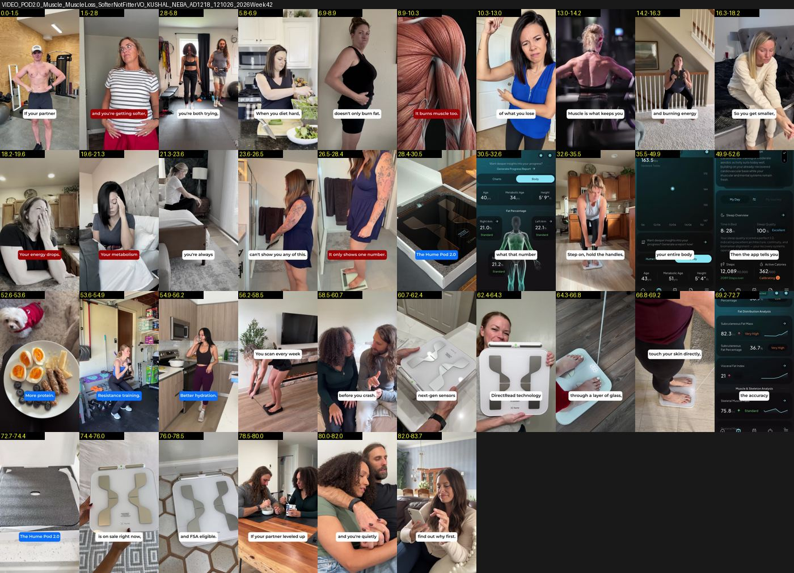

# VIDEO_POD2.0_Muscle_MuscleLoss_SofterNotFitterVO_KUSHAL_NEBA_AD1218_121026_2026Week42

Master: `VIDEO_POD2.0_Muscle_MuscleLoss_SofterNotFitterVO_KUSHAL_NEBA_AD1218_121026_2026Week42_Hook1_9x16.mp4` · 83.7s · 1080x1920

**Pacing:** 36 shots · avg 2.325s · median 1.94s · 4.18 cuts/10s · first cut 1.52s · 198.0 wpm · talk ratio 0.92 · cuts on word start 68.6% · cuts in speech gaps 74.3%
**Audio:** {'I_lufs': -19.9, 'LRA': 4.1, 'true_peak_db': -2.0} · BPM≈112.3 · music {'speech_rms_db': -24.6, 'pause_seconds': 2.6, 'pause_rms_db': -24.5, 'bed_minus_voice_db': 0.0, 'music_bed_likely': True} · cuts with SFX/transient 57.1%

**Captions:** 224 cards · 1.0 words/card (median) · y≈0.725 of frame height · text height≈0.0281 · colours {'white': 153, 'red': 7, 'dark/other': 57, 'blue': 6, 'green': 1} · cards crossing a cut: 1
Highlighted: and you're getting softer,, It burns muscletoo., Your energy drops., Yourmetabolism, slows down., It only shows one number., TheHume Pod2.0, Standard, Excellent, Calibrating, More protein., Resistance training., Betterhydration, The Hume Pod 2.0
**Headlines:** HumePod (31.0–32.0s, dark/other) | Age (31.0–31.0s, white) | Metabolic Age (31.0–31.0s, white) | Height (31.0–31.0s, white) | 40yrs (31.0–31.0s, white) | 34yrs (31.0–31.0s, white) | 5'9"ft (31.0–31.0s, white) | FatPercentage (31.0–31.0s, white)

**Hook (0–3s) spoken:** If your partner is getting fitter and you're getting softer, even though
**Hook on-screen:** If your partner / and you're getting softer, / is getting fitter
**CTA (last 5s):** partner leveled up and you're quietly trying to catch up, Find out why first. · on-screen: If your partner leveled up / and you're quietly / find out why first. / trying to catch up,

## Beat sheet

| # | in–out (s) | dur | transition | spoken | on-screen text |
|---|---|---|---|---|---|
| 1 | 0.00–1.52 | 1.52 |  | If your partner is getting fitter and | If your partner / is getting fitter / and you're getting softer, [red] |
| 2 | 1.52–2.76 | 1.24 | cut +SFX hit | you're getting softer, | and you're getting softer, [red] |
| 3 | 2.76–5.76 | 3.0 | cut | even though you're both trying, you need to hear this. | and you're getting softer, [red] / even though / you're both trying, / you need to hear this. |
| 4 | 5.76–6.88 | 1.12 | cut +SFX hit | When you diet hard, | you need to hear this. / When you diet hard, |
| 5 | 6.88–8.88 | 2.0 | cut +SFX hit | your body doesn't only burn fat. | your body / doesn't only burn fat. |
| 6 | 8.88–10.28 | 1.4 | cut +SFX hit | It burns muscle too. | It burns muscletoo. [red] |
| 7 | 10.28–12.96 | 2.68 | cut +SFX hit | And a big chunk of what you lose is muscle. | It burns muscletoo. [red] / of what you lose / is muscle. |
| 8 | 12.96–14.16 | 1.2 | cut +SFX hit | Muscle is what keeps you firm, | Muscle is what keeps you / firm, strong |
| 9 | 14.16–16.32 | 2.16 | cut +SFX hit | strong, and burning energy. | firm, strong / and burning energy |
| 10 | 16.32–18.16 | 1.84 | cut | So you get smaller, but softer. | and burning energy / So you get smaller, / but softer. |
| 11 | 18.16–19.56 | 1.4 | cut | Your energy drops, | but softer. / Your energy drops. [red] |
| 12 | 19.56–21.32 | 1.76 | cut | your metabolism slows down, | Yourmetabolism [red] / slows down. [red] |
| 13 | 21.32–23.64 | 2.32 | cut +SFX hit | and you feel like you're always a step behind. | slows down. [red] / you're always / a step behind. |
| 14 | 23.64–26.52 | 2.88 | cut | A bathroom scale can't show you any of this. it | Abathroomscale / can't show you any of this. |
| 15 | 26.52–28.36 | 1.84 | cut +SFX hit | only shows one number. | It only shows one number. [red] |
| 16 | 28.36–30.48 | 2.12 | cut | The HumePod 2 .0 shows | It only shows one number. [red] / YHume / TheHume Pod2.0 [blue] / XHurme |
| 17 | 30.48–32.56 | 2.08 | cut +SFX hit | you what that number is made of. | TheHume Pod2.0 [blue] / XHurme / HumePod (HEADLINE) / Age (HEADLINE) / Metabolic Age (HEADLINE) / Height (HEADLINE) |
| 18 | 32.56–35.52 | 2.96 | cut | Step on, hold the handles, and in 30 seconds it | Step on, hold the handles, / andin30 seconds |
| 19 | 35.52–49.92 | 14.4 | cut +SFX hit | scans your entire body. You see your muscle, your fat, your hydration, and your metabolic age. It breaks down your entire body into five parts and shows you how much muscle and fat you have separately in each leg, arm, and your torso. | ScalelsConnected (HEADLINE) / Yourscaleisready! / Steponyourscaletoweigh-in. / it scans your entire body. / Measuring... (HEADLINE) / Correct [green] (HEADLINE) |
| 20 | 49.92–52.64 | 2.72 | cut +SFX hit | Then the app tells you exactly what to do. more | onhighdays,restonlowdays,avoidgoingover. (HEADLINE) / What's betteris thatyourband is still learning (HEADLINE) / too,soitgetsmorepreciseovertime (HEADLINE) / ViewMoreDetails→ (HEADLINE) / Today's Recommendation (HEADLINE) / Cardiovasculartrainingormoderate (HEADLINE) |
| 21 | 52.64–53.64 | 1.0 | cut +SFX hit | protein, | More protein. [blue] |
| 22 | 53.64–54.92 | 1.28 | cut | resistance training, | Resistance training. [blue] |
| 23 | 54.92–56.20 | 1.28 | cut | better hydration. | Betterhydration [blue] / You scan every week |
| 24 | 56.20–58.48 | 2.28 | cut +SFX hit | You scan every week and watch the trend, | You scan every week / and watch the trend, |
| 25 | 58.48–60.72 | 2.24 | cut | so you catch the slide before you crash. | and watch the trend, / so you catch the slide / before you crash. |
| 26 | 60.72–62.40 | 1.68 | cut +SFX hit | It comes with next -gen sensors that | next-gensensors |
| 27 | 62.40–64.32 | 1.92 | cut +SFX hit | use direct -read technology. | next-gensensors / DirectRead technology / XHume / ritasechargefor / Sminsormore / Wisnotturningon |
| 28 | 64.32–66.76 | 2.44 | cut +SFX hit | Instead of reading your body through a layer of glass, | DirectRead technology / XHume / ritasechargefor / Sminsormore / Wisnotturningon / 1267 (HEADLINE) |
| 29 | 66.76–69.20 | 2.44 | cut +SFX hit | the sensors now touch your skin directly, | the sensors now / touch your skin directly, / HumePod(97%) (HEADLINE) / Connected [green] (HEADLINE) / 113.9ibs (HEADLINE) / Standard (HEADLINE) |
| 30 | 69.20–72.68 | 3.48 | cut | which increases the accuracy and consistency of your results. | HumePod(97%) (HEADLINE) / Connected [green] (HEADLINE) / 113.9ibs (HEADLINE) / Standard (HEADLINE) / LeanMass (HEADLINE) / 50.7% (HEADLINE) |
| 31 | 72.68–74.40 | 1.72 | cut | The HumePod 2 .0 is | The Hume Pod 2.0 [blue] |
| 32 | 74.40–76.00 | 1.6 | cut +SFX hit | on sale right now, and | The Hume Pod 2.0 [blue] / XHume / is on sale right now, |
| 33 | 76.00–78.52 | 2.52 | cut | it's HSA and FSA eligible. | XHume / and it's HSA / and FSA eligible. / me |
| 34 | 78.52–80.00 | 1.48 | cut +SFX hit | If your partner leveled up | If your partner leveled up |
| 35 | 80.00–81.96 | 1.96 | cut | and you're quietly trying to catch up, | and you're quietly / trying to catch up, |
| 36 | 81.96–83.69 | 1.73 | cut | Find out why first. | find out why first. |

## Hook variants

| hook | file | dur | first cut | spoken 0–3s | on-screen 0–3s |
|---|---|---|---|---|---|
| 1 | `erVO_KUSHAL_NEBA_AD1218_121026_2026Week42_Hook1_9x16_Raw.mp4` | 83.7 | 1.52 | If your partner is getting fitter and you're getting softer, even though |  |
| 1 | `FitterVO_KUSHAL_NEBA_AD1218_121026_2026Week42_Hook1_9x16.mp4` | 83.7 | 1.52 | If your partner is getting fitter and you're getting softer, even though | If your partner / and you're getting softer, / is getting fitter |
| 2 | `erVO_KUSHAL_NEBA_AD1218_121026_2026Week42_Hook2_9x16_Raw.mp4` | 82.9 | 1.64 | Your diet is working, so why do you look softer |  |
| 2 | `FitterVO_KUSHAL_NEBA_AD1218_121026_2026Week42_Hook2_9x16.mp4` | 82.9 | 1.64 | Your diet is working, so why do you look softer | So why do you look softer / Your diet is working. |
| 3 | `erVO_KUSHAL_NEBA_AD1218_121026_2026Week42_Hook3_9x16_Raw.mp4` | 82.9 | 2.48 | The scale says you lost 20 pounds. It doesn't |  |
| 3 | `FitterVO_KUSHAL_NEBA_AD1218_121026_2026Week42_Hook3_9x16.mp4` | 82.9 | 2.48 | The scale says you lost 20 pounds. It doesn't |  |

## Full transcript

If your partner is getting fitter and you're getting softer, even though you're both trying, you need to hear this. When you diet hard, your body doesn't only burn fat. It burns muscle too. And a big chunk of what you lose is muscle. Muscle is what keeps you firm, strong, and burning energy. So you get smaller, but softer. Your energy drops, your metabolism slows down, and you feel like you're always a step behind. A bathroom scale can't show you any of this. it only shows one number. The HumePod 2.0 shows you what that number is made of. Step on, hold the handles, and in 30 seconds it scans your entire body. You see your muscle, your fat, your hydration, and your metabolic age. It breaks down your entire body into five parts and shows you how much muscle and fat you have separately in each leg, arm, and your torso. Then the app tells you exactly what to do. more protein, resistance training, better hydration. You scan every week and watch the trend, so you catch the slide before you crash. It comes with next-gen sensors that use direct-read technology. Instead of reading your body through a layer of glass, the sensors now touch your skin directly, which increases the accuracy and consistency of your results. The HumePod 2.0 is on sale right now, and it's HSA and FSA eligible. If your partner leveled up and you're quietly trying to catch up, Find out why first.