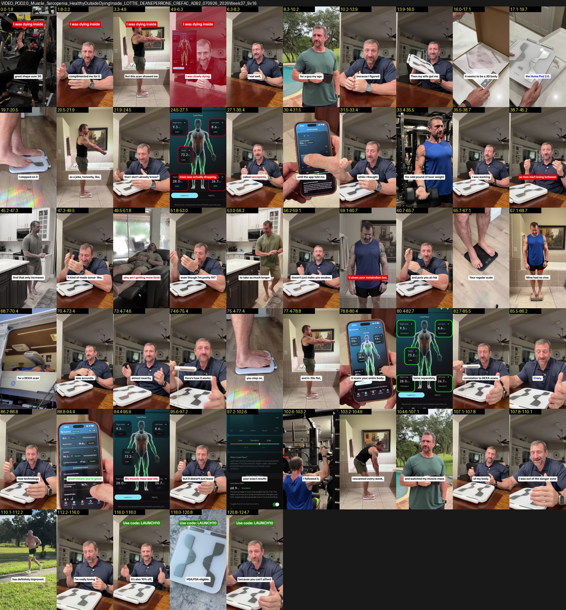

# VIDEO_POD2.0_Muscle_Sarcopenia_HealthyOutsideDyingInside_LOTTIE_DEANEPERRONE_CREFAC_AD92_070926_2026Week37_9x16

Master: `VIDEO_POD2.0_Muscle_Sarcopenia_HealthyOutsideDyingInside_LOTTIE_DEANEPERRONE_CREFAC_AD92_070926_2026Week37_Hook1_9x16.mp4` · 124.7s · 1080x1920

**Pacing:** 55 shots · avg 2.267s · median 2.033s · 4.33 cuts/10s · first cut 1.833s · 229.0 wpm · talk ratio 0.95 · cuts on word start 83.3% · cuts in speech gaps 74.1%
**Audio:** {'I_lufs': -13.2, 'LRA': 3.5, 'true_peak_db': 0.1} · BPM≈112.3 · music {'speech_rms_db': -17.3, 'pause_seconds': 0.6, 'pause_rms_db': -19.4, 'bed_minus_voice_db': -2.1, 'music_bed_likely': True} · cuts with SFX/transient 33.3%

**Captions:** 294 cards · 1.0 words/card (median) · y≈0.68 of frame height · text height≈0.0269 · colours {'white': 227, 'dark/other': 43, 'red': 16, 'blue': 7, 'green': 1} · cards crossing a cut: 4
Highlighted: wasslowlydying, 73.2b, 26.70s, wasslowlydying., the Hume Pod 2.0., Lean(lbs), masswasactuallydropping, called sarcopenia,, testosterone starts dropping, somenstartlosingbetween, 3and8%oftheirmuscle, why amI getting more tired, This sarcopeniathing, itslowsyourmetabolismtoo,, ofsystemicproblems
**Headlines:** I was dying inside (0.0–6.0s, red) | 9.30 (5.0–5.0s, dark/other) | 8.60s (5.0–5.0s, dark/other) | 8.6 (5.5–5.5s, red) | 9.3s (6.0–6.0s, dark/other) | 8.6m (6.0–6.0s, dark/other) | FRAGILE (16.0–16.0s, white) | HumeHealth (16.0–16.0s, yellow)

**Hook (0–3s) spoken:** I thought I was in great shape over 50. Everyone complimented me for
**Hook on-screen:** 455 / I thought I was in / I was dying inside / complimented me for it. / great shape over 50.
**CTA (last 5s):** eligible. Seriously, check it out, because you can't afford to guess about your health as you get older. · on-screen: HSA/FSA eligible. / Seriously, check it out, / Usecode:LAUNCH10 / XHume / because you can't afford / health asyou get older. / to guess about your

## Beat sheet

| # | in–out (s) | dur | transition | spoken | on-screen text |
|---|---|---|---|---|---|
| 1 | 0.00–1.83 | 1.83 |  | I thought I was in great shape over 50. | I was dying inside [red] (HEADLINE) / I thought I was in / great shape over 50. |
| 2 | 1.83–3.30 | 1.47 | cut | Everyone complimented me for it, | I was dying inside [red] (HEADLINE) / great shape over 50. / complimented me for it. / 455 / 4-55 |
| 3 | 3.30–4.87 | 1.57 | cut | but this scan showed me | I was dying inside [red] (HEADLINE) / complimented me for it. / 4-55 / But thisscan showed me |
| 4 | 4.87–6.27 | 1.4 | cut +SFX hit | I was slowly dying. | I was dying inside [red] (HEADLINE) / But thisscan showed me / 9.30 (HEADLINE) / 8.60s (HEADLINE) / 73.20 / 26.7ms |
| 5 | 6.27–8.30 | 2.03 | cut | I'm active, I eat well, I thought I looked | I was dying inside [red] (HEADLINE) / 9.3s (HEADLINE) / 8.6m (HEADLINE) / 73.2 / 26.7as / wasslowlydying. [red] |
| 6 | 8.30–10.20 | 1.9 | cut | pretty good in the mirror for a guy my age. | I thought I looked / for a guy my age. / I neverthoughttwice |
| 7 | 10.20–13.90 | 3.7 | cut +SFX hit | I never thought twice about my health because I figured I'm doing everything right. | I neverthoughttwice / about my health / because Ifigured / I'm doing everything right. / 4:56 |
| 8 | 13.90–15.97 | 2.07 | cut | Then my wife got me this for my birthday. | Then my wifegot me / this for my birthday; |
| 9 | 15.97–17.10 | 1.13 | cut | It seems to be a 3D | FRAGILE (HEADLINE) / HumeHealth [yellow] (HEADLINE) / it seems to be a 3D body |
| 10 | 17.10–19.70 | 2.6 | cut | body scanner called the HumePod 2 .0. | it seems to be a 3D body / XHume / the Hume Pod 2.0. [blue] |
| 11 | 19.70–20.47 | 0.77 | cut +SFX hit | I stepped on it | I stepped on it |
| 12 | 20.47–21.87 | 1.4 | cut | as a joke, honestly, like | I stepped on it / as a joke, honestly, like, |
| 13 | 21.87–24.47 | 2.6 | cut +SFX hit | what is this gonna tell me that I don't already know? | what isthisgoingto tell me / thatIdon't already know? |
| 14 | 24.47–27.07 | 2.6 | cut | It showed me my muscle mass was actually dropping. | thatIdon't already know? / Lean Mass (HEADLINE) / RightArm (HEADLINE) / LeftArm (HEADLINE) / 9.31bs (HEADLINE) / 8.61bs (HEADLINE) |
| 15 | 27.07–30.43 | 3.37 | cut | It's something called sarcopenia. I had no idea what that was | It's something / called sarcopenia, [red] / I had no idea what that was |
| 16 | 30.43–31.53 | 1.1 | cut | until the app told me | I had no idea what that was / 6:06 [blue] (HEADLINE) / LeftArmLeanMass [blue] (HEADLINE) / Standard (HEADLINE) / 9.5ibs (HEADLINE) / Updated:04/10 |
| 17 | 31.53–33.43 | 1.9 | cut | turns out while I thought I'd been trimming the | while I thought / I'd been trimming |
| 18 | 33.43–35.53 | 2.1 | cut | odd pound of beer Weight or fluff. | I'd been trimming / the odd pound of beer weight / or fluff, |
| 19 | 35.53–38.67 | 3.13 | cut | I was actually losing the muscle I was working so hard to build | I was actually / I was working / so hard to build. |
| 20 | 38.67–45.20 | 6.53 | cut | apparently after 30 testosterone starts dropping so men start losing between 3 and 8 % of their muscle mass every decade and | Apparently after 30, / testosterone starts dropping [red] / somenstartlosingbetween [red] / 3and8%oftheirmuscle [red] / mass every decade, / And that only increases |
| 21 | 45.20–47.30 | 2.1 | cut | that only increases the older you get and | And that only increases / the older you get. |
| 22 | 47.30–49.53 | 2.23 | cut | suddenly it kind of made sense Like why | the older you get. / it kind of made sense- like, |
| 23 | 49.53–51.77 | 2.23 | cut | am I getting more tired during the day even | why amI getting more tired [red] / during the day |
| 24 | 51.77–53.00 | 1.23 | cut | though I'm pretty fit? | even though I'm pretty fit? |
| 25 | 53.00–56.20 | 3.2 | cut | Why do my muscles seem to take so much longer to recover from training this? | Why do my muscles seem / to take so much longer / to recover from training? / This sarcopeniathing [red] |
| 26 | 56.20–59.10 | 2.9 | cut | This sarcopenia thing doesn't just make you weaker, | This sarcopeniathing [red] / doesn't just make you weaker, / itslowsyourmetabolismtoo, [red] |
| 27 | 59.10–60.70 | 1.6 | cut +SFX hit | it slows your metabolism too, | itslowsyourmetabolismtoo, [red] |
| 28 | 60.70–65.73 | 5.03 | cut | which causes all kinds of systemic problems and puts you at risk of a serious accident as you get older. | whichcauses / ofsystemicproblems [red] / and puts you at risk / of a serious accident / as you get older. |
| 29 | 65.73–67.10 | 1.37 | cut +SFX hit | Your regular scale cannot detect | Yourregularscale / cannot detect it. |
| 30 | 67.10–68.67 | 1.57 | cut +SFX hit | it. Mine had no clue. | cannot detect it. / Mine had no clue. |
| 31 | 68.67–70.40 | 1.73 | cut +SFX hit | So I actually paid for a Dexascan | So lactually paid / for a DEXA scan |
| 32 | 70.40–73.37 | 2.97 | cut +SFX hit | just to see if this thing was accurate. The numbers match almost | for a DEXA scan / just to see if this thing / wasaccurate. / The numbers matched, |
| 33 | 73.37–74.57 | 1.2 | cut | exactly. | The numbers matched, / almost exactly |
| 34 | 74.57–75.37 | 0.8 | cut +SFX hit | Here's how it works. | Here's how it works: |
| 35 | 75.37–77.37 | 2.0 | cut +SFX hit | You step on, grab these handles, | Here's how it works: / you step on, / grab these handles, |
| 36 | 77.37–78.77 | 1.4 | cut | and in 30 seconds flat it | grab these handles, / and in 30s flat, |
| 37 | 78.77–80.43 | 1.67 | cut | scans your entire body. | 5:056 [blue] (HEADLINE) / Step OnScale [blue] (HEADLINE) / HumePod [blue] (HEADLINE) / 5'10" [blue] (HEADLINE) / 38yrs [blue] (HEADLINE) / 5lyrs [blue] (HEADLINE) |
| 38 | 80.43–82.67 | 2.23 | cut +SFX hit | Arms, legs, torso separately with | Step OnScale [blue] (HEADLINE) / HumePod [blue] (HEADLINE) / LeanMass [blue] (HEADLINE) / LeftArm (HEADLINE) / Standard / 79.01bs |
| 39 | 82.67–85.53 | 2.87 | cut +SFX hit | 99 % correlation to Dexascans. Crazy. | with 99% / correlationtoDEXAscans / correlationtoDEXAscans. |
| 40 | 85.53–86.20 | 0.67 | cut |  | All thankstothis |
| 41 | 86.20–88.80 | 2.6 | cut +SFX hit | All thanks to this new technology found in the sensors. | All thankstothis / new technology / found in the sensors. |
| 42 | 88.80–94.40 | 5.6 | cut | Everything shows up, color coded in the app. Green means you're good, red means it's time to act now. | 5:056 [blue] (HEADLINE) / StepOnScale [blue] (HEADLINE) / HumePod [blue] (HEADLINE) / Wantdeeperinsights intoyourprogress? [blue] (HEADLINE) / GenerateProgressReport→ [blue] (HEADLINE) / Body (HEADLINE) |
| 43 | 94.40–95.57 | 1.17 | cut +SFX hit | My muscle mass was red, | StepOnScale [blue] (HEADLINE) / Standard / Band / Muscle&SkeletonAnalysis / red meansit's time toactnow. [red] / Skeletal Mass |
| 44 | 95.57–97.20 | 1.63 | cut | but it doesn't just leave you scared. | but itdoesn't justleave / YourMetabolicCapacity48isyourdaily limitfor (HEADLINE) / all strain-beneficialandnegativecombined.The (HEADLINE) / goalismaximizingbeneficialstrain (exercise) (HEADLINE) / whileminimizingnegative strain(stress).Going (HEADLINE) / overbackfires-you'llactuallymakelessprogress (HEADLINE) |
| 45 | 97.20–102.57 | 5.37 | cut | The app uses Proth AI to analyze your exact results and build a plan around your body specifically. | YourMetabolicCapacity48isyourdaily limitfor (HEADLINE) / all strain-beneficialandnegativecombined.The (HEADLINE) / goalismaximizingbeneficialstrain (exercise) (HEADLINE) / whileminimizingnegative strain(stress).Going (HEADLINE) / overbackfires-you'llactuallymakelessprogress (HEADLINE) / Thismightfeelabstractatfirst,butyou'lllearnto (HEADLINE) |
| 46 | 102.57–103.23 | 0.67 | cut +SFX hit | I followed it, | rescanned every week, |
| 47 | 103.23–104.60 | 1.37 | cut | re -scanned every week | rescanned every week, |
| 48 | 104.60–107.13 | 2.53 | cut | and watched my muscle mass pick up in every part | andwatchedmymusclemass / pick up in every part / of my body. |
| 49 | 107.13–107.77 | 0.63 | cut +SFX hit | of my body. | of my body. |
| 50 | 107.77–110.10 | 2.33 | cut | 12 weeks later, I was out of the danger zone | 12 weeks later, / I was out of thedanger zone / and my energy |
| 51 | 110.10–112.23 | 2.13 | cut | and my energy has definitely improved. I | and my energy / has definitely improved. / wasn't sure at first, |
| 52 | 112.23–116.00 | 3.77 | cut +SFX hit | wasn't sure at first, but I gotta say, I'm really loving the HumePod 2 .0. | wasn't sure at first, / but I gotta say, / I'm really loving / theHumePod2.0! [blue] |
| 53 | 116.00–118.03 | 2.03 | cut | Right now, it's also 10 % off, | Usecode:LAUNCH10 (HEADLINE) / Rightnow / it's also 10% off, / and it's even |
| 54 | 118.03–120.77 | 2.73 | cut | and it's even HSA FSA eligible. | Usecode:LAUNCH10 (HEADLINE) / and it's even / HSA/FSA eligible. / XHume |
| 55 | 120.77–124.67 | 3.91 | cut | Seriously, check it out, because you can't afford to guess about your health as you get older. | Usecode:LAUNCH10 (HEADLINE) / Seriously, check it out, / because you can't afford / to guess about your / health asyou get older. |

## Hook variants

| hook | file | dur | first cut | spoken 0–3s | on-screen 0–3s |
|---|---|---|---|---|---|
| 1 | `IE_DEANEPERRONE_CREFAC_AD92_070926_2026Week37_Hook1_9x16.mp4` | 124.7 | 1.833 | I thought I was in great shape over 50. Everyone complimented me for | 455 / I thought I was in / I was dying inside / complimented me for it. / great shape over 50. |
| 2 | `IE_DEANEPERRONE_CREFAC_AD92_070926_2026Week37_Hook2_9x16.mp4` | 123.0 | 0.867 | This at -home dexa scan saved me from dying while | 4:55 / DEXA scan saved me fromdying / I had no idea I was dying / This at-home / on the inside |
| 3 | `IE_DEANEPERRONE_CREFAC_AD92_070926_2026Week37_Hook3_9x16.mp4` | 124.1 | 1.867 | I've kept myself in shape all my life. I'm pretty proud of it, |  |

## Full transcript

I thought I was in great shape over 50. Everyone complimented me for it, but this scan showed me I was slowly dying. I'm active, I eat well, I thought I looked pretty good in the mirror for a guy my age. I never thought twice about my health because I figured I'm doing everything right. Then my wife got me this for my birthday. It seems to be a 3D body scanner called the HumePod 2.0. I stepped on it as a joke, honestly, like what is this gonna tell me that I don't already know? It showed me my muscle mass was actually dropping. It's something called sarcopenia. I had no idea what that was until the app told me turns out while I thought I'd been trimming the odd pound of beer Weight or fluff. I was actually losing the muscle I was working so hard to build apparently after 30 testosterone starts dropping so men start losing between 3 and 8% of their muscle mass every decade and that only increases the older you get and suddenly it kind of made sense Like why am I getting more tired during the day even though I'm pretty fit? Why do my muscles seem to take so much longer to recover from training this? This sarcopenia thing doesn't just make you weaker, it slows your metabolism too, which causes all kinds of systemic problems and puts you at risk of a serious accident as you get older. Your regular scale cannot detect it. Mine had no clue. So I actually paid for a Dexascan just to see if this thing was accurate. The numbers match almost exactly. Here's how it works. You step on, grab these handles, and in 30 seconds flat it scans your entire body. Arms, legs, torso separately with 99% correlation to Dexascans. Crazy. All thanks to this new technology found in the sensors. Everything shows up, color coded in the app. Green means you're good, red means it's time to act now. My muscle mass was red, but it doesn't just leave you scared. The app uses Proth AI to analyze your exact results and build a plan around your body specifically. I followed it, re-scanned every week and watched my muscle mass pick up in every part of my body. 12 weeks later, I was out of the danger zone and my energy has definitely improved. I wasn't sure at first, but I gotta say, I'm really loving the HumePod 2.0. Right now, it's also 10% off, and it's even HSA FSA eligible. Seriously, check it out, because you can't afford to guess about your health as you get older.