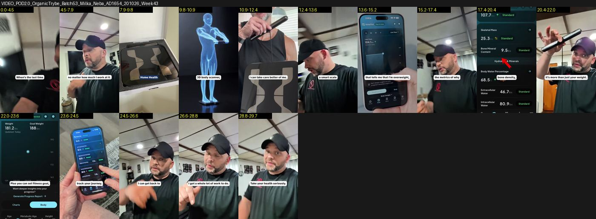

# VIDEO_POD2.0_OrganicTrybe_Batch53_Milka_Neba_AD1654_201026_Week43

Master: `VIDEO_POD2.0_OrganicTrybe_Batch53_Milka_Neba_AD1654_201026_Week43.mp4` · 29.7s · 1080x1920

**Pacing:** 15 shots · avg 1.983s · median 1.6s · 4.71 cuts/10s · first cut 4.52s · 261.0 wpm · talk ratio 0.93 · cuts on word start 85.7% · cuts in speech gaps 78.6%
**Audio:** {'I_lufs': -17.7, 'LRA': 2.5, 'true_peak_db': -2.7} · BPM≈123.0 · music {'speech_rms_db': -22.0, 'pause_seconds': 0.5, 'pause_rms_db': -29.8, 'bed_minus_voice_db': -7.8, 'music_bed_likely': True} · cuts with SFX/transient 35.7%

**Captions:** 87 cards · 1 words/card (median) · y≈0.652 of frame height · text height≈0.0269 · colours {'white': 62, 'dark/other': 19, 'blue': 3, 'green': 3} · cards crossing a cut: 0
Highlighted: Body, 15.5, RightArmFatPercentage, Stendard, Btendard, Standard
**Headlines:** SOS (14.0–14.0s, white) | 2:496 (14.0–14.0s, blue) | StepOnScale (14.0–14.0s, dark/other) | HumePod (14.0–14.0s, blue) | Lean Mass (14.0–14.0s, white) | 104.1ibs (14.0–14.0s, white) | 107.7lbs+ (18.0–18.0s, white) | Standard (18.0–19.0s, green)

**Hook (0–3s) spoken:** True. When's the last time you actually
**Hook on-screen:** When's the last time
**CTA (last 5s):** I can get back to where I should be. For now, I've got a whole lot of work to do. Check out that link. Take care out of the series. · on-screen: Check out that link. / I got a whole lot of work to do. / Ican get back to / Take your health seriously. / WwhereIshould be.

## Beat sheet

| # | in–out (s) | dur | transition | spoken | on-screen text |
|---|---|---|---|---|---|
| 1 | 0.00–4.52 | 4.52 |  | True. When's the last time you actually took your health serious? | When's the last time / you actually took your / health serious? / Mineis a constant struggle, |
| 2 | 4.52–7.92 | 3.4 | cut | Mine is a constant struggle no matter how much I work at. | Mineis a constant struggle, / nomatterhow muchI work atit |
| 3 | 7.92–9.80 | 1.88 | cut | But now, thanks to Hume Health and their 3D | But now, thanksto / Hume Health |
| 4 | 9.80–10.88 | 1.08 | cut | body scanner, | 3Dbodyscanner, |
| 5 | 10.88–12.44 | 1.56 | cut +SFX hit | I can take care better of me. | I can take care better of me. |
| 6 | 12.44–13.64 | 1.2 | cut +SFX hit | It's basically a smart scale that | I can take care better of me. / a smart scale |
| 7 | 13.64–15.20 | 1.56 | cut | tells me that I'm overweight. | SOS (HEADLINE) / 2:496 [blue] (HEADLINE) / StepOnScale (HEADLINE) / HumePod [blue] (HEADLINE) / Lean Mass (HEADLINE) / 104.1ibs (HEADLINE) |
| 8 | 15.20–17.40 | 2.2 | cut +SFX hit | But it's gonna give you the metrics of what? | but it's going to give you / the metrics of why |
| 9 | 17.40–20.40 | 3.0 | cut | Waterweight, bone density, and a slew of whole other things. | the metrics of why / 107.7lbs+ (HEADLINE) / Standard [green] (HEADLINE) / SkeletalMass (HEADLINE) / 25.3ibs (HEADLINE) / Bone Mineral |
| 10 | 20.40–21.96 | 1.56 | cut +SFX hit | And yeah, it's more than just your weight, | Standard / and a slew of whole other things. / Verylow / 9.6%≤Verylow (HEADLINE) / BodyFat (HEADLINE) / 17.4bs (HEADLINE) |
| 11 | 21.96–23.56 | 1.6 | cut | plus you can set fitness goals, | Hume... (97%) (HEADLINE) / Weight (HEADLINE) / Goal Weight (HEADLINE) / 188ibs (HEADLINE) / 181.2 ibs (HEADLINE) / Updated:Today (HEADLINE) |
| 12 | 23.56–24.52 | 0.96 | cut | track your journey, | CeBodyPod [blue] (HEADLINE) / 14.3 [blue] (HEADLINE) / LoftLegMuscle Mass [blue] (HEADLINE) / Standard [blue] (HEADLINE) / 15.5 [blue] / RightArmFatPercentage [blue] |
| 13 | 24.52–26.60 | 2.08 | cut +SFX hit | and now I can get back to where I should be. | Ican get back to / WwhereIshould be. |
| 14 | 26.60–28.84 | 2.24 | cut | For now, I've got a whole lot of work to do. Check out that link. | I got a whole lot of work to do. / Check out that link. |
| 15 | 28.84–29.74 | 0.9 | cut | Take care out of the series. | Take your health seriously. |

## Full transcript

True. When's the last time you actually took your health serious? Mine is a constant struggle no matter how much I work at. But now, thanks to Hume Health and their 3D body scanner, I can take care better of me. It's basically a smart scale that tells me that I'm overweight. But it's gonna give you the metrics of what? Waterweight, bone density, and a slew of whole other things. And yeah, it's more than just your weight, plus you can set fitness goals, track your journey, and now I can get back to where I should be. For now, I've got a whole lot of work to do. Check out that link. Take care out of the series.