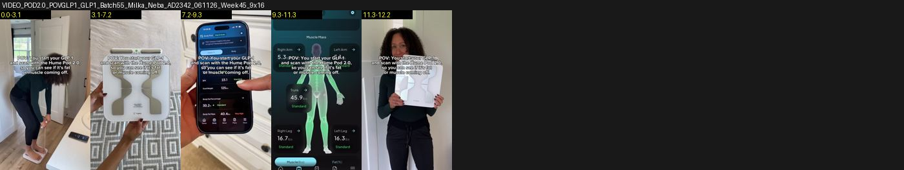

# VIDEO_POD2.0_POVGLP1_GLP1_Batch55_Milka_Neba_AD2342_061126_Week45_9x16

Master: `VIDEO_POD2.0_POVGLP1_GLP1_Batch55_Milka_Neba_AD2342_061126_Week45_Hook1_9x16.mp4` · 12.2s · 1080x1920

**Pacing:** 5 shots · avg 2.433s · median 2.1s · 3.29 cuts/10s · first cut 3.133s · None wpm · talk ratio 0.0 · cuts on word start 0.0% · cuts in speech gaps 100.0%
**Audio:** {'I_lufs': -13.7, 'LRA': 1.9, 'true_peak_db': -1.8} · BPM≈117.5 · music None · cuts with SFX/transient 100.0%

**Captions:** 27 cards · 1 words/card (median) · y≈0.564 of frame height · text height≈0.0269 · colours {'white': 23, 'green': 1, 'dark/other': 2, 'blue': 1} · cards crossing a cut: 3
Highlighted: Standard, Muscle(lbs)
**Headlines:** PoV: You start your GLP-1 (0.0–9.0s, white) | and scan with the Hume Pod 2.0, (0.0–9.0s, white) | 10:09元 (7.0–8.0s, blue) | StepOnScale (7.0–11.0s, blue) | Body Pod (7.0–8.0s, blue) | GealWeight (7.0–7.0s, dark/other) | Weight (7.0–7.0s, dark/other) | 125 lbs (7.0–7.0s, white)

**Hook (0–3s) spoken:** 
**Hook on-screen:** PoV: You start your GLP-1 / and scan with the Hume Pod 2.0, / or muscle coming off. / so youcan seeif it'sfat
**CTA (last 5s):**  · on-screen: 10:09# / 10:09元 / 125ibs / 16.3ibs / 16.7ibs / 23.1 / 30.2% / 30.2%+ / 40.4ibs / 45.9 / 45.916 / 5.1ibs

## Beat sheet

| # | in–out (s) | dur | transition | spoken | on-screen text |
|---|---|---|---|---|---|
| 1 | 0.00–3.13 | 3.13 |  |  | PoV: You start your GLP-1 (HEADLINE) / and scan with the Hume Pod 2.0, (HEADLINE) / so youcan seeif it'sfat / or muscle coming off. |
| 2 | 3.13–7.17 | 4.03 | cut +SFX hit |  | PoV: You start your GLP-1 (HEADLINE) / and scan with the Hume Pod 2.0, (HEADLINE) / so youcan seeif it'sfat / or muscle coming off. / XHume / X.Hume |
| 3 | 7.17–9.27 | 2.1 | cut +SFX hit |  | PoV: You start your GLP-1 (HEADLINE) / and scan with the Hume Pod 2.0, (HEADLINE) / so youcan seeif it'sfat / or muscle coming off. / 10:09元 [blue] (HEADLINE) / StepOnScale [blue] (HEADLINE) |
| 4 | 9.27–11.30 | 2.03 | cut +SFX hit |  | PoV: You start your GLP-1 (HEADLINE) / and scan with the Hume Pod 2.0, (HEADLINE) / StepOnScale [blue] (HEADLINE) / 125ibs / 40.4ibs / 10:09# [blue] (HEADLINE) |
| 5 | 11.30–12.17 | 0.87 | cut +SFX hit |  | StepOnScale [blue] (HEADLINE) / or muscle coming off. / HumePod (HEADLINE) / MuscleMass (HEADLINE) / LeftArm (HEADLINE) / RightArm (HEADLINE) |

## Hook variants

| hook | file | dur | first cut | spoken 0–3s | on-screen 0–3s |
|---|---|---|---|---|---|
| 1 | `_GLP1_Batch55_Milka_Neba_AD2342_061126_Week45_Hook1_9x16.mp4` | 12.2 | 3.133 |  | PoV: You start your GLP-1 / and scan with the Hume Pod 2.0, / or muscle coming off. / so youcan seeif it'sfat |
| 2 | `_GLP1_Batch55_Milka_Neba_AD2342_061126_Week45_Hook2_9x16.mp4` | 12.2 | 3.133 |  |  |
| 3 | `_GLP1_Batch55_Milka_Neba_AD2342_061126_Week45_Hook3_9x16.mp4` | 12.2 | 3.133 |  |  |

## Full transcript

