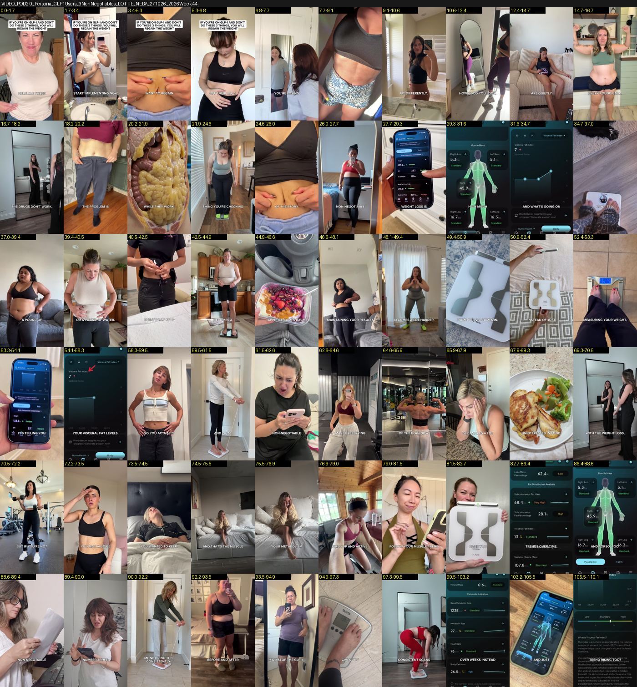

# VIDEO_POD2.0_Persona_GLP1Users_3NonNegotiables_LOTTIE_NEBA_271026_2026Week44

Master: `VIDEO_POD2.0_Persona_GLP1Users_3NonNegotiables_LOTTIE_NEBA_271026_2026Week44_Hook1_9x16.mp4` · 132.8s · 1080x1920

**Pacing:** 74 shots · avg 1.794s · median 1.633s · 5.5 cuts/10s · first cut 1.667s · 225.0 wpm · talk ratio 0.92 · cuts on word start 84.9% · cuts in speech gaps 63.0%
**Audio:** {'I_lufs': -19.2, 'LRA': 3.4, 'true_peak_db': -2.7} · BPM≈112.3 · music {'speech_rms_db': -24.5, 'pause_seconds': 0.0} · cuts with SFX/transient 72.6%

**Captions:** 366 cards · 1.0 words/card (median) · y≈0.746 of frame height · text height≈0.0246 · colours {'white': 243, 'red': 7, 'other-colour': 2, 'dark/other': 103, 'blue': 10, 'yellow': 1} · cards crossing a cut: 6
Highlighted: IFTHEYDON'T, WANTTO REGAIN, ALLTHATWEIGHT, INSIDEYOUR BODY, WHILE THEY WORK, OF THESTORY, Fat(%), Body, ASSOON ASYOUR, APPETITECOMESBACK, 8888, Body, UNINTERESTED IN FOOD., Very High, Muscle(lbs)
**Headlines:** IFYOU'REONGLP-1ANDDON'T (0.0–6.0s, white) | DOTHESE3THINGS,YOUWILL (0.0–6.0s, white) | REGAINTHEWEIGHT (0.0–6.0s, white) | 10:094 (28.0–28.0s, blue) | CoBodyPod (28.0–28.0s, blue) | 10:09元 (29.0–29.0s, blue) | StepOnScale (29.0–31.0s, blue) | CBodyPod (29.0–29.0s, blue)

**Hook (0–3s) spoken:** Here are three non -negotiables. Women need to start implementing now
**Hook on-screen:** DOTHESE3THINGS,YOUWILL / HEREARETHREE / IFYOU'REONGLP-1ANDDON'T / NON-NEGOTIABLES / REGAINTHEWEIGHT / STARTIMPLEMENTING NOW / WOMENINEEDTO / WOMENNEEDTO
**CTA (last 5s):** 2 .0 now. Start while the weight is coming off, not only when it starts coming back. · on-screen: HumeHealth.com / NOT ONLY WHENIT / STARTS COMING BACK / THEHUMEPOD2.ONOW / WEIGHTISCOMING OFF,

## Beat sheet

| # | in–out (s) | dur | transition | spoken | on-screen text |
|---|---|---|---|---|---|
| 1 | 0.00–1.67 | 1.67 |  | Here are three non -negotiables. | IFYOU'REONGLP-1ANDDON'T (HEADLINE) / DOTHESE3THINGS,YOUWILL (HEADLINE) / REGAINTHEWEIGHT (HEADLINE) / HEREARETHREE / NON-NEGOTIABLES / WOMENINEEDTO |
| 2 | 1.67–3.40 | 1.73 | cut | Women need to start implementing now if | IFYOU'REONGLP-1ANDDON'T (HEADLINE) / DOTHESE3THINGS,YOUWILL (HEADLINE) / REGAINTHEWEIGHT (HEADLINE) / WOMENINEEDTO / WOMENNEEDTO / STARTIMPLEMENTING NOW |
| 3 | 3.40–5.30 | 1.9 | cut +SFX hit | they don't want to regain all that weight when | IFYOU'REONGLP-1ANDDON'T (HEADLINE) / DOTHESE3THINGS,YOUWILL (HEADLINE) / REGAINTHEWEIGHT (HEADLINE) / STARTIMPLEMENTING NOW / IFTHEYDON'T [red] / WANTTO REGAIN [red] |
| 4 | 5.30–6.80 | 1.5 | cut | they come off their GLP -1. | IFYOU'REONGLP-1ANDDON'T (HEADLINE) / DOTHESE3THINGS,YOUWILL (HEADLINE) / REGAINTHEWEIGHT (HEADLINE) / ALLTHATWEIGHT [red] / WHEN THEY COME / OFFTHEIRGLP-1 |
| 5 | 6.80–7.67 | 0.87 | cut | You're losing 20, | YOU'RE LOSING |
| 6 | 7.67–9.07 | 1.4 | cut +SFX hit | 30, 40 pounds. | THIRTY, / YOUR CLOTHES |
| 7 | 9.07–10.60 | 1.53 | cut +SFX hit | Your clothes fit differently. | YOUR CLOTHES / FITDIFFERENTLY |
| 8 | 10.60–12.40 | 1.8 | cut +SFX hit | Everyone's telling you how good you look. | EVERYONE'S TELLING YOU / HOW GOOD YOU LOOK. |
| 9 | 12.40–14.73 | 2.33 | cut +SFX hit | But most women are quietly setting themselves up | HOW GOOD YOU LOOK. / BUTMOSTWOMEN / SETTING THEMSELVES |
| 10 | 14.73–16.73 | 2.0 | cut +SFX hit | to gain every pound back. Not | UP TO GAIN / EVERYPOUND BACK. |
| 11 | 16.73–18.23 | 1.5 | cut +SFX hit | because the drugs don't work, | THEDRUGSDON'TWORK. / THEY WORK. |
| 12 | 18.23–20.23 | 2.0 | cut +SFX hit | they work. The problem is what's happening inside | THEY WORK. / THEPROBLEMIS / INSIDEYOUR BODY [other-colour] |
| 13 | 20.23–21.87 | 1.63 | cut | your body while they work. | INSIDEYOUR BODY [other-colour] / WHILE THEY WORK [other-colour] |
| 14 | 21.87–24.60 | 2.73 | cut | But if the only thing you're checking is your weight, there's a whole part | BUTIFTHE ONLY / THINGYOU'RECHECKING / THERE'SAWHOLEPART |
| 15 | 24.60–26.03 | 1.43 | cut +SFX hit | of the story you're missing. | OF THESTORY [red] / NON-NEGOTIABLE |
| 16 | 26.03–27.70 | 1.67 | cut +SFX hit | Non -negotiable number one, monitor | NON-NEGOTIABLE / NUMBERONE: |
| 17 | 27.70–29.33 | 1.63 | cut | what that weight loss is actually | 10:094 [blue] (HEADLINE) / CoBodyPod [blue] (HEADLINE) / 18/81118113481 / 133:9165 / MONITOR WHAT THAT / 10:09元 [blue] (HEADLINE) |
| 18 | 29.33–31.57 | 2.23 | cut +SFX hit | made of. How much is really fat? | 10:09元 [blue] (HEADLINE) / StepOnScale [blue] (HEADLINE) / CBodyPod [blue] (HEADLINE) / Wantdeeperinsights intoyour (HEADLINE) / progress?Generateareportnow (HEADLINE) / BodyCompositionFundamentals [blue] (HEADLINE) |
| 19 | 31.57–34.70 | 3.13 | cut | How much water? And what's going on with the fat that's still there? | Standard / Standard [green] (HEADLINE) / BoneMineral (HEADLINE) / bs (HEADLINE) / Content (HEADLINE) / Hydration&Minerals (HEADLINE) |
| 20 | 34.70–37.00 | 2.3 | cut | Your bathroom scale can't tell the difference between a | SALTER / YOUR BATHROOMSCALE / THEDIFFERENCEBETWEEN |
| 21 | 37.00–39.37 | 2.37 | cut +SFX hit | pound of belly fat, a pound of visceral fat, | APOUND OF BELLYFAT, / APOUND OF / VISCERAL FAT |
| 22 | 39.37–40.47 | 1.1 | cut | or a pound of water. | VISCERAL FAT / ORA POUND OF WATER. |
| 23 | 40.47–42.47 | 2.0 | cut +SFX hit | And when you eventually stop the medication, | ORA POUND OF WATER. / EVENTUALLY STOP / THE MEDICATION, |
| 24 | 42.47–44.93 | 2.47 | cut +SFX hit | keeping weight off becomes a different challenge. | THE MEDICATION, / KEEPINGWEIGHT OFF / DIFFERENTCHALLENGE. |
| 25 | 44.93–46.63 | 1.7 | cut +SFX hit | As soon as your appetite comes back, | AIRBAG (HEADLINE) / ASSOON ASYOUR [red] / NRBAG / APPETITECOMESBACK [red] |
| 26 | 46.63–48.13 | 1.5 | cut +SFX hit | maintaining your results becomes | MAINTAININGYOURRESULTS / BECOMESA LOTHARDER |
| 27 | 48.13–49.40 | 1.27 | cut | a lot harder. That's | BECOMESA LOTHARDER / BECOMESA LOTHARDER. |
| 28 | 49.40–50.87 | 1.47 | cut +SFX hit | where the HumePod 2 .0 | BECOMESA LOTHARDER. / HUME POD2.OCOMESIN. / Hume |
| 29 | 50.87–52.40 | 1.53 | cut +SFX hit | comes in. Instead of just measuring | HUMEPOD2.OCOMESIN / INSTEADOFJUST |
| 30 | 52.40–53.30 | 0.9 | cut +SFX hit | your weight, | INSTEADOFJUST / 8888 [blue] / MEASURINGYOURWEIGHT, |
| 31 | 53.30–54.10 | 0.8 | cut +SFX hit | it's telling you your | 8888 [blue] / MEASURINGYOURWEIGHT, / HumePod (HEADLINE) / BFP (HEADLINE) / 31% (HEADLINE) / 33 |
| 32 | 54.10–58.30 | 4.2 | cut +SFX hit | body fat percentage, your visceral fat levels, and your cellular hydration. | HumePod (HEADLINE) / BFP (HEADLINE) / 31% (HEADLINE) / 33 / 30 / Mar |
| 33 | 58.30–59.53 | 1.23 | cut +SFX hit | So you actually know what | Standard (HEADLINE) / Standard / High / Metaboliclndicators / BasalMetabolicRate / Extracellular (HEADLINE) |
| 34 | 59.53–61.53 | 2.0 | cut +SFX hit | you're carrying and what you're losing. | YOU'RE CARRYING / YOU'RE LOSING |
| 35 | 61.53–62.63 | 1.1 | cut +SFX hit | Non -negotiable number two, | NON-NEGOTIABLE |
| 36 | 62.63–64.57 | 1.93 | cut +SFX hit | make preserving muscle part | MAKEPRESERVING / MUSCLEPART |
| 37 | 64.57–65.87 | 1.3 | cut | of the plan now. | OF THEPLAN NOW |
| 38 | 65.87–67.87 | 2.0 | cut +SFX hit | GLP -1 makes a lot of people just | GLP-1MAKESALOT / OFPEOPLEJUST |
| 39 | 67.87–69.27 | 1.4 | cut +SFX hit | uninterested in food, | UNINTERESTED IN FOOD / UNINTERESTED IN FOOD. [yellow] |
| 40 | 69.27–70.50 | 1.23 | cut | which helps with the weight loss, | UNINTERESTED IN FOOD. [yellow] / WITH THE WEIGHT LOSS, |
| 41 | 70.50–72.17 | 1.67 | cut +SFX hit | but if you're not resistance training, you | BUTIFYOU'RENOT / YOU MAY ALSO BE |
| 42 | 72.17–73.53 | 1.37 | cut +SFX hit | may also be losing muscle | YOU MAY ALSO BE / LOSING MUSCLE |
| 43 | 73.53–74.47 | 0.93 | cut | you wanted to keep. | YOU WANTED TO KEEP. |
| 44 | 74.47–75.47 | 1.0 | cut +SFX hit | And that's the muscle that's | YOU WANTED TO KEEP. / ANDTHAT'STHE MUSCLE |
| 45 | 75.47–76.87 | 1.4 | cut +SFX hit | going to keep your metabolism fired | ANDTHAT'STHE MUSCLE / YOURMETABOLISM |
| 46 | 76.87–79.03 | 2.17 | cut | up and active. So you need to follow | FIREDUP AND ACTIVE. / FIRED UPAND ACTIVE / FOLLOWYOURMUSCLE TREND |
| 47 | 79.03–81.50 | 2.47 | cut +SFX hit | your muscle trend alongside your strength. | FOLLOWYOURMUSCLE TREND / ALONGSIDE YOURSTRENGTH |
| 48 | 81.50–82.67 | 1.17 | cut +SFX hit | And the pod gives you all | GIVES YOU / Hume |
| 49 | 82.67–86.43 | 3.77 | cut +SFX hit | that data, not just your trends over time, but broken down across your | HumePod(l00%) (HEADLINE) / LeanMass (HEADLINE) / 152.2ibs (HEADLINE) / Standard (HEADLINE) / 62.4% (HEADLINE) / Low (HEADLINE) |
| 50 | 86.43–88.63 | 2.2 | cut +SFX hit | arms, legs, and torso too. | Standard (HEADLINE) / High / Body (HEADLINE) / Charts [blue] (HEADLINE) / BodyCompositionFundamentals (HEADLINE) / Weight (HEADLINE) |
| 51 | 88.63–89.37 | 0.73 | cut | Non -negotiable number | NON-NEGOTIABLE |
| 52 | 89.37–90.00 | 0.63 | cut +SFX hit | three. | NON-NEGOTIABLE |
| 53 | 90.00–92.17 | 2.17 | cut | You should be monitoring this consistently, | YOU SHOULD BE / MONITORING THIS / CONSISTENTLY- / BEFOREANDAFTER |
| 54 | 92.17–93.47 | 1.3 | cut +SFX hit | before and after you | BEFOREANDAFTER |
| 55 | 93.47–94.87 | 1.4 | cut +SFX hit | stop the GLP -1, | BEFOREANDAFTER / YOU STOPTHEGLP-1. |
| 56 | 94.87–97.27 | 2.4 | cut +SFX hit | because one measurement gives you a starting point. | TANOTA / BECAUSE ONE MEASUREMENT / TANITA (HEADLINE) / GIVES YOU / ASTARTING POINT. |
| 57 | 97.27–99.50 | 2.23 | cut +SFX hit | Consistent scans give you a trend. | TANITA (HEADLINE) / ASTARTING POINT. / CONSISTENTSCANS / GIVEYOU A TREND |
| 58 | 99.50–103.17 | 3.67 | cut | Then you can look at the pattern over weeks instead, and see the difference between real | 11.3kg (HEADLINE) / Standard (HEADLINE) / 18.3kg (HEADLINE) / IntracellularWater (HEADLINE) / 0.6kg (HEADLINE) / Metabolic Indicators |
| 59 | 103.17–105.50 | 2.33 | cut +SFX hit | change and just one off day. | Standard / 4:29 [blue] (HEADLINE) / CoHumePod [blue] (HEADLINE) / StepOnScale [blue] (HEADLINE) / 125 (HEADLINE) / 12/10 |
| 60 | 105.50–110.10 | 4.6 | cut +SFX hit | If weight starts creeping up, is your body fat trend rising too? Is your muscle trend holding? | Standard / MetabolicAge [blue] (HEADLINE) / Height (HEADLINE) / Left Leg / Age (HEADLINE) / 31yrs (HEADLINE) |
| 61 | 110.10–111.63 | 1.53 | cut | What's changed in your routine? The | WHAT'S CHANGED / IN YOUR ROUTINE? |
| 62 | 111.63–113.07 | 1.43 | cut +SFX hit | HumePod 2 .0 puts | THEHUMEPOD 2.0 / 1305 (HEADLINE) / PUTSTHOSETRENDS |
| 63 | 113.07–114.67 | 1.6 | cut +SFX hit | those trends in one app with | 1305 (HEADLINE) / PUTSTHOSETRENDS / 1199. (HEADLINE) / INONEAPP |
| 64 | 114.67–115.83 | 1.17 | cut +SFX hit | no subscription. | Lean Mass (HEADLINE) / RightArm (HEADLINE) / LeftArm (HEADLINE) / 5.61bs (HEADLINE) / 5.4bs (HEADLINE) / Trunk |
| 65 | 115.83–119.83 | 4.0 | cut +SFX hit | 99 % DEXA accurate data at home whenever you need it. | High / 19.5k (HEADLINE) / Low (HEADLINE) / SkeletalMass / 8.2kg / 2kg |
| 66 | 119.83–121.50 | 1.67 | cut +SFX hit | The medication can help you lose weight, | THEMEDICATION / LOSE WEIGHT. |
| 67 | 121.50–123.63 | 2.13 | cut +SFX hit | but you need a plan for what's next, too. | APLAN FOR / WHAT'S NEXT,TOO. |
| 68 | 123.63–124.67 | 1.03 | cut +SFX hit | Watch what you're losing, | YOU'RELOSING |
| 69 | 124.67–126.07 | 1.4 | cut | work to preserve your muscle, | WORKTOPRESERVE / SCAN CONSISTENTLY |
| 70 | 126.07–126.73 | 0.67 | cut +SFX hit | scan consistently. | SCAN CONSISTENTLY |
| 71 | 126.73–127.80 | 1.07 | cut | Check out the | SCAN CONSISTENTLY |
| 72 | 127.80–129.63 | 1.83 | cut +SFX hit | HumePod 2 .0 now. | HumeHealth.com (HEADLINE) / THEHUMEPOD2.ONOW |
| 73 | 129.63–131.07 | 1.43 | cut +SFX hit | Start while the weight is coming off, | HumeHealth.com (HEADLINE) / WEIGHTISCOMING OFF, / NOT ONLY WHENIT |
| 74 | 131.07–132.77 | 1.7 | cut +SFX hit | not only when it starts coming back. | HumeHealth.com (HEADLINE) / NOT ONLY WHENIT / STARTS COMING BACK |

## Hook variants

| hook | file | dur | first cut | spoken 0–3s | on-screen 0–3s |
|---|---|---|---|---|---|
| 1 | `3NonNegotiables_LOTTIE_NEBA_271026_2026Week44_Hook1_9x16.mp4` | 132.8 | 1.667 | Here are three non -negotiables. Women need to start implementing now | DOTHESE3THINGS,YOUWILL / HEREARETHREE / IFYOU'REONGLP-1ANDDON'T / NON-NEGOTIABLES / REGAINTHEWEIGHT / STARTIMPLEMENTING NOW / WOMENINEEDTO / WOMENNEEDTO |
| 2 | `3NonNegotiables_LOTTIE_NEBA_271026_2026Week44_Hook2_9x16.mp4` | 131.9 | 1.567 |  |  |
| 3 | `3NonNegotiables_LOTTIE_NEBA_271026_2026Week44_Hook3_9x16.mp4` | 130.2 | 2.367 |  |  |

## Full transcript

Here are three non-negotiables. Women need to start implementing now if they don't want to regain all that weight when they come off their GLP-1. You're losing 20, 30, 40 pounds. Your clothes fit differently. Everyone's telling you how good you look. But most women are quietly setting themselves up to gain every pound back. Not because the drugs don't work, they work. The problem is what's happening inside your body while they work. But if the only thing you're checking is your weight, there's a whole part of the story you're missing. Non-negotiable number one, monitor what that weight loss is actually made of. How much is really fat? How much water? And what's going on with the fat that's still there? Your bathroom scale can't tell the difference between a pound of belly fat, a pound of visceral fat, or a pound of water. And when you eventually stop the medication, keeping weight off becomes a different challenge. As soon as your appetite comes back, maintaining your results becomes a lot harder. That's where the HumePod 2.0 comes in. Instead of just measuring your weight, it's telling you your body fat percentage, your visceral fat levels, and your cellular hydration. So you actually know what you're carrying and what you're losing. Non-negotiable number two, make preserving muscle part of the plan now. GLP-1 makes a lot of people just uninterested in food, which helps with the weight loss, but if you're not resistance training, you may also be losing muscle you wanted to keep. And that's the muscle that's going to keep your metabolism fired up and active. So you need to follow your muscle trend alongside your strength. And the pod gives you all that data, not just your trends over time, but broken down across your arms, legs, and torso too. Non-negotiable number three. You should be monitoring this consistently, before and after you stop the GLP-1, because one measurement gives you a starting point. Consistent scans give you a trend. Then you can look at the pattern over weeks instead, and see the difference between real change and just one off day. If weight starts creeping up, is your body fat trend rising too? Is your muscle trend holding? What's changed in your routine? The HumePod 2.0 puts those trends in one app with no subscription. 99% DEXA accurate data at home whenever you need it. The medication can help you lose weight, but you need a plan for what's next, too. Watch what you're losing, work to preserve your muscle, scan consistently. Check out the HumePod 2.0 now. Start while the weight is coming off, not only when it starts coming back.