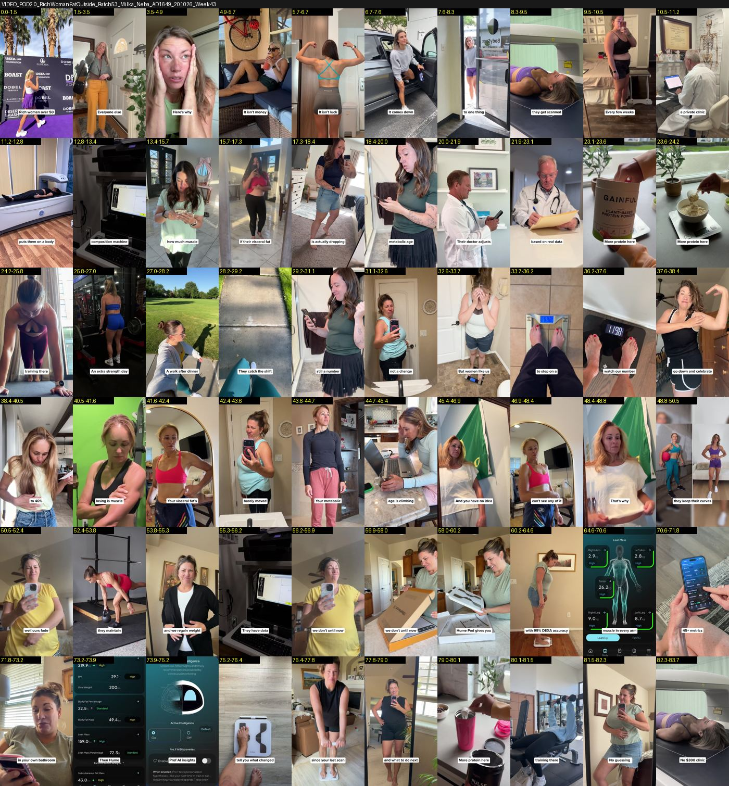

# VIDEO_POD2.0_RichWomanEatOutside_Batch53_Milka_Neba_AD1649_201026_Week43

Master: `VIDEO_POD2.0_RichWomanEatOutside_Batch53_Milka_Neba_AD1649_201026_Week43_Hook1_9x16.mp4` · 101.2s · 1080x1920

**Pacing:** 71 shots · avg 1.425s · median 1.233s · 6.92 cuts/10s · first cut 1.5s · 198.0 wpm · talk ratio 0.95 · cuts on word start 88.6% · cuts in speech gaps 78.6%
**Audio:** {'I_lufs': -15.3, 'LRA': 1.9, 'true_peak_db': -2.8} · BPM≈129.2 · music {'speech_rms_db': -19.0, 'pause_seconds': 0.2} · cuts with SFX/transient 55.7%

**Captions:** 213 cards · 1 words/card (median) · y≈0.785 of frame height · text height≈0.0293 · colours {'white': 195, 'dark/other': 11, 'blue': 3, 'green': 4} · cards crossing a cut: 5
Highlighted: 88889, Standard, Lea, Lean(kg), 57.1%+Standard, Standard, Standard
**Headlines:** Bullding (7.0–7.0s, white) | GAINFUL (23.0–23.0s, dark/other) | 1198 (36.0–36.0s, white) | 1198. (37.0–37.0s, white) | LIFL (44.0–44.0s, white) | Body Pod (65.0–66.0s, white) | StepOnScale (65.0–66.0s, green) | 159.0lbs (65.0–65.0s, white)

**Hook (0–3s) spoken:** Rich women over 50 look 10 years younger. Everyone else
**Hook on-screen:** ACH / ACHARITYCELE / ATION / B+AST / BOA / BOAST / COMPROMISENOTHING / DE / DESER / DOBEL / DOBI / Everyone else / FOU / FOUNDATION / LA / QUILA / RT / Richwomenover50 / SMASH / TEQUIL / TEQUILA / TWENTYSE / USTA / ZENYARA / look 10yearsyounger
**CTA (last 5s):** and us was never money. It was what they could see. Now you can too. Link below. · on-screen: It was what / Now you can too / and us was never money

## Beat sheet

| # | in–out (s) | dur | transition | spoken | on-screen text |
|---|---|---|---|---|---|
| 1 | 0.00–1.50 | 1.5 |  | Rich women over 50 look | USTA / ZENYARA / FOUNDATION / BOAST / DOBEL / Richwomenover50 |
| 2 | 1.50–3.50 | 2.0 | cut +SFX hit | 10 years younger. Everyone else just looks | look 10yearsyounger / Everyone else / just looks |
| 3 | 3.50–4.93 | 1.43 | cut +SFX hit | hollow. Here's why. | hollow / Here's why |
| 4 | 4.93–5.73 | 0.8 | cut | It isn't money, | Here's why / It isn't money / ALPHALETE / Itisn't luck |
| 5 | 5.73–6.70 | 0.97 | cut | it isn't luck. | ALPHALETE / Itisn't luck |
| 6 | 6.70–7.60 | 0.9 | cut +SFX hit | It comes down to one | Bullding (HEADLINE) / It comes down |
| 7 | 7.60–8.30 | 0.7 | cut +SFX hit | thing. | 310-e0-818r / to one thing |
| 8 | 8.30–9.47 | 1.17 | cut | They get scanned. | 310-e0-818r / to one thing / they get scanned |
| 9 | 9.47–10.50 | 1.03 | cut +SFX hit | Every few weeks, | they get scanned / Everyfewweeks |
| 10 | 10.50–11.20 | 0.7 | cut +SFX hit | a private clinic | a private clinic |
| 11 | 11.20–12.77 | 1.57 | cut | puts them on a body composition machine. | a private clinic / composition machine |
| 12 | 12.77–13.37 | 0.6 | cut |  | composition machine |
| 13 | 13.37–15.73 | 2.37 | cut +SFX hit | They see exactly how much muscle they're holding. | composition machine / They see exactly / they're holding |
| 14 | 15.73–17.33 | 1.6 | cut +SFX hit | They see if their visceral fat is actually | if their visceral fat / is actually dropping |
| 15 | 17.33–18.37 | 1.03 | cut +SFX hit | dropping. | is actually dropping |
| 16 | 18.37–20.03 | 1.67 | cut +SFX hit | They see their metabolic age. | is actually dropping / metabolic age / Their doctor adjusts |
| 17 | 20.03–21.93 | 1.9 | cut | Their doctor adjusts their protocol based | Their doctor adjusts / their protocol |
| 18 | 21.93–23.07 | 1.13 | cut +SFX hit | on real data. | Blane Sd / based on real data / GAINFUL (HEADLINE) / Unflavored / 24 / Moreprotein here |
| 19 | 23.07–23.60 | 0.53 | cut | More protein | GAINFUL (HEADLINE) / Unflavored / 24 / Moreprotein here |
| 20 | 23.60–24.20 | 0.6 | cut +SFX hit | here, | moreresistance |
| 21 | 24.20–25.80 | 1.6 | cut | more resistance training there. | moreresistance / training there |
| 22 | 25.80–27.03 | 1.23 | cut | An extra strength day, | An extra strength day / A walk after dinner |
| 23 | 27.03–28.20 | 1.17 | cut +SFX hit | a walk after dinner. They | A walk after dinner / Theycatchthe shift |
| 24 | 28.20–29.23 | 1.03 | cut +SFX hit | catch the shift while | Theycatchthe shift / while it's |
| 25 | 29.23–31.10 | 1.87 | cut | it's still a number on a screen, | while it's / still a number / not a change |
| 26 | 31.10–32.57 | 1.47 | cut | not a change in the mirror. | not a change / in the mirror |
| 27 | 32.57–33.73 | 1.17 | cut +SFX hit | But women like us, | But women like us |
| 28 | 33.73–36.17 | 2.43 | cut | we're more likely to step on a bathroom scale, | 88889 [blue] / we're more likely / bathroomscale / 1198 (HEADLINE) / ETEKCITY / watchournumber |
| 29 | 36.17–37.57 | 1.4 | cut | watch our number go down, | 1198 (HEADLINE) / ETEKCITY / watchournumber / 1198. (HEADLINE) / go down and celebrate |
| 30 | 37.57–38.37 | 0.8 | cut +SFX hit | and celebrate. | go down and celebrate |
| 31 | 38.37–40.53 | 2.17 | cut | Meanwhile, up to 40 % of what you're | go down and celebrate / to 40% / of what you're |
| 32 | 40.53–41.57 | 1.03 | cut | losing is muscle. | losing is muscle |
| 33 | 41.57–42.43 | 0.87 | cut +SFX hit | Your visceral fat's | Your visceral fat's |
| 34 | 42.43–43.57 | 1.13 | cut | barely moved, | Your visceral fat's / barely moved |
| 35 | 43.57–44.73 | 1.17 | cut +SFX hit | your metabolic age is | LIFL (HEADLINE) / Your metabolic |
| 36 | 44.73–45.37 | 0.63 | cut +SFX hit | climbing, | age is climbing |
| 37 | 45.37–46.90 | 1.53 | cut +SFX hit | and you have no idea because | age is climbing / And you have no idea |
| 38 | 46.90–48.37 | 1.47 | cut +SFX hit | your scale can't see any | becauseyour scale / can't see any of it |
| 39 | 48.37–48.80 | 0.43 | cut | of it. | can't see any of it |
| 40 | 48.80–50.50 | 1.7 | cut | That's why they keep their curves, | That's why / they keep their curves |
| 41 | 50.50–52.43 | 1.93 | cut +SFX hit | while we, well, ours fade. | well ours fade |
| 42 | 52.43–53.83 | 1.4 | cut +SFX hit | That's why they maintain, | well ours fade / they maintain |
| 43 | 53.83–55.27 | 1.43 | cut +SFX hit | and we regain weight. | and we regain weight / They have data |
| 44 | 55.27–56.17 | 0.9 | cut +SFX hit | They have data, | They have data / we don't until now |
| 45 | 56.17–56.87 | 0.7 | cut | we don't. | we don't until now |
| 46 | 56.87–58.00 | 1.13 | cut +SFX hit | Until now, because the | we don't until now |
| 47 | 58.00–60.17 | 2.17 | cut +SFX hit | new Hume Pod gives you what they get, | because the new / Hume Pod gives you / a 3D scan |
| 48 | 60.17–64.60 | 4.43 | cut +SFX hit | a 3D scan of your whole body with 99 % DEXA accuracy, | a 3D scan / of your whole body / with99%DEXAaccuracy |
| 49 | 64.60–70.63 | 6.03 | cut +SFX hit | visceral fat with color -coded zones, muscle in every arm and leg, body water, metabolic age, | Body Pod (HEADLINE) / StepOnScale [green] (HEADLINE) / 159.0lbs (HEADLINE) / High [blue] (HEADLINE) / 72.3% (HEADLINE) / LeanMassPercentage (HEADLINE) |
| 50 | 70.63–71.83 | 1.2 | cut | 45 plus metrics | 10.7m [blue] (HEADLINE) / 12.3* / 45+ metrics |
| 51 | 71.83–73.20 | 1.37 | cut +SFX hit | in your own bathroom, | in your own bathroom / Body CompositionFundamentals (HEADLINE) / Weight (HEADLINE) / 219.9ibs (HEADLINE) / High (HEADLINE) / 29.1 (HEADLINE) |
| 52 | 73.20–73.90 | 0.7 | cut | then Hume Prof | Body CompositionFundamentals (HEADLINE) / Weight (HEADLINE) / 219.9ibs (HEADLINE) / High (HEADLINE) / 29.1 (HEADLINE) / BMI (HEADLINE) |
| 53 | 73.90–75.20 | 1.3 | cut +SFX hit | AI Insights | Pro.FActiveIntelligence (HEADLINE) / Unlockreal-timeinsightsandtimely (HEADLINE) / recommendationspoweredby (HEADLINE) / continuousmonitoring (HEADLINE) / ActiveIntelligence / Default |
| 54 | 75.20–76.43 | 1.23 | cut +SFX hit | tell you what changed since | tell you what changed |
| 55 | 76.43–77.80 | 1.37 | cut +SFX hit | your last scan and | tell you what changed / sinceyour last scan |
| 56 | 77.80–78.97 | 1.17 | cut | what to do next. | and what to do next |
| 57 | 78.97–80.07 | 1.1 | cut | More protein here, | legion. / PULSE (HEADLINE) / PRE-WORKOUTDRINK / SOURCANDY / Moreproteinhere / more strength |
| 58 | 80.07–81.47 | 1.4 | cut +SFX hit | more strength training there, | more strength / training there |
| 59 | 81.47–82.33 | 0.87 | cut | no guessing, | training there / No guessing |
| 60 | 82.33–83.73 | 1.4 | cut | no $300 clinic | No guessing / No $300 clinic |
| 61 | 83.73–84.53 | 0.8 | cut +SFX hit | appointments, | era/681bc1e330144e369ca442799ce48d32 (HEADLINE) / SAooStore]Reven. (HEADLINE) / ATLORIVE (HEADLINE) / YourDEXArepontisreody.Thisteportwosgoeneratedon04/15/25andcompor (HEADLINE) / 8.o00womenoges32to3a.Youcancustomizeyourselectedscansandref (HEADLINE) / epont. (HEADLINE) |
| 62 | 84.53–85.60 | 1.07 | cut | no waiting lists, | No waiting lists |
| 63 | 85.60–87.83 | 2.23 | cut | just you, every morning if you want. | Just you every morning / if you want |
| 64 | 87.83–93.10 | 5.27 | cut +SFX hit | It's 30 % off right now and it's HSA and FSA eligible. There's no subscription and | It's 30% off right now / HSA and FSA eligible / There's no subscription / and you get 45 days |
| 65 | 93.10–95.13 | 2.03 | cut | you get 45 days to try it. | and you get 45 days / The difference |
| 66 | 95.13–96.53 | 1.4 | cut +SFX hit | The difference between them and | The difference / betweenthem |
| 67 | 96.53–97.90 | 1.37 | cut +SFX hit | us was never money. | and us was never money |
| 68 | 97.90–99.20 | 1.3 | cut +SFX hit | It was what they could see. | It was what / Now you can too |
| 69 | 99.20–100.37 | 1.17 | cut | Now you can too. | Now you can too |
| 70 | 100.37–101.17 | 0.8 | cut | Link below. | Now you can too |
| 71 | 101.17–101.20 | 0.04 | cut |  |  |

## Hook variants

| hook | file | dur | first cut | spoken 0–3s | on-screen 0–3s |
|---|---|---|---|---|---|
| 1 | `tside_Batch53_Milka_Neba_AD1649_201026_Week43_Hook1_9x16.mp4` | 101.2 | 1.5 | Rich women over 50 look 10 years younger. Everyone else | ACH / ACHARITYCELE / ATION / B+AST / BOA / BOAST / COMPROMISENOTHING / DE |
| 1 | `tside_Batch53_Milka_Neba_AD1649_201026_Week43_Hook1_9x16.mp4` | 101.2 | 1.5 | Rich women over 50 look 10 years younger. Everyone else | ACH / ACHARITYCELE / ATION / B+AST / BOA / BOAST / COMPROMISENOTHING / COUPROMISENOTHING" |
| 2 | `tside_Batch53_Milka_Neba_AD1649_201026_Week43_Hook2_9x16.mp4` | 109.9 | 2.167 | Women who look incredible at 55 aren't luckier than you. |  |
| 2 | `tside_Batch53_Milka_Neba_AD1649_201026_Week43_Hook2_9x16.mp4` | 109.9 | 2.167 | Women who look incredible at 55 aren't luckier than you. |  |
| 3 | `tside_Batch53_Milka_Neba_AD1649_201026_Week43_Hook3_9x16.mp4` | 106.7 | 1.067 | Rich women over 50 have the same wine nights and the same vacations | RUANIA / Richwomenover50 / andthe same / have the / same wine nights |
| 3 | `tside_Batch53_Milka_Neba_AD1649_201026_Week43_Hook3_9x16.mp4` | 106.7 | 1.067 | Rich women over 50 have the same wine nights and the same vacations |  |
| 4 | `tside_Batch53_Milka_Neba_AD1649_201026_Week43_Hook4_9x16.mp4` | 105.2 | 1.7 | Women who look incredible at 55 aren't luckier than | Women who look / aren't luckier than you / incredibleat55 |
| 4 | `tside_Batch53_Milka_Neba_AD1649_201026_Week43_Hook4_9x16.mp4` | 105.2 | 1.7 | Women who look incredible at 55 aren't luckier than |  |

## Full transcript

Rich women over 50 look 10 years younger. Everyone else just looks hollow. Here's why. It isn't money, it isn't luck. It comes down to one thing. They get scanned. Every few weeks, a private clinic puts them on a body composition machine. They see exactly how much muscle they're holding. They see if their visceral fat is actually dropping. They see their metabolic age. Their doctor adjusts their protocol based on real data. More protein here, more resistance training there. An extra strength day, a walk after dinner. They catch the shift while it's still a number on a screen, not a change in the mirror. But women like us, we're more likely to step on a bathroom scale, watch our number go down, and celebrate. Meanwhile, up to 40% of what you're losing is muscle. Your visceral fat's barely moved, your metabolic age is climbing, and you have no idea because your scale can't see any of it. That's why they keep their curves, while we, well, ours fade. That's why they maintain, and we regain weight. They have data, we don't. Until now, because the new Hume Pod gives you what they get, a 3D scan of your whole body with 99% DEXA accuracy, visceral fat with color-coded zones, muscle in every arm and leg, body water, metabolic age, 45 plus metrics in your own bathroom, then Hume Prof AI Insights tell you what changed since your last scan and what to do next. More protein here, more strength training there, no guessing, no $300 clinic appointments, no waiting lists, just you, every morning if you want. It's 30% off right now and it's HSA and FSA eligible. There's no subscription and you get 45 days to try it. The difference between them and us was never money. It was what they could see. Now you can too. Link below.