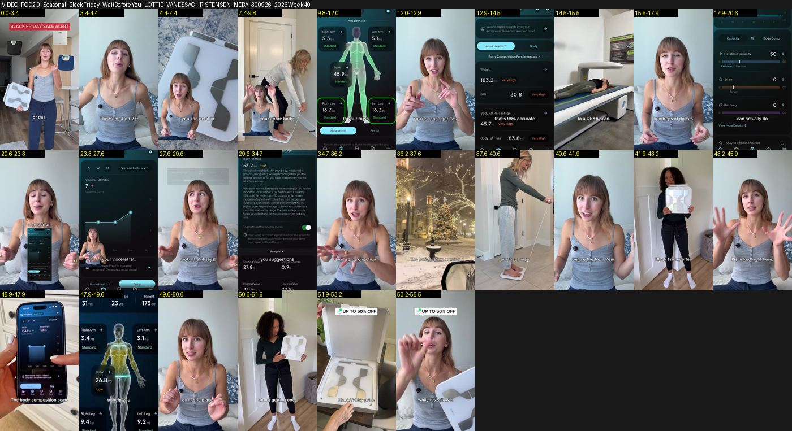

# VIDEO_POD2.0_Seasonal_BlackFriday_WaitBeforeYou_LOTTIE_VANESSACHRISTENSEN_NEBA_300926_2026Week40

Master: `VIDEO_POD2.0_Seasonal_BlackFriday_WaitBeforeYou_LOTTIE_VANESSACHRISTENSEN_NEBA_300926_2026Week40_Hook1_9x16.mp4` · 55.5s · 1080x1920

**Pacing:** 26 shots · avg 2.134s · median 2.016s · 4.51 cuts/10s · first cut 3.433s · 252.0 wpm · talk ratio 0.95 · cuts on word start 84.0% · cuts in speech gaps 60.0%
**Audio:** {'I_lufs': -19.6, 'LRA': 2.7, 'true_peak_db': -3.0} · BPM≈136.0 · music {'speech_rms_db': -24.6, 'pause_seconds': 0.0} · cuts with SFX/transient 48.0%

**Captions:** 190 cards · 1.0 words/card (median) · y≈0.756 of frame height · text height≈0.0258 · colours {'white': 141, 'dark/other': 42, 'green': 2, 'blue': 3, 'red': 2} · cards crossing a cut: 1
Highlighted: Standard, Muscle(lbs), HumeHealth, VeryHigh, yoursubcutaneousfat,, Body, The body composition scan,
**Headlines:** BLACKFRIDAYSALEALERT (0.0–2.0s, red) | BLACK FRIDAY SALEAERT (2.5–2.5s, white) | BLACKFRIDAYSALE ALERT (3.0–3.0s, red) | HumePod (10.0–11.0s, white) | StepOnScale (10.0–11.0s, green) | MuscleMass (10.0–11.0s, white) | LeftArm (10.0–11.0s, white) | RightArm (10.0–11.0s, white)

**Hook (0–3s) spoken:** Wait, before you do this, this, or this, you gotta look at this.
**Hook on-screen:** BLACK FRIDAY SALEAERT / BLACKFRIDAYSALEALERT / Wait, before you do / orthis, / this, / you gotta look at this!
**CTA (last 5s):** you've been thinking about getting one check the Black Friday price while it's still live go grab yours now · on-screen: Check the / Go grab yours Now. / Hume / UPTO50%OFF / XHun / about getting one, / while it's still live.

## Beat sheet

| # | in–out (s) | dur | transition | spoken | on-screen text |
|---|---|---|---|---|---|
| 1 | 0.00–3.43 | 3.43 |  | Wait, before you do this, this, or this, you gotta look at this. | BLACKFRIDAYSALEALERT [red] (HEADLINE) / Wait, before you do / this, / orthis, / BLACK FRIDAY SALEAERT (HEADLINE) / you gotta look at this! |
| 2 | 3.43–4.37 | 0.93 | cut +SFX hit | The HumePod 2 .0 | you gotta look at this! / BLACKFRIDAYSALE ALERT [red] (HEADLINE) / The Hume Pod 2.0 |
| 3 | 4.37–7.40 | 3.03 | cut +SFX hit | is out, and right now you can get it in Hume's Block Friday sale. | The Hume Pod 2.0 / is out, and right now, / you can get it in / Hume's Black Friday sale. |
| 4 | 7.40–9.77 | 2.37 | cut | You're gonna get a 3D scan of your entire body. | Hume's Black Friday sale. / a3Dscanof / your entire body |
| 5 | 9.77–12.03 | 2.27 | cut | It goes from your legs to your torso to your upper body. | HumePod (HEADLINE) / StepOnScale [green] (HEADLINE) / MuscleMass (HEADLINE) / LeftArm (HEADLINE) / RightArm (HEADLINE) / 5.ibs (HEADLINE) |
| 6 | 12.03–12.93 | 0.9 | cut +SFX hit | You're gonna get data that's | You're gonna get data |
| 7 | 12.93–14.53 | 1.6 | cut | 99 % accurate to a | 174 (HEADLINE) / 165 (HEADLINE) / 20/07 (HEADLINE) / 22/07 (HEADLINE) / 21/07 (HEADLINE) / 07 (HEADLINE) |
| 8 | 14.53–15.50 | 0.97 | cut | DEXA scan, | WEWILLTRAVELTOGETYOUSO [other-colour] (HEADLINE) / to a DEXA scan. |
| 9 | 15.50–17.87 | 2.37 | cut | and you don't have to pay hundreds of dollars each time. | to pay / hundreds of dollars |
| 10 | 17.87–20.57 | 2.7 | cut | You're gonna get data that you can actually do something from. | HumePlusExclusive (HEADLINE) / Generateyour HealthReportby (HEADLINE) / upgradingtoHumePlus (HEADLINE) / MetabolicMomentum (HEADLINE) / Capacity / BodyComp |
| 11 | 20.57–23.30 | 2.73 | cut +SFX hit | You're not just looking at that number on the scale anymore. You're seeing your | looking at that / the scale anymore. / You're seeing your muscle, |
| 12 | 23.30–27.63 | 4.33 | cut +SFX hit | muscle, your subcutaneous fat, your visceral fat, even your metabolic age. | You're seeing your muscle, / LeftLegMuscleMass (HEADLINE) / 14.4 bs (HEADLINE) / Standard [green] (HEADLINE) / Updated:Today (HEADLINE) / 15 |
| 13 | 27.63–29.60 | 1.97 | cut | I'm 28 years old, look what it says. Then | I'm 28years old, / 23yrs (HEADLINE) / MetabolicAge (HEADLINE) / Good (HEADLINE) / look what it says! |
| 14 | 29.60–34.73 | 5.13 | cut | Prop AI goes over your data and gives you suggestions moving forward So you've got the information and some | BodyFatPercentage (HEADLINE) / 35 (HEADLINE) / 26 (HEADLINE) / 22 / 09/10 / 10/10 |
| 15 | 34.73–36.20 | 1.47 | cut +SFX hit | direction on what to do next the | and some direction / The holidays are coming |
| 16 | 36.20–37.57 | 1.37 | cut | holidays are coming What | The holidays are coming |
| 17 | 37.57–40.60 | 3.03 | cut +SFX hit | a fantastic gift or what a way to get started yourself before | What a fantastic gift... / or what a way / yourself |
| 18 | 40.60–41.90 | 1.3 | cut +SFX hit | the new year But the | before the New Year. |
| 19 | 41.90–43.17 | 1.27 | cut +SFX hit | Black Friday offer isn't | Black Friday offer / isn't sticking around |
| 20 | 43.17–45.87 | 2.7 | cut +SFX hit | sticking around until Christmas It's linked right here the body | isn't sticking around / until Christmas. / It's linked right here. |
| 21 | 45.87–47.93 | 2.07 | cut | composition scan all that data and | 10:09 [blue] (HEADLINE) / Step OnScale [blue] (HEADLINE) / BodyPod [blue] (HEADLINE) / Weight (HEADLINE) / 125ibs (HEADLINE) / 133.9ibs+ (HEADLINE) |
| 22 | 47.93–49.63 | 1.7 | cut | Prop AI to help you make sense of it all in | Standard / 3Tyrs (HEADLINE) / 23yrs (HEADLINE) / ght Arm (HEADLINE) / LeftArm (HEADLINE) / .4 kg (HEADLINE) |
| 23 | 49.63–50.60 | 0.97 | cut +SFX hit | one place If you've | all in one place |
| 24 | 50.60–51.87 | 1.27 | cut | been thinking about getting one check | about getting one, |
| 25 | 51.87–53.20 | 1.33 | cut +SFX hit | the Black Friday price while | UPTO50%OFF (HEADLINE) / XHun / Check the / while it's still live. |
| 26 | 53.20–55.47 | 2.27 | cut | it's still live go grab yours now | UPTO50%OFF (HEADLINE) / while it's still live. / Go grab yours Now. / Hume |

## Hook variants

| hook | file | dur | first cut | spoken 0–3s | on-screen 0–3s |
|---|---|---|---|---|---|
| 1 | `TIE_VANESSACHRISTENSEN_NEBA_300926_2026Week40_Hook1_9x16.mp4` | 55.5 | 3.433 | Wait, before you do this, this, or this, you gotta look at this. | BLACK FRIDAY SALEAERT / BLACKFRIDAYSALEALERT / Wait, before you do / orthis, / this, / you gotta look at this! |
| 2 | `TIE_VANESSACHRISTENSEN_NEBA_300926_2026Week40_Hook2_9x16.mp4` | 55.4 | 3.433 | Wait, before you do this, this, or this, you gotta look at this. |  |
| 3 | `TIE_VANESSACHRISTENSEN_NEBA_300926_2026Week40_Hook3_9x16.mp4` | 56.3 | 4.233 | Listen, instead of waiting until January to get your health on track, |  |
| 4 | `TIE_VANESSACHRISTENSEN_NEBA_300926_2026Week40_Hook4_9x16.mp4` | 56.4 | 4.367 | Stop. Before you buy this, this or this holiday gift, | BLACK FRIDAY SALEALERT / BLACKFR / BLACKFRIDAYSALEALERT / Before you buy / DAYSALE / RIDAY SALEALERT / Stop! / holiday gift, |

## Full transcript

Wait, before you do this, this, or this, you gotta look at this. The HumePod 2.0 is out, and right now you can get it in Hume's Block Friday sale. You're gonna get a 3D scan of your entire body. It goes from your legs to your torso to your upper body. You're gonna get data that's 99% accurate to a DEXA scan, and you don't have to pay hundreds of dollars each time. You're gonna get data that you can actually do something from. You're not just looking at that number on the scale anymore. You're seeing your muscle, your subcutaneous fat, your visceral fat, even your metabolic age. I'm 28 years old, look what it says. Then Prop AI goes over your data and gives you suggestions moving forward So you've got the information and some direction on what to do next the holidays are coming What a fantastic gift or what a way to get started yourself before the new year But the Black Friday offer isn't sticking around until Christmas It's linked right here the body composition scan all that data and Prop AI to help you make sense of it all in one place If you've been thinking about getting one check the Black Friday price while it's still live go grab yours now